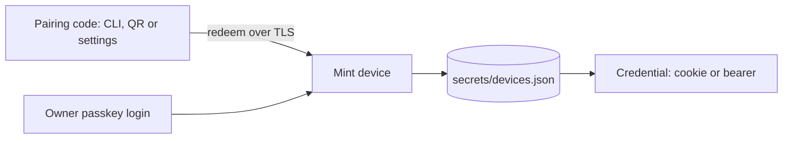

# Access and authentication

The daemon exposes shell, tool and file access, so whoever authenticates owns the machine. Access control is single-owner: there are no users, roles or per-device scopes, and a paired device is the owner. It is access control, not sandboxing; [permissions](permissions.md) govern what agents may do once a client is in.

## Principals

Every HTTP request and WebSocket upgrade passes one resolver, [`AccessGate`](../../packages/workbench-server/src/domains/access/access-gate.ts), so the two transports cannot diverge. It yields a `Principal`:

- **`local`**: proof of filesystem access to `secrets/daemon-token`. Accepted only from a loopback peer with a loopback `Host` and no forwarding headers (`ClientInfo.localEligible`). It is never placed in a URL, QR code or settings file. The desktop shell and the CLI use it implicitly. A non-loopback bearer use of the token is still accepted but flagged `legacyRemote` and audited.
- **`device`**: a per-device credential (`nd_…`) minted by pairing or owner passkey login, sent as a bearer (native clients) or an HttpOnly session cookie (browsers).

Gate rule order: browser isolation (cross-origin browser requests are refused) → passkey enrollment gate → failure throttle → local token → device credential → transport check. Device credentials are refused over plaintext off-loopback (`TLS_REQUIRED`), and cookie-authenticated mutating requests and WebSockets need same-origin proof. `Host` is validated earlier, by the host guard and upgrade handler. Routes that do their own authorization (pairing, login, session probe) are marked public and receive no principal rather than a failure.

## Devices, pairing and passkeys

- **Device store** ([`DeviceStore`](../../packages/workbench-server/src/domains/access/device-store.ts)): the 0600 file `secrets/devices.json` holds device records, passkeys and only SHA-256 hashes of secrets. Credentials expire after an absolute and an idle lifetime (`DEVICE_ABSOLUTE_LIFETIME_MS`, `DEVICE_IDLE_LIFETIME_MS` in contracts), rotate after 24 hours with a short grace for the previous secret, and can be revoked individually or all at once; revocation closes the device's live sockets ([`device-sockets.ts`](../../packages/workbench-server/src/domains/access/device-sockets.ts)). The file is not a database table and does not take part in schema migrations.
- **Pairing** ([`PairingCodes`](../../packages/workbench-server/src/domains/access/pairing-codes.ts)): in-memory, short-lived, single-use codes with a purpose (mobile, browser, desktop); a code is invalidated after five wrong guesses and redemption is throttled per IP. Clients receive the code in the URL fragment (`#pair=CODE`) so it never reaches logs or referrers. Codes are created from the CLI (`nerve pair`, [`access-cli.ts`](../../packages/workbench-server/src/cli/access-cli.ts)) or by an authenticated client.
- **Owner passkey** ([`PasskeyService`](../../packages/workbench-server/src/domains/access/passkey-service.ts)): WebAuthn login for self-hosted browsers. When `publicUrl` is set and no passkey exists, the gate stays closed to non-local clients (`PASSKEY_ENROLLMENT_REQUIRED`) until one is enrolled with the setup code the daemon prints (or `nerve pair --enroll`).
- **Throttling and audit** ([`FailureLimiter`](../../packages/workbench-server/src/domains/access/failure-limiter.ts), [`AccessAuditLog`](../../packages/workbench-server/src/domains/access/audit-log.ts)): failed credentials, pairing and login are rate-limited per IP and globally. Security events append to `logs/access-audit.jsonl` (0600, rotated once at 5 MiB); audit write failures never affect requests.

[`AccessService`](../../packages/workbench-server/src/domains/access/access-service.ts) composes these and backs the [`/api/access` routes](../../packages/workbench-server/src/adapters/http/routes/access-routes.ts); the gate is mounted by the [auth middleware](../../packages/workbench-server/src/adapters/http/auth-middleware.ts). Wire shapes live in [`contracts/src/domains/access`](../../packages/contracts/src/domains/access/access.ts).

## Network settings

`application.network.publicUrl` and `trustProxy.peers` (see [configuration](configuration.md)) define the external origin and which peers may supply `X-Forwarded-*`. [`resolveClient`](../../packages/workbench-server/src/domains/access/client-info.ts) honors forwarding headers only from a trusted peer and only when `publicUrl` is set; it derives the client IP, effective host and whether the transport is secure. Forwarded requests are never `localEligible`, so a reverse proxy on loopback cannot obtain local trust. TLS is terminated by a reverse proxy for hosted servers; the optional mobile HTTPS listener serves LAN phones.

## Clients

The web app's [`access` feature](../../packages/workbench-app/src/lib/features/access/index.ts) owns the pairing, login and device-list UI and routes unauthenticated sessions to it; a 401 anywhere raises the shared unauthorized signal. The desktop shell reads the local token for its own daemon and stores a device credential for remote daemons ([`daemon-access.ts`](../../packages/desktop-shell/src/daemon/adapters/daemon-access.ts)). The operator guide is the [hosted-server guide](../../packages/website/src/content/docs/operations/hosted-server.md).
