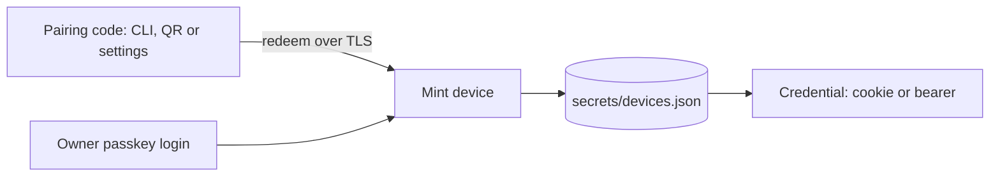

# Access and authentication

The daemon exposes shell, tool and file access, so whoever authenticates owns the machine. Access control is single-owner: there are no users, roles or per-device scopes, and a paired device is the owner. It is access control, not sandboxing; [permissions](permissions.md) govern what agents may do once a client is in.

## Principals

Every HTTP request and WebSocket upgrade passes one resolver, [`AccessGate`](../../packages/workbench-server/src/domains/access/access-gate.ts), so the two transports cannot diverge. It yields a `Principal`:

- **`local`**: proof of filesystem access to `secrets/daemon-token`. Accepted only from a loopback peer with a loopback `Host` and no forwarding headers (`ClientInfo.localEligible`). It is never placed in a URL, QR code or settings file. The desktop shell and the CLI use it implicitly (as a bearer or, from a loopback peer, a cookie). A non-loopback bearer use of the token is still accepted but flagged `legacyRemote` and audited.
- **`device`**: a per-device credential (`nd_…`) minted by pairing or owner passkey login, sent as a bearer (native clients) or an HttpOnly session cookie (browsers).

Gate rule order: browser isolation (cross-origin browser requests are refused) → passkey enrollment gate → failure throttle → local token → device credentials. Each device credential candidate is checked for transport first (plaintext off-loopback is refused with `TLS_REQUIRED`), then cookie candidates on mutating requests and WebSockets need same-origin proof, then the credential is authenticated. `Host` is validated earlier, by the host guard and upgrade handler. Routes that do their own authorization (pairing, login, session probe) are marked public and receive no principal rather than a failure.

## Devices, pairing and passkeys

- **Device store** ([`DeviceStore`](../../packages/workbench-server/src/domains/access/device-store.ts)): the 0600 file `secrets/devices.json` holds device records, passkeys and only SHA-256 hashes of secrets. Credentials expire after an absolute and an idle lifetime (`DEVICE_ABSOLUTE_LIFETIME_MS`, `DEVICE_IDLE_LIFETIME_MS` in contracts), rotate after 24 hours with a short grace for the previous secret, and can be revoked individually or all at once; revocation closes the device's live sockets ([`device-sockets.ts`](../../packages/workbench-server/src/domains/access/device-sockets.ts)). The file is not a database table and does not take part in schema migrations.
- **Pairing** ([`PairingCodes`](../../packages/workbench-server/src/domains/access/pairing-codes.ts)): in-memory, short-lived, single-use codes with a purpose (mobile, browser, desktop); a code is invalidated after five wrong guesses and redemption is throttled per IP. Clients receive the code in the URL fragment (`#pair=CODE`) so it never reaches logs or referrers. Codes are created from the CLI (`nerve pair`, [`access-cli.ts`](../../packages/workbench-server/src/cli/access-cli.ts)) or by an authenticated client.
- **Owner passkey** ([`PasskeyService`](../../packages/workbench-server/src/domains/access/passkey-service.ts)): WebAuthn login for self-hosted browsers. When `publicUrl` is set and no passkey exists, the gate stays closed to non-local clients (`PASSKEY_ENROLLMENT_REQUIRED`) until one is enrolled with the setup code the daemon prints (or `nerve pair --enroll`).
- **Throttling and audit** ([`FailureLimiter`](../../packages/workbench-server/src/domains/access/failure-limiter.ts), [`AccessAuditLog`](../../packages/workbench-server/src/domains/access/audit-log.ts)): failed credentials, pairing and login are rate-limited per IP and globally. Security events append to `logs/access-audit.jsonl` (0600, rotated once at 5 MiB); audit write failures never affect requests.

[`AccessService`](../../packages/workbench-server/src/domains/access/access-service.ts) composes these and backs the [`/api/access` routes](../../packages/workbench-server/src/adapters/http/routes/access-routes.ts); the gate is mounted by the [auth middleware](../../packages/workbench-server/src/adapters/http/auth-middleware.ts). Wire shapes live in [`contracts/src/domains/access`](../../packages/contracts/src/domains/access/access.ts).

## Network settings

`application.network.publicUrl` (`NERVE_PUBLIC_URL`, `--public-url`) and `trustProxy.peers` (`NERVE_TRUST_PROXY_PEERS`) are daemon-restart settings stored per [configuration](configuration.md). `publicUrl` is the external origin behind a reverse proxy: it adds its host to the Host allowlist, is the passkey RP ID and origin, and enables the owner passkey gate. `trustProxy.peers` lists the peers allowed to supply `X-Forwarded-*`, honored only when `publicUrl` is set; invalid entries are rejected on save and at startup. [`resolveClient`](../../packages/workbench-server/src/domains/access/client-info.ts) honors forwarding headers only from a trusted peer and only when `publicUrl` is set; it derives the client IP, effective host and whether the transport is secure. Forwarded requests are never `localEligible`, so a reverse proxy on loopback cannot obtain local trust. TLS is terminated by a reverse proxy for hosted servers; the optional mobile HTTPS listener serves LAN phones.

## Private tunnel

The private tunnel ([`TunnelService`](../../packages/workbench-server/src/domains/access/tunnel-service.ts), CLI adapter [`tailscale.ts`](../../packages/workbench-server/src/infrastructure/network/tailscale.ts)) serves the daemon through Tailscale Serve without exposing a LAN port. The daemon opens a separate loopback-only listener as the Serve backend ([`tunnel-runtime.ts`](../../packages/workbench-server/src/app/runtime/tunnel-runtime.ts)); sockets it accepts are marked ([`tunnel-sockets.ts`](../../packages/workbench-server/src/infrastructure/network/tunnel-sockets.ts)) and only those requests carry `viaTunnel`, so no header can claim it. `resolveClient` treats them as secure remote clients with the tunnel origin and client IP from Serve's `X-Forwarded-For`: never `localEligible`, never `viaTrustedProxy`, and independent of `publicUrl`. They are not `localEligible`, so the owner passkey gate applies to them whenever `publicUrl` is set and no passkey is enrolled. The legacy daemon-token bearer is refused on the tunnel, and requests carrying `Tailscale-Funnel-Request` get 403. The tunnel listener answers only to the tunnel host (HTTP host guard and WebSocket upgrade share one decision, [`isRequestHostAllowed`](../../packages/workbench-server/src/adapters/http/host-allowlist.ts)), and nothing while the tunnel is off. Pairing links list the tunnel first; the host allowlist accepts its host only while it is on.

`application.network.tunnel` applies on save (restart target `none`). Nerve adds a Serve entry only when the HTTPS port is free, never touches anyone else's, and refuses Funnel on any entry that proxies to its listener. The entry does not outlive the daemon: turning the tunnel off and clean shutdown both close the listener first (destroying every socket it accepted, including WebSockets), then remove the entry. A failed removal is reported as a `command_failed` problem, not as off. After a crash the entry remains; the next start recognizes it as its own (it proxies to the saved `listenerPort`, which only the daemon writes, never a client) and removes or reuses it, even when the listener had to fall back to another port. While active, `serve status` is re-checked every minute: a vanished or changed entry (`entry_changed`) or Funnel on our target (`funnel_enabled`) closes the listener. If the certificate does not arrive within two minutes the tunnel reports `command_failed` ("Tailscale could not get a certificate") but stays up; Try again restarts it. The app re-reads the tunnel state whenever the workbench connection reconnects. State is pushed as `access.tunnel_changed` and included in the status response.

## Clients

The web app's [`access` feature](../../packages/workbench-app/src/lib/features/access/index.ts) owns pairing, login and device-list UI; the desktop shell reads the local token for its own daemon and stores a device credential for remote ones ([`daemon-access.ts`](../../packages/desktop-shell/src/daemon/adapters/daemon-access.ts)). The operator guide is the [hosted-server guide](../../packages/website/src/content/docs/operations/hosted-server.md).
