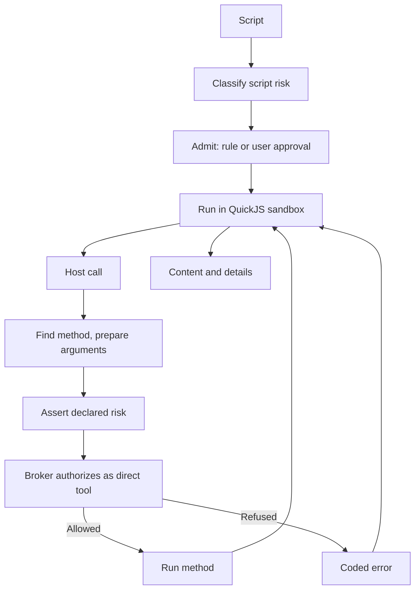

# Code mode

`atlassian_code_mode` lets the agent do multi-step Jira and Confluence work, plus file, image and diagram handling, in one tool call: it writes a TypeScript script instead of spending a model turn per request. The script runs in a sandbox with no ambient authority, and every external effect is a **host call** authorized as the equivalent direct tool, so batching does not widen what policy allows.

## Sandbox

The engine is QuickJS in the `native` addon: a fresh runtime per script on its own thread, with caps on memory, time, output and host calls. The script has no filesystem, network or timers, only `console` and the host-call channel. Everything else, including methods, credentials and policy, belongs to the tool.

## Permissions

Two levels apply; see [permissions](permissions.md) for the general model.

**Script level.** Admission scans the script text for SDK calls and the highest risk wins. Anything the scanner cannot follow (aliasing, bracket access, `eval`, a computed request method) counts as destructive, and ambiguous syntax takes the riskier reading. The approval shows the risk and the operations found.

**Nested level.** Each host call is checked against current policy as a direct call to its tool would be, and a deny always holds. When the verdict needs approval, the script's admission decides. A script a **user approved** may make calls up to the risk they approved. A script a **rule allowed** has no ceiling to spend, so such calls are refused. The one exception is a raw non-GET request, which cannot be analysed: it runs only in a destructive, rule-admitted script when its verdict is allow.

The scan can be evaded, so it is only the first level. The executor also refuses a method whose declared risk is below that of the direct call it is authorized as, and a unit test checks that every method's nested arguments validate against the direct tool's schema.

## SDK methods

Each method is declared once in a method table (`defineMethod` and a positional variant): signature, declared risk, authorizing tool, argument parsing and implementation. The sandbox prelude, the scanner and dispatch read these tables. The guide's `references/*.d.ts` files are generated from them, and a test fails when they are stale.

## Errors

A host failure crosses into the script as `[CODE] message`, which the prelude turns into `e.code`. Codes are a small closed set (`NOT_FOUND`, `CONFLICT`, `DENIED`, `UNAUTHORIZED` and so on); product and policy errors collapse into it. An `UNAUTHORIZED` response aborts the whole run, since later calls would fail the same way.

## Artifacts

Scripts write files into the conversation's `code-mode/` folder and refer to them by handle `artifact:<name>` (flat names). Workspace paths are separate handles: reads are authorized as the direct `read` tool. The folder is copied when the conversation is forked and removed with the conversation's files.

## Results

Content is the script output, any error, report lines (written pages with lint findings, created entities, artifacts) and a footer of calls per product, denials and exit status. Failed, timed-out and cancelled scripts still return a normal result with a non-zero exit code. `details` records status, resource use and one entry per host call, so nested calls are not separate tool-call rows. No database schema is involved. [Tool-result projection](tool-result-projection.md) covers how content reaches the model.

## Cancellation and restart

Cancelling the tool call aborts the sandbox and in-flight host calls; finished calls are not undone. The tool is write-capable and so not replay-safe: a call running at restart settles as indeterminate instead of being run again ([tool-call lifecycle](conversation-core/tool-call-lifecycle.md)).

## Where it lives

| Concern                             | Owner                                                                                                                                                                                                                    |
| ----------------------------------- | ------------------------------------------------------------------------------------------------------------------------------------------------------------------------------------------------------------------------ |
| Executor, host-call loop and result | [`atlassian-code-mode.ts`](../../packages/tools/src/execution/atlassian-code-mode/atlassian-code-mode.ts)                                                                                                                |
| Method model and prelude            | [`sdk-types.ts`](../../packages/tools/src/execution/atlassian-code-mode/sdk-types.ts) and [`sdk.ts`](../../packages/tools/src/execution/atlassian-code-mode/sdk.ts)                                                      |
| Script scan and declared-risk guard | [`script-risk.ts`](../../packages/tools/src/execution/atlassian-code-mode/script-risk.ts) and [`method-risk.test.ts`](../../packages/tools/src/execution/atlassian-code-mode/method-risk.test.ts)                        |
| Generated reference types           | [`sdk-dts.ts`](../../packages/tools/src/execution/atlassian-code-mode/sdk-dts.ts) and [guide](../../packages/skills/src/guides/atlassian-code-mode/)                                                                     |
| Nested authorization                | [`createCodeModeAuthorizer`](../../packages/workbench-server/src/core-host/code-mode-broker.ts), wired in [`create-conversation-core.ts`](../../packages/workbench-server/src/app/bootstrap/create-conversation-core.ts) |
| Sandbox engine                      | [`sandbox/`](../../packages/native/src/sandbox/) bindings and [Rust engine](../../packages/native/native/src/sandbox/mod.rs)                                                                                             |
| Result details contract             | [`code-mode.ts`](../../packages/contracts/src/domains/tools/code-mode.ts)                                                                                                                                                |
