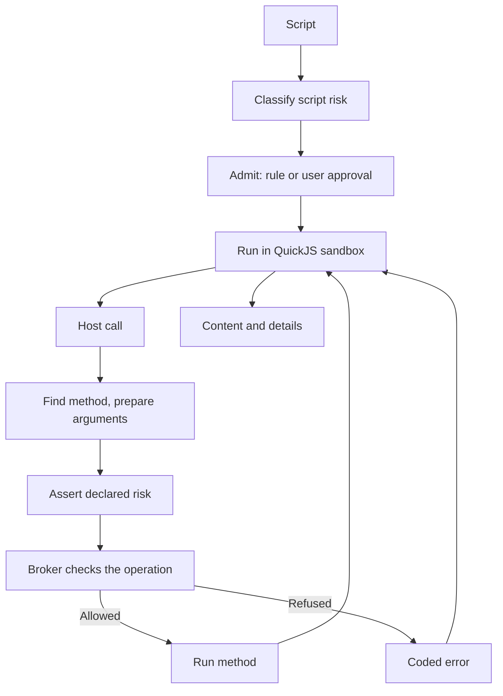

# Code mode

`quick_script` lets the agent do multi-step integration work (Jira and Confluence today) and file, image, diagram and image-generation handling in one tool call. It is the only route to those integrations: the former direct Jira, Confluence, diagram export and image generation tools are gone: it writes a TypeScript script instead of spending a model turn per request. The script runs in a sandbox with no ambient authority, and every external effect is a **host call** checked against the same policy as an operation, so batching does not widen what policy allows.

## Positioning and name

| Tool           | Use for                                                                | Runs                                         |
| -------------- | ---------------------------------------------------------------------- | -------------------------------------------- |
| `quick_script` | Integrations and document utilities; getting multi-step work done fast | Sandboxed JavaScript; effects via host calls |
| `python_exec`  | General Python scripting                                               | Local Python; not a security boundary        |
| `bash`         | The local machine: builds, git, processes                              | Local shell                                  |

The tool descriptions carry this split. The name `quick_script` feels like scripting without promising a runtime. Rejected names: `tsx` and `deno` (agents expect Node or Deno APIs, `fetch`, imports, JSX), `code_mode` (says nothing about when to choose it), `macro` (clashes with Confluence macros), `sdk` and `integrations` (hide the file utilities). The description's first line states the sandbox limits, and `import`, `require` and JSX fail with an error naming the alternative.

## Sandbox

The engine is QuickJS in the `native` addon: a fresh runtime per script on its own thread, with caps on memory, time, output and host calls. The script has no filesystem, network or timers, only `console` and the host-call channel. Everything else, including methods, credentials and policy, belongs to the tool. Extension code is reached through one asynchronous interface (`ExtensionCode`, see the [extension platform](extension-platform.md#rules)); the host prepares each call (parse, authorize) asynchronously, so the script scan that reads those authorizations (`classifyQuickScriptScript`, `classifyQuickScriptArguments`) is asynchronous as well, and permission admission awaits it while preparing (`ensureLoaded`) before the synchronous policy evaluation. A run's extension code is opened on first use and disposed when the run ends.

## Configuration

`tools.quick_script = { enabled }` is a plain switch, on by default. Which namespaces it offers comes from the [extension settings](configuration.md#extension-settings): the Atlassian extension's `account` and `jira`/`confluence` switches, the Web extension's switch (search also needs its `searchAccount`; fetch needs none), the Diagrams extension's `server` (default `https://kroki.io/`) and the Image generation extension's backend, model and default options (off by default; the backend's credential, for `openai-codex` the ChatGPT subscription connection, is checked when a call is made). The tool works with no extension: utilities are always present. A disabled extension, or one without an account or saved token, is unavailable for that run, and a call into it fails with an error naming Settings → Extensions → its name. The runtime derives each extension namespace and direct tool as configured (the extension and its `enabledBy` switch are on) and available (also its `requires` met: the selected account exists and has a saved secret; and the optional `availability(ctx)` hook), with a reason and fix generated from the manifest and the extension's name ([`availability.ts`](../../packages/tools/src/extension-host/availability.ts)); the server feeds it the resolved settings and `AccountsReader` ([`extension-availability.ts`](../../packages/workbench-server/src/core-host/extensions/extension-availability.ts)). Configured namespaces build the tool description; the same availability reaches the sandbox as `context.namespaces`, so `sdk.list` can report it. The description never contains availability, so credential changes do not touch the prompt prefix.

## Permissions

Two levels apply; see [permissions](permissions.md) for the general model. The tool has its own `quickScript` permission group; its rule risk is the classified risk of the script, so Planning and Read-only allow read scripts through their ordinary read rule.

**Script level.** Admission scans the script text for SDK calls (extension namespaces and the runtime namespaces `launches`, `configuration`, `extensions`, `mcp` and `sdk`) and the highest risk wins on the scale read < external_read < workspace write = external write < destructive (Jira/Confluence writes are external, workspace file writes local; the label prefers external on a tie): local files, XLSX and docx work is read, any integration read (Jira, Confluence, web, diagrams, a GET `request`) is external_read, so rule sets treat a script like the equivalent direct external-read tool. Anything the scanner cannot follow (aliasing, bracket access, `eval`, a computed request method) counts as destructive, and ambiguous syntax takes the riskier reading. The scan also yields the operations as structured data (`operation`, normalized `targets` from literal arguments, a call count; targets are unknown when an argument is not literal). The approval and the tool card list them as `operation · target` lines (`supervision.operations`).

**Operation rules at admission.** When the scan is complete (no aliasing, `eval` or computed request method, and no `web.*`, `files.*` or `image` call, which are checked as direct tools), operation rules can decide the script ([composition](permissions.md#operation-and-resource-rules)). Otherwise only the classified risk applies, as above, and no "always allow" rule is offered.

**Nested level.** Each host call is checked against current policy as a request for tool `quick_script` ([operation and resource rules](permissions.md#operation-and-resource-rules)): the operation (`jira.issues.create`) is the primary argument, the namespace the tool group, the method's declared risk gives the base risk (a Jira/Confluence write is never `write`) and the resources it acts on are `resource` targets. The broker accepts any operation of a registered namespace. `web.*` and `files.*` keep the direct route (`web_fetch`, `web_search`, `read` / `write` / `edit`, plus `read` for file arguments such as attachments). A deny always holds. When the verdict needs approval, the script's admission decides. A script a **user approved** may make calls up to the risk they approved. A script a **rule allowed** (by its risk class or by operation rules) has no ceiling to spend, so such calls are refused. A raw `request` is an operation like any other: GET is `external_read`, any other method `destructive`, and the target is `<system>:request/<METHOD> <path>`. A rule matching that method and path can allow it; otherwise it needs a destructive approval. Denials and approval errors name `operation · targets`, and the tool record stores both (`method`, `targets`); `authorizedAs` is set only for the remaining direct routes.

The scan can be evaded, so it is only the first level. The executor also refuses a method whose declared risk is below that of the check it runs (an operation's own risk, or the direct tool for `web.*` and `files.*`), and a unit test checks that every operation's targets are normalized and that built-in rule sets decide each SDK call the same as the old direct-tool identity did.

## SDK methods

Each method is declared once in a method table (`defineMethod` and a positional variant): signature, declared risk, authorization (operation, targets and risk; the operation defaults to `<namespace>.<path>`), argument parsing and implementation. The sandbox prelude, the scanner and dispatch read these tables. `sdk.describe` generates declarations from them at run time ([`sdk-dts.ts`](../../packages/tools/src/quick-script/runtime/sdk-dts.ts)).

### Registry and extensions

The extension API is documented in [`packages/extension-api/src/types.ts`](../../packages/extension-api/src/types.ts); its design and security rules (secrets, credential origins, network allowlist, risk ceiling, tool views) are in [extension platform](extension-platform.md).

Namespaces come from one registry ([`registry.ts`](../../packages/tools/src/quick-script/registry.ts), built by the host from the built-in extension list; there is no default registry): quick_script's built-in capabilities (`files`, `artifacts`, `image`, `web` (`web.fetch`), `extensions`, `libraries`, `sdk`; no settings, always present, labelled `built-in` in `sdk.list()`) followed by the namespaces that built-in extensions contribute (definitions written against `@nervekit/extension-api`, converted by the host with `fromDefinition`; `ExtensionManifest` in [`manifest-types.ts`](../../packages/tools/src/quick-script/manifest-types.ts) is the registry's view). Extensions exist for `atlassian` (namespaces `atlassian`, `jira`, `confluence`, `storage`; `jira` and `confluence` are tied to their switches by `enabledBy`), `web-search` (namespace `search`), `imagegen` and `diagram`, each in [`packages/extensions/src/<id>/`](../../packages/extensions/src/) with its declarations and `docs/`. A namespace declares its `summary`, up to three `rules`, method table, shared type declarations, doc topics and optionally a `configuration` line that `sdk.describe` prints (for `imagegen`, the configured backend and its per-call options). The description, prelude, guarded globals and discovery all read the registry; adding a namespace means adding it to an extension definition. Authorization names operations (`web.*` and `files.*` still name their direct tools). `imagegen.generate` is an `external_write` operation without targets: it spends the user's credit at the backend and creates something there; the host adapter for the selected backend (`openai-codex` today) executes it ([`image-generation`](../../packages/workbench-server/src/domains/image-generation/)), and the result is an artifact like `diagram.render`'s.

**`extensions` namespace.** The build loop of the [`configure-nerve` skill](../../packages/workbench-server/src/builtin-skills/builtin/configure-nerve/reference/extensions/build.md): `extensions.reload(id)` re-reads one installed extension in the conversation's project (the catalog's `reload(id)`, then its status) and `extensions.status(id)` returns `state`, `source`, `folder`, `version`, `sdkVersion`, `consent` (`pending`, `granted`, `not_required`, `unknown`), `switch`, `diagnostics` and `recentErrors`. The methods reach the host through one port on the run context (`extensionAgent`, [`agent-port.ts`](../../packages/tools/src/extension-host/agent-port.ts)), which `ExtensionCatalog.agentPort` implements for the run's project; it has no consent operation, and the status carries no content hash or consent text. Risks: `reload` is `read` (it re-reads local files and refreshes the host's in-memory view, changes no file, never grants consent, and the write that changed the folder was already checked as a file write; its target is `extensions:extension/<id>`, so operation rules can match it), `status` is `none` (it reads what the last load recorded). `recentErrors` come from a bounded in-memory log (`ExtensionErrorLog`: 20 entries per extension, 64 extensions, cleared by a reload) fed by the code adapter that wraps installed extensions, so it holds backend failures of every hook, whether from a script, a direct tool or a frame's `host.call`. Frame console output is not included: the bridge has no frame-to-host report method, and adding one is a contract change.

**`launches` namespace.** The project's launch catalog and runs, so the agent neither edits `definitions.json` nor has a direct launch tool. Reads and control: `list()` (`{ definitions, folders, runs }`: each definition with its id, name and `runs`, plus runs of no current definition; fails with the fix when `definitions.json` is invalid), `start`, `restart`, `stop` and `logs`, each taking a name or `{ name?, runId? }` (`logs` also `offset`, `lines`; default 100, maximum 500, tail by default). Catalog writes: `create`, `update({ name, ...fields })`, `remove(name)`, `folders.create` and `move({ name, folder, before })`. `name`, `folder` and `before` accept the label the user sees (definition label, or command when unlabeled; folder label) or an id (`launchdef_`/`launchfolder_`); ambiguous names fail listing ids and folders, and `runId` disambiguates runs. Risks: catalog writes are `write` (target `launches:catalog/project`, summary with the command); `stop` is an operation check of risk `external_write` (target `launches:launch/<definition id>`, or `launches:run/<run id>` for a run of no definition, resolved before the check); `start` and `restart` resolve the definition first, then the call is authorized as the `bash` command it runs, with its cwd as a Bash call would name it (relative to the project, absent at its root, absolute outside it), so Bash rules decide it. The scanner treats them like direct-tool calls: operation rules cannot admit a script that starts a launch. Their declared risk is destructive, so a script calling them is classified destructive. Inputs carry only what the agent decides (`label`, `command`, `cwd`, `port`, `runPolicy`, `folder`, `before`); the host fills ids, timestamps and order through [`LaunchDefinitionService`](../../packages/workbench-server/src/domains/launch-definitions/launch-definition.service.ts) ([details](launch-definitions.md), [execution](conversation-core/async-bash-and-launches.md#launch-execution-capability)). The port, `LaunchesAgentPort` on the run context (`launchesAgent`), is implemented by [`createLaunchesAgentPort`](../../packages/workbench-server/src/core-host/configuration/launches-agent-port.ts).

**`mcp` namespace.** The tools and resources of the MCP servers in the user's `config/mcp.json` and the project's `.nerve/config/mcp.json` (the `mcpServers` shape other MCP clients share; validated with `@earendil-works/pi-mcp`'s `validateMcpServerConfig`, `${VAR}` expanded from the daemon's environment and `${secret:name}` from the credential vault; [`mcp-config.ts`](../../packages/workbench-server/src/domains/mcp/mcp-config.ts)). MCP tools are never direct tools: one namespace with a fixed method table reaches every server, so the tool list and prompt prefix do not change with a server's tools. Methods: `servers.list()` (state, error, the server's `instructions`; connects to none), `tools.list(server?)`, `tools.search({ query, server? })`, `tools.get({ server, tool })` (input schema), `tools.call({ server, tool, arguments })`, `resources.list(server?)` and `resources.get({ server, uri })`. `servers.list()` also reports `scope` and the states `disabled`, `needs_review` and `rejected`; a second entry of a name in use (a pending project entry next to the user's) is marked `duplicate`. `tools.search(query)` is the first step: it ranks over an index of each server's `tools/list` (filled by a connection, refreshed by `list_changed`, stored in `<home>/cache/mcp/`, so it needs no server start for an indexed server and starts an approved, not yet indexed one at most four at a time). The query splits into words, names split on `_`, `-` and camelCase; a name match scores above a title match above a description match, exact words above prefixes, every word must match somewhere (the server name counts), and ties order by server then tool. Results are compact `McpToolMatch` values `{ server, name, title?, summary, arguments }` (`summary` is the first sentence, at most 200 characters; `arguments` a one-line schema such as `owner: string, body?: string`), `limit` defaults to 10 (max 50) and a note names the total when it cuts; `tools.get` returns the full schema. Search is `external_read`. The description line lists method names only, so it does not change with servers or consent. Without `server`, a listing covers every connected, idle or failed server (disabled, unapproved and rejected ones are skipped with a note): each is checked as the same operation with that server's target (the call's own check has no target), and a server that is refused or fails is skipped with a note. A call result is `{ text, structured?, files? }`: text blocks joined, `structuredContent` as is, images, audio and binary resources saved as artifacts; a result with `isError` throws `SERVER_ERROR`. Risks: `servers.list` is `read`; listings, `tools.get` and `resources.get` are `external_read` (target `mcp:server/<name>`); `tools.call` is `destructive` with target `mcp:tool/<server>/<tool>`, because Nerve cannot know a tool's effect and the server's annotations are hints from the server, not something policy can rely on. The method declares `scanOptions: ["server", "tool"]`: the scan reads only those from the object literal and passes the other options as `null`, so a call with computed `arguments` still names its tool and operation rules can allow that one tool. The namespace is a built-in with `listedWhenConfigured`: the description lists it only while the conversation has a server its settings leave on (one waiting for approval counts, so the agent can tell the user). The port, `McpAgentPort` on the run context (`mcpAgent`), is implemented by [`McpServerHub`](../../packages/workbench-server/src/domains/mcp/mcp-server-hub.ts): connections are opened on first use (the `@earendil-works/pi-mcp` client; stdio and Streamable HTTP), shared by runs with the same resolved entry (a stdio server per project directory, which is its default `cwd` and the root offered to it), closed after ten idle minutes and at daemon shutdown. The files are read on every call, so an edit applies to the next one; the `mcp-servers` configuration resource reports invalid entries and entries waiting for approval to `configuration.check`. Trust: nothing starts, connects or is indexed before the user approved that exact entry (trust kind `mcp_server`, per entry, in both scopes; saving in Settings records the approval); a disabled, waiting or rejected server fails with `FORBIDDEN` naming the settings page ([trust](trust.md)). The on/off switch is the `mcpServers` map of the agent settings, resolved per name like skills. OAuth sign-in is not supported yet.

**`configuration` namespace.** The check-and-reload step of the [`configure-nerve` skill](../../packages/workbench-server/src/builtin-skills/builtin/configure-nerve/SKILL.md). There are no file watchers, so after the agent edits configuration files by hand it calls two methods with scope `"user"` or `"project"` (the conversation's project):

- `configuration.check(scope)` validates the files as they are on disk and activates nothing.
- `configuration.reload(scope)` activates the valid ones. A file that is invalid on disk never replaces a valid loaded version ([validate, then activate](permissions.md#trust-and-child-policy)); it comes back with `previousVersionActive`.

Four more methods read rather than change: `describe()` (the conversation's directories, selected rule set and what selected it, model, applied profile), `list(filter)` (the [resource registry](configuration.md#resource-registry) after precedence), `tools.list()` (every tool as rules match it) and `explain({ tool, args })` (the decision of the active policy and the rule that decides, through the same admission path as a real call, executing nothing); see [`conversation-view.ts`](../../packages/workbench-server/src/core-host/configuration/conversation-view.ts).

Both cover skills, prompt suggestions, extensions, `agent.json`, conversation defaults, the whole profile catalog (new and removed files too), the scope's permission overlay, for `project` the launch catalog (reported only when invalid, since an invalid catalog reads as empty) and, for `user`, all rule sets. They return `{ resources }`: one [`ConfigurationResource`](../../packages/contracts/src/domains/configuration/resource.ts) per file that has a diagnostic, with a `state` the agent can act on (`invalid`, `needs_review` for a project file the user has not approved, `active` with `previousVersionActive`). Neither grants trust, and profiles are checked as files, not against a lead or sub-agent role.

Each owner validates its own resources through a provider of the [resource registry](configuration.md#resource-registry), so the same calls also report skills, prompt suggestions and extensions. The port, `ConfigurationAgentPort` on the run context (`configurationAgent`), implemented by [`createConfigurationAgentPort`](../../packages/workbench-server/src/core-host/configuration/configuration-agent-port.ts), adds no validation of its own. Launch definitions are read on every use and need no reload; when the catalog is invalid, `launches.list()` and the other `launches.*` calls fail naming the file and the reason. Risks: `reload` is `read` (target `configuration:scope/<scope>`), `check` is `none`.

### Discovery

The tool description is a cache-stable index: sandbox limits, global rules, the rules of each configured namespace, namespace summaries and the libraries. Detail comes from the `sdk` built-in namespace (risk `none`, so scripts using only `sdk.*` classify as read; [`discovery.ts`](../../packages/tools/src/quick-script/runtime/discovery.ts)):

| Call                                  | Returns                                                                                                              |
| ------------------------------------- | -------------------------------------------------------------------------------------------------------------------- |
| `sdk.list()`                          | Every namespace with source, availability (reason and fix), method count and doc topics                              |
| `sdk.describe(path)`                  | Declarations for a namespace, group or method with the shapes they use; unavailable namespaces return reason and fix |
| `sdk.search(query, { in?, offset? })` | One line per method, path matches before doc matches, 20 per page with a `next:` hint                                |
| `sdk.docs(topic?)`                    | Topic index with when-to-read lines, or one Markdown topic                                                           |

All `sdk.*` text of one run shares a budget of 12,000 characters. Past it, `describe` returns a summary and writes the full declarations to the artifact `sdk-<path>.d.ts`; `docs` returns an excerpt and writes the full topic. A wrong-argument error ends with the method's declaration. Doc topics are Markdown files in each extension's `docs/` (runtime topics in `runtime/docs/`), named `<namespace>/<topic>`, with each fact in one topic and limits written as `{{limit:name}}` and filled from the constants that enforce them (`limits.ts`). `scripts/build/copy-quick-script-assets.ts` ships them in `dist/quick-script-docs/`. Tests render every topic and `describe` output and fail on links to missing topics or on method names that do not exist.

### Namespace design rules

These held up in the Atlassian SDK and apply to every namespace:

- **Follow the service's own API vocabulary** (resource names, query languages, IDs) so models reuse what they know; the SDK fills in site, version, auth and pagination.
- **Names instead of awkward IDs** where the API makes them painful (custom fields, transitions, users, spaces).
- **A namespace is the unit of availability.** It belongs to one extension or built-in capability and is enabled, listed in the description and callable as a whole. An extension never adds methods to another's namespace (web search is `search.web`, not `web.search`, because `web` is built in and always present); calling a disabled namespace fails with how to enable it.
- **Predictable paths:** `namespace.resource.verb`, with the resource in the plural (`jira.issues.get`); a namespace with one job may skip the resource (`diagram.render`). Verbs come from one vocabulary: `get` (one by ID), `list` (all of a kind or of a parent), `search` (by query or filter), `create` / `update` / `delete` (an entity of its own), `add` / `remove` (attach to or detach from a parent), `upload` / `download`, plus the service's own action words (`transition`, `move`, `resolve`).
- **One calling convention:** one options object, one ID name per resource, no aliases. When the only required option is the ID, key or query, the method also takes that value alone (`pages.get("123")`); `update` methods are the exception. Unknown options fail with the valid names. Positional exceptions (`request`, `sdk.search`) are named in the description.
- **One name per idea across methods:** `limit`, `fields`, `body`, `filename` (the remote name) and `name` (the artifact to save as) mean the same everywhere, and a result field keeps its name and type between methods of a namespace.
- **Lists are plain arrays.** A method that pages takes `limit` (default 50) and, when the limit cut the result, adds a footer note that names the limit and how to get the rest; methods without `limit` return everything.
- **Compact, complete results:** flattened, never truncated for display.

[`sdk-conventions.test.ts`](../../packages/workbench-server/test/extensions/sdk-conventions.test.ts) checks the path, verb and calling rules against every registered method; a deliberate exception is listed there with its reason. The description states the same conventions in one paragraph, so agents can write most calls without discovery and rely on errors and `sdk.describe` for the rest.

- **Actionable errors** that list the valid values, with a closed `e.code` set.
- **A raw `request()` escape hatch** plus a recipes reference keeps the typed surface small. Promote a recipe to a method only when agents keep getting it wrong.
- **Writes report what they changed** (`Created:` / `Updated:` / `Deleted:` footer lines) and protect user content (stale-version `CONFLICT`, lossy-update guard on Confluence pages).

### Libraries

Prefer a well-known JavaScript library that runs inside the sandbox over a custom API, because agents already know `XLSX.read` and `Papa.parse`. Use host functions only where nothing runs in QuickJS or the work needs the network or native code (`image`, `diagram`). Libraries load lazily, only for scripts that mention them ([`libraries.ts`](../../packages/tools/src/quick-script/runtime/libraries.ts)). Each new library needs a QuickJS run test and a doc topic.

## Errors

A host failure crosses into the script as `[CODE] message`, which the prelude turns into `e.code`. Codes are a small closed set (`NOT_FOUND`, `CONFLICT`, `DENIED`, `UNAUTHORIZED` and so on); product and policy errors collapse into it. An `UNAUTHORIZED` response aborts the whole run, since later calls would fail the same way.

## Artifacts

Two namespaces split the files a script touches. `artifacts.*` covers the conversation's own files in its `quick-script/` folder (results, downloads, generated documents), named `<name>` or by handle `artifact:<name>` (flat names) and never checked by policy. `files.*` covers the workspace: `list` and `search` are checked as the direct `find` and `grep` tools, `read`, `write` and `edit` as `read`, `write` and `edit`, so path rules apply unchanged. Methods of other namespaces that take any file (`image(…)`, attachments) accept a `FileHandle`: an `artifact:` handle or a workspace path. The folder is copied when the conversation is forked and removed with the conversation's files.

`files.edit` is the batch editor ([`files/`](../../packages/tools/src/quick-script/runtime/files/)): each edit names a `path` or a `glob`, or inherits the call's, and is an exact, replace-all, regex, anchor-range or insert edit. A file's edits apply in list order. Every file is read and every match count checked before anything is written (a `glob` edit may skip files but must match in total), a write that fails partway restores the files already written, and a file changed since it was read fails with `CONFLICT`. Globs expand while the call is prepared, so every file is checked as `edit` before the call runs; the script itself is still approved once. `artifacts.edit` runs the same engine on one artifact. `transform` covers logic the edit shapes cannot express: a function cannot cross the JSON bridge, so the prelude makes two `files.edit` calls, one that returns the files' text with a content version and one that writes what the function returned through the same all-or-nothing path, failing with `CONFLICT` when a version no longer matches. An edit has two audiences ([result text and tool card](#results)): the model gets match counts (the result prints as one line per file, and the run's result states each edit's total), the tool card gets line counts and the diff through the call record's `edit` field. `result.diff` is capped by `SCRIPT_EDIT_DIFF_BYTES`, with the full diff saved as an artifact. The edit shapes and rules agents read are in the `files/editing` doc topic.

## Results

A run has two outputs. The result text goes to the model and is written only for it: the fewest tokens that let it act without another call. The call records in `details` (one `QuickScriptHostCall` per host call, so nested calls are not separate tool-call rows) go to the workbench, whose tool card renders calls, timings, edit diffs and anything else a person wants from them. When the two audiences need different things, the agent's version goes in the text and the user's in the call record.

The text is the script's output, any error, report lines (written pages with lint findings, created, updated and deleted entities, artifacts, notes such as a list cut at its limit or an edit's match counts) and the calls that failed or were still running when the script ended (a write among them is marked as outcome unknown). A status line follows only for what the script's author cannot know: denied calls, a run that did not complete (`failed · exit 1`, `timed out · exit 124`), or one near the SDK-call limit. A completed run that printed nothing returns `ok, no output` with the reason.

Output is what the script prints with `console.log` plus its result: a top-level `return`, or the value of its last expression. [`script-result.ts`](../../packages/tools/src/quick-script/runtime/script-result.ts) finds that expression with the classifier's tokenizer, not a parser, so it rewrites only where the statement boundary is certain (a braceless loop body is never returned), and a rewrite that does not compile is dropped: a syntax error is raised before anything runs, and the script then runs as written. A `/` after `)` or `}` can divide or start a regular expression, so the division reading is tried first and the other only when it gives a different rewrite. A completed run that printed nothing says which case it was: the last expression was empty, or the last statement was not an expression. `console.log` arguments and the result share one formatter in the prelude, chosen for token count: text as is, an array of flat objects as a table (each key once), other values as compact JSON. A long string inside a value, a long array and a large value are cut with a note (`PRINT_*` in [`limits.ts`](../../packages/tools/src/quick-script/limits.ts)). A large array is cut between items and its note names the items shown and their keys, so the next call can narrow without guessing; a printed array's note is a line after it, never an item. A string the script prints itself is not cut here; [tool-result projection](tool-result-projection.md) still bounds what reaches the model, so the description points large values to `artifacts.write`. List defaults (`files.list`, `files.search`) equal the item cap, so a default call prints whole. An uncaught SDK failure is reported as `CODE: message` with the call and its script line, and a wrong-argument error carries the method's declaration once per method in a run.

Failed, timed-out and cancelled scripts still return a normal result with a non-zero exit code. `details` records status, resource use and one entry per host call, so nested calls are not separate tool-call rows. No database schema is involved. [Tool-result projection](tool-result-projection.md) covers how content reaches the model.

## Cancellation and restart

Cancelling the tool call aborts the sandbox and in-flight host calls; finished calls are not undone. Extension code that runs in its own persistent runtimes (the [sandbox adapter](extension-platform.md#sandbox-adapter)) is cancelled with the run and its runtimes are disposed when the script ends; those runtimes are separate from the script's sandbox and have their own limits. The tool is write-capable and so not replay-safe: a call running at restart settles as indeterminate instead of being run again ([tool-call lifecycle](conversation-core/tool-call-lifecycle.md)).

## Where it lives

| Concern                             | Owner                                                                                                                                                                                                                                                                                                                                                                                                                                                                                                                                                                                                                                                                                                                                                                                                                                                                                                                                                                                                                                                                                                                                                                                                                                                                                                                                                                                                                                                                                                                                                                                                                                                              |
| ----------------------------------- | ------------------------------------------------------------------------------------------------------------------------------------------------------------------------------------------------------------------------------------------------------------------------------------------------------------------------------------------------------------------------------------------------------------------------------------------------------------------------------------------------------------------------------------------------------------------------------------------------------------------------------------------------------------------------------------------------------------------------------------------------------------------------------------------------------------------------------------------------------------------------------------------------------------------------------------------------------------------------------------------------------------------------------------------------------------------------------------------------------------------------------------------------------------------------------------------------------------------------------------------------------------------------------------------------------------------------------------------------------------------------------------------------------------------------------------------------------------------------------------------------------------------------------------------------------------------------------------------------------------------------------------------------------------------ |
| Package and tool wiring             | `@nervekit/tools` owns the `quick_script` tool definition ([`tool.ts`](../../packages/tools/src/quick-script/tool.ts)), runtime and registry (subpath `@nervekit/tools/quick-script`), plus the execution primitives, web fetch and search. `@nervekit/extensions` owns the built-in extensions: the Jira and Confluence clients, the Kroki client, the image generation request model and the image explanation tool. Tools never import extensions (and extensions depend on `extension-api` only; tests that run the built-ins through the runtime live in `packages/workbench-server/test/extensions/`): the host builds the registry from the built-in list (`createQuickScriptRegistry(builtinExtensions)`), passes it explicitly to the tool, the description, the authorizer and the availability, and adds `quick_script` and the extensions' direct tools to the catalog with `registerToolDefinitions`, all in [`host-tools.ts`](../../packages/workbench-server/src/core-host/host-tools.ts). Extensions written against `@nervekit/extension-api` run through `ctx` (settings, accounts, `http` with credential injection, artifacts, report, `progress`, `models.image`, `models.vision`, `models.text`; [`extension-host/`](../../packages/tools/src/extension-host)); all five built-ins are written this way. An extension only declares its doc topic paths (`docs/<file>`); the host reads them (`readExtensionDoc`, for the built-ins `readBuiltinExtensionDoc` from `@nervekit/extensions/docs`), so extension code never touches the file system. The server builds the real tool description per conversation from `quickScriptDescription` |
| Executor, host-call loop and result | [`quick-script.ts`](../../packages/tools/src/quick-script/runtime/quick-script.ts)                                                                                                                                                                                                                                                                                                                                                                                                                                                                                                                                                                                                                                                                                                                                                                                                                                                                                                                                                                                                                                                                                                                                                                                                                                                                                                                                                                                                                                                                                                                                                                                 |
| Layout                              | `packages/tools/src/quick-script/`: `runtime/` (executor, sandbox glue, prelude, scanner, discovery, description, SDK model; `files/`; `docs/` runtime topics), `registry.ts`, `tool.ts`, `extension-host/` (the host side of `ctx`). `packages/extensions/src/<id>/` (definition in `manifest.ts`, declarations, docs; `atlassian/{jira,confluence,shared}`, `web`, `imagegen`, `diagram`)                                                                                                                                                                                                                                                                                                                                                                                                                                                                                                                                                                                                                                                                                                                                                                                                                                                                                                                                                                                                                                                                                                                                                                                                                                                                        |
| Tool description                    | [`description.ts`](../../packages/tools/src/quick-script/runtime/description.ts): built from the registry for the configured namespaces, in registry order                                                                                                                                                                                                                                                                                                                                                                                                                                                                                                                                                                                                                                                                                                                                                                                                                                                                                                                                                                                                                                                                                                                                                                                                                                                                                                                                                                                                                                                                                                         |
| Method model and prelude            | [`sdk-types.ts`](../../packages/tools/src/quick-script/runtime/sdk-types.ts), [`sdk-args.ts`](../../packages/tools/src/quick-script/runtime/sdk-args.ts) (`defineMethod`) and [`sdk.ts`](../../packages/tools/src/quick-script/runtime/sdk.ts)                                                                                                                                                                                                                                                                                                                                                                                                                                                                                                                                                                                                                                                                                                                                                                                                                                                                                                                                                                                                                                                                                                                                                                                                                                                                                                                                                                                                                     |
| Script scan and declared-risk guard | [`script-risk.ts`](../../packages/tools/src/quick-script/runtime/script-risk.ts) (risk scale, declared-risk guard), [`script-tokenizer.ts`](../../packages/tools/src/quick-script/runtime/script-tokenizer.ts), [`script-literals.ts`](../../packages/tools/src/quick-script/runtime/script-literals.ts), [`script-classifier.ts`](../../packages/tools/src/quick-script/runtime/script-classifier.ts) and [`method-risk.test.ts`](../../packages/workbench-server/test/extensions/method-risk.test.ts)                                                                                                                                                                                                                                                                                                                                                                                                                                                                                                                                                                                                                                                                                                                                                                                                                                                                                                                                                                                                                                                                                                                                                            |
| Declarations for `sdk.describe`     | [`sdk-dts.ts`](../../packages/tools/src/quick-script/runtime/sdk-dts.ts)                                                                                                                                                                                                                                                                                                                                                                                                                                                                                                                                                                                                                                                                                                                                                                                                                                                                                                                                                                                                                                                                                                                                                                                                                                                                                                                                                                                                                                                                                                                                                                                           |
| Nested authorization                | [`createQuickScriptAuthorizer`](../../packages/workbench-server/src/core-host/quick-script-broker.ts), wired in [`create-conversation-core.ts`](../../packages/workbench-server/src/app/bootstrap/create-conversation-core.ts)                                                                                                                                                                                                                                                                                                                                                                                                                                                                                                                                                                                                                                                                                                                                                                                                                                                                                                                                                                                                                                                                                                                                                                                                                                                                                                                                                                                                                                     |
| Sandbox engine                      | [`sandbox/`](../../packages/native/src/sandbox/) bindings and [Rust engine](../../packages/native/native/src/sandbox/mod.rs)                                                                                                                                                                                                                                                                                                                                                                                                                                                                                                                                                                                                                                                                                                                                                                                                                                                                                                                                                                                                                                                                                                                                                                                                                                                                                                                                                                                                                                                                                                                                       |
| Result details contract             | [`quick-script.ts`](../../packages/contracts/src/domains/tools/quick-script.ts)                                                                                                                                                                                                                                                                                                                                                                                                                                                                                                                                                                                                                                                                                                                                                                                                                                                                                                                                                                                                                                                                                                                                                                                                                                                                                                                                                                                                                                                                                                                                                                                    |
