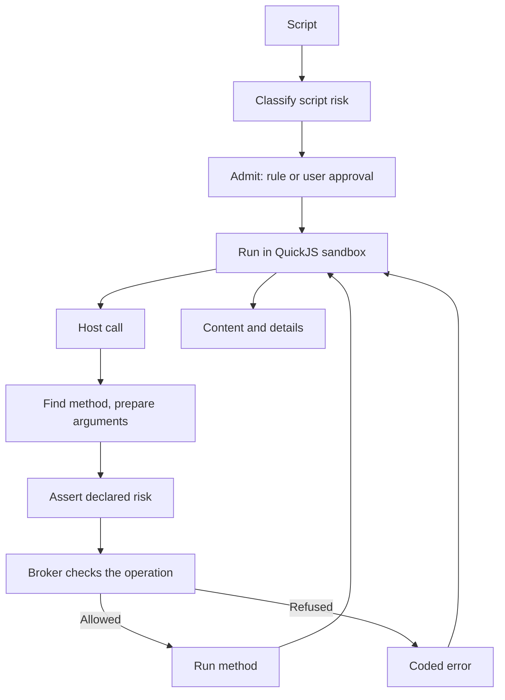

# Code mode

`quick_script` lets the agent do multi-step integration work (Jira and Confluence today) and file, image, diagram and image-generation handling in one tool call. It is the only route to those integrations: the former direct Jira, Confluence, diagram export and image generation tools are gone: it writes a TypeScript script instead of spending a model turn per request. The script runs in a sandbox with no ambient authority, and every external effect is a **host call** checked against the same policy as an operation, so batching does not widen what policy allows.

## Positioning and name

| Tool           | Use for                                                                | Runs                                         |
| -------------- | ---------------------------------------------------------------------- | -------------------------------------------- |
| `quick_script` | Integrations and document utilities; getting multi-step work done fast | Sandboxed TypeScript; effects via host calls |
| `python_exec`  | General Python scripting                                               | Local Python; not a security boundary        |
| `bash`         | The local machine: builds, git, processes                              | Local shell                                  |

The tool descriptions carry this split. The name `quick_script` feels like scripting without promising a runtime. Rejected names: `tsx` and `deno` (agents expect Node or Deno APIs, `fetch`, imports, JSX), `code_mode` (says nothing about when to choose it), `macro` (clashes with Confluence macros), `sdk` and `integrations` (hide the file utilities). The description's first line states the sandbox limits, and `import`, `require` and JSX fail with an error naming the alternative.

## Sandbox

The engine is QuickJS in the `native` addon: a fresh runtime per script on its own thread, with caps on memory, time, output and host calls. The script has no filesystem, network or timers, only `console` and the host-call channel. Everything else, including methods, credentials and policy, belongs to the tool.

## Configuration

`tools.quick_script = { enabled }` is a plain switch, off by default. Which namespaces it offers comes from the [extension settings](configuration.md#extension-settings): the Atlassian extension's `account` and `jira`/`confluence` switches, the Web extension's switch (search also needs its `searchAccount`; fetch needs none), the Diagrams extension's `server` (default `https://kroki.io/`) and the Image generation extension's backend, model and default options (off by default; the backend's credential, for `openai-codex` the ChatGPT subscription connection, is checked when a call is made). The tool works with no extension: utilities are always present. A disabled extension, or one without an account or saved token, is unavailable for that run, and a call into it fails with an error naming Settings → Extensions → its name. The runtime derives each extension namespace and direct tool as configured (the extension and its `enabledBy` switch are on) and available (also its `requires` met: the selected account exists and has a saved secret; and the optional `availability(ctx)` hook), with a reason and fix generated from the manifest and the extension's name ([`availability.ts`](../../packages/tools/src/quick-script/extension-host/availability.ts)); the server feeds it the resolved settings and `AccountsReader` ([`extension-availability.ts`](../../packages/workbench-server/src/core-host/extension-availability.ts)). Configured namespaces build the tool description; the same availability reaches the sandbox as `context.namespaces`, so `sdk.list` can report it. The description never contains availability, so credential changes do not touch the prompt prefix.

## Permissions

Two levels apply; see [permissions](permissions.md) for the general model. The tool has its own `quickScript` permission group; its rule risk is the classified risk of the script, so Planning and Read-only allow read scripts through their ordinary read rule.

**Script level.** Admission scans the script text for SDK calls and the highest risk wins on the scale read < network < workspace write = external write < destructive (Jira/Confluence writes are external, workspace file writes local; the label prefers external on a tie): local files, XLSX and docx work is read, any integration read (Jira, Confluence, web, diagrams, a GET `request`) is network, so rule sets treat a script like the equivalent direct network tool. Anything the scanner cannot follow (aliasing, bracket access, `eval`, a computed request method) counts as destructive, and ambiguous syntax takes the riskier reading. The scan also yields the operations as structured data (`operation`, normalized `targets` from literal arguments, a call count; targets are unknown when an argument is not literal). The approval and the tool card list them as `operation · target` lines (`supervision.operations`).

**Operation rules at admission.** When the scan is complete (no aliasing, `eval` or computed request method, and no `web.*`, workspace `files.*` or `image` call, which are checked as direct tools), operation rules can decide the script ([composition](permissions.md#operation-and-resource-rules)). Otherwise only the classified risk applies, as above, and no "always allow" rule is offered.

**Nested level.** Each host call is checked against current policy as a request for tool `quick_script` ([operation and resource rules](permissions.md#operation-and-resource-rules)): the operation (`jira.issues.create`) is the primary argument, the namespace the tool group, the method's declared risk gives the base risk (a Jira/Confluence write is never `write`) and the resources it acts on are `resource` targets. The broker accepts any operation of a registered namespace. `web.*` and `files.*` keep the direct route (`web_fetch`, `web_search`, `read` / `write` / `edit`, plus `read` for file arguments such as attachments). A deny always holds. When the verdict needs approval, the script's admission decides. A script a **user approved** may make calls up to the risk they approved. A script a **rule allowed** (by its risk class or by operation rules) has no ceiling to spend, so such calls are refused. A raw `request` is an operation like any other: GET is `network`, any other method `destructive`, and the target is `<system>:request/<METHOD> <path>`. A rule matching that method and path can allow it; otherwise it needs a destructive approval. Denials and approval errors name `operation · targets`, and the tool record stores both (`method`, `targets`); `authorizedAs` is set only for the remaining direct routes.

The scan can be evaded, so it is only the first level. The executor also refuses a method whose declared risk is below that of the check it runs (an operation's own risk, or the direct tool for `web.*` and `files.*`), and a unit test checks that every operation's targets are normalized and that built-in rule sets decide each SDK call the same as the old direct-tool identity did.

## SDK methods

Each method is declared once in a method table (`defineMethod` and a positional variant): signature, declared risk, authorization (operation, targets and risk; the operation defaults to `<namespace>.<path>`), argument parsing and implementation. The sandbox prelude, the scanner and dispatch read these tables. `sdk.describe` generates declarations from them at run time ([`sdk-dts.ts`](../../packages/tools/src/quick-script/runtime/sdk-dts.ts)).

### Registry and extensions

Namespaces come from one registry ([`registry.ts`](../../packages/tools/src/quick-script/registry.ts), built from the extension list the host installs): quick_script's built-in capabilities (`files`, `image`, `libraries`, `sdk`; no settings, always present, labelled `built-in` in `sdk.list()`) followed by the namespaces that built-in extension manifests contribute (`ExtensionManifest` in [`manifest-types.ts`](../../packages/tools/src/quick-script/manifest-types.ts)). Manifests exist for `atlassian` (namespaces `atlassian`, `jira`, `confluence`, `storage`; `jira` and `confluence` are tied to their switches by `enabledBy`), `web`, `imagegen` and `diagram`, each in [`packages/extensions/src/<id>/`](../../packages/extensions/src/) with its declarations and `docs/`. A namespace declares its `summary`, up to three `rules`, method table, shared type declarations, doc topics and optionally a `configuration` line that `sdk.describe` prints (for `imagegen`, the configured backend and its per-call options). The description, prelude, guarded globals and discovery all read the registry; adding a namespace means adding it to a manifest. Authorization names operations (`web.*` and `files.*` still name their direct tools). `imagegen.generate` is a `network` operation without targets: it spends the user's credit at the backend but changes no user data; the host adapter for the selected backend (`openai-codex` today) executes it ([`image-generation`](../../packages/workbench-server/src/domains/image-generation/)), and the result is an artifact like `diagram.render`'s.

### Discovery

The tool description is a cache-stable index: sandbox limits, global rules, the rules of each configured namespace, namespace summaries and the libraries. Detail comes from the `sdk` built-in namespace (risk `none`, so scripts using only `sdk.*` classify as read; [`discovery.ts`](../../packages/tools/src/quick-script/runtime/discovery.ts)):

| Call                                  | Returns                                                                                                              |
| ------------------------------------- | -------------------------------------------------------------------------------------------------------------------- |
| `sdk.list()`                          | Every namespace with source, availability (reason and fix), method count and doc topics                              |
| `sdk.describe(path)`                  | Declarations for a namespace, group or method with the shapes they use; unavailable namespaces return reason and fix |
| `sdk.search(query, { in?, offset? })` | One line per method, path matches before doc matches, 20 per page with a `next:` hint                                |
| `sdk.docs(topic?)`                    | Topic index with when-to-read lines, or one Markdown topic                                                           |

All `sdk.*` text of one run shares a budget of 12,000 characters. Past it, `describe` returns a summary and writes the full declarations to the artifact `sdk-<path>.d.ts`; `docs` returns an excerpt and writes the full topic. A wrong-argument error ends with the method's declaration. Doc topics are Markdown files in each extension's `docs/` (runtime topics in `runtime/docs/`), named `<namespace>/<topic>`, with each fact in one topic and limits written as `{{limit:name}}` and filled from the constants that enforce them (`limits.ts`). `scripts/build/copy-quick-script-assets.ts` ships them in `dist/quick-script-docs/`. Tests render every topic and `describe` output and fail on links to missing topics or on method names that do not exist.

### Namespace design rules

These held up in the Atlassian SDK and apply to every namespace:

- **Follow the service's own API vocabulary** (resource names, query languages, IDs) so models reuse what they know; the SDK fills in site, version, auth and pagination.
- **Names instead of awkward IDs** where the API makes them painful (custom fields, transitions, users, spaces).
- **One calling convention:** a bare ID or one options object, one ID name per resource, no aliases. Unknown options fail with the valid names.
- **Compact, complete results:** flattened, never truncated for display.
- **Actionable errors** that list the valid values, with a closed `e.code` set.
- **A raw `request()` escape hatch** plus a recipes reference keeps the typed surface small. Promote a recipe to a method only when agents keep getting it wrong.
- **Writes report what they changed** (`Created:` / `Updated:` / `Deleted:` footer lines) and protect user content (stale-version `CONFLICT`, lossy-update guard on Confluence pages).

### Libraries

Prefer a well-known JavaScript library that runs inside the sandbox over a custom API, because agents already know `XLSX.read` and `Papa.parse`. Use host functions only where nothing runs in QuickJS or the work needs the network or native code (`image`, `diagram`). Libraries load lazily, only for scripts that mention them ([`libraries.ts`](../../packages/tools/src/quick-script/runtime/libraries.ts)). Each new library needs a QuickJS run test and a doc topic.

## Errors

A host failure crosses into the script as `[CODE] message`, which the prelude turns into `e.code`. Codes are a small closed set (`NOT_FOUND`, `CONFLICT`, `DENIED`, `UNAUTHORIZED` and so on); product and policy errors collapse into it. An `UNAUTHORIZED` response aborts the whole run, since later calls would fail the same way.

## Artifacts

Scripts write files into the conversation's `quick-script/` folder and refer to them by handle `artifact:<name>` (flat names). Workspace paths are separate handles: reads are authorized as the direct `read` tool. The folder is copied when the conversation is forked and removed with the conversation's files.

## Results

Content is the script output, any error, report lines (written pages with lint findings, created entities, artifacts) and a footer of calls per product, denials and exit status. Failed, timed-out and cancelled scripts still return a normal result with a non-zero exit code. `details` records status, resource use and one entry per host call, so nested calls are not separate tool-call rows. No database schema is involved. [Tool-result projection](tool-result-projection.md) covers how content reaches the model.

## Cancellation and restart

Cancelling the tool call aborts the sandbox and in-flight host calls; finished calls are not undone. The tool is write-capable and so not replay-safe: a call running at restart settles as indeterminate instead of being run again ([tool-call lifecycle](conversation-core/tool-call-lifecycle.md)).

## Where it lives

| Concern                             | Owner                                                                                                                                                                                                                                                                                                                                                                                                                                                                                                                                                                                                                                                                                                                                                                                                                                                                                                                                                                                                                                                                                                                                                                                                                                             |
| ----------------------------------- | ------------------------------------------------------------------------------------------------------------------------------------------------------------------------------------------------------------------------------------------------------------------------------------------------------------------------------------------------------------------------------------------------------------------------------------------------------------------------------------------------------------------------------------------------------------------------------------------------------------------------------------------------------------------------------------------------------------------------------------------------------------------------------------------------------------------------------------------------------------------------------------------------------------------------------------------------------------------------------------------------------------------------------------------------------------------------------------------------------------------------------------------------------------------------------------------------------------------------------------------------- |
| Package and tool wiring             | `@nervekit/tools` owns the `quick_script` tool definition ([`tool.ts`](../../packages/tools/src/quick-script/tool.ts)), runtime and registry (subpath `@nervekit/tools/quick-script`), plus the execution primitives, web fetch and search. `@nervekit/extensions` owns the built-in extensions: the Jira and Confluence clients, the Kroki client and the image generation request model. Tools never import extensions: the host builds the registry from the built-in list (`createQuickScriptRegistry(builtinExtensions)`), passes it explicitly to the tool, the description, the authorizer and the availability, and adds `quick_script` and the extensions' direct tools to the catalog with `registerToolDefinitions`, all in [`host-tools.ts`](../../packages/workbench-server/src/core-host/host-tools.ts). Extensions written against `@nervekit/extension-api` run through `ctx` (settings, accounts, `http` with credential injection, artifacts, report, `models.image`; [`extension-host/`](../../packages/tools/src/quick-script/extension-host)); the built-ins keep the hand-written `contributes.sdk` shape until they are ported. The server builds the real tool description per conversation from `quickScriptDescription` |
| Executor, host-call loop and result | [`quick-script.ts`](../../packages/tools/src/quick-script/runtime/quick-script.ts)                                                                                                                                                                                                                                                                                                                                                                                                                                                                                                                                                                                                                                                                                                                                                                                                                                                                                                                                                                                                                                                                                                                                                                |
| Layout                              | `packages/tools/src/quick-script/`: `runtime/` (executor, sandbox glue, prelude, scanner, discovery, description, SDK model; `files/`; `docs/` runtime topics), `registry.ts`, `tool.ts`. `packages/extensions/src/<id>/` (manifest, declarations, docs; `atlassian/{jira,confluence,shared}`, `web`, `imagegen`, `diagram`)                                                                                                                                                                                                                                                                                                                                                                                                                                                                                                                                                                                                                                                                                                                                                                                                                                                                                                                      |
| Tool description                    | [`description.ts`](../../packages/tools/src/quick-script/runtime/description.ts): built from the registry for the configured namespaces, in registry order                                                                                                                                                                                                                                                                                                                                                                                                                                                                                                                                                                                                                                                                                                                                                                                                                                                                                                                                                                                                                                                                                        |
| Method model and prelude            | [`sdk-types.ts`](../../packages/tools/src/quick-script/runtime/sdk-types.ts) and [`sdk.ts`](../../packages/tools/src/quick-script/runtime/sdk.ts)                                                                                                                                                                                                                                                                                                                                                                                                                                                                                                                                                                                                                                                                                                                                                                                                                                                                                                                                                                                                                                                                                                 |
| Script scan and declared-risk guard | [`script-risk.ts`](../../packages/tools/src/quick-script/runtime/script-risk.ts) and [`method-risk.test.ts`](../../packages/extensions/test/method-risk.test.ts)                                                                                                                                                                                                                                                                                                                                                                                                                                                                                                                                                                                                                                                                                                                                                                                                                                                                                                                                                                                                                                                                                  |
| Declarations for `sdk.describe`     | [`sdk-dts.ts`](../../packages/tools/src/quick-script/runtime/sdk-dts.ts)                                                                                                                                                                                                                                                                                                                                                                                                                                                                                                                                                                                                                                                                                                                                                                                                                                                                                                                                                                                                                                                                                                                                                                          |
| Nested authorization                | [`createQuickScriptAuthorizer`](../../packages/workbench-server/src/core-host/quick-script-broker.ts), wired in [`create-conversation-core.ts`](../../packages/workbench-server/src/app/bootstrap/create-conversation-core.ts)                                                                                                                                                                                                                                                                                                                                                                                                                                                                                                                                                                                                                                                                                                                                                                                                                                                                                                                                                                                                                    |
| Sandbox engine                      | [`sandbox/`](../../packages/native/src/sandbox/) bindings and [Rust engine](../../packages/native/native/src/sandbox/mod.rs)                                                                                                                                                                                                                                                                                                                                                                                                                                                                                                                                                                                                                                                                                                                                                                                                                                                                                                                                                                                                                                                                                                                      |
| Result details contract             | [`quick-script.ts`](../../packages/contracts/src/domains/tools/quick-script.ts)                                                                                                                                                                                                                                                                                                                                                                                                                                                                                                                                                                                                                                                                                                                                                                                                                                                                                                                                                                                                                                                                                                                                                                   |
