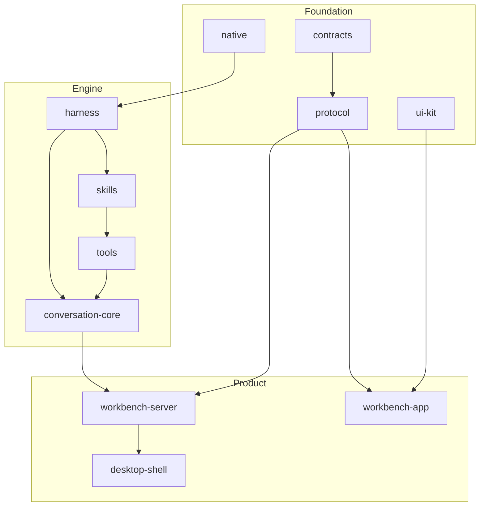

# Codebase architecture

Nerve separates the reusable agent engine from the workbench that hosts it. The server supplies storage and local environment services, the web app supplies the user interface, and the desktop shell manages the application window and server process. Shared contracts let these parts agree on domain data without tying that data to a particular connection or platform.

Arrows mean “is consumed by.” The diagram highlights key direct dependencies; contracts supply shared domain types throughout the engine and product, so their other edges are omitted. The exact allowed graph lives in [`workspacePackages`](../../scripts/shared/workspace-architecture.mjs) and is enforced by the [boundary checker](../../scripts/checks/check-package-boundaries.mjs).

| Package             | Layer      | One-line responsibility                                                     |
| ------------------- | ---------- | --------------------------------------------------------------------------- |
| `contracts`         | Foundation | Transport-neutral domain schemas and policy contracts.                      |
| `protocol`          | Foundation | Sessions, remote procedure calls, replay and transport lifecycle.           |
| `native`            | Foundation | Rust-backed Git reads, managed processes, filesystem monitoring and search. |
| `ui-kit`            | Foundation | Domain-independent UI primitives and shared styles.                         |
| `harness`           | Engine     | Model execution and the agent loop, with conversation orchestration.        |
| `skills`            | Engine     | Built-in skills and their integration with harness resources.               |
| `tools`             | Engine     | Tool execution, policy and result projection.                               |
| `conversation-core` | Engine     | Portable conversation storage and durable runtime behavior.                 |
| `workbench-server`  | Product    | Host services, core composition and client-facing adapters.                 |
| `workbench-app`     | Product    | Web UI, application workflows and feature state.                            |
| `desktop-shell`     | Product    | Electron windows, integration and daemon supervision.                       |
| `website`           | Standalone | Public website and documentation.                                           |

## Reusable engine

Contracts describe domain data and policy independently of transport. Protocol owns the mechanics of exchanging that data, including sessions, remote procedure calls and replay after reconnecting. Keeping those concerns separate lets core behavior work without a network connection.

The execution libraries build upward from native Git/process capabilities through model execution, skills and tools. Conversation core combines them into durable conversation behavior. A **port** is an interface through which the core asks its host for an environment service, such as model resolution or permission evaluation. Ports keep the core reusable because it can ask for those services without importing the workbench server or UI.

For example, changing how the local host resolves a model belongs in its port implementation; changing how conversation history is stored belongs in the core. See [conversation core](conversation-core/README.md) for the engine's internal boundaries.

## Product composition

The server constructs the core and supplies its environment ports. Its protocol adapters expose durable conversation history and workbench invalidation notices—signals that clients should fetch fresh state. Storage stays with the domain owner so that transport recovery does not become a second persistence system. See [channels](conversation-core/channels.md).

The web app owns workflows and feature state. UI-kit supplies reusable primitives and styles without domain contracts, so presentation components can be reused without inheriting application state. [Conversation state and attention](conversation-state-and-attention.md) explains the application-owned state around conversations.

The desktop shell owns Electron windows and daemon supervision. The server owns storage initialization, while the web app renders progress and recovery. This division gives browser and desktop clients the same [startup](startup.md) behavior.

## Where it lives

| Concern                                      | Owner                                                                                                                                         |
| -------------------------------------------- | --------------------------------------------------------------------------------------------------------------------------------------------- |
| Package graph and enforcement                | [`workspacePackages`](../../scripts/shared/workspace-architecture.mjs); [boundary checker](../../scripts/checks/check-package-boundaries.mjs) |
| Portable core facade and host interfaces     | [`ConversationCore`](../../packages/conversation-core/src/core.ts); [ports](../../packages/conversation-core/src/ports.ts)                    |
| Server construction and host implementations | [bootstrap](../../packages/workbench-server/src/app/bootstrap/); [core-host](../../packages/workbench-server/src/core-host/)                  |
| Desktop lifetime                             | [`DesktopRuntime`](../../packages/desktop-shell/src/app/desktop-runtime.ts)                                                                   |
