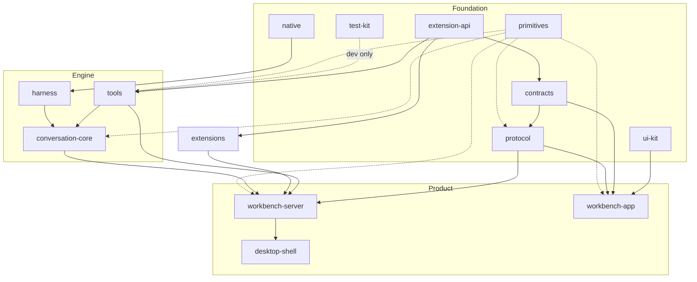

# Codebase architecture

Nerve separates the reusable agent engine from the workbench that hosts it. The server supplies storage and local environment services, the web app supplies the user interface, and the desktop shell manages the application window and server process. Shared contracts let these parts agree on domain data without tying that data to a particular connection or platform.

Arrows mean “is consumed by.” The diagram highlights key direct dependencies; contracts supply shared domain types throughout the engine and product, so their other edges are omitted. Extensions never import `tools`, and `tools` never imports extensions: `workbench-server` is the host that composes both. Outside its own folder an extension is named only by the built-in list and old migration steps ([`extension-naming` rule](../../scripts/checks/extension-naming-policy.ts)). The exact allowed graph lives in [`ALLOWED_INTERNAL_DEPENDENCIES`](../../scripts/checks/package-architecture.rules.ts) and is enforced by the [boundary checker](../../scripts/checks/check-package-boundaries.ts).

| Package             | Layer      | One-line responsibility                                                                                                                                                                                                                                                              |
| ------------------- | ---------- | ------------------------------------------------------------------------------------------------------------------------------------------------------------------------------------------------------------------------------------------------------------------------------------ |
| `primitives`        | Foundation | Dependency-free runtime helpers for browser and Node: serial queues (`SerialQueue`, `KeyedSerialQueue`), `singleFlight`, abortable `sleep` and `createDebouncedTask`. Allowed everywhere; use them instead of hand-rolled promise chains, dedupe maps and timer pairs.               |
| `test-kit`          | Foundation | Private, Node-only test support: `makeTempDir`, `waitFor`, `flush`, `waitForProcessExit`, `createManualTimerCore`, `stubFetch`. A devDependency used from tests only; the boundary check rejects it in `dependencies` and in non-test source.                                        |
| `extension-api`     | Foundation | The extension contract: manifest and `ctx` types, `define*` helpers and a fake context for tests. No dependencies.                                                                                                                                                                   |
| `contracts`         | Foundation | Transport-neutral domain schemas and policy contracts.                                                                                                                                                                                                                               |
| `protocol`          | Foundation | Sessions, remote procedure calls, replay and transport lifecycle.                                                                                                                                                                                                                    |
| `native`            | Foundation | Rust-backed Git reads, managed processes, file monitoring, listing, search and script sandbox.                                                                                                                                                                                       |
| `ui-kit`            | Foundation | Domain-independent UI primitives and shared styles.                                                                                                                                                                                                                                  |
| `harness`           | Engine     | Model execution and registry, messages, conversation trees, compaction, skills and prompt templates.                                                                                                                                                                                 |
| `tools`             | Engine     | Tool execution, policy, result projection and the `quick_script` tool with its runtime and extension registry.                                                                                                                                                                       |
| `extensions`        | Engine     | The built-in `quick_script` extensions: Atlassian with the Jira and Confluence clients, web, diagrams, image generation, with their docs. Depends on `extension-api` only; the server host registers its definitions list (`builtinExtensions`) with the registry that `tools` owns. |
| `conversation-core` | Engine     | Portable conversation storage and durable runtime behavior.                                                                                                                                                                                                                          |
| `workbench-server`  | Product    | Host services, core composition, client-facing adapters and the built-in skill catalog.                                                                                                                                                                                              |
| `workbench-app`     | Product    | Web UI, application workflows and feature state.                                                                                                                                                                                                                                     |
| `desktop-shell`     | Product    | Electron windows, integration and daemon supervision.                                                                                                                                                                                                                                |
| `website`           | Standalone | Public website and documentation.                                                                                                                                                                                                                                                    |

## Reusable engine

Contracts describe domain data and policy independently of transport. Protocol owns the mechanics of exchanging that data, including sessions, remote procedure calls and replay after reconnecting. Keeping those concerns separate lets core behavior work without a network connection.

The execution libraries build upward from native Git/process capabilities through model execution and tools. Conversation core combines them into durable conversation behavior. A **port** is an interface through which the core asks its host for an environment service, such as model resolution or permission evaluation. Ports keep the core reusable because it can ask for those services without importing the workbench server or UI.

See [conversation core](conversation-core/README.md) for the engine's internal boundaries.

## Product composition

The server constructs the core and supplies its environment ports. Its protocol adapters expose durable conversation history and workbench invalidation notices—signals that clients should fetch fresh state. Storage stays with the domain owner so that transport recovery does not become a second persistence system. See [channels](conversation-core/channels.md).

The web app owns workflows and feature state. UI-kit supplies reusable primitives and styles without domain contracts, so presentation components can be reused without inheriting application state. [Conversation state and attention](conversation-state-and-attention.md) explains the application-owned state around conversations.

The desktop shell owns Electron windows and daemon supervision. The server owns storage initialization, while the web app renders progress and recovery. This division gives browser and desktop clients the same [startup](startup.md) behavior.

## Where it lives

| Concern                                                                | Owner                                                                                                                                                                  |
| ---------------------------------------------------------------------- | ---------------------------------------------------------------------------------------------------------------------------------------------------------------------- |
| Package graph and enforcement                                          | [`ALLOWED_INTERNAL_DEPENDENCIES`](../../scripts/checks/package-architecture.rules.ts); [boundary checker](../../scripts/checks/check-package-boundaries.ts)            |
| Portable core facade and host interfaces                               | [`ConversationCore`](../../packages/conversation-core/src/core.ts); [ports](../../packages/conversation-core/src/ports.ts)                                             |
| Server construction and host implementations                           | [bootstrap](../../packages/workbench-server/src/app/bootstrap/); [core-host](../../packages/workbench-server/src/core-host/) (layout below)                            |
| Extension host (sandbox, direct tools, UI calls, account tests, icons) | [`tools/src/extension-host`](../../packages/tools/src/extension-host), exported as `@nervekit/tools/extension-host`; `quick-script` imports it like any other consumer |
| Access control                                                         | [access and authentication](access.md)                                                                                                                                 |
| Desktop lifetime                                                       | [`DesktopRuntime`](../../packages/desktop-shell/src/app/desktop-runtime.ts)                                                                                            |

### Server host layout

[`core-host`](../../packages/workbench-server/src/core-host/) is grouped by concern: `permissions/` (policy source, overlays, rule sets, validation, execution admission), `configuration/` (agent port, reload, scoped agent configuration, the [resource registry](configuration.md#resource-registry) and its providers), `extensions/` (catalog, store, UI serving, availability) and `resources/` (resource loader, turn resources, system prompt, project skill trust). `agent-browser-skills.ts` stays at the top level because the released migration `0002-agent-profiles` imports it by path and released migrations are locked by content. Each `quick_script` namespace's agent port type sits beside the namespace's methods (`quick-script/runtime/configuration`, `launches`, and `extension-host/agent-port.ts`); the server implements them.

### Vocabulary

A **tool** is what the model calls by name (a core tool or an extension's `defineTool`), a **method** is a function of a `quick_script` namespace, and an **operation** is the permission identity of a method call (`jira.issues.create`). Rule files and stored approvals contain operation names, so those strings are persisted contract.

## Tooling and tests

Workbench app building blocks and conventions are in [`packages/workbench-app/AGENTS.md`](../../packages/workbench-app/AGENTS.md); repository scripts and the path-impact engine behind focused checks are in [`scripts/README.md`](../../scripts/README.md). Unit tests colocate with the module as `<name>.test.ts`, and `test/` directories hold cross-module scenarios, integration tests and fixtures; see [`AGENTS.md`](../../AGENTS.md) and [`CONTRIBUTING.md`](../../CONTRIBUTING.md).
