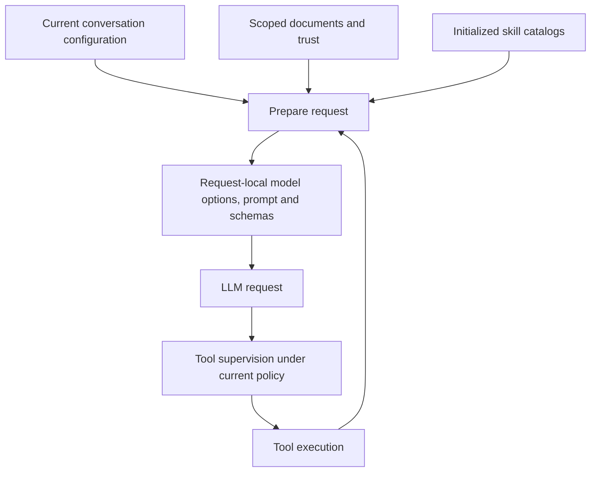

# Scoped configuration

> **Status:** Current architecture. Owning contracts, configuration services and runtime tests are authoritative.

Configuration has separate owners and documents, but a common scope structure. Do not combine tools, skills, agent profiles and permissions into one settings document, or copy all effective configuration into conversation storage.

## Scope directories

| Scope        | Configuration root                                          | Ownership                                |
| ------------ | ----------------------------------------------------------- | ---------------------------------------- |
| Built-in     | Application-owned defaults; no writable directory           | Contracts and owning packages            |
| User         | `<NERVE_HOME>/config/`                                      | The active Nerve home                    |
| Project      | `<project>/.nerve/config/`                                  | The project                              |
| Conversation | `<NERVE_HOME>/data/conversations/<conversation-id>/config/` | The conversation; removed with its owner |

These roots apply across domains, not only to agent profiles. A scope root is a directory contract, not a requirement that every domain has a file at every scope. Credentials remain in secret storage, not in portable configuration. See [storage architecture](storage.md) for the full home layout.

Skill instruction files, project instructions and other authored resources remain in their discovery locations. Their selection/configuration is distinct from their content: enabling a skill does not move its `SKILL.md` into `config/` or install its dependencies.

## Documents and exceptions

| Domain                                  | User                                            | Project               | Conversation          |
| --------------------------------------- | ----------------------------------------------- | --------------------- | --------------------- |
| Tool and skill selection, tool settings | Existing harness/integration settings documents | `capabilities.json`   | `capabilities.json`   |
| Agent profile definitions and overrides | `agent-profiles.json`                           | `agent-profiles.json` | `agent-profiles.json` |
| Permission overlays                     | `permissions.json`                              | `permissions.json`    | `permissions.json`    |
| Compaction settings                     | `harness.json`                                  | `harness.json`        | `harness.json`        |

Filenames in this table are relative to the corresponding scope root. Built-in values come from each domain's defaults, not another persisted document.

Two intentional distinctions:

- Conversation model, reasoning level, profile, instructions and permission rule-set selection currently belong to the existing SQLite conversation configuration. They are not duplicated into conversation JSON. User/project creation defaults do not overwrite explicit choices in an existing conversation.
- Permission rule-set definitions are not overlays. Built-in definitions ship with the application; custom definitions live under the user's `config/rule-sets/`. The conversation selects a rule set, and overlays modify its evaluated policy. See [permissions](permissions.md).

These are existing storage boundaries. Relocating an existing owner requires an explicit migration design; do not add permanent dual reads or silent fallback paths.

## Resolution is domain-owned

The common precedence is **built-in → user → project → conversation**, up to the scopes supported by the domain. Missing local values inherit; reset removes a local override. An explicit enable can override a lower disable for selectable capabilities. Capability preferences are not authorization guardrails.

The common precedence does not imply one universal merge algorithm:

- [Capabilities](conversation-core/README.md#capabilities) resolve tool and skill selections by name. Supported tool settings replace the inherited settings for that tool as a whole. File skills default to enabled; bundled Nerve and Agent Browser skills are opt-in. Capability normalization can remove overrides equal to inherited values.
- [Agent profiles](agent-profiles.md) merge sparse fields and named tool/skill maps. Explicit profile fields remain pinned until reset, including values equal to their parent. Lead instructions, capability deltas and Locks resolve each turn; Set values apply on switching. Sub-agent profiles are creation-time templates, not live bindings to existing children.
- [Permissions](permissions.md) compose Baseline, the selected rule set and its scoped overlays under evaluator and guardrail rules. This is ordered policy evaluation, not ordinary last-value-wins configuration. The Planning profile selects the Planning policy.
- [Compaction](conversation-core/delegation.md#compaction-settings) replaces the inherited structured value as a whole.

Trust is also domain-owned. Project capability, profile and permission documents have exact-content trust requirements, but do not all handle untrusted entries identically. Preserve their diagnostics and fail-closed behavior rather than treating untrusted or malformed content as an ordinary empty override. Profile-document trust does not establish independent trust in skill content.

## Persistence and host boundaries

Contracts own schemas and pure resolution rules. Host services own scope paths, filesystem reads/writes, trust, conflict handling and notifications. Conversation core owns conversation configuration and runtime lifecycle, without loading host configuration files itself.

The shared [scope-path resolver](../../packages/workbench-server/src/infrastructure/configuration/scope-paths.ts) constructs canonical document paths and checks conversation/project ownership. Domain owners retain schemas, filesystem protection, trust and merge semantics; this is shared storage infrastructure, not a generic settings framework.

Configuration files are validated and atomically replaced. Capability and profile services serialize mutations and support digest-based conflict checks. User settings and provider-catalog writes share a per-storage mutation queue, so concurrent read–modify–write operations do not lose independent updates. Authoritative in-memory configuration is updated after persistence; handlers publish changes afterward and failed mutations do not poison the queue.

Atomic replacement protects an individual file from partial writes; it does not make multiple documents one transaction. Serialization is within one storage instance, not across processes. A failure partway through a multi-document home write can require recovery/reload; do not claim all-or-nothing persistence across the home. Direct edits to user-home configuration require its supported reload/restart mechanism; this architecture does not add file watching or support direct SQLite edits.

Relevant implementation owners:

- [Home paths](../../packages/workbench-server/src/infrastructure/storage-bootstrap/paths.ts) and [configuration adapters](../../packages/workbench-server/src/infrastructure/configuration/).
- [Capability service](../../packages/workbench-server/src/core-host/capability.service.ts) and [capability contracts](../../packages/contracts/src/domains/capabilities/capabilities.ts).
- [Agent profile service](../../packages/workbench-server/src/domains/agent-profiles/agent-profile.service.ts).
- [Conversation configuration service](../../packages/conversation-core/src/conversations/conversation.service.ts).

## Request preparation and effective time

A new LLM request uses current successfully saved configuration from its applicable scopes. A save acknowledged before request preparation starts must be visible to that preparation, subject to higher-scope overrides, availability, validity and trust. A change during preparation may take effect on the following request. There is no cross-document configuration transaction.

| Change                                                       | Effective boundary                                                                            |
| ------------------------------------------------------------ | --------------------------------------------------------------------------------------------- |
| Tools, supported tool settings and skill selections          | Next prepared LLM request                                                                     |
| Available agent profiles and their settings                  | Next prepared request; resolve and validate again at new-child creation                       |
| Conversation model and reasoning level                       | Next prepared LLM request, including retry attempts                                           |
| Active agent profile and instructions                        | Next prepared LLM request; effective permission also governs subsequent permission evaluation |
| Permission rule-set selection, rule definitions and overlays | Next tool supervision evaluation                                                              |
| Existing sub-agent configuration                             | Direct changes on that child, not edits to its creation profile                               |

The [conversation runner](../../packages/conversation-core/src/runtime/conversation-runner.ts) refreshes conversation configuration for each provider attempt, not only each logical turn. [Model-turn preparation](../../packages/conversation-core/src/runtime/model-turn.ts) owns a request-local copy of configuration, resolved model options, prompt and tool schemas. [Host resource preparation](../../packages/workbench-server/src/core-host/turn-resources.adapter.ts) resolves effective capabilities, usable profiles and skill selections for that request. After preparation, the provider consumes that bundle without independently refreshing its prompt, model options or schemas.

This boundary includes automatic continuations, retries after backoff and requests following compaction. Configuration refresh must not redeliver queued inputs or notices. Context/compaction decisions use the current model; post-compaction requests prepare again. Compaction uses its own current model, reasoning and compaction settings, not the normal conversation tool/skill prompt.

Skill catalogs are service-owned resources. Startup initializes them before conversation-core recovery/execution and before mounting request handlers. Consumers retain read-only catalog owners and obtain current contents during preparation, never detached pre-initialization arrays. Catalog listing, profile availability and child initialization read the same owners. Enablement changes do not require catalog reloads; automatic discovery reloads are not promised.

System-prompt preview uses the same preparation path without invoking a model. Its pane is a snapshot, not a live view; reopening it fetches current resources. Intentional visibility limits remain: a non-null conversation `systemPrompt` replaces generated prompt construction; generated skill listings require `read`; skills marked `disable-model-invocation` are omitted; duplicate names follow resource precedence. These must not be confused with a failed save.

## Authorization and work already in progress

Settings changes do not cancel or mutate an already-prepared provider request, replay delivered inputs or restart executing tools. Tool visibility is not an authorization grant: a call entering supervision reads current conversation context and policy independently of prompt preparation. Calls already approved or running are not automatically reauthorized or cancelled by a settings edit; recorded decision authority remains intact.

Tool execution can resolve current operational settings and credentials through its host adapter. A request bundle does not freeze the entire tool-execution environment or make permission overlays ordinary capability preferences. Tool credentials are resolved by execution adapters, not embedded in the prompt or advertised schemas; provider authentication stays in the model invocation options. Profiles likewise resolve and validate a child-creation snapshot at creation; existing children retain their own configuration.

Usable sub-agent profile descriptions are listed in `<available_agent_profiles>`, not repeated in tool schemas. The schema and creation-time validation still constrain usable profiles.
