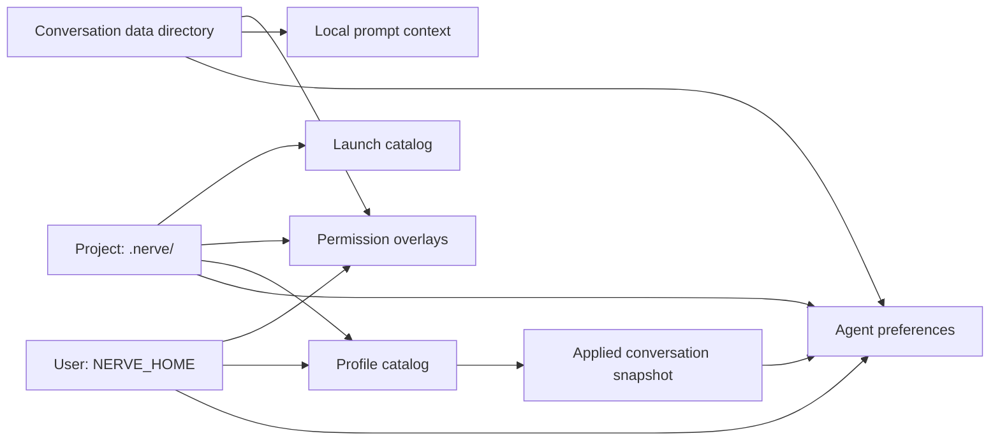
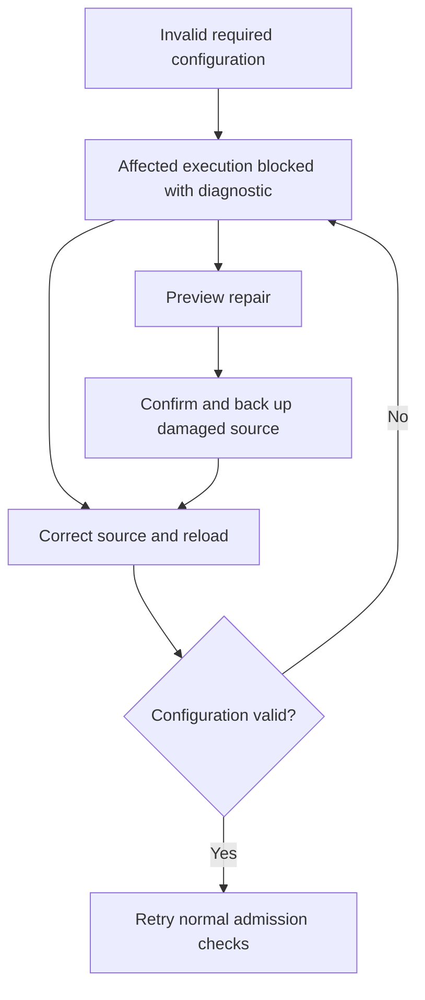

# Scoped configuration

Nerve stores configuration at three scopes: user files under `NERVE_HOME`, project files under `.nerve/`, and conversation files under the conversation's data directory. These let maintainers distinguish personal defaults, shared project policy and choices for one conversation. Each domain owns how those scopes combine; host services load and save the files, while conversation core consumes validated settings for execution.

## Scope ownership

The scopes provide storage locations; domain-specific resolution gives those files meaning:

| Domain                            | Where it is stored                                                              | How scopes combine                                                                                         | Owner                                                                                                                            |
| --------------------------------- | ------------------------------------------------------------------------------- | ---------------------------------------------------------------------------------------------------------- | -------------------------------------------------------------------------------------------------------------------------------- |
| Agent preferences                 | Scoped `config/agent.json`                                                      | Fields inherit according to declared merge units; profile contributions participate in resolution          | [`resolveAgentConfiguration`](../../packages/contracts/src/domains/agent-configuration/resolver.ts)                              |
| Prompt context                    | Conversation `config/agent.json`                                                | Local instructions and base prompt belong to that conversation; profile instructions contribute separately | [`scopedTurnResources`](../../packages/workbench-server/src/core-host/scoped-turn-resources.ts)                                  |
| Profile definitions               | User `data/agent-profiles/` and project `.nerve/agent-profiles/`                | Same-name project definitions replace whole lower definitions; application saves a conversation snapshot   | [`AgentProfileCatalog`](../../packages/workbench-server/src/infrastructure/configuration/agent-configuration/profile-catalog.ts) |
| Permission rule sets and overlays | Built-in policy, user `config/rule-sets/`, and scoped `config/permissions.json` | Select one rule set, then compose applicable overlays; child policy differs                                | [`createPermissionConfigurationService`](../../packages/workbench-server/src/core-host/permission-configuration.ts)              |
| Launch definitions                | Project `.nerve/launches/definitions.json`                                      | One project catalog, with no user/conversation inheritance                                                 | [`LaunchDefinitionRepository`](../../packages/workbench-server/src/domains/launch-definitions/launch-definition.repository.ts)   |

Creation preferences choose a starting profile independently of execution settings, so opening a new conversation need not change an existing one. [Agent profiles and delegation](conversation-core/delegation.md) explains precedence, applied snapshots and frozen child preferences. [Permissions](permissions.md) explains overlays and authorization; [launch definitions](launch-definitions.md) explains catalog concurrency.

JSON owns agent preferences and prompt context. SQLite owns conversation identity, relationships, history, lifecycle and working directory. Credentials stay with provider and secret owners so configuration snapshots do not capture secret values. See [storage](storage.md) for the wider layout.

## Persistence and activation

Saves validate a candidate, check its **revision** (document version) and **digest** (hash of source bytes), then atomically replace one document and publish a validated in-memory generation. These checks reject stale edits so one settings view cannot silently overwrite another. If persistence fails, readers retain the previous generation; if publication fails after the write commits, the document becomes unavailable until reload so execution cannot use stale memory.

Atomic replacement applies to one file, and serialization coordinates writers within one storage instance. Writes to different files can interleave, and an external writer can race between the digest check and replacement; callers must not treat a multi-file edit as one transaction or rely on this store for cross-process coordination.

A missing optional preference file means inheritance. A missing required conversation document blocks resolution because substituting defaults would discard that conversation's captured choices.

| Change                                                | Takes effect at                                                          | Why                                                                                                                           |
| ----------------------------------------------------- | ------------------------------------------------------------------------ | ----------------------------------------------------------------------------------------------------------------------------- |
| Model, prompt, tools and other request preferences    | Next request preparation, including retries and post-compaction requests | A prepared provider request keeps a consistent configuration while later requests can use new settings                        |
| Profile switch or reapplication                       | Next preparation after the conversation document commits                 | Choices and profile contribution must become visible together                                                                 |
| New-child launch choices and profile availability     | Child admission                                                          | Launch revalidation prevents stale advertised choices from starting a child; existing children retain their captured baseline |
| Authorization                                         | Each tool execution admission, including after approval waits            | Approval must not defeat a later policy denial                                                                                |
| External edits to agent documents or profile catalogs | Explicit reload or restart                                               | Loaded authority is cached without filesystem watchers or polling                                                             |

Restart re-captures not-yet-started tool calls, so a changed execution target requires fresh approval. Configuration changes leave already-running tools and in-flight provider requests unchanged because their execution has already begun.

## Health and recovery

Required configuration failures block only the affected execution and expose a diagnostic. The user can reload corrected files or review and confirm a repair; repair preserves damaged source bytes in a backup so recovery is reversible.

Retry re-reads authority and repeats authorization because repairing configuration does not itself grant permission. Dismissing a diagnostic leaves the underlying problem unchanged. The system has no persisted last-known-good execution authority, so a stale backup cannot silently authorize work.

The summary cache lets conversation-list rows show fields such as model and profile without opening every conversation document. Reading a summary never loads that conversation; missing or invalid cache entries display unknown fields so a disposable projection cannot block execution or trigger a startup scan. See [conversation state and attention](conversation-state-and-attention.md) for consumer ownership.

## Where it lives

| Concern                          | Owner                                                                                                                                                                                                                                                          |
| -------------------------------- | -------------------------------------------------------------------------------------------------------------------------------------------------------------------------------------------------------------------------------------------------------------- |
| Scope roots and agent paths      | [`ConfigurationScopePaths`](../../packages/workbench-server/src/infrastructure/configuration/scope-paths.ts) and [`AgentConfigurationPaths`](../../packages/workbench-server/src/infrastructure/configuration/agent-configuration/document-adapters.ts)        |
| Atomic saves and publication     | [`ScopedDocumentStore`](../../packages/workbench-server/src/infrastructure/configuration/scoped-store/scoped-document-store.ts) and [store tests](../../packages/workbench-server/src/infrastructure/configuration/scoped-store/scoped-document-store.test.ts) |
| Loaded generations and summaries | [`AgentConfigurationService`](../../packages/workbench-server/src/infrastructure/configuration/agent-configuration/agent-configuration-service.ts), especially `getSummary`                                                                                    |
| Request capture                  | [`createScopedAgentConfiguration`](../../packages/workbench-server/src/core-host/scoped-agent-configuration.ts) and [request freshness tests](../../packages/conversation-core/src/runtime/request-freshness.test.ts)                                          |
| Execution admission and restart  | [`ToolCallService`](../../packages/conversation-core/src/tool-calls/tool-call.service.ts) and [admission tests](../../packages/conversation-core/src/tool-calls/execution-admission.test.ts)                                                                   |
| Reload and confirmed repair      | [`createConfigurationReload`](../../packages/workbench-server/src/core-host/configuration-reload.ts) and [`createScopedRepair`](../../packages/workbench-server/src/infrastructure/configuration/agent-configuration/scoped-repair.ts)                         |
