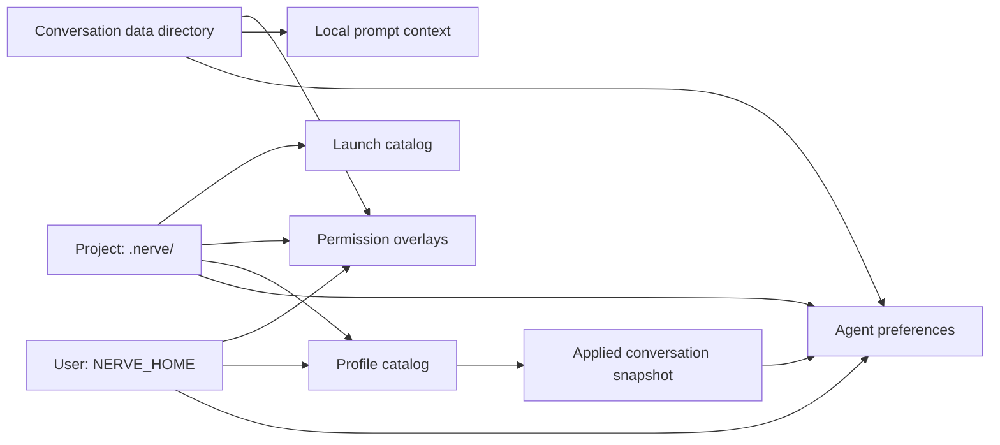
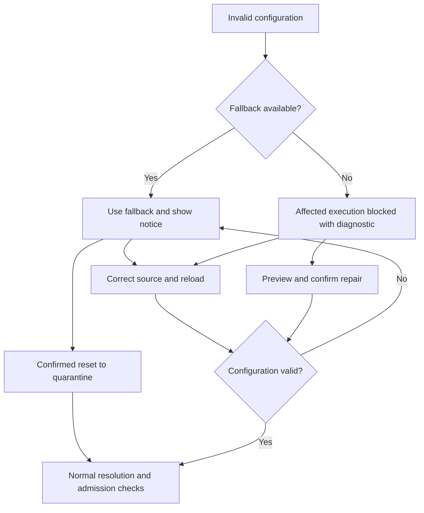

# Scoped configuration

Nerve stores configuration at three scopes: user files under `NERVE_HOME`, project files under `.nerve/`, and conversation files under the conversation's data directory. These let maintainers distinguish personal defaults, shared project policy and choices for one conversation. Each domain owns how those scopes combine; host services load and save the files, while conversation core consumes validated settings for execution.

## Scope ownership

The scopes provide storage locations; domain-specific resolution gives those files meaning:

| Domain                            | Where it is stored                                                                                       | How scopes combine                                                                                                                                                                 | Owner                                                                                                                                                               |
| --------------------------------- | -------------------------------------------------------------------------------------------------------- | ---------------------------------------------------------------------------------------------------------------------------------------------------------------------------------- | ------------------------------------------------------------------------------------------------------------------------------------------------------------------- |
| Agent preferences                 | Scoped `config/agent.json`                                                                               | Fields inherit according to declared merge units; profile contributions participate in resolution                                                                                  | [`resolveAgentConfiguration`](../../packages/contracts/src/domains/agent-configuration/resolver.ts)                                                                 |
| Prompt context                    | Conversation `config/agent.json`                                                                         | Local instructions and base prompt belong to that conversation; profile instructions contribute separately                                                                         | [`scopedTurnResources`](../../packages/workbench-server/src/core-host/resources/scoped-turn-resources.ts)                                                           |
| Extension settings                | Scoped `config/extensions.json`; agent profiles carry an `extensions` section                            | Per field: manifest default, user, project (trusted by exact content), profile, conversation                                                                                       | [`ExtensionSettingsService`](../../packages/workbench-server/src/infrastructure/configuration/extensions/extension-settings-service.ts)                             |
| Profile definitions               | User `agent/agent-profiles/` and project `.nerve/agent-profiles/`                                        | Same-name project definitions replace whole lower definitions; application saves a conversation snapshot                                                                           | [`AgentProfileCatalog`](../../packages/workbench-server/src/infrastructure/configuration/agent-configuration/profile-catalog.ts)                                    |
| Permission rule sets and overlays | Built-in policy, user `config/rule-sets/`, and scoped `config/permissions.json`                          | Select one rule set, then compose applicable overlays; child policy differs                                                                                                        | [`createPermissionConfigurationService`](../../packages/workbench-server/src/core-host/permissions/permission-configuration.ts)                                     |
| Launch definitions                | Project `.nerve/launches/definitions.json`                                                               | One project catalog, with no user/conversation inheritance                                                                                                                         | [`LaunchDefinitionRepository`](../../packages/workbench-server/src/domains/launch-definitions/launch-definition.repository.ts)                                      |
| MCP servers                       | User `config/mcp.json`; project `.nerve/config/mcp.json`; on/off in the agent settings' `mcpServers` map | Read on every use. An approved project entry replaces a user entry of the same name; each entry needs [consent](trust.md); secrets `${secret:name}` come from the credential vault | [`McpServerHub`](../../packages/workbench-server/src/domains/mcp/mcp-server-hub.ts), [`McpCatalog`](../../packages/workbench-server/src/domains/mcp/mcp-catalog.ts) |

Accounts live in the `account` table of the home database, not in a configuration file ([storage](storage.md#accounts)): non-secret fields as JSON, the credential (typed-in secrets, tokens, identity) as one encrypted value only the credential vault reads. Extensions define the account kinds, their fields, secret inputs and credential provider, and extension settings select accounts by id. An account is user-level (every project) or project-level (one project); neither level is stored in the repository. The app edits accounts through the `accounts.*` operations ([extension platform](extension-platform.md#accounts)).

Creation preferences (`config/conversation-defaults.json` at user and project scope) choose a starting profile independently of execution settings, so opening a new conversation need not change an existing one. [Agent profiles and delegation](conversation-core/delegation.md) explains precedence, applied snapshots and frozen child preferences. [Permissions](permissions.md) explains overlays and authorization; [launch definitions](launch-definitions.md) explains catalog concurrency.

The zod schemas in `packages/contracts` own the shape of every configuration file. At build time `scripts/build/copy-skills-assets.ts` generates JSON Schemas from them into the built-in `configure-nerve` skill (`reference/schemas/`), which the agent reads to edit these files by chat; `configuration.check`/`configuration.reload` in `quick_script` ([code mode](code-mode.md#registry-and-extensions)) re-read them, because there are no file watchers. JSON owns agent preferences and prompt context. SQLite owns conversation identity, relationships, history, lifecycle and working directory. Credentials stay with provider and secret owners so configuration snapshots do not capture secret values. See [storage](storage.md) for the wider layout.

## Persistence and activation

Saves validate a candidate, check its **revision** (document version) and **digest** (hash of source bytes), then atomically replace one document and publish a validated in-memory generation. These checks reject stale edits so one settings view cannot silently overwrite another. If persistence fails, readers retain the previous generation; if publication fails after the write commits, the document becomes unavailable until reload so execution cannot use stale memory.

Atomic replacement applies to one file, and serialization coordinates writers within one storage instance. Writes to different files can interleave, and an external writer can race between the digest check and replacement; callers must not treat a multi-file edit as one transaction or rely on this store for cross-process coordination.

A missing optional preference file means inheritance. A missing required conversation document blocks resolution because substituting defaults would discard that conversation's captured choices.

| Change                                                | Takes effect at                                                          | Why                                                                                                                           |
| ----------------------------------------------------- | ------------------------------------------------------------------------ | ----------------------------------------------------------------------------------------------------------------------------- |
| Model, prompt, tools and other request preferences    | Next request preparation, including retries and post-compaction requests | A prepared provider request keeps a consistent configuration while later requests can use new settings                        |
| Profile switch or reapplication                       | Next preparation after the conversation document commits                 | Choices and profile contribution must become visible together                                                                 |
| New-child launch choices and profile availability     | Child admission                                                          | Launch revalidation prevents stale advertised choices from starting a child; existing children retain their captured baseline |
| Authorization                                         | Each tool execution admission, including after approval waits            | Approval must not defeat a later policy denial                                                                                |
| External edits to agent documents or profile catalogs | Explicit reload or restart                                               | Loaded authority is cached without filesystem watchers or polling                                                             |

**Explicit reload.** Ordinary reads, background retries and trust changes do not poll files. Loaded permission documents are shared across conversations: `invalidate()` re-evaluates what is already in memory, while `reload(paths)` activates changes from disk, and application writes publish only the paths they changed. A revision conflict on save reloads the conflicting document before returning. The "configuration blocked" Retry reloads the agent and policy files it reported, then repeats admission; it never grants approval.

**Hand edits.** The agent's `configuration.reload` validates before it activates: a file that is invalid on disk never replaces a valid loaded document (`ScopedDocumentStore.reloadKeepingLoaded`, and the permission source for overlays and rule sets). `configuration.check` (`inspect`) reads the disk and changes nothing. The app's own Reload keeps publishing what is on disk, so a user who repairs a file sees its real state.

**Project defaults.** `AgentConfigurationService.projectDefaults` caches the effective lead settings and selected profile per project without building a prompt or creating a conversation, so a blank draft renders at once. Saves and reloads invalidate it; explicit profile or draft overrides resolve separately. Creation and execution keep their own admission checks and never trust this projection.

**Profile switches and plan approval.** A switch, reapply or plan approval validates the target's digest, trust and applicability against the expected configuration; choices and the applied snapshot commit in one revision. A profile save writes no conversation event. An interrupted plan approval needs explicit reconfirmation; a completed one returns its recorded tool outcome.

Restart re-captures not-yet-started tool calls, so a changed execution target requires fresh approval. Configuration changes leave already-running tools and in-flight provider requests unchanged because their execution has already begun.

## Project configuration versions

Home migrations never touch project files, so each project file type carries its own version and upgrades lazily when a feature loads it. A file is classified against its type's current schema:

| File state                                     | Result                                                                                                                        |
| ---------------------------------------------- | ----------------------------------------------------------------------------------------------------------------------------- |
| Current version, valid                         | Used.                                                                                                                         |
| Older version                                  | Converted by that type's version chain, validated, and written back over the same file; the original goes to home quarantine. |
| Current version but invalid, or failed upgrade | **Corrupted**: the file is left unchanged and the resource uses its safe fallback.                                            |
| Newer version than this installation           | **Incompatible**: read-only, never reset, because it probably belongs to a newer Nerve sharing the project.                   |

Upgrades happen at load time rather than at startup because projects may be unregistered, unreachable or restored independently of the home. Each chain reads and writes one file; types never merge several files or import old filenames. Older project files under names the current version no longer reads produce one notice listing them, with a confirmed action that moves them to quarantine. Their settings are not carried over.

Feature loaders contain no format conversion; they accept only the current schema and delegate everything else to the migration service. Feature writes are refused while a file is corrupted or incompatible, so a fallback can never overwrite the original. Only a confirmed reset replaces a corrupted file, and reset revokes rather than grants trust. An upgrade keeps an existing approval only when the exact original bytes were approved, because the output is a deterministic conversion of approved input.

Each type declares its fallback, reset effect and wording in its descriptor; see the [project-chains README](../../packages/workbench-server/src/infrastructure/configuration/agent-configuration/project-chains/README.md). An invalid permission overlay is the notable case: when no valid version of it is loaded, it blocks tool execution in that project while plain model replies continue ([validate, then activate](permissions.md#trust-and-child-policy)).

## Extension settings

Each extension declares a settings schema in its manifest; `config/extensions.json` stores `{ schemaVersion, revision, extensions: { <id>: { version, enabled?, settings? } } }` at user, project and conversation scope (the conversation file is backend-only). The contracts resolver ([`domains/extensions`](../../packages/contracts/src/domains/extensions/resolver.ts)) resolves each field from the manifest default, then user, project, profile recommendations, conversation and profile requirements. Every value carries its source, a field's `scopes` are enforced with diagnostics, and entries of unregistered extensions are kept and reported.

- **Schema rules.** A field may limit its `scopes`; a field outside the scope is rejected in that file with a diagnostic and shown read-only with its inherited value. A hidden (`visibleWhen`) field keeps its stored value, so switching back restores it. Each extension also has an implicit `enabled` switch; built-ins default to off except Diagrams (its default server is public).
- **Versions.** The entry `version` is upgraded on read by the manifest's `migrations` and written back only when that scope is next saved. A newer entry is read-only and ignored, with a diagnostic.
- **Project trust.** The project file is used only when its exact bytes are trusted. It reuses the `project_capabilities` trust kind, keyed by the file path with the `sha256:` digest of the exact bytes, like the project agent file; a file that is not trusted is ignored with a `project-needs-review` or `project-declined` diagnostic. The `extensions` project chain starts at v1.
- **Profiles.** A profile definition's `extensions.recommendations` apply below the conversation layer, `extensions.requirements` above it and lock their fields. The applied-profile snapshot includes both.
- **Accounts are not settings.** They have a level of their own (user or project), change on another cadence (add, sign in, test, rotate) and are shared by kind, so they stay out of `extensions.json`; settings select them by id. An `account` setting saved at user scope can select user-level accounts only; at project or conversation scope it also sees that project's accounts. Ids are local to a home, so an unknown id makes the extension unavailable rather than falling back. Newer-version entries and entries of unregistered extensions are kept, never rewritten or dropped, so a downgrade or later registration restores them.
- **Installed extensions** live outside `config/` ([home layout](storage.md#home-layout); consent is in SQLite, see [trust](trust.md)): user extensions in `<NERVE_HOME>/agent/extensions/<id>/`, project extensions in `<project>/.nerve/extensions/<id>/` (only `dist/` is read). Their settings use the same `extensions.json` entries as built-ins; a settings definition comes from the extension's manifest and exists only while the extension is registered. See [extension platform](extension-platform.md#installed-extensions).
- **Sub-agents.** A child resolves user → project → child profile at creation and keeps the result in its own conversation `extensions.json`; it never reads the parent's layer or later user changes.
- **Consumers.** Quick-script availability, the extension host's `ctx` (an extension reads its resolved settings and selected accounts through it), extension direct tools such as `web_search` and the tool description read the resolved settings captured with each request. The `extensions.get`, `extensions.save`, `extensions.reset` and `extensions.trustProject` operations serve the settings pages. Every scope change publishes `extensions.changed` (with the scope), like `accounts.changed` for accounts, so other windows reload their extension views.
- **Moved settings.** Account choices and tool options left `config/agent.json`, and the direct `jira`, `confluence`, `generate_image` and `kroki_export` tools were removed. Home migration `0005-extension-settings` moves integration accounts into the account store by kind (home migration `0006-agent-resource-layout` then moves them into the `account` table, see [storage](storage.md#accounts)) and their settings (`tools.generate_image` becomes `extensions.imagegen`, enabled from `tools.generate_image.enabled`) for user and conversation files and profiles, drops the removed entries, and rewrites permission rules that name removed tools (user and conversation overlays, custom rule sets) to `quick_script` operation rules; a rule it cannot convert is disabled and reported. The project `agent-settings` (v2), `capabilities` (v4) and profile (v3) chains drop the same entries with an upgrade notice, and the `permission-overlay` chain (v3) converts rules deterministically, which keeps an existing approval of the exact original bytes.

## MCP servers

Files: the user's `<home>/config/mcp.json` and a project's `<project>/.nerve/config/mcp.json` (next to its `permissions.json` and `agent.json`, resolved by `projectConfigurationRoot`), both in the `mcpServers` shape other MCP clients share. Only these two files are read: `.mcp.json`, `.vscode/mcp.json` and other clients' files are neither read nor imported. Files are read on every use; saving goes through `mcp.servers.save`, which validates with the same parser, writes two-space JSON atomically and refuses to overwrite a file that is invalid on disk unless the user chose to replace it.

**Precedence.** The same name in both files: an approved project entry replaces the user entry whole, with no field merging. While the project entry waits for review (or is rejected) the user entry keeps working, and the project one is listed as a duplicate row.

**Enablement.** On and off is not part of the entry. The agent settings hold `mcpServers: { defaults?: boolean, servers?: { <name>: boolean } }`, resolved like skills over the layers (requirement, launch, conversation, recommendation, process, project, user, built-in): per server name the highest layer with a decision wins, and within a layer a named entry beats that layer's `defaults`. The built-in layer decides nothing, so a name no layer decides follows `enabled` in the entry (default on). Eligible names are the servers defined for the conversation's project after precedence, so a project server's toggle never reaches another project. Profiles can list `servers` in requirements and recommendations (not `defaults`). A project toggle lives in the project's `agent.json`, which is gated by `project_capabilities` [trust](trust.md). A disabled server is not started, indexed or searched, and `servers.list()` reports `disabled` before `needs_review`. The hub receives the conversation's resolved map (and the highest `defaults` for names outside it) with the project per run.

**Consent.** Every entry in both files needs the user's approval of its exact content before anything starts, connects or is indexed; saving in Settings approves what it wrote ([trust](trust.md#kinds)).

**Secrets.** `${secret:<name>}` in `command`, `args`, `env`, `cwd`, `url` and `headers` reads the credential vault: `mcp:user:<name>` for user entries, `mcp:project:<projectId>:<name>` for a project's, which are never in the repository. A project entry reaches only its project's secrets, and can still reference environment variables, which the review lists. An unset secret makes that server fail with an error naming it and the page. Values leave the host in no result: errors, logs and listings replace expanded secret and referenced environment values. Removing an entry deletes the secrets only it used, and removing a project deletes its secrets.

**Tool index.** The hub keeps each server's `tools/list` result, keyed by the entry's digest (and the project directory for a stdio server), in memory and in `<home>/cache/mcp/`. A connection fills it, `notifications/tools/list_changed` refreshes it, and `mcp.tools.search` and `tools.list` read it without starting the server ([code mode](code-mode.md)).

**Settings.** Settings → MCP servers is one layered page (User column, plus a project column when a project is open): list with state, the layered on/off switches, add and edit (including secret values and paste-JSON), test, review, disconnect and remove, through the `mcp.servers.*` operations (never reachable from the agent). `mcp.changed` refreshes open pages. Messages the page shows are worded for the user; the agent gets its own wording of the same facts.

## Resource registry

Everything configurable is reported in one shape, [`ConfigurationResource`](../../packages/contracts/src/domains/configuration/resource.ts) with [`Diagnostic`](../../packages/contracts/src/domains/configuration/diagnostic.ts)s, by the owner of its kind. The [registry](../../packages/workbench-server/src/core-host/configuration/resource-registry.ts) holds one provider per owner and knows no kind itself; a new configurable thing becomes visible by adding a provider.

| Provider                                                                                                                     | Kinds                                                    | `reload`                                                                                                                  |
| ---------------------------------------------------------------------------------------------------------------------------- | -------------------------------------------------------- | ------------------------------------------------------------------------------------------------------------------------- |
| [Permissions](../../packages/workbench-server/src/core-host/configuration/providers/permission-provider.ts)                  | Rule sets, overlays                                      | Validate, then activate                                                                                                   |
| [Agent configuration](../../packages/workbench-server/src/core-host/configuration/providers/agent-configuration-provider.ts) | Preferences, profiles                                    | Validate, then activate                                                                                                   |
| [Launches](../../packages/workbench-server/src/core-host/configuration/providers/launch-provider.ts)                         | Launch catalog                                           | Equals `check`: read fresh on every use                                                                                   |
| [Skills](../../packages/workbench-server/src/core-host/configuration/providers/skill-provider.ts)                            | Skills                                                   | Equals `check`                                                                                                            |
| [Prompt suggestions](../../packages/workbench-server/src/core-host/configuration/providers/prompt-suggestion-provider.ts)    | Prompt suggestions                                       | Equals `check`                                                                                                            |
| [Extensions](../../packages/workbench-server/src/core-host/configuration/providers/extension-provider.ts)                    | Extensions (summary; `extensions.status` has the detail) | Re-reads every folder; `check` reads the folders on disk and reports `reload-needed` for one that is valid but not loaded |

`list` reports what is in effect after precedence (states `active`, `disabled`, `shadowed`, `invalid`, `incompatible`, `needs_review`), with built-ins in the user scope. `check` and `reload` return only resources that have a diagnostic. Providers reload in registration order, so rule sets are active before the preferences that select them. The agent's `configuration` namespace ([code mode](code-mode.md#registry-and-extensions)) reads the registry and adds no validation of its own.

**One diagnostic.** `Diagnostic` is `{ level: "error" | "warning", code, message, pointer? }`: `error` means the resource does not load, `warning` that it loads and probably does not do what was meant. Codes are stable kebab-case and each owner defines its own; where the problem is (scope, file, resource) lives on the carrier, and a loader that scans many files returns `FileDiagnostic` (the same shape plus `path`). One located shape stays: agent configuration's `configurationDiagnosticSchema` is the record of a blocked tool call (scope, document, path, `affectedCapability`, `recoveryChoices`). It is stored with tool-call interactions and a released migration froze it, so replacing it would be a data change for no gain; the agent-configuration provider maps it to `Diagnostic` where it leaves that owner.

**The user's view.** `configuration.attention({ projectId? })` returns the registry's resources for the user scope and the open project that are `invalid`, `incompatible` or `needs_review`, or carry an `error` diagnostic (`needsAttention`; warnings never qualify). The app turns them into two groups in the Activity bell, waiting for review and not working, each entry saying where it comes from (the repository, or the user's own) and the diagnostic's words. [`ConfigurationAttentionWatcher`](../../packages/workbench-app/src/lib/app/shell/ConfigurationAttentionWatcher.svelte) re-reads after the events that can change a resource and when the list opens (files change without an event), and toasts when the set differs from the one held in memory for the project; nothing is persisted and there is no database state. "Review" opens the item's page in the settings scope that holds it ([settings UI](../ui/settings.md#scopes-and-what-needs-you)); "Ask the agent to fix" or "upgrade" starts a conversation in the Forge profile with the item's kind, id, path and diagnostics as the prompt. Neither approves anything: approval stays a per-item user decision ([trust](trust.md)).

## Configuring by conversation

Users shape Nerve by asking the agent, and the built-in [`configure-nerve` skill](../../packages/workbench-server/src/builtin-skills/builtin/configure-nerve/SKILL.md) does the work. The rules that keep that loop safe:

- **The agent reads state from calls, not prose.** Tool names as rules match them, the selected rule set, applied profile, available profiles and rule sets, and why a call was decided come from `configuration.describe`, `list`, `tools.list` and `explain`; launches are written through `launches.*`. The skill holds no hand-written catalog tables, so there is nothing to drift from the code and no test that parses Markdown.
- **Edit, check, reload, hand over.** A hand edit is validated with `configuration.check`, activated with `configuration.reload` (an invalid file never replaces a valid loaded one) and ended by reporting what `configuration.list` shows as `needs_review`. The agent copies a file under the Nerve home next to itself before editing it. It cannot approve, consent or add credentials ([trust](trust.md)).
- **One file serves a direct request.** `SKILL.md` carries the triage (act when one mechanism clearly fits, brainstorm when the mechanism is open), the mechanism chooser, the table of things with a path and default scope each, and the loop; each `reference/<thing>.md` starts with a short procedure. Default scope: a personal rule, skill or profile belongs at user scope because it works without approval; project scope is for what the team shares, and the hand-over names the approval the user must give. Rule sets are user-only, launches project-only.
- **Generated schemas are the format reference.** One JSON Schema per document, shared parts as `$defs`, minified, opened only for a diagnostic the agent cannot resolve. Wording rules for the skill are in [agent-facing content](../agent-facing.md); [`catalog.test.ts`](../../packages/workbench-server/src/builtin-skills/catalog.test.ts) checks that the catalog loads and that the extension reference mirrors the limits and runtime API it documents, not prose tables.

## Health and recovery

Invalid configuration degrades only what depends on it and raises a diagnostic. Project files report health through a header activity item, a toast when the set of failing files changes and, where a feature shows the resource, an inline notice. The actions are open the file, reload after a manual fix, and a confirmed reset that preserves the original in quarantine.

Home settings use [settings health](storage.md#settings-health). Required configuration, such as a conversation's own document, has no fallback. Its failure blocks only the affected execution; the user can reload corrected files or review and confirm a repair that backs up the damaged bytes.

A repair is previewed first (`agentConfiguration.repairPreview`: candidate and source digests, changed JSON pointers, the proposed resolution) and applied only on confirmation with the same digests, so changed bytes conflict. Applying backs up the original bytes and never grants trust.

Retry re-reads authority and repeats authorization because repairing configuration does not itself grant permission. Dismissing a diagnostic leaves the underlying problem unchanged. The system has no persisted last-known-good execution authority, so a stale backup cannot silently authorize work. Validation happens at load time; there are no filesystem watchers, so external edits are noticed on reload, on restart or when the feature next loads the file.

The conversation-list summary cache is display-only: missing or invalid entries show unknown fields and never block execution (see `getSummary` in the service).

## Network and remote-access settings

`application.network` lives in `config/daemon.json` and resolves like every other program-level setting (command line, then environment, then saved). `publicUrl` and `trustProxy.peers` are daemon-restart settings owned by [access and authentication](access.md#network-settings). Device credentials, pairing state and owner passkeys are not settings; they live in `secrets/devices.json`.

## Where it lives

| Concern                          | Owner                                                                                                                                                                                                                                                                                                                                                                                                    |
| -------------------------------- | -------------------------------------------------------------------------------------------------------------------------------------------------------------------------------------------------------------------------------------------------------------------------------------------------------------------------------------------------------------------------------------------------------- |
| Scope roots and agent paths      | [`ConfigurationScopePaths`](../../packages/workbench-server/src/infrastructure/configuration/scope-paths.ts) and [`AgentConfigurationPaths`](../../packages/workbench-server/src/infrastructure/configuration/agent-configuration/document-adapters.ts)                                                                                                                                                  |
| Atomic saves and publication     | [`ScopedDocumentStore`](../../packages/workbench-server/src/infrastructure/configuration/scoped-store/scoped-document-store.ts) and [store tests](../../packages/workbench-server/src/infrastructure/configuration/scoped-store/scoped-document-store.test.ts)                                                                                                                                           |
| Loaded generations and summaries | [`AgentConfigurationService`](../../packages/workbench-server/src/infrastructure/configuration/agent-configuration/agent-configuration-service.ts), especially `getSummary`                                                                                                                                                                                                                              |
| Request capture                  | [`createScopedAgentConfiguration`](../../packages/workbench-server/src/core-host/configuration/scoped-agent-configuration.ts) and [request freshness tests](../../packages/conversation-core/src/runtime/request-freshness.test.ts)                                                                                                                                                                      |
| Execution admission and restart  | [`ToolCallService`](../../packages/conversation-core/src/tool-calls/tool-call.service.ts) and [admission tests](../../packages/conversation-core/src/tool-calls/execution-admission.test.ts)                                                                                                                                                                                                             |
| Project file versions and health | [`ProjectMigrationService`](../../packages/workbench-server/src/infrastructure/configuration/project-migration/project-migration.ts), [type registry](../../packages/workbench-server/src/infrastructure/configuration/project-migration/descriptors.ts) and [agent configuration chains](../../packages/workbench-server/src/infrastructure/configuration/agent-configuration/project-chains/README.md) |
| Project health notices           | [`ProjectConfigurationHealthWatcher`](../../packages/workbench-app/src/lib/app/shell/ProjectConfigurationHealthWatcher.svelte)                                                                                                                                                                                                                                                                           |
| Reload and confirmed repair      | [`createConfigurationReload`](../../packages/workbench-server/src/core-host/configuration/configuration-reload.ts) and [`createScopedRepair`](../../packages/workbench-server/src/infrastructure/configuration/agent-configuration/scoped-repair.ts)                                                                                                                                                     |
