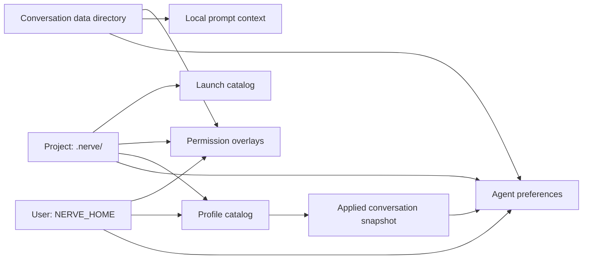
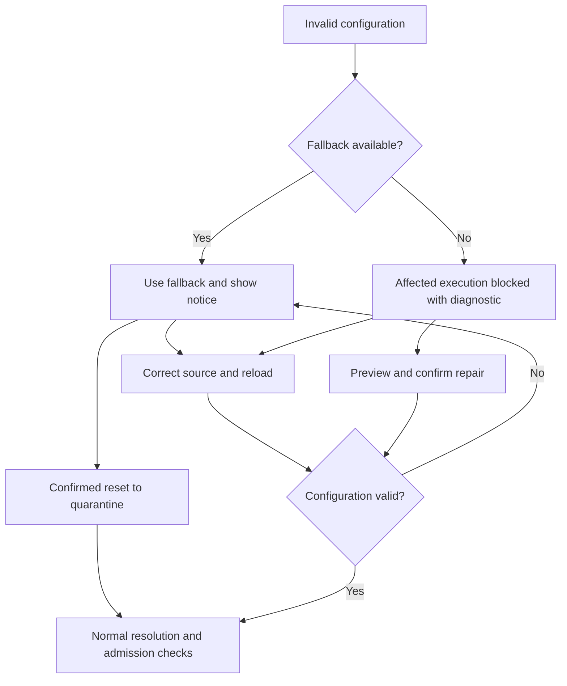

# Scoped configuration

Nerve stores configuration at three scopes: user files under `NERVE_HOME`, project files under `.nerve/`, and conversation files under the conversation's data directory. These let maintainers distinguish personal defaults, shared project policy and choices for one conversation. Each domain owns how those scopes combine; host services load and save the files, while conversation core consumes validated settings for execution.

## Scope ownership

The scopes provide storage locations; domain-specific resolution gives those files meaning:

| Domain                            | Where it is stored                                                              | How scopes combine                                                                                         | Owner                                                                                                                            |
| --------------------------------- | ------------------------------------------------------------------------------- | ---------------------------------------------------------------------------------------------------------- | -------------------------------------------------------------------------------------------------------------------------------- |
| Agent preferences                 | Scoped `config/agent.json`                                                      | Fields inherit according to declared merge units; profile contributions participate in resolution          | [`resolveAgentConfiguration`](../../packages/contracts/src/domains/agent-configuration/resolver.ts)                              |
| Prompt context                    | Conversation `config/agent.json`                                                | Local instructions and base prompt belong to that conversation; profile instructions contribute separately | [`scopedTurnResources`](../../packages/workbench-server/src/core-host/scoped-turn-resources.ts)                                  |
| Profile definitions               | User `data/agent-profiles/` and project `.nerve/agent-profiles/`                | Same-name project definitions replace whole lower definitions; application saves a conversation snapshot   | [`AgentProfileCatalog`](../../packages/workbench-server/src/infrastructure/configuration/agent-configuration/profile-catalog.ts) |
| Permission rule sets and overlays | Built-in policy, user `config/rule-sets/`, and scoped `config/permissions.json` | Select one rule set, then compose applicable overlays; child policy differs                                | [`createPermissionConfigurationService`](../../packages/workbench-server/src/core-host/permission-configuration.ts)              |
| Launch definitions                | Project `.nerve/launches/definitions.json`                                      | One project catalog, with no user/conversation inheritance                                                 | [`LaunchDefinitionRepository`](../../packages/workbench-server/src/domains/launch-definitions/launch-definition.repository.ts)   |

Creation preferences choose a starting profile independently of execution settings, so opening a new conversation need not change an existing one. [Agent profiles and delegation](conversation-core/delegation.md) explains precedence, applied snapshots and frozen child preferences. [Permissions](permissions.md) explains overlays and authorization; [launch definitions](launch-definitions.md) explains catalog concurrency.

JSON owns agent preferences and prompt context. SQLite owns conversation identity, relationships, history, lifecycle and working directory. Credentials stay with provider and secret owners so configuration snapshots do not capture secret values. See [storage](storage.md) for the wider layout.

## Persistence and activation

Saves validate a candidate, check its **revision** (document version) and **digest** (hash of source bytes), then atomically replace one document and publish a validated in-memory generation. These checks reject stale edits so one settings view cannot silently overwrite another. If persistence fails, readers retain the previous generation; if publication fails after the write commits, the document becomes unavailable until reload so execution cannot use stale memory.

Atomic replacement applies to one file, and serialization coordinates writers within one storage instance. Writes to different files can interleave, and an external writer can race between the digest check and replacement; callers must not treat a multi-file edit as one transaction or rely on this store for cross-process coordination.

A missing optional preference file means inheritance. A missing required conversation document blocks resolution because substituting defaults would discard that conversation's captured choices.

| Change                                                | Takes effect at                                                          | Why                                                                                                                           |
| ----------------------------------------------------- | ------------------------------------------------------------------------ | ----------------------------------------------------------------------------------------------------------------------------- |
| Model, prompt, tools and other request preferences    | Next request preparation, including retries and post-compaction requests | A prepared provider request keeps a consistent configuration while later requests can use new settings                        |
| Profile switch or reapplication                       | Next preparation after the conversation document commits                 | Choices and profile contribution must become visible together                                                                 |
| New-child launch choices and profile availability     | Child admission                                                          | Launch revalidation prevents stale advertised choices from starting a child; existing children retain their captured baseline |
| Authorization                                         | Each tool execution admission, including after approval waits            | Approval must not defeat a later policy denial                                                                                |
| External edits to agent documents or profile catalogs | Explicit reload or restart                                               | Loaded authority is cached without filesystem watchers or polling                                                             |

Restart re-captures not-yet-started tool calls, so a changed execution target requires fresh approval. Configuration changes leave already-running tools and in-flight provider requests unchanged because their execution has already begun.

## Project configuration versions

Home migrations never touch project files, so each project file type carries its own version and upgrades lazily when a feature loads it. A file is classified against its type's current schema:

| File state                                     | Result                                                                                                                        |
| ---------------------------------------------- | ----------------------------------------------------------------------------------------------------------------------------- |
| Current version, valid                         | Used.                                                                                                                         |
| Older version                                  | Converted by that type's version chain, validated, and written back over the same file; the original goes to home quarantine. |
| Current version but invalid, or failed upgrade | **Corrupted**: the file is left unchanged and the resource uses its safe fallback.                                            |
| Newer version than this installation           | **Incompatible**: read-only, never reset, because it probably belongs to a newer Nerve sharing the project.                   |

Upgrades happen at load time rather than at startup because projects may be unregistered, unreachable or restored independently of the home. Each chain reads and writes one file; types never merge several files or import old filenames. Older project files under names the current version no longer reads produce one notice listing them, with a confirmed action that moves them to quarantine. Their settings are not carried over.

Feature loaders contain no format conversion; they accept only the current schema and delegate everything else to the migration service. Feature writes are refused while a file is corrupted or incompatible, so a fallback can never overwrite the original. Only a confirmed reset replaces a corrupted file, and reset revokes rather than grants trust. An upgrade keeps an existing approval only when the exact original bytes were approved, because the output is a deterministic conversion of approved input.

Fallbacks follow each resource's meaning: an invalid launch catalog shows no launches, an invalid override lets lower-precedence settings apply, a bad profile or suggestion hides only that entry, and an invalid permission overlay blocks tool execution in that project while plain model replies continue. Each type declares its fallback, reset effect and user-facing wording in its descriptor.

## Health and recovery

Invalid configuration degrades only what depends on it and raises a diagnostic. Project files report health through a header activity item, a toast when the set of failing files changes and, where a feature shows the resource, an inline notice. The actions are open the file, reload after a manual fix, and a confirmed reset that preserves the original in quarantine. Home settings use the equivalent [settings-health](storage.md#settings-health) path.

Required configuration, such as a conversation's own document, has no fallback. Its failure blocks only the affected execution; the user can reload corrected files or review and confirm a repair that backs up the damaged bytes.

Retry re-reads authority and repeats authorization because repairing configuration does not itself grant permission. Dismissing a diagnostic leaves the underlying problem unchanged. The system has no persisted last-known-good execution authority, so a stale backup cannot silently authorize work. Validation happens at load time; there are no filesystem watchers, so external edits are noticed on reload, on restart or when the feature next loads the file.

The summary cache lets conversation-list rows show fields such as model and profile without opening every conversation document. Reading a summary never loads that conversation; missing or invalid cache entries display unknown fields so a disposable projection cannot block execution or trigger a startup scan. See [conversation state and attention](conversation-state-and-attention.md) for consumer ownership.

## Where it lives

| Concern                          | Owner                                                                                                                                                                                                                                                                                                                                                                                                    |
| -------------------------------- | -------------------------------------------------------------------------------------------------------------------------------------------------------------------------------------------------------------------------------------------------------------------------------------------------------------------------------------------------------------------------------------------------------- |
| Scope roots and agent paths      | [`ConfigurationScopePaths`](../../packages/workbench-server/src/infrastructure/configuration/scope-paths.ts) and [`AgentConfigurationPaths`](../../packages/workbench-server/src/infrastructure/configuration/agent-configuration/document-adapters.ts)                                                                                                                                                  |
| Atomic saves and publication     | [`ScopedDocumentStore`](../../packages/workbench-server/src/infrastructure/configuration/scoped-store/scoped-document-store.ts) and [store tests](../../packages/workbench-server/src/infrastructure/configuration/scoped-store/scoped-document-store.test.ts)                                                                                                                                           |
| Loaded generations and summaries | [`AgentConfigurationService`](../../packages/workbench-server/src/infrastructure/configuration/agent-configuration/agent-configuration-service.ts), especially `getSummary`                                                                                                                                                                                                                              |
| Request capture                  | [`createScopedAgentConfiguration`](../../packages/workbench-server/src/core-host/scoped-agent-configuration.ts) and [request freshness tests](../../packages/conversation-core/src/runtime/request-freshness.test.ts)                                                                                                                                                                                    |
| Execution admission and restart  | [`ToolCallService`](../../packages/conversation-core/src/tool-calls/tool-call.service.ts) and [admission tests](../../packages/conversation-core/src/tool-calls/execution-admission.test.ts)                                                                                                                                                                                                             |
| Project file versions and health | [`ProjectMigrationService`](../../packages/workbench-server/src/infrastructure/configuration/project-migration/project-migration.ts), [type registry](../../packages/workbench-server/src/infrastructure/configuration/project-migration/descriptors.ts) and [agent configuration chains](../../packages/workbench-server/src/infrastructure/configuration/agent-configuration/project-chains/README.md) |
| Project health notices           | [`ProjectConfigurationHealthWatcher`](../../packages/workbench-app/src/lib/app/shell/ProjectConfigurationHealthWatcher.svelte)                                                                                                                                                                                                                                                                           |
| Reload and confirmed repair      | [`createConfigurationReload`](../../packages/workbench-server/src/core-host/configuration-reload.ts) and [`createScopedRepair`](../../packages/workbench-server/src/infrastructure/configuration/agent-configuration/scoped-repair.ts)                                                                                                                                                                   |
