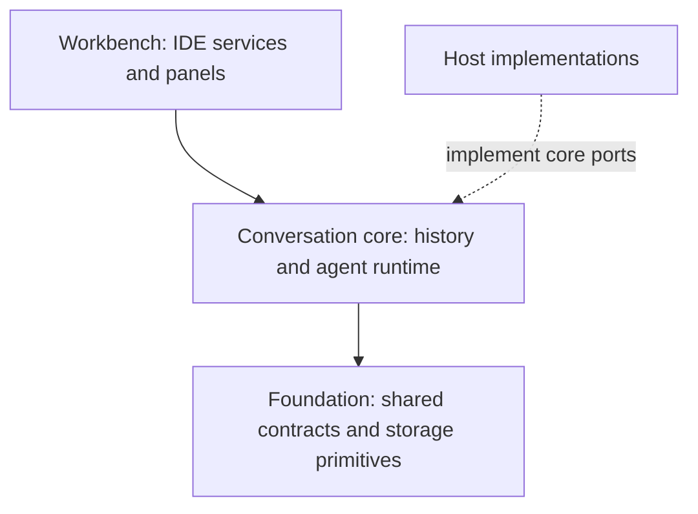

# Conversation core

Conversation core is the engine that stores conversation history and runs agents through model turns and tool calls. The application supplies its environment, while clients submit work and observe progress through the conversation channel.

## Goal

Make the conversation the portable core of Nerve: persistent identity, branchable history and an agent runtime behind its own client channel. Workbench features depend on the core, never the reverse. Host ports are interfaces through which the application supplies model access, tools and processes, so the core can run without IDE services.

## Principles

- **The conversation is the agent.** A child is a conversation created by a parent to delegate work, so it uses the same storage and runtime.
- **History is append-only and branchable; configuration is current-only.** Settings remain current so selecting older context cannot silently restore obsolete authorization.
- **Tables hold current state and unfinished work; events hold facts.** Tool settlement and input delivery replace pending rows with durable events transactionally so restarts see a consistent boundary.
- **Live progress is disposable.** Clients recover through durable events and current snapshots, so transient progress needs no persistent copy.
- **External effects are not exactly-once.** Recovery records uncertainty because repeating an unsafe tool could duplicate its effects.

## Architectural choices

SQLite owns history, relationships and pending work; scoped files own configuration; managed files own large results ([data model](data-model.md)). Canonical events describe application meaning, not a provider's wire format, and context is projected from the selected branch ([events and context](events-and-context.md)). Caller identities prevent duplicate durable submissions, not duplicate external effects. Separate [channels](channels.md) isolate conversation streaming from workbench traffic.

## Life of a prompt

A prompt is accepted into the [input queue](input-queue.md) and delivered at a safe boundary, which appends it to history. Each model turn then projects [context](events-and-context.md), appends the assistant event and supervises its [tool calls](tool-call-lifecycle.md) until all settle. When no further turn is needed, the execution ends and [status](../conversation-state-and-attention.md) is published through the [channel](channels.md).

## Glossary

| Term                 | Meaning                                                                            |
| -------------------- | ---------------------------------------------------------------------------------- |
| Conversation         | Persistent owner of history, queued inputs and unfinished calls.                   |
| Lead                 | User-facing conversation that can delegate work to children.                       |
| Turn                 | One model invocation and processing of its tool calls.                             |
| Execution            | A span of turns identified by an execution-start event.                            |
| Event                | Append-only fact; not necessarily model context.                                   |
| Head (selected head) | Event ending the active branch; its predecessor path supplies history for context. |
| Compaction           | Appended summary and retained-history boundary used to shorten model context.      |
| Notice               | Typed input from an internal producer, delivered as a system event.                |
| Port                 | Interface through which the host supplies an environmental capability to core.     |

## Documents

| Document                                              | Covers                                                   |
| ----------------------------------------------------- | -------------------------------------------------------- |
| [Data model](data-model.md)                           | Storage boundaries, relationships and deletion.          |
| [Events and context](events-and-context.md)           | Canonical history, projection, branching and compaction. |
| [Tool-call lifecycle](tool-call-lifecycle.md)         | Checkpoints, admission, settlement and recovery.         |
| [Input queue](input-queue.md)                         | Ordering and retry identity.                             |
| [Agent profiles and delegation](delegation.md)        | Child conversations, profiles and completion notices.    |
| [Async bash and launches](async-bash-and-launches.md) | Conversation-owned processes versus workbench launches.  |
| [Channels](channels.md)                               | Connection boundaries, replay and reconnect.             |

[Conversation state and attention](../conversation-state-and-attention.md) owns composer, draft, status and notification behavior. [Storage migrations](../migrations.md) owns upgrades.

## Where it lives

| Concern             | Owner                                                                        |
| ------------------- | ---------------------------------------------------------------------------- |
| Runtime composition | [`ConversationCoreOptions`](../../../packages/conversation-core/src/core.ts) |
| Host interfaces     | [Core ports](../../../packages/conversation-core/src/ports.ts)               |
