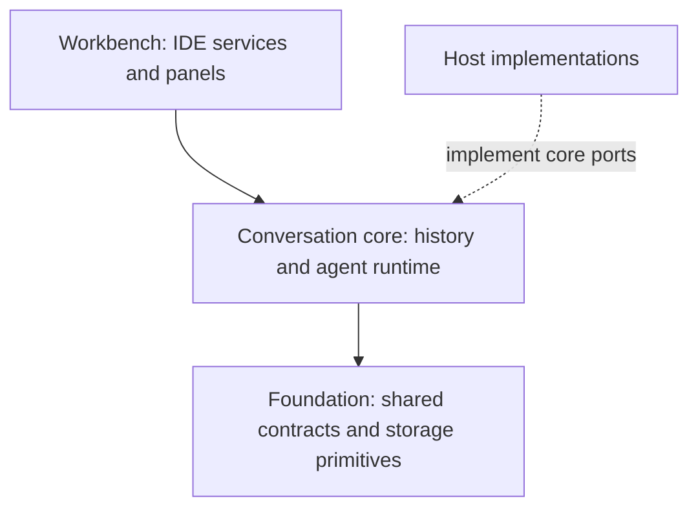
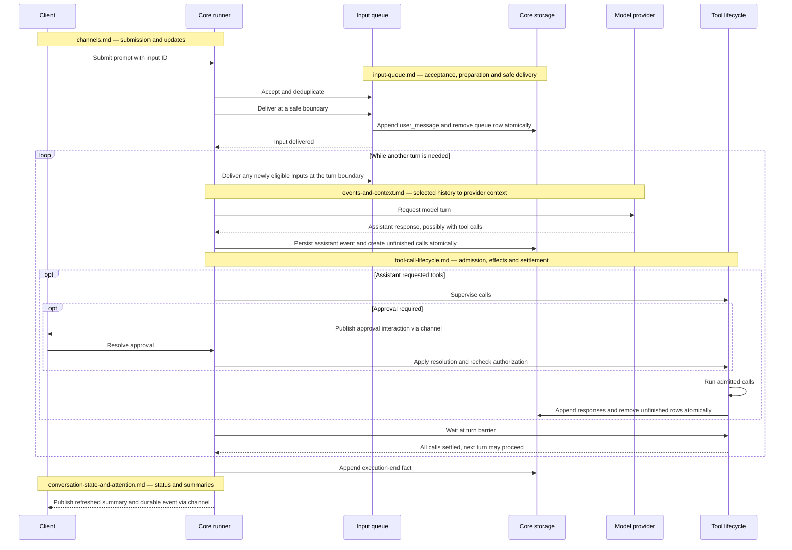

# Conversation core

Conversation core is the engine that stores conversation history and runs agents through model turns and tool calls. The application supplies its environment, while clients submit work and observe progress through the conversation channel.

## Goal

Make the conversation the portable core of Nerve: persistent identity, branchable history and an agent runtime behind its own client channel. Workbench features depend on the core, never the reverse. Host ports are interfaces through which the application supplies model access, tools and processes, so the core can run without IDE services.

## Principles

- **The conversation is the agent.** A child is a conversation created by a parent to delegate work, so it uses the same storage and runtime.
- **History is append-only and branchable; configuration is current-only.** Settings remain current so selecting older context cannot silently restore obsolete authorization.
- **Tables hold current state and unfinished work; events hold facts.** Tool settlement and input delivery replace pending rows with durable events transactionally so restarts see a consistent boundary.
- **Live progress is disposable.** Clients recover through durable events and current snapshots, so transient progress needs no persistent copy.
- **External effects are not exactly-once.** Recovery records uncertainty because repeating an unsafe tool could duplicate its effects.

## Architectural choices

A small relational core owns history, relationships and pending work. Scoped files own configuration and permissions; managed files own large results. This keeps history independent of mutable preferences and avoids duplicating large content in SQLite. See [data model](data-model.md), [configuration](../configuration.md) and [permissions](../permissions.md).

Canonical events describe application meaning, not a provider's wire format. Context is projected from the selected branch, so changing providers does not rewrite history. See [events and context](events-and-context.md).

The [input queue](input-queue.md) serializes delivery at safe boundaries; the [tool-call lifecycle](tool-call-lifecycle.md) checkpoints work across waits and restarts. Neither requires a separate receipt or execution table. Caller identities prevent duplicate durable submissions, not duplicate external effects.

Separate [channels](channels.md) isolate conversation streaming from workbench traffic. Durable history replays from SQLite; current state is recovered through snapshots.

## Life of a prompt

A normal prompt travels from accepted input to durable history, then through model turns until the execution finishes. The diagram shows the successful path with tool calls; approvals are optional, and each new turn first checks for more eligible input.

[Conversation state and attention](../conversation-state-and-attention.md) explains how execution facts become client-visible status; the document map below covers the other handoffs.

## Glossary

| Term                 | Meaning                                                                               |
| -------------------- | ------------------------------------------------------------------------------------- |
| Conversation         | Persistent owner of history, queued inputs and unfinished calls.                      |
| Lead                 | User-facing conversation that can delegate work to children.                          |
| Sub-agent            | Child conversation configured through a profile; see [delegation](delegation.md).     |
| Profile              | Reusable agent definition applied to a conversation; see [delegation](delegation.md). |
| Turn                 | One model invocation and processing of its tool calls.                                |
| Execution            | A span of turns identified by an execution-start event.                               |
| Event                | Append-only fact; not necessarily model context.                                      |
| Head (selected head) | Event ending the active branch; its predecessor path supplies history for context.    |
| Compaction           | Appended summary and retained-history boundary used to shorten model context.         |
| Notice               | Typed input from an internal producer, delivered as a system event.                   |
| Async bash           | Conversation-owned background command tracked beyond foreground tool completion.      |
| Port                 | Interface through which the host supplies an environmental capability to core.        |

## Documents

The data model defines storage ownership. Events explain how that history becomes model context; queue and tool-call documents explain how work enters and leaves it. Delegation and background work reuse those boundaries, while channels expose them to clients.

| Document                                              | Covers                                                   |
| ----------------------------------------------------- | -------------------------------------------------------- |
| [Data model](data-model.md)                           | Storage boundaries, relationships and deletion.          |
| [Events and context](events-and-context.md)           | Canonical history, projection, branching and compaction. |
| [Tool-call lifecycle](tool-call-lifecycle.md)         | Checkpoints, admission, settlement and recovery.         |
| [Input queue](input-queue.md)                         | Ordering, command preparation and retry identity.        |
| [Delegation](delegation.md)                           | Child conversations, profiles and completion notices.    |
| [Async bash and launches](async-bash-and-launches.md) | Conversation-owned processes versus workbench launches.  |
| [Channels](channels.md)                               | Connection boundaries, replay and reconnect.             |

[Conversation state and attention](../conversation-state-and-attention.md) owns composer, draft, status and notification behavior. [Storage migrations](../migrations.md) owns upgrades.

## Where it lives

| Concern             | Owner                                                                        |
| ------------------- | ---------------------------------------------------------------------------- |
| Runtime composition | [`ConversationCoreOptions`](../../../packages/conversation-core/src/core.ts) |
| Host interfaces     | [Core ports](../../../packages/conversation-core/src/ports.ts)               |
