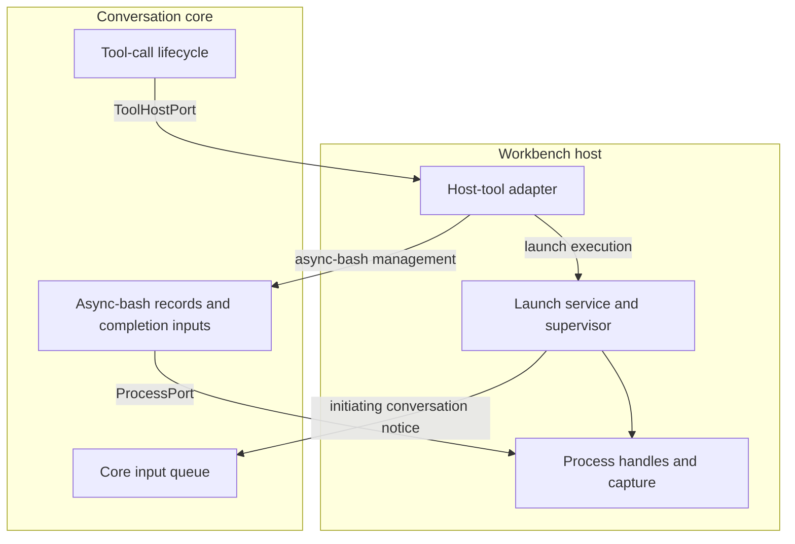
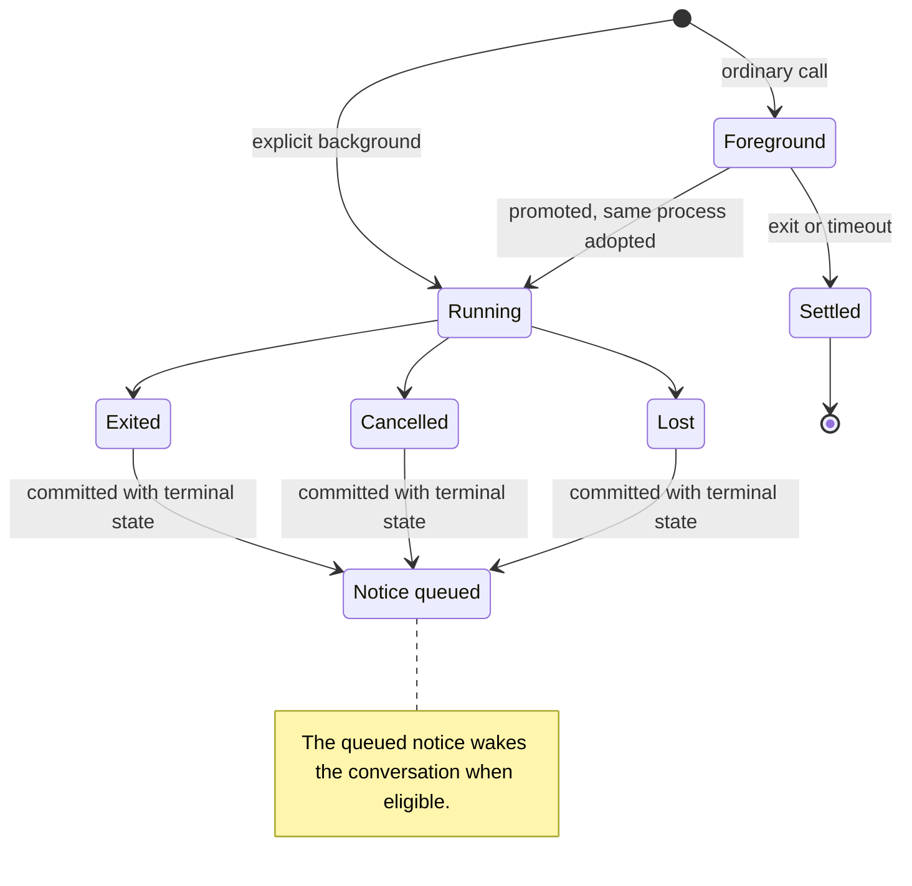

# Async bash and launches

Async bash lets an agent continue working while a shell command runs in the background. Launches let users and agents execute saved project commands, such as a development server. Conversation core tracks conversation-owned background work, while the workbench host owns operating-system process handles and project launch execution.

## Two owners of process work

An **async-bash record** tracks background command work for a conversation. A **launch definition** is saved project configuration; a **launch run** is one execution of it. Both paths supervise processes, but their lifetimes and persistence belong to different domains so a project's servers do not become conversation-owned work.

| Concern          | Async bash                                 | Launch                                                     |
| ---------------- | ------------------------------------------ | ---------------------------------------------------------- |
| Lifecycle owner  | Conversation core                          | Workbench launch domain                                    |
| Durable state    | Async-bash records and conversation assets | Project definitions and log files                          |
| In-memory state  | Host process handles and core watchers     | Run records and initiating-conversation ownership          |
| Agent completion | Queued conversation input                  | Host queues a notice while it retains initiating ownership |

Core uses ports—interfaces supplied by its host—to request process work without importing workbench launch services. The host handles environment preparation, capture and process-tree cancellation because those depend on operating-system capabilities.

The [launch catalog](../launch-definitions.md) covers saved definitions and organization.

| Concern               | Owner                                                                                                    |
| --------------------- | -------------------------------------------------------------------------------------------------------- |
| Core/host interfaces  | `ProcessPort` and `ToolHostPort` in [`ports.ts`](../../../packages/conversation-core/src/ports.ts)       |
| Host-tool composition | [`createToolHostPort`](../../../packages/workbench-server/src/core-host/tool-host.adapter.ts)            |
| Launch execution      | [`LaunchService`](../../../packages/workbench-server/src/domains/launches/application/launch.service.ts) |

## Async-bash lifecycle

A shell command may finish in the foreground, start explicitly in the background, or be **promoted**: the foreground call returns while the same process continues as tracked background work. Promotion adopts the existing process and open output files so subsequent reads do not rely on a stale copy. When promotion is disabled, foreground execution instead uses an explicit timeout.

Terminal state and its queued completion notice commit in one storage transaction, so a recorded completion cannot lose its notice between separate commits. The queue can wake the conversation when eligible; the agent does not need to poll. Pause and delivery behavior are covered in [input queue](input-queue.md).

Conversation stop/delete and host shutdown participate in cancellation. A foreground return caused by promotion leaves the background command running because that return transfers tracking rather than ending execution. Readiness checks observe the background command; failure to become ready does not itself terminate it.

Descriptions, arguments and settings stay in the tool definitions so agent-facing guidance remains authoritative in one place.

| Concern                                         | Owner                                                                                                               |
| ----------------------------------------------- | ------------------------------------------------------------------------------------------------------------------- |
| Settings-derived shell contract                 | [`buildBashToolDefinition`](../../../packages/tools/src/catalog/definitions/core/shell.tools.ts)                    |
| Shell execution mechanics                       | [`bash.ts`](../../../packages/tools/src/execution/shell/bash.ts)                                                    |
| Adoption, watching and transactional settlement | [`AsyncBashService`](../../../packages/conversation-core/src/async-bash/async-bash.service.ts), especially `finish` |
| Management adapter                              | [`createAsyncBashTools`](../../../packages/conversation-core/src/async-bash/async-bash-tools.ts)                    |
| Process tool schemas and action risk            | [`processToolDefinitions`](../../../packages/tools/src/catalog/definitions/orchestration/process.tools.ts)          |

## Launch execution capability

The launch tool resolves definitions and executions within the conversation's project. Saved definitions use project-local name selection, while an optional run selector chooses one execution. Duplicate names fail visibly because arbitrary catalog ordering cannot establish the agent's intended command.

User catalog management and agent process control are separate capabilities. Agents can operate existing launches through the tool, but cannot edit the catalog through it, preserving the user's ownership of reusable configuration. Execution permissions still apply independently of folder organization.

A restart uses the current saved definition; an existing run retains the command it actually executed. This distinction lets status and logs explain a historical run even after the user edits its configuration.

The host remembers which conversation initiated an agent launch and can notify it on spontaneous exit. This association is memory-only, so it provides notification during host lifetime rather than a durable subscription across restart. Explicit stops are handled separately from spontaneous exits.

Selection, execution preparation and notification ownership live in [`LaunchTool`](../../../packages/workbench-server/src/core-host/launch-tool.ts). Run policy, restart and cancellation live in the launch service linked above.

## Shared output projection

Process output uses the common tool-result projection machinery so foreground results and background notices share diagnostic and recovery policy. Small output can remain inline; larger output is reduced around useful evidence and references to fuller files. Log pages provide bounded inspection and continuation.

For example, a long build log can produce a compact failure summary that points to retained output, allowing the agent to investigate with file tools instead of receiving the whole log on completion. Capture limits, pagination and budgets remain implementation policy rather than duplicated architectural constants.

Async-bash output assets belong to the conversation. Launch logs belong to the execution domain independently of catalog placement, so reorganizing definitions cannot relocate or reinterpret a run's output.

| Concern                                  | Owner                                                                                                                                           |
| ---------------------------------------- | ----------------------------------------------------------------------------------------------------------------------------------------------- |
| Output and log-page projection           | `projectProcessOutput` and `projectProcessOutputPage` in [`process-output.ts`](../../../packages/tools/src/result-projection/process-output.ts) |
| Launch log storage                       | [`LaunchRepository`](../../../packages/workbench-server/src/domains/launches/persistence/launch.repository.ts)                                  |
| Complete payload and consumer boundaries | [Tool-result projection](../tool-result-projection.md)                                                                                          |

## Recovery without process resurrection

Durable async-bash metadata records what was running, but controlling it still requires verifiable process ownership. Recovery asks the host to reattach; if ownership cannot be established, core settles the record as lost and queues the corresponding notice. This avoids adopting an unrelated process based on stale metadata.

The current host can find handles retained in its own instance but cannot reconstruct native handles after restart. Thus the core recovery hook does not promise cross-restart process recovery. Launch run records and initiating-conversation ownership are likewise memory-only, although definitions and logs persist.

Saved configuration and surviving output are evidence of past work, not proof of a controllable live process. Commands are not automatically replayed after process loss because replay could duplicate external side effects.

Recovery policy lives in `AsyncBashService.recover`; host reattachment is implemented by [`CoreProcessHost`](../../../packages/workbench-server/src/core-host/process.adapter.ts).
