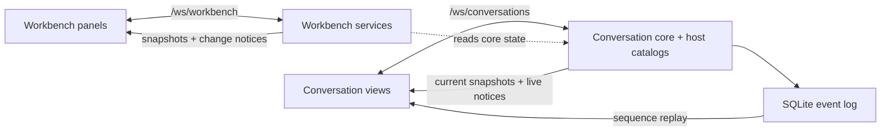

# Channels

The client uses separate connections for conversation activity and workbench panels. Conversation history can replay after a disconnect, while current panel state is recovered from snapshots. This split keeps workbench traffic out of conversation streaming buffers and lets the core operate independently of IDE services.

Part of [conversation core](README.md).

## Connection boundary

Each channel has its own Protocol v1 session, buffering and reconnect lifecycle, so workbench load cannot consume the conversation connection's streaming buffer. Workbench services may read core state; core uses host interfaces rather than depending on workbench services.

Conversation operations include core access and host catalogs. Workbench operations serve IDE resources and panels. Prompt suggestions belong to workbench because their evaluation can depend on git state. The owning contracts define these catalogs; duplicating operation or event names here would obscure the boundary as capabilities evolve.

## Durable replay versus current state

The conversation channel separates three recovery models:

| State                          | Recovery                                                             |
| ------------------------------ | -------------------------------------------------------------------- |
| Durable events                 | Replay from the last processed conversation event sequence.          |
| Lists and conversation details | Re-fetch current snapshots.                                          |
| Live progress                  | Discard on reconnect; later snapshots and durable events replace it. |

A snapshot includes a history high-water mark, the newest event sequence at the time of reading. A client can subscribe from that point to cover events arriving after the snapshot. Stream activation also covers appends during subscription setup, closing the handoff gap.

Replay reads the core event log directly, including every branch; the selected head controls transcript projection instead. Keeping replay independent of branch selection ensures clients observe all durable changes without a second notification store.

Tool responses transfer their user projection, and details are fetched on demand, so complete results need not travel with every replay. See [tool-result projection](../tool-result-projection.md).

Project-scoped notices invalidate lists; subscription-scoped notices update retained conversation details. Both are disposable because reconnect re-fetches current state. Unavailable conversation subscriptions are handled independently so one deleted conversation does not invalidate every stream on a connection.

## Workbench and client ownership

Workbench panels recover from snapshots and scoped resource-change notices. Reconnect also restores monitor demand so services resume producing the panel updates clients need.

Conversation summaries serve navigation, while retained detail stores own streaming state and child subscriptions. This separation keeps token updates local to open conversations. Composer, status and notification ownership is described in [conversation state and attention](../conversation-state-and-attention.md).

## Where it lives

| Concern                                    | Owner                                                                                                                                  |
| ------------------------------------------ | -------------------------------------------------------------------------------------------------------------------------------------- |
| Conversation operation and event catalogs  | [`conversationChannelOperations`, `conversationChannelEventSchemas`](../../../packages/contracts/src/domains/core/channel.ts)          |
| Server binding, scoping and replay handoff | [`createConversationProtocolSession`](../../../packages/workbench-server/src/adapters/protocol/conversation-channel.ts)                |
| Workbench ownership predicates             | [`isWorkbenchOperation`, `isWorkbenchEvent`](../../../packages/contracts/src/events/workbench-events.ts)                               |
| Public event transfer                      | [`transferConversationEvent`](../../../packages/contracts/src/domains/core/event.ts)                                                   |
| Workbench snapshot recovery                | [`recoverWorkbenchPanels`](../../../packages/workbench-app/src/lib/application/events/workbench-event-bus.ts)                          |
| Navigation summaries                       | [`ConversationListStore`](../../../packages/workbench-app/src/lib/features/conversations/state/core-conversation-list-store.svelte.ts) |
| Shared detail subscriptions                | [`retainConversationStore`](../../../packages/workbench-app/src/lib/features/conversations/state/open-conversation-stores.ts)          |
