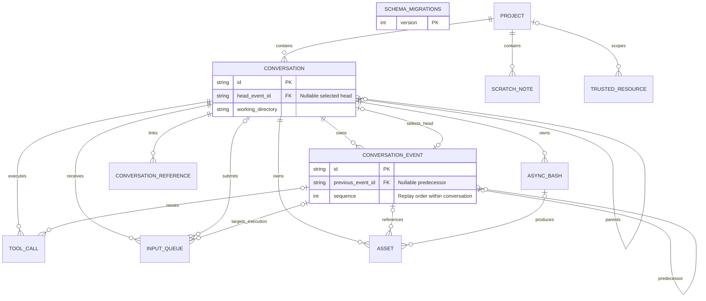

# Data model

A conversation owns its history and pending work, while its project groups conversations and shared resources. The storage model separates relational records, configuration files and large result files so each has a clear lifecycle. This page explains those ownership boundaries and how deletion follows them.

Part of [conversation core](README.md).

## Storage boundaries

SQLite owns relational identity, branchable facts and unfinished work. Scoped JSON owns agent configuration and permission files; managed files hold large outputs and images. Live progress and launch instances remain in memory. Each authority has its own lifecycle, keeping mutable settings and large payloads out of the event log; see [storage](../storage.md) and [configuration](../configuration.md).

Working directory belongs to the conversation, while agent settings live in files, so history selection and configuration changes remain independent. The schema and migration runner define the physical constraints; contracts validate application shapes.

## Relationships

This diagram emphasizes identity and ownership. Non-key fields, constraints and indexes remain authoritative in the schema. `parent_tool_call_id` and producer `tool_call_id` are logical associations, not foreign keys: settled calls leave no row.

Event predecessors, selected heads, tool-call assistant references and asset references are constrained to the owning conversation. Parent relationships stay within the project, keeping recursive ownership inside one project. Event sequence replay includes every branch independently of the selected head, so clients can observe durable changes even outside the active transcript.

## What the tables own

| Table                    | Purpose                                                                                                             |
| ------------------------ | ------------------------------------------------------------------------------------------------------------------- |
| `project`                | Groups conversations and project-scoped resources.                                                                  |
| `trusted_resource`       | Records approval of file content using a digest, a hash identifying those exact bytes.                              |
| `schema_migrations`      | Records applied core schema steps so database opening can verify them.                                              |
| `conversation`           | Owns identity, parent relationship, selected history head and current runtime controls.                             |
| `conversation_event`     | Stores durable facts, with predecessor links for branches and sequence order for replay.                            |
| `tool_call`              | Checkpoints unfinished tool work across execution and interaction waits.                                            |
| `input_queue`            | Holds accepted inputs until safe delivery.                                                                          |
| `async_bash`             | Tracks conversation-owned background commands beyond foreground tool completion.                                    |
| `asset`                  | Tracks managed files and their producers so results can be referenced and cleaned up.                               |
| `conversation_reference` | Links a conversation to external resources it referenced or created; see [discovery](../conversation-discovery.md). |
| `scratch_note`           | Stores project-owned workbench notes independently of agent history.                                                |

## Durability and identity

A storage transaction is the atomic boundary for [tool settlement](tool-call-lifecycle.md) and [input delivery](input-queue.md). Pending rows become events without a window in which both durable representations disagree. Execution claims identify the worker allowed to settle a call, fencing late writes from stale workers. External effects remain outside SQLite, so a claim cannot prove whether an interrupted command ran.

Trust decisions identify approved content by digest, so changing a file requires renewed approval. Decisions also record scope, allowing user and project resources to have independent identities. The final schema defines profile trust as `agent_profile`.

Derived conversation status and presentation state are covered by [conversation state and attention](../conversation-state-and-attention.md).

## Deletion

Conversation deletion collects descendants, stops work, cancels async bash and queued preparation, removes managed conversation files, then deletes the conversation. Foreign keys cascade relational ownership. Deletion removes the conversation's configuration and permission overlay—a scoped file extending permission rules—along with its assets, so no conversation-owned files remain after removal.

Orphan cleanup removes unreferenced assets only when no pending tool or async-bash producer remains. This protects files produced before settlement attaches them to an event.

Project deletion deletes conversations before the project row; project-owned scratch notes and trust decisions cascade. The project's working files are not deleted.

## Where it lives

| Concern                          | Owner                                                                                                                                                       |
| -------------------------------- | ----------------------------------------------------------------------------------------------------------------------------------------------------------- |
| Physical schema                  | [`coreSchemaV1`](../../../packages/conversation-core/src/storage/schema.ts), [`coreSchemaV2`](../../../packages/conversation-core/src/storage/schema-v2.ts) |
| Schema verification and upgrades | [`migrate`](../../../packages/conversation-core/src/storage/migrations.ts)                                                                                  |
| Event reads and writes           | [`ConversationEventRepository`](../../../packages/conversation-core/src/storage/conversation-event.repository.ts)                                           |
| Trust decisions                  | [`TrustedResourceRepository`](../../../packages/conversation-core/src/storage/trusted-resource.repository.ts)                                               |
| Application shapes               | [Core contracts](../../../packages/contracts/src/domains/core/)                                                                                             |
| Atomic updates                   | [`CoreStorage.transaction`](../../../packages/conversation-core/src/storage/core-storage.ts)                                                                |
| Conversation deletion            | [`ConversationService.delete`](../../../packages/conversation-core/src/conversations/conversation.service.ts)                                               |
| File cleanup                     | [`AssetStore.cleanupOrphans`](../../../packages/conversation-core/src/assets/asset-store.ts)                                                                |
| Project deletion                 | [`ProjectService.delete`](../../../packages/conversation-core/src/conversations/project.service.ts)                                                         |
