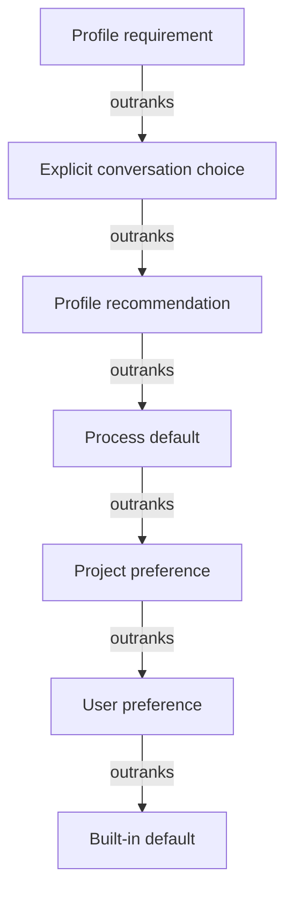
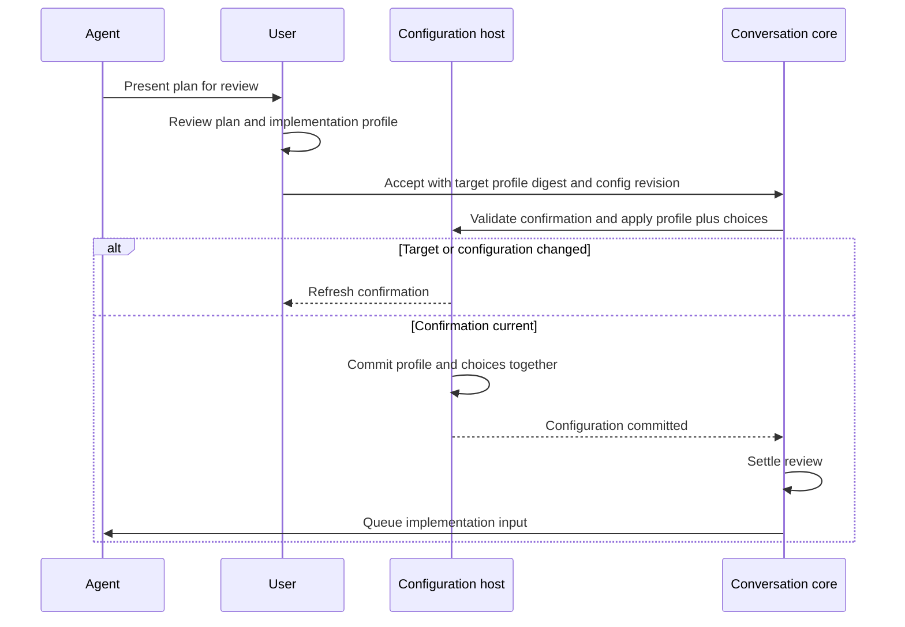
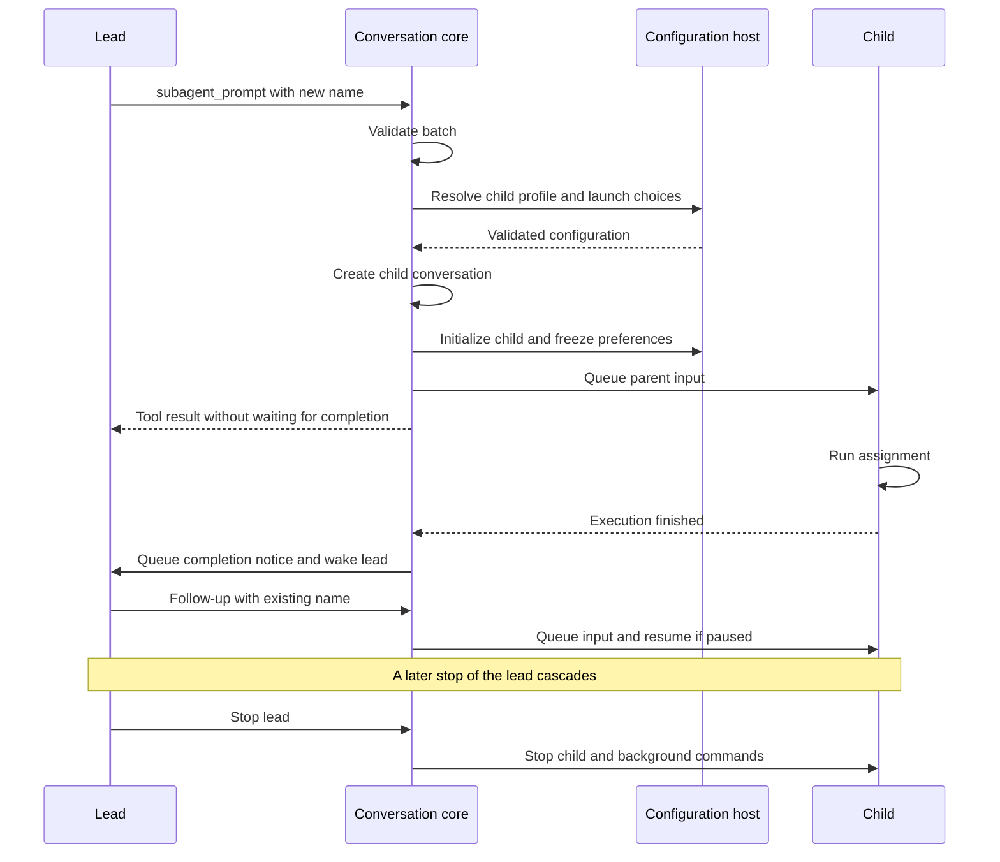

# Agent profiles and delegation

A **profile** is a named, reusable agent definition containing instructions and recommended or required preferences. Nerve supplies built-in profiles such as Coding and Planning; users and projects can define their own. A **lead** is the user-facing conversation, and a **child** (or sub-agent) is a conversation the lead creates through `subagent_prompt` to carry out delegated work. The host resolves configuration and trust, while conversation core runs both kinds of conversation and owns their history.

## Catalog and applied snapshots

User definitions live in `<NERVE_HOME>/data/agent-profiles/<name>.json`; project definitions live in `<project>/.nerve/agent-profiles/<name>.json`. See [storage](../storage.md) for the home layout and [configuration](../configuration.md) for scope ownership.

A same-name project definition replaces the whole user or built-in definition, so one profile has one coherent source. An invalid, disabled or untrusted replacement stays unavailable rather than exposing a lower definition with potentially different behavior. Unrelated malformed profiles remain isolated so one broken entry does not disable the catalog.

An **applied snapshot** is the copy of a profile's identity and contributions saved in a conversation's `config/agent.json`. Its **digest** is a content hash identifying the source bytes. The snapshot keeps catalog edits or deletion from silently changing an existing conversation. Switching or explicitly reapplying captures a fresh snapshot after checking validity, enablement, trust and suitability for the lead or child role. Project trust also binds exact bytes, so editing a definition requires renewed trust; referenced skills retain their own trust checks.

## Preference contributions

For each setting, the highest applicable contribution wins:

A profile may leave a setting alone, recommend a value or require it. Requirements control the effective value while preserving the underlying choice, so switching away restores that choice. Reset removes a local override so inheritance can resume.

For example, a conversation can retain Supervised as its own permission choice while Planning requires planning policy. Returning to Coding reveals Supervised again; Coding does not itself grant write permission. Authorization still checks current policy because a profile preference is not permission to execute a tool.

Conversation-local instructions and custom base prompts survive profile switches because they belong to the conversation rather than the reusable definition. Profile instructions also contribute with a custom base; see [prompt assembly](../system-prompt.md).

## Lead lifecycle

Creation preferences choose the initial lead profile, while later profile switches are user-controlled. Planning requires planning policy and plan presentation, so its behavior comes from the same profile mechanism as other agent configurations.

In the planning flow, the agent presents a plan for the user to review. Accepting it selects an implementation profile and queues implementation input. Confirmation binds to both the target profile's digest and the conversation document's **revision**, a version counter used to reject stale saves. If the target or configuration changes, the user must refresh confirmation so acceptance cannot silently authorize a different setup.

The implementation choices and profile snapshot commit together before core settles the review and queues the input. JSON configuration and conversation history have separate persistence boundaries, so an interrupted pending review requires explicit reconfirmation rather than inferring acceptance from the current profile.

## Child configuration

A new child resolves its own defaults and profile. The lead contributes supported launch choices, such as a model selection, but does not copy its effective configuration or prompt context. Launch choices beat recommendations while remaining subject to requirements, so delegation can choose an appropriate model without bypassing profile constraints.

At creation, the host saves the applied snapshot and **frozen preferences**: the child's complete underlying preferences after recommendations and launch choices, but before requirements. Follow-ups use that baseline plus captured requirements and supported direct child edits. This keeps later default or catalog edits from reconfiguring delegated work mid-task. Child profile switching and reapplication are unsupported because the captured configuration belongs to that assignment.

Credentials, resource availability and authorization remain live because execution must reflect current access and policy. Children have no parent-permission ceiling: their allowed policy is evaluated independently of the lead's.

### Rules enforced for every sub-agent

- Children cannot delegate again or use human-in-the-loop tools, so delegated work cannot create an unmanaged interaction tree. Tool preparation filters these operations, and execution independently rejects them.
- Children use only allowed rule sets without human approval prompts, so they can complete without a person answering on their behalf.
- Children receive no Baseline or overlay grants, so interactive lead grants cannot widen delegated execution. These policy terms are defined in [permissions](../permissions.md).
- Children reject direct user input, so the lead remains the source of assignments and follow-ups.

## Delegation lifecycle

Delegation is asynchronous: the tool returns after initialization and queuing, allowing the lead to continue while the child works. Core validates the whole batch and asks the host to resolve profiles before creating or prompting children. Later creation failures can still leave earlier assignments started, because preflight validation is not a transaction across child conversations.

Names identify children within a lead, case-insensitively. Reusing a name queues a follow-up to the existing child, preserving its context and configuration. Stopping a child preserves it for later follow-ups; stopping the lead cascades to descendants and background commands so delegated work does not continue behind a paused lead. Deleting the lead deletes its children.

## Completion notices

A finished child execution queues a notice that wakes an idle lead, avoiding polling. Background commands can outlive an execution; their completion wakes the child for another execution and report. Explicit tool stops and stops cascading from a paused lead suppress redundant cancellation notices because the stop is already accounted for.

### Report cap

Final responses have a bounded inline representation, with the full report saved in conversation-owned assets, so long child output does not overwhelm the lead's context. This is separate from [tool-result projection](../tool-result-projection.md), which can also project the delegation tool's own result.

## Where it lives

| Concern                                   | Owner                                                                                                                                                                                                                                                                                             |
| ----------------------------------------- | ------------------------------------------------------------------------------------------------------------------------------------------------------------------------------------------------------------------------------------------------------------------------------------------------- |
| Catalog shadowing and trust               | [`AgentProfileCatalog`](../../../packages/workbench-server/src/infrastructure/configuration/agent-configuration/profile-catalog.ts)                                                                                                                                                               |
| Preference precedence, reset and freezing | [`resolveAgentConfiguration`, `applySettingsMutation`, `freezeChildPreferences`](../../../packages/contracts/src/domains/agent-configuration/resolver.ts)                                                                                                                                         |
| Profile preview and application           | [`createProfileTransitions`](../../../packages/workbench-server/src/infrastructure/configuration/agent-configuration/profile-transitions.ts) and [transition tests](../../../packages/workbench-server/src/infrastructure/configuration/agent-configuration/profile-transitions.test.ts)          |
| Initial selection and child configuration | [`scopedConversationCreation`](../../../packages/workbench-server/src/core-host/scoped-conversation-creation.ts)                                                                                                                                                                                  |
| Built-in profile contributions            | [Built-in definitions](../../../packages/workbench-server/src/infrastructure/configuration/agent-configuration/builtins/)                                                                                                                                                                         |
| Plan acceptance and interrupted reviews   | [Plan-review lifecycle tests](../../../packages/conversation-core/src/runtime/plan-review-lifecycle.test.ts)                                                                                                                                                                                      |
| Delegation and host boundary              | [`createDelegationTools`](../../../packages/conversation-core/src/delegation/delegation-tools.ts), [`SubagentHost`](../../../packages/conversation-core/src/delegation/subagent-host.ts) and [lifecycle tests](../../../packages/conversation-core/src/delegation/delegation-tools.test.ts)       |
| Child tool and input restrictions         | [`scopedTurnResources`](../../../packages/workbench-server/src/core-host/scoped-turn-resources.ts), [`ToolCallService`](../../../packages/conversation-core/src/tool-calls/tool-call.service.ts) and [`InputQueueService`](../../../packages/conversation-core/src/inputs/input-queue.service.ts) |
| Child policy composition                  | [`composeEffectivePermissionPolicy`](../../../packages/tools/src/policy/permission-policy.ts)                                                                                                                                                                                                     |
| Limits and report storage                 | [Sub-agent constants](../../../packages/contracts/src/domains/subagents/constants.ts) and [`inlineReport`](../../../packages/conversation-core/src/delegation/child-report.ts)                                                                                                                    |

Conversation presentation and attention belong to [conversation state and attention](../conversation-state-and-attention.md).
