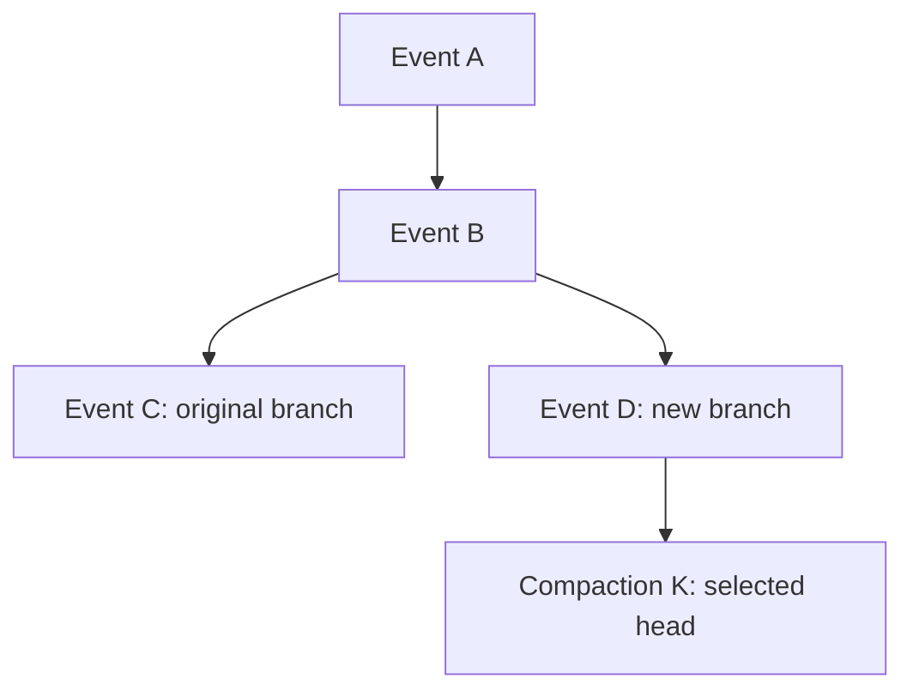
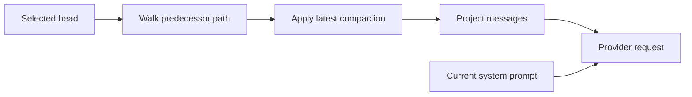

# Events and context

A conversation stores durable facts as events, then selects some of those facts as context for a model request. The selected history can branch, and compaction can summarize older context while preserving the original events. Separating stored meaning from provider formatting lets the same history work across model providers.

Part of [conversation core](README.md).

The event tree preserves both branches. Here the new branch ends at compaction `K`, the selected head:

Request preparation follows the selected branch and then projects it into provider context:

## Canonical facts, projected context

Events describe application meaning independently of provider message packaging. Tool requests are blocks in an assistant event; [unfinished calls](tool-call-lifecycle.md) checkpoint their execution, and settlement appends responses. Complete results live in managed files, with separate [agent and user projections](../tool-result-projection.md), so large outputs need not travel through every history read.

Each event type declares whether and how it can appear in model context. Branch selection and compaction decide actual inclusion. Operational facts remain available for lifecycle reconstruction even when they contribute no model context. Application-generated notices become ordinary context rather than provider-system instructions, preserving the authority boundary.

Execution transitions are written directly as durable lifecycle facts; notices arrive through the [input queue](input-queue.md). An execution is a span of model turns identified by its start event, so later transitions and targeted inputs need no separate execution table. Child completion arrives as a queued notice; [delegation](delegation.md) explains how a parent associates it with assigned work.

## Projection to provider requests

Projection converts the selected path into model messages. The harness converts application notices and summaries, and the provider adapter builds the wire request. The current system prompt is supplied separately, so provider switching rebuilds a request without rewriting history.

Tool results follow the originating assistant's blocks in content order, even when responses persisted in completion order. Missing or mismatched responses produce synthetic interrupted results so the provider receives valid assistant/result pairs. Direct user-command results included in context become user content because they have no model-issued tool request to answer. Image files are resolved during request preparation to keep binary content out of event payloads.

## Compaction

Compaction appends a summary and a retained-history boundary. Original events remain available for browsing and branching because summarization changes context selection rather than storage history.

For example, if `A → B → C → D` is compacted with `C` retained, the next request contains:

1. The current system prompt.
2. A summary of `A` and `B`.
3. Retained events `C` and `D`.
4. Events appended after compaction.

The latest compaction on the selected path controls this selection. Planning keeps assistant tool calls and their responses together, moving the cut backward when completion order crosses it, so a retained response never loses its request. Manual and automatic compaction derive their policies from effective settings rather than thresholds documented here.

## Branching

Each append links to the selected head, the event currently ending the active branch. Walking predecessor links defines the transcript; event sequence order defines replay across all branches. Selecting a head changes future context while leaving configuration and performed effects intact, because browsing old facts must not execute them again.

A branch can append a compaction to summarize context it leaves behind. Head selection requires a quiescent runner, no unfinished calls and no unfinished prompt-command preparation, so in-flight work cannot land on an unexpectedly changed branch. Parent and child histories branch independently; selecting a parent head does not rewind child effects.

## Where it lives

| Concern                                | Owner                                                                                                                  |
| -------------------------------------- | ---------------------------------------------------------------------------------------------------------------------- |
| Event shapes and valid representations | [`conversationEventSchema`](../../../packages/contracts/src/domains/core/event.ts)                                     |
| Context selection and projection       | [`selectContextEvents`, `projectModelMessages`](../../../packages/conversation-core/src/context/context-projection.ts) |
| Harness message conversion             | [`convertToLlm`](../../../packages/harness/src/messages/messages.ts)                                                   |
| Compaction planning and settings       | [`prepareCompaction`, `runCompaction`](../../../packages/conversation-core/src/context/compaction.ts)                  |
| Append order and branch reads          | [`ConversationEventRepository`](../../../packages/conversation-core/src/storage/conversation-event.repository.ts)      |
| Head-selection safety                  | [`ConversationService.selectHead`](../../../packages/conversation-core/src/conversations/conversation.service.ts)      |
| Execution transitions                  | [`StatusService`](../../../packages/conversation-core/src/runtime/status.ts)                                           |
