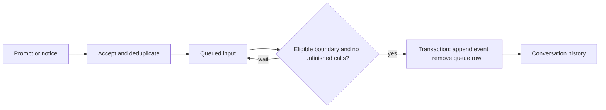

# Input queue

The input queue holds prompts and system notices until a conversation can safely deliver them to history. People, parent conversations and internal producers share the same ordering mechanism. An input can be reserved for a particular execution—a span of model turns—or for a later execution; this is execution targeting. Targeting lets inputs wait for the right boundary without interrupting unfinished tool work.

Part of [conversation core](README.md).

## Ordering and delivery

Acceptance order determines delivery order among eligible inputs, so source does not grant priority. Execution targeting selects eligible rows. Safe boundaries occur between model turns or at execution start, after unfinished calls have settled, so new inputs cannot bypass an unresolved approval or question.

Delivery appends prompt or notice events, advances the head, updates prompt activity and deletes queue rows in one transaction. This ensures a crash cannot leave a delivered event with an undelivered copy of the same input.

## Pause and waking

Acceptance and waking are separate decisions, so a producer can queue context without starting model work. A user submission clears pause; parent prompts and system notices respect it. Any of them wakes an idle conversation only if its wake flag is set and the conversation is unpaused. User and parent prompts wake by default; notice producers choose explicitly. Retrying an already delivered input neither clears pause nor wakes. Child conversations reject user submissions; see [delegation](delegation.md).

Force push reaches a safe boundary through [scheduler cancellation](tool-call-lifecycle.md#cancellation-and-force-push); the queued input gets no special priority.

## Retry identity

An input ID names one submission. Retrying a timed-out submission reuses its ID; deliberately sending the same text twice uses two IDs. Acceptance checks pending rows and delivered events, rejecting conflicting reuse, so a network retry cannot duplicate durable delivery.

## Cancellation

Cancellation removes an undelivered row without appending an event. Deduplication therefore covers pending and delivered inputs, **not cancelled submissions**: retrying a cancelled ID can queue it again. This deliberate gap avoids retaining a separate cancellation ledger.

## Where it lives

| Concern                                     | Owner                                                                                                                          |
| ------------------------------------------- | ------------------------------------------------------------------------------------------------------------------------------ |
| Sources, targeting and payloads             | [`queuedInputSchema`, `submitInputRequestSchema`, `systemNoticeSchema`](../../../packages/contracts/src/domains/core/input.ts) |
| Acceptance, eligibility and atomic delivery | [`InputQueueService`](../../../packages/conversation-core/src/inputs/input-queue.service.ts)                                   |
