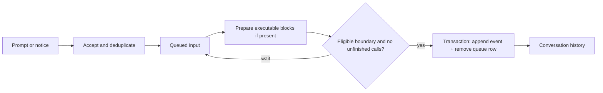

# Input queue

The input queue holds prompts and system notices until a conversation can safely deliver them to history. People, parent conversations and internal producers share the same ordering mechanism. An input can be reserved for a particular execution—a span of model turns—or for a later execution; this is execution targeting. Command preparation and targeting let inputs wait for the right boundary without interrupting unfinished tool work.

Part of [conversation core](README.md).

## Ordering and delivery

Acceptance order determines delivery order among eligible inputs, so source does not grant priority. Execution targeting selects eligible rows. An eligible prompt still undergoing command preparation blocks later delivery in that scan to preserve acceptance order. Safe boundaries occur between model turns or at execution start, after unfinished calls have settled, so new inputs cannot bypass an unresolved approval or question.

Delivery appends prompt or notice events, advances the head, updates prompt activity and deletes queue rows in one transaction. This ensures a crash cannot leave a delivered event with an undelivered copy of the same input.

## Pause and waking

Acceptance and waking are separate decisions because a producer may want to queue context without starting model work. Targeting controls when an input can be delivered; the wake setting controls whether acceptance requests idle processing. These rules apply to queued inputs, including prompt preparation:

| Source        | Respects pause?                             | Clears pause?                 | Can wake?                                                     |
| ------------- | ------------------------------------------- | ----------------------------- | ------------------------------------------------------------- |
| User          | Clears it before checking wake eligibility. | Yes, for pending submissions. | Yes, when waking is enabled.                                  |
| Parent        | Yes.                                        | No.                           | Yes, when waking is enabled and the conversation is unpaused. |
| System notice | Yes.                                        | No.                           | Yes, when waking is enabled and the conversation is unpaused. |

User and parent prompts enable waking by default; notice producers choose it explicitly. Retrying an already delivered input neither clears pause nor wakes processing. Child conversations, created by a parent to delegate work, reject user submissions; see [delegation](delegation.md).

Replacement through force push uses [scheduler cancellation](tool-call-lifecycle.md#cancellation-and-force-push) to reach a safe boundary; it does not give the queued input special priority.

## Retry identity

An input ID names one submission. Retrying a timed-out submission reuses its ID; deliberately sending the same text twice uses two IDs. Acceptance checks pending rows and delivered events, rejecting conflicting reuse, so a network retry cannot duplicate durable delivery. External command effects remain outside that guarantee.

## Command preparation

Fenced executable blocks are prepared before prompt delivery. Each block is checkpointed before execution and recorded results are reused. Interrupted effects become indeterminate rather than being rerun automatically, because a process may already have changed external state. A recorded completion means an outcome is known, including command failure.

Prepared output replaces blocks in the delivered prompt, while the original text and preparation receipts remain in its event. Inline direct commands instead use the [tool-call lifecycle](tool-call-lifecycle.md#direct-user-commands), because their result can be recorded without a model turn.

## Cancellation

Cancellation aborts preparation and removes an undelivered row without appending an event. Deduplication therefore covers pending and delivered inputs, **not cancelled submissions**: retrying a cancelled ID can queue it again. This deliberate gap avoids retaining a separate cancellation ledger. Cancellation cannot undo effects a preparation command already performed.

## Where it lives

| Concern                                     | Owner                                                                                                                          |
| ------------------------------------------- | ------------------------------------------------------------------------------------------------------------------------------ |
| Sources, targeting and payloads             | [`queuedInputSchema`, `submitInputRequestSchema`, `systemNoticeSchema`](../../../packages/contracts/src/domains/core/input.ts) |
| Acceptance, eligibility and atomic delivery | [`InputQueueService`](../../../packages/conversation-core/src/inputs/input-queue.service.ts)                                   |
| Executable-block checkpoints                | [`prepareCommands`](../../../packages/conversation-core/src/inputs/command-preparation.ts)                                     |
