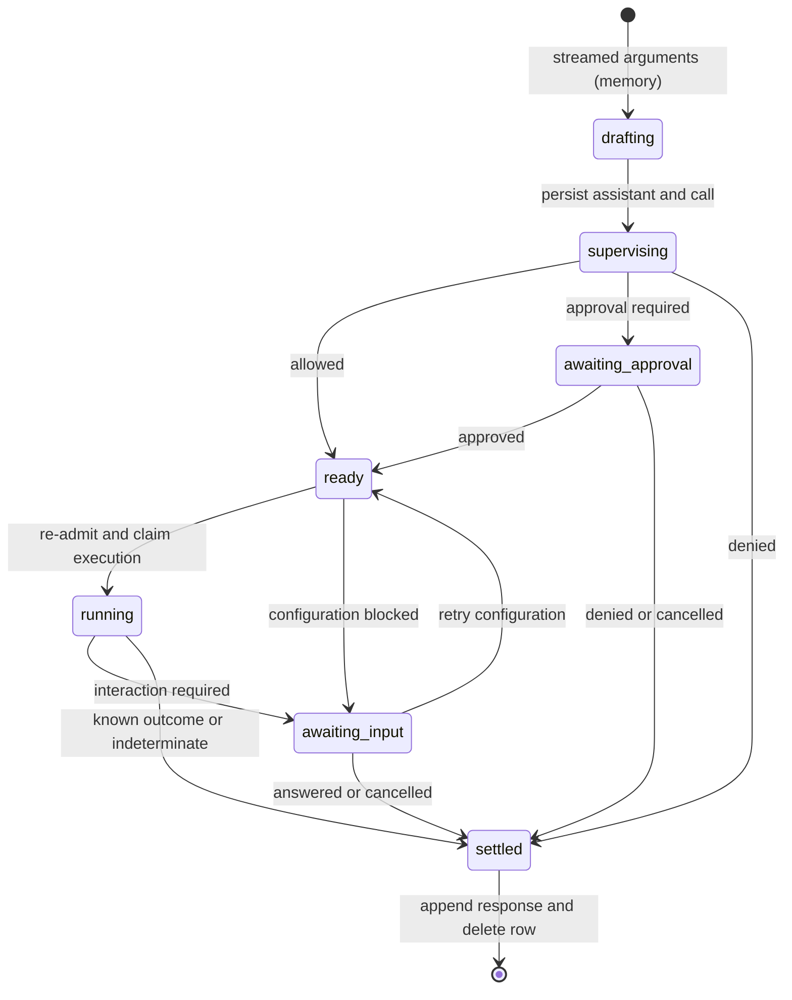

# Tool-call lifecycle

A tool call moves from proposed arguments through permission checks, execution and a durable result. Calls may wait for approval or user input, so unfinished work must survive restarts independently of a running model request. One lifecycle handles model-issued calls and direct user commands.

Part of [conversation core](README.md).

## State machine

Direct commands skip argument streaming, and cancellation can settle any unfinished durable state. The unfinished-call table stores durable checkpoints between drafting and settlement. Settlement appends a response and deletes the pending row in one transaction, so history records one outcome regardless of how many waits preceded it. Drafting stays in memory because incomplete streamed arguments are not executable work. Result storage is covered by [tool-result projection](../tool-result-projection.md).

Configuration-blocked admission reuses `awaiting_input`, so it appears as an interaction the user can resolve by retrying after configuration repair. A retry repeats admission after configuration repair, because resolving the wait does not itself grant permission.

## Admission and the turn barrier

Supervision evaluates permission policy and records its decision and authority before effects, so the eventual result can explain why execution was allowed. An execution claim identifies the worker entitled to settle the call, so a stale worker cannot overwrite a newer outcome. Final admission checks current authorization after waits, so prior approval cannot override a later denial. Invalid security configuration blocks execution rather than falling back to permissive defaults. Persistent approval rules are stored in permission overlays, scoped files that extend the baseline rules; see [permissions](../permissions.md).

A turn is one model invocation and its tool processing. Sibling calls can progress independently, but the turn barrier holds the next model request until that turn has no unfinished calls, so the model sees a complete result set. Responses persist in completion order; [context projection](events-and-context.md#projection-to-provider-requests) restores assistant-block order for the provider.

## Recovery

Recovery re-admits work that has not started so current authorization governs execution. Ordinary unanswered input interactions remain suspended; approval and configuration-blocked waits are re-evaluated, not blindly restored as authorization. Persisted resolutions are replayed through the interaction resolver using their resolution request identity.

A running call is retried only if the host declares the tool safe to repeat after interruption; otherwise it settles as indeterminate. This is deliberate: a committed claim cannot prove whether an external effect happened before a crash. Core recovery repairs lifecycle state without invoking a provider merely to finish an old execution; newly deliverable queued work can still wake processing. This avoids turning a status repair into fresh model work.

## Cancellation and force push

Stopping cancels work, pauses the conversation and cascades through descendants and their async bash (conversation-owned background commands), so delegated work cannot continue after a deliberate user stop. Cancellation settles unfinished calls but cannot undo external effects; uncertain running outcomes may be indeterminate.

Force push cancels only the receiving conversation's current work, clears pause and starts eligible [queued input](input-queue.md), so a replacement prompt can take over at a safe boundary. It does not perform stop's descendant/async-bash cascade, and stores no force-push state. Pause semantics are covered by the [input queue](input-queue.md#pause-and-waking); presentation behavior belongs to [conversation state and attention](../conversation-state-and-attention.md).

## Other entry and exit paths

Promotion to [async bash](async-bash-and-launches.md) settles the foreground call with a process identity; later completion is a queued notice, not a second response. [Delegation](delegation.md) likewise returns before a child execution completes.

### Direct user commands

Input submission routes inline commands through supervised user-origin tool calls, so they receive permission checks without requiring a provider invocation. They have no originating assistant event because the user supplied the command. The submission ID deduplicates pending and settled commands. Included results become user context, not model-tool results. Fenced prompt commands instead use [queue preparation](input-queue.md#command-preparation).

## Where it lives

| Concern                                  | Owner                                                                                                      |
| ---------------------------------------- | ---------------------------------------------------------------------------------------------------------- |
| Durable call and interaction shapes      | [`toolCallSchema`](../../../packages/contracts/src/domains/core/tool-call.ts)                              |
| Admission, transitions and call recovery | [`ToolCallService`](../../../packages/conversation-core/src/tool-calls/tool-call.service.ts)               |
| Settlement and turn barrier              | [`ToolCallSettlement`](../../../packages/conversation-core/src/tool-calls/tool-call-settlement.service.ts) |
| Startup recovery                         | [`recoverCore`](../../../packages/conversation-core/src/runtime/recovery.ts)                               |
| Stop and force push                      | [`ConversationScheduler`](../../../packages/conversation-core/src/runtime/scheduler.ts)                    |
| Direct-command routing                   | [`ConversationCore.submitInput`](../../../packages/conversation-core/src/core.ts)                          |
