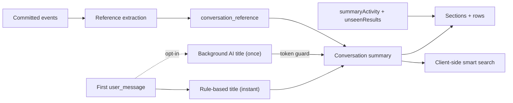

# Conversation discovery

The conversation list has to answer three questions at a glance: which conversation this is, whether it needs the user, and where its work went. Titles, list sections and PR/issue references answer them. Each one reuses existing state where it can, so discovery adds one table, one user setting and no new status machine.

## Titles

There are two independent paths. The **local title** is derived without network access on the first user message. The **AI title** is an opt-in background request to a small model the user picks in user settings. The local title never waits for the AI title, and any AI failure (disabled, unavailable, timeout, invalid output, queue overflow) simply keeps it. There is no retry, no fallback model and no user-facing error per conversation; logs record the outcome category and never the prompt or title text.

- **Once, for new root conversations only.** No backfill, no regeneration on later turns, no retry after a restart. A title is an identifier the user learns, so it should not change without the user's action.
- **A manual rename always wins.** Every title change advances a process-local token kept in the conversation service. The AI result is applied only if, in one serialized step, the conversation still exists, the token is unchanged and the setting still selects the same model. Renaming to the same text still advances the token, so the guard never compares strings. The token lives in memory because in-flight jobs are dropped on restart anyway.
- **The prompt is untrusted input sent to a third party.** Only a shortened first prompt is sent: code blocks and scaffolding are stripped, likely secrets are masked, and the length is capped. Files, history, URLs and tools are never included. The output is validated rather than repaired. Invented identifiers or a script the source doesn't use (a model drifting into another language) cause it to be rejected.
- **Bounded cost.** The server owns a small concurrency limit and bounded queue, a short deadline and a low output cap. Title requests never appear as agent runs or transcript messages. They never block agent work either.
- **Images are a marker, not text.** Generated titles replace image mentions with a reserved marker token that ordinary text can't produce, so manual titles are never transformed. The list renders it as an icon. Surfaces that need plain text (notifications, window title) use the shared fallback helper.

Core owns the title policy, the token guard and input/output rules behind an injected capability. The server implements that capability with the model registry and provider authentication, so core imports neither.

## References

A reference links one conversation to one external resource with a relationship: `referenced` (a user prompt pointed to it) or `created` (the conversation created it). GitHub PRs and issues are the only provider today. `provider`, `resource_key` and `kind` are open text validated in contracts, so other trackers can be added as new extractors without a migration.

- **One row per conversation and resource, upgrade-only.** `created` wins over `referenced` and a concrete kind wins over `unknown`. First-seen time is kept, so tag order is stable. Extraction runs on committed events through idempotent upserts, so replay is safe.
- **Referenced comes from user-authored text only**, never from system text, child prompts, expanded commands or fenced code. Hosts are limited to `github.com` and the project's git remotes, which covers GitHub Enterprise without a setting.
- **Created is strict.** It requires a successful `gh pr create`/`gh issue create` bash call whose output contains a matching URL. Assistant claims, wrappers and failed commands never count: a missing tag is better than a false one. A resource created by a descendant is also recorded on its root conversation, because the root row is where the user looks.
- **No network.** There is no live PR state, no GitHub API call and no new authorization. Deleting a conversation cascades its references. There is no backfill.

Summaries carry the references, so the client needs no separate fetch or search operation.

## List sections, ordering and search

Each visible root conversation appears in exactly one section, using the first rule that matches: **Pinned**, **Needs you** (pending input, uncleared failure or interruption), then day buckets. Section assignment is a pure presentation function over the existing [summary activity](conversation-state-and-attention.md#summary-activity-across-the-conversation-tree) plus pin and completion state. It is not a second status predicate. Finished results are not "Needs you": they keep the session-local unseen marker in their day section, because they don't wait on the user.

Order and relative time use `last_user_message_at`, which is only set when a `user_message` is appended. Titles, references, status and assistant output are metadata. They never reorder rows, change sections or create unseen state, so the list stays stable while agents work.

Search is one input with no syntax, run client-side over the loaded summaries. `conversation.list` returns every root conversation, so the display cap doesn't limit search. Every term must match a reference, a status word, the image marker or the title (substring, then a lazy subsequence). Completed conversations are hidden from sections but are searchable (for example with "done").

## Owners

| Concern                                | Owner                                                                                                                                                                                                                                                                                                                                           |
| -------------------------------------- | ----------------------------------------------------------------------------------------------------------------------------------------------------------------------------------------------------------------------------------------------------------------------------------------------------------------------------------------------- |
| Local title and image marker           | [deriveConversationTitle](../../packages/conversation-core/src/conversations/conversation-title.ts), [conversation-title helpers](../../packages/contracts/src/domains/core/conversation-title.ts)                                                                                                                                              |
| AI title policy, input and validation  | [ai-title](../../packages/conversation-core/src/conversations/ai-title.ts), token guard in [ConversationService](../../packages/conversation-core/src/conversations/conversation.service.ts)                                                                                                                                                    |
| AI title provider call and queue       | [ConversationTitleService](../../packages/workbench-server/src/domains/conversation-titles/title.service.ts)                                                                                                                                                                                                                                    |
| Title setting and page                 | [settings contracts](../../packages/contracts/src/domains/settings/settings.ts), [TitlesSettingsPage](../../packages/workbench-app/src/lib/features/settings/views/pages/titles/TitlesSettingsPage.svelte)                                                                                                                                      |
| Reference parsing and extraction       | [github](../../packages/conversation-core/src/conversations/references/github.ts), [ReferenceExtraction](../../packages/conversation-core/src/conversations/references/reference-extraction.ts)                                                                                                                                                 |
| Reference storage and summary delivery | [ConversationReferenceRepository](../../packages/conversation-core/src/storage/conversation-reference.repository.ts), [summary schema](../../packages/contracts/src/domains/core/conversation.ts)                                                                                                                                               |
| Sections, ordering, search and tags    | [conversation-list](../../packages/workbench-app/src/lib/presentation/conversations/conversation-list.ts), [conversation-search](../../packages/workbench-app/src/lib/presentation/conversations/conversation-search.ts), [conversation-references](../../packages/workbench-app/src/lib/presentation/conversations/conversation-references.ts) |
| List panel                             | [ProjectConversationNavigator](../../packages/workbench-app/src/lib/features/projects/views/ProjectConversationNavigator.svelte)                                                                                                                                                                                                                |

## Deliberate limits

No live tracker state, manual reference correction, transcript full-text search, persisted or cross-client seen state, AI summaries or importance scoring, and no bulk retitling. The mobile inbox keeps its own grouping.
