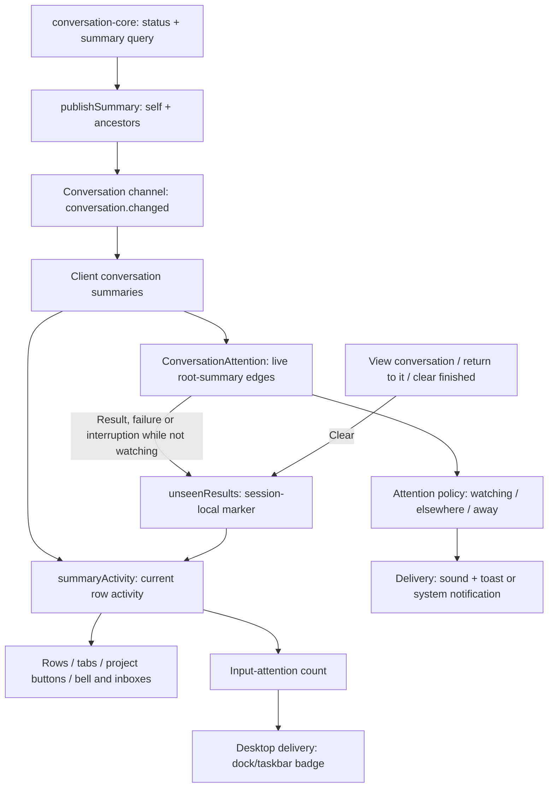
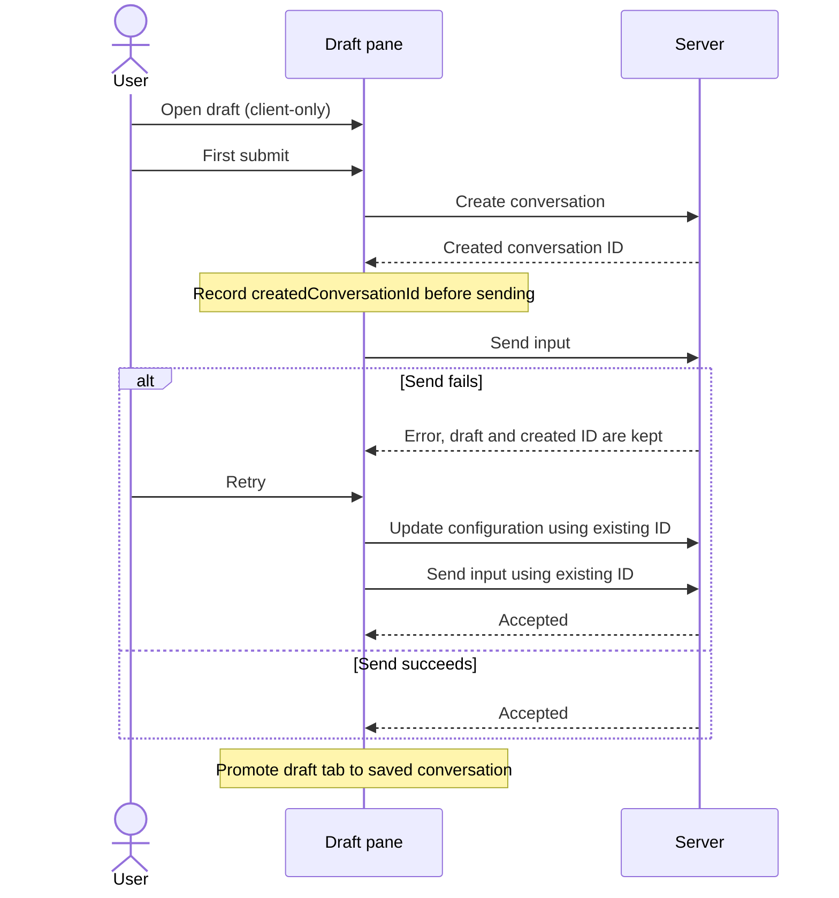
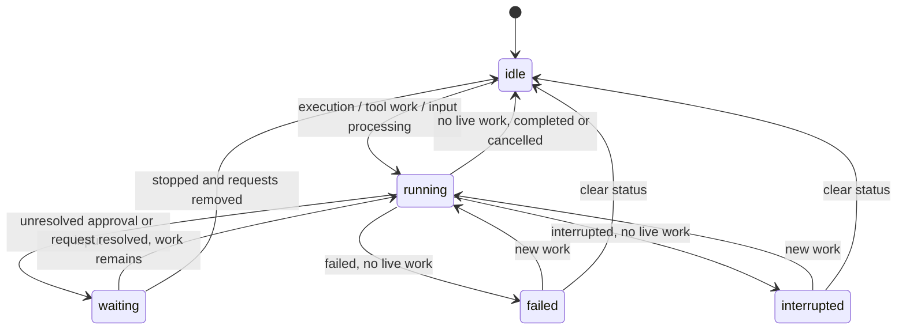

# Conversation state and attention

Users must notice when any conversation needs them or has finished, including conversations they have not opened and requests from sub-agents. The composer must also behave consistently in draft and saved panes, so shortcuts and the status bar reflect the pane in front of the user. The server owns configuration and execution truth; the client turns that truth into editing controls, activity indicators and attention signals.

The badge and other passive surfaces update independently of presence or mute. Only intrusive delivery depends on whether the user is already watching.

## Composer ownership and draft lifecycle

Each conversation pane has one composer view, shared by its toolbar, capability controls and editing actions. While that pane is active, it registers the view in an active-composer slot that shortcuts and subscription-provider highlighting read. This prevents those consumers from reconstructing a different configuration or ignoring drafts. Non-conversation tabs register no composer; run controls remain attached to the conversation store.

The view reads configuration rather than defining its policy. Untouched drafts use shared project defaults; explicit draft profiles or overrides request a server preview, ignoring obsolete responses. Saved panes read the conversation store's effective configuration. Scoped notices, profile changes and reconnect invalidate these projections. Editing actions enforce requirement-derived locks and make sub-agent views read-only, including keyboard paths. Saved capability edits use revision-checked writes.

A draft holds in-memory creation intent and submission bookkeeping, not another copy of resolved settings. Opening it neither creates a server conversation nor requires a usable model. Creation happens on first submission, and the created ID is recorded before sending input so a failed send can be retried without creating another conversation.

Creation failure leaves the draft available for another attempt. The server remains the configuration authority throughout; see [configuration](configuration.md) for layering and save guarantees.

### Owners

| Concern                         | Owner                                                                                                                                                                                                                                                                                                                                         |
| ------------------------------- | --------------------------------------------------------------------------------------------------------------------------------------------------------------------------------------------------------------------------------------------------------------------------------------------------------------------------------------------- |
| Pane composition and promotion  | [ConversationCenterHost](../../packages/workbench-app/src/lib/app/composition/centers/ConversationCenterHost.svelte)                                                                                                                                                                                                                          |
| Composer resolution and editing | [createComposerView](../../packages/workbench-app/src/lib/application/composer/composer-view.svelte.ts)                                                                                                                                                                                                                                       |
| Active pane and consumers       | [activeComposer](../../packages/workbench-app/src/lib/application/composer/active-composer.svelte.ts), [WorkbenchProvider](../../packages/workbench-app/src/lib/app/providers/WorkbenchProvider.svelte), [workspace read models](../../packages/workbench-app/src/lib/app/composition/registrations/register-workspace-read-models.svelte.ts) |
| Draft state and submission      | [PendingConversationState](../../packages/workbench-app/src/lib/application/workspace/pending-conversations.svelte.ts), [submitPendingConversation](../../packages/workbench-app/src/lib/app/composition/conversations/submit-pending-conversation.ts)                                                                                        |
| Server configuration resolution | [AgentConfigurationService](../../packages/workbench-server/src/infrastructure/configuration/agent-configuration/agent-configuration-service.ts), [ProjectAgentDefaults](../../packages/workbench-server/src/infrastructure/configuration/agent-configuration/project-agent-defaults.ts)                                                      |

## Server execution status

The server derives a stored status projection from execution events, live tool calls and input processing. Centralizing this decision keeps clients consistent instead of making each surface interpret transcript events. Unresolved human requests take priority as `waiting`; otherwise an open execution, live tool calls or active input processing produce `running`. With no live work, the latest uncleared failure/interruption determines the status, or it becomes `idle`.

This diagram summarizes the projection, not a separately enforced transition graph: the priority rules remain authoritative. An execution event labeled `waiting` or `retrying` still identifies an open execution and does not by itself mean human input is needed.

Clearing status records `statusClearedAt`, so only newer terminal events remain visible. The update path refreshes status before publishing its summary, and clients trust that status rather than hiding every failure after a clear. User-marked completion (`completedAt`) is separate from execution completion.

### Owners

| Concern                                     | Owner                                                                                                    |
| ------------------------------------------- | -------------------------------------------------------------------------------------------------------- |
| Status derivation and execution transitions | [StatusService.refresh / transition](../../packages/conversation-core/src/runtime/status.ts)             |
| Clear-status update and publication         | [ConversationService.update](../../packages/conversation-core/src/conversations/conversation.service.ts) |

## Summary activity across the conversation tree

Two summary fields expose work and human requests without requiring a client to open the transcript. They are computed from existing tables on read, rather than persisted as additional state, so there is no separate schema or synchronization lifecycle for them.

- **`pendingWork`** reports running async Bash or unpaused queued wake input in the conversation or its descendants, or a running/waiting descendant. The conversation's own running status is represented separately.
- **`pendingInput`** identifies the oldest unresolved approval/input across the same tree, ordered by tool-call update time then ID. Its conversation ID/title and tool-call identity let root surfaces label and open a descendant's request.

A child change can therefore change its ancestors' summaries. Publication includes the changed conversation and every ancestor so root rows show descendant requests even when no transcript is open. Status, queue and async-Bash changes use this path. Completion and follow-up wake inputs are handed off transactionally, avoiding a brief false impression that all work has finished. The conversation channel forwards summaries as `conversation.changed` for subscribed projects, adding cached configuration fields.

The client derives row activity from each summary and its unseen-result marker. The first matching condition wins:

1. Human input is needed, either locally or in a descendant.
2. The conversation failed.
3. The conversation is running.
4. Background work is pending.
5. The conversation was interrupted.
6. A result is unseen.
7. The user marked the conversation complete.
8. Otherwise, the conversation is idle.

This precedence makes a descendant's request visible ahead of other root activity. It is presentation logic, not another persisted status machine.

### Owners

| Concern                                    | Owner                                                                                                                                                                                    |
| ------------------------------------------ | ---------------------------------------------------------------------------------------------------------------------------------------------------------------------------------------- |
| Summary contract and query                 | [conversationSummarySchema](../../packages/contracts/src/domains/core/conversation.ts), [summaryQuery](../../packages/conversation-core/src/storage/conversation.repository.ts)          |
| Ancestor publication and protocol delivery | [publishSummary](../../packages/conversation-core/src/runtime/publish-summary.ts), [conversation channel](../../packages/workbench-server/src/adapters/protocol/conversation-channel.ts) |
| Transactional work handoffs                | [StatusService.transition](../../packages/conversation-core/src/runtime/status.ts), [AsyncBashService](../../packages/conversation-core/src/async-bash/async-bash.service.ts)            |
| Client row activity                        | [summaryActivity](../../packages/workbench-app/src/lib/presentation/conversations/conversation-activity.ts)                                                                              |

## Attention edges and unseen results

An **attention edge** is a transition between two consecutive live summaries of a root conversation that deserves the user's attention. The controller detects a new pending-input tool-call identity, completion, failure or interruption. Completion means the previous summary was running, waiting or had pending work, and the next summary is idle with neither pending work nor pending input. This prevents a turn ending while sub-agents are still working from being announced as finished.

When attention edges coincide, only the most urgent is selected:

1. Input required.
2. Failure or interruption.
3. Finished.

Sub-agent completion and failure do not directly notify; the lead handles those outcomes. Human requests instead surface through the root's pending input. List loads and reconnects establish a quiet baseline, so old state is not replayed as new notifications. When the user presses Stop locally, the controller suppresses the next finished/interrupted attention edge if it arrives within the suppression window, rather than announcing the user's own action.

Finished, failed and interrupted attention edges add an unseen marker unless the user is watching. Input needs no such marker because it remains visible in the current summary. Unseen markers are session-local: they support noticing results without introducing acknowledgement storage or cross-window synchronization.

Viewing includes the active conversation, a pending tab's created conversation and their known ancestors. Switching to a conversation or returning focus/input to its view clears its unseen marker; a result arriving while the user is away stays unseen until return. Deletion and Clear finished also clear markers. A failure or interruption still takes precedence over the unseen-result glyph.

### Owners

| Concern                                | Owner                                                                                                                                                                                                                                                                                                              |
| -------------------------------------- | ------------------------------------------------------------------------------------------------------------------------------------------------------------------------------------------------------------------------------------------------------------------------------------------------------------------ |
| Attention edges and baseline lifecycle | [ConversationAttention](../../packages/workbench-app/src/lib/application/activity/conversation-attention.ts), [workbench-client](../../packages/workbench-app/src/lib/application/startup/workbench-client.svelte.ts)                                                                                              |
| Viewing, unseen state and local Stop   | [startConversationAttention](../../packages/workbench-app/src/lib/application/activity/conversation-attention.svelte.ts), [unseenResults](../../packages/workbench-app/src/lib/application/activity/unseen-results.svelte.ts), [user-stop](../../packages/workbench-app/src/lib/application/activity/user-stop.ts) |

## Presence, delivery and surfaces

Presence decides how intrusive delivery should be: do not interrupt someone already watching, but reach someone working elsewhere or away from the app. A visible, focused window with recent input counts as active; viewing the target conversation or its descendant distinguishes watching from elsewhere.

| Presence  | Meaning                                              | Intrusive delivery          |
| --------- | ---------------------------------------------------- | --------------------------- |
| Watching  | Active and viewing the target                        | None                        |
| Elsewhere | Active but viewing something else                    | Sound + Open toast          |
| Away      | Hidden/unfocused or idle past the presence threshold | Sound + system notification |

System notifications disabled or unavailable normally fall back to an Open toast. Sounds use existing event preferences, coalesce nearby events by urgency and are throttled per window. Session-local mute suppresses sounds, toasts and system notifications, not passive indicators. Notification settings and their test action use this delivery path.

Rows and tabs share the activity indicator, including a success dot for unseen finished results. Project buttons count conversation attention/work with urgency coloring, or show a success dot when only unseen results remain; background-launch counts stay in popover rows. The bell and mobile inbox share root input/failure/interruption derivation, and unseen results join finished activities. The bell groups attention, running and finished items; its number counts input requests, while failures use the unseen-failure dot.

The dock/taskbar badge is another passive projection, not a presence-triggered notification. It sends the input-attention count, excluding failures and finished results, through desktop IPC to best-effort `app.setBadgeCount` and clears at zero. This keeps outstanding requests visible while the running app is hidden in the tray.

### Owners

| Concern                              | Owner                                                                                                                                                                                                                                                                                                                    |
| ------------------------------------ | ------------------------------------------------------------------------------------------------------------------------------------------------------------------------------------------------------------------------------------------------------------------------------------------------------------------------ |
| Presence, urgency, mute and delivery | [attention-policy](../../packages/workbench-app/src/lib/application/notifications/attention-policy.ts), [deliverAttention](../../packages/workbench-app/src/lib/application/notifications/attention-delivery.svelte.ts), [notifyNative](../../packages/workbench-app/src/lib/application/notifications/notify.svelte.ts) |
| Rows, tabs and projects              | [ConversationActivityIndicator](../../packages/workbench-app/src/lib/presentation/conversations/ConversationActivityIndicator.svelte), [ProjectSwitcher](../../packages/workbench-app/src/lib/features/projects/views/ProjectSwitcher.svelte)                                                                            |
| Bell and inbox derivation            | [deriveNeedsYou](../../packages/workbench-app/src/lib/application/activity/needs-you.ts), [ActivityPopover](../../packages/workbench-app/src/lib/presentation/activity/ActivityPopover.svelte)                                                                                                                           |
| Desktop notifications and badge      | [notifications IPC](../../packages/desktop-shell/src/ipc/notifications-ipc.ts)                                                                                                                                                                                                                                           |

## Deliberate limits

There is no persisted draft or acknowledgement model, cross-window/device notification deduplication, disconnected-event replay or delivery while the app is closed. Local Stop suppression and mute apply only to the current window. Browser notifications use a conversation tag and navigate on click; desktop notifications only focus the window and do not carry that replacement tag.

The client does not resolve configuration policy, and attention does not add a separate server status store or expand draft editing workflows. Contracts and owning implementations remain authoritative for fields, event catalogs, thresholds and settings.
