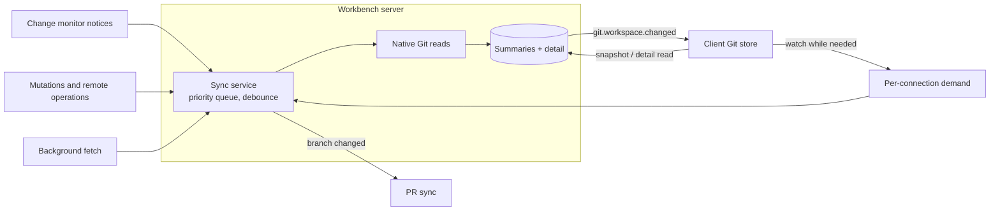

# Git workspace sync

The workbench server owns local Git state. A sync service keeps an in-memory summary of every repository and worktree in a watched project, plus file-level detail for the worktrees a client is looking at, and notifies clients when either changes. The Git panel, Files panel decorations, open diffs and prompt suggestions all render from one client store that mirrors those snapshots. [Pull request sync](pull-request-sync.md) reuses the model below.

## Design decisions

- **Repositories group worktrees.** Discovery also reads each repository's linked worktrees and keeps those inside the project, including under dot-directories. Worktrees sharing a Git directory share one `worktreeGroup`. The UI shows one repository with a branch row per worktree. Fetch, stashes and the GitHub identity belong to the group; branch, sync state and changes belong to each worktree.
- **Two tiers, read on demand.** Summaries (branch, ahead/behind, change and stash counts, merged into base) are kept for visible projects. Detail (files and stashes) is kept only for worktrees a connection asks for: the selected branch with Changes open, or an open diff. Hover and focus send a low-priority `hint` that warms detail on the server only.
- **One queue per daemon.** Reads share one priority queue (order in [`git-workspace-sync-policy.ts`](../../packages/workbench-server/src/domains/git/workspace-sync/git-workspace-sync-policy.ts)) with a small concurrency limit, per-repository debounce and coalescing, so a change during a read schedules exactly one follow-up. A notice aborts only that repository's reads. Scopes the monitor reports as degraded fall back to a slow poll, and a cheap periodic check re-runs discovery when repositories or worktrees appear.
- **Server-owned snapshots; events invalidate, clients re-read.** This is the pattern PR sync reuses. The server holds snapshots in memory only. Each connection declares what it is looking at, and disconnecting releases that demand, so work scales with what users watch and not with windows or devices. Without demand nothing is read; change notices only mark entries dirty. Each project has one revision counter that moves only when content changes. `git.workspace.changed` names changed repositories rather than carrying data, and clients re-read `git.workspace.snapshot.get` or `git.repo.detail.get`; after a revision gap or reconnect they read the full snapshot. Mutations return the revision that includes their effect, so the UI waits for it instead of re-reading. Nothing is persisted: after a restart snapshots rebuild from the next demand.
- **Background fetch is server-side.** Repositories with a remote in a visible project are fetched every 5–10 minutes with jitter. Fetches run one at a time, once per worktree group, and never prompt for credentials. A repository is skipped while a user network operation runs in it, and failures back off. Moved remote refs mark summaries dirty and signal PR sync.
- **UI state stays on the client.** Filters, expansion, selection and section sizes are `localStorage` preferences.

## Where it lives

| Concern                              | Owner                                                                                                                                                                                                                         |
| ------------------------------------ | ----------------------------------------------------------------------------------------------------------------------------------------------------------------------------------------------------------------------------- |
| Snapshot, demand and event contracts | [`git-workspace.ts`](../../packages/contracts/src/domains/git/git-workspace.ts); [`operations.ts`](../../packages/contracts/src/domains/git/operations.ts); [`events.ts`](../../packages/contracts/src/domains/git/events.ts) |
| Discovery including linked worktrees | [`project.rs`](../../packages/native/native/src/git/project.rs); [`git-project-reader.ts`](../../packages/tools/src/git/git-project-reader.ts)                                                                                |
| Sync service, scheduling, fetch      | [`workspace-sync/`](../../packages/workbench-server/src/domains/git/workspace-sync/)                                                                                                                                          |
| Client store and watch delivery      | [`git-store.svelte.ts`](../../packages/workbench-app/src/lib/features/git/state/git-store.svelte.ts); [`git-store-model.ts`](../../packages/workbench-app/src/lib/features/git/state/git-store-model.ts)                      |
| Panel preferences                    | [`git-panel-preferences.ts`](../../packages/workbench-app/src/lib/features/git/state/git-panel-preferences.ts); [`pr-panel-preferences.ts`](../../packages/workbench-app/src/lib/features/git/state/pr-panel-preferences.ts)  |
