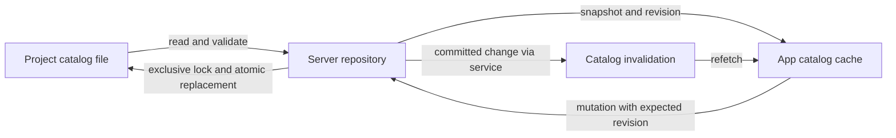
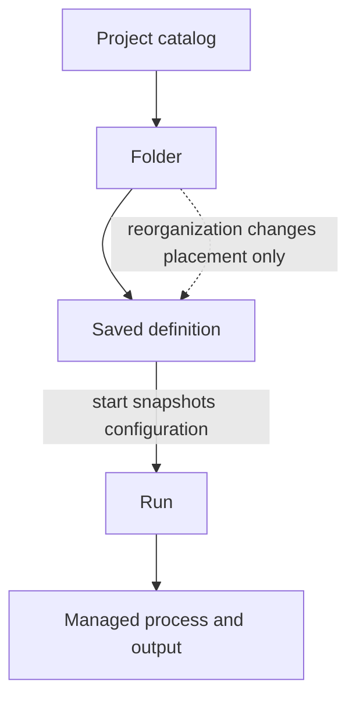

# Launch catalog

The launch catalog holds a project's saved commands and the folders used to organize them. The server manages the project file, and the app displays a cached snapshot. Running a saved command creates a separate execution, so users can reorganize their catalog without disturbing processes.

## Configuration and execution

A **definition** is saved execution configuration, a **folder** groups catalog entries, and a **run** is one execution. The project owns its catalog at `.nerve/launches/definitions.json`, making commands and organization portable together. Runtime project identity is supplied by the enclosing project so the file can travel between installations.

Folder placement and manual order live in the same document as definitions, giving the server one source to validate. Folders supply organization only: inheriting execution settings from them would make a move change command behavior.

For example, moving an active “API” definition into a “Development” folder changes its placement while its existing process continues with the command and working directory it started with. Editing that command affects a subsequent execution.

| Concern                                    | Owner                                                                                                           |
| ------------------------------------------ | --------------------------------------------------------------------------------------------------------------- |
| Persisted catalog and hierarchy validation | [`launchDefinitionFileSchema`](../../packages/contracts/src/domains/launch-definitions/launch-definition.ts)    |
| Runtime snapshot                           | [`launchDefinitionCatalogSchema`](../../packages/contracts/src/domains/launch-definitions/launch-definition.ts) |

## Safe shared editing

A **revision** is an opaque equality token representing validated catalog content. Each management mutation includes the revision the user saw, so the server can reject stale intent rather than apply it to a changed tree. Formatting alone does not change the token.

Moves express a destination folder and an optional sibling anchor rather than client-assigned positions. This lets dragging and menu actions share the same command while the server validates and normalizes placement. Moving a folder preserves its descendants' attachment.

**Guarantees and limits:**

- The canonical catalog path is the write boundary so cooperating processes and project aliases coordinate on the same file.
- Exclusive locking prevents lost read–modify–write updates, while atomic replacement prevents partial documents; revision checking alone cannot provide either guarantee.
- Locks fail closed and are never automatically stolen because guessing that a writer is dead risks concurrent writes. Crash-leftover locks require operator recovery with quiescent writers.
- External edits require quiescent catalog writes and reload/revalidation because external editors do not participate in this coordination.

A committed write remains committed even if notification publication fails. The service retries notification, and clients recover by revalidation, so a failed notification does not invite duplicate creation or another repeated mutation.

| Concern                              | Owner                                                                                                                                   |
| ------------------------------------ | --------------------------------------------------------------------------------------------------------------------------------------- |
| Management requests and responses    | [`launchDefinitionOperationDefinitions`](../../packages/contracts/src/domains/launch-definitions/operations.ts)                         |
| Structural mutations and publication | [`LaunchDefinitionService`](../../packages/workbench-server/src/domains/launch-definitions/launch-definition.service.ts)                |
| Locking, validation and replacement  | [`LaunchDefinitionRepository.transact`](../../packages/workbench-server/src/domains/launch-definitions/launch-definition.repository.ts) |
| Content-based revision               | [`launchCatalogRevision`](../../packages/workbench-server/src/domains/launch-definitions/launch-definition.repository.ts)               |

## Client state and identity

The app caches complete project snapshots and refetches on invalidation. Subscriptions live at module/application lifetime so freshness does not depend on a mounted catalog panel. Revalidation recovers missed events. Each invalidation advances a local generation counter, so a read started before that invalidation cannot install an outdated snapshot.

Runtime identity is `(projectId, definitionId)` because project copies can retain the same portable IDs. Actions resolve within their specified project; ownership is independent of the command's working directory. Agent-facing name selection is a separate execution capability, so the launch tool does not expose catalog management.

Activity is derived from catalog and run state, keeping transient execution out of portable configuration. Deleting a definition leaves its runs independently controllable. A failed catalog load cannot establish deletion, because the saved definition may simply be unavailable. General conversation status and attention are covered in [conversation state and attention](conversation-state-and-attention.md).

| Concern                                       | Owner                                                                                                                                                                                                                                                          |
| --------------------------------------------- | -------------------------------------------------------------------------------------------------------------------------------------------------------------------------------------------------------------------------------------------------------------- |
| Snapshot cache and overlapping reads          | [`createLaunchCatalogCache`](../../packages/workbench-app/src/lib/features/launches/state/launch-catalog-cache.ts), [`createLaunchDefinitionRevalidationGate`](../../packages/workbench-app/src/lib/features/launches/state/launch-definition-revalidation.ts) |
| Application-lifetime subscriptions and access | `cachedLaunchCatalog` and `invalidateLaunchCatalog` in [`launch-definitions.svelte.ts`](../../packages/workbench-app/src/lib/features/launches/state/launch-definitions.svelte.ts)                                                                             |
| Agent execution selection                     | [`LaunchTool`](../../packages/workbench-server/src/core-host/launch-tool.ts)                                                                                                                                                                                   |

## Format versions and recovery

The catalog file is versioned. An older catalog is upgraded when the project's catalog is loaded, through the shared [project configuration versions](configuration.md#project-configuration-versions) service rather than in the repository; the original bytes go to home quarantine. Home migrations never touch the catalog, so projects opened long after an upgrade receive the same handling.

A corrupted catalog shows no launches, an inline notice in the Launches panel and a header activity item. Management actions are hidden and the server refuses catalog mutations, so a save cannot overwrite the invalid original. The user fixes the file and reloads, or confirms a reset to an empty catalog. A catalog written by a newer Nerve is read-only and never reset. A missing file means an empty catalog. An old `tasks/definitions.json` is reported as a leftover file and is not imported.

| Concern                            | Owner                                                                                                                                   |
| ---------------------------------- | --------------------------------------------------------------------------------------------------------------------------------------- |
| Catalog version chain and reset    | [`launch-definition-migrations.ts`](../../packages/workbench-server/src/domains/launch-definitions/launch-definition-migrations.ts)     |
| Loading through the shared service | [`LaunchDefinitionRepository`](../../packages/workbench-server/src/domains/launch-definitions/launch-definition.repository.ts)          |
| Inline notice and blocked actions  | [`LaunchConfigurationNotice`](../../packages/workbench-app/src/lib/features/launches/hosts/LaunchConfigurationNotice.svelte)            |
| Persistence-boundary verification  | [`launch-definition-catalog.test.ts`](../../packages/workbench-server/src/domains/launch-definitions/launch-definition-catalog.test.ts) |
| Wider persistence boundaries       | [Storage architecture](storage.md)                                                                                                      |
