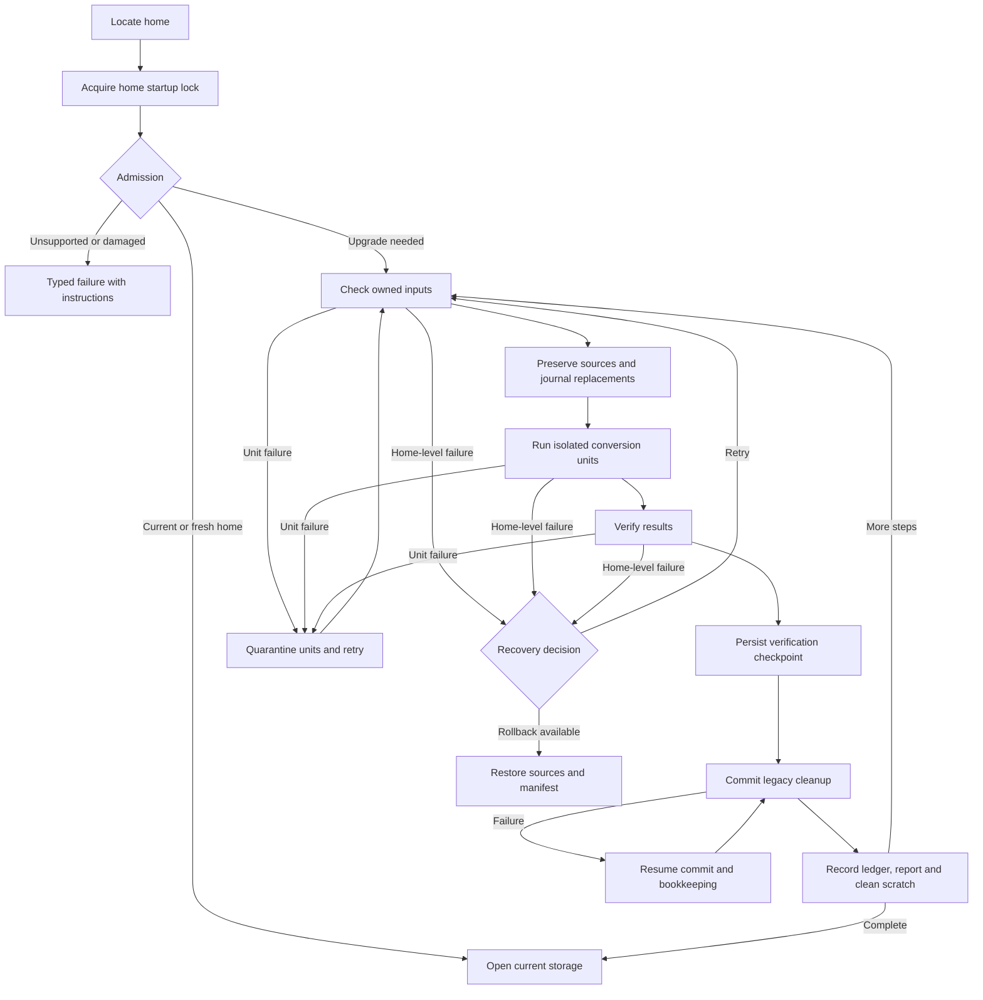

# Storage migrations

Home migrations upgrade persistent data when a release changes how Nerve stores it. They coordinate database, file and configuration changes in the Nerve home before the normal runtime opens storage. The daemon runs the upgrade and preserves recovery state. Damage that can be attributed to one item is set aside automatically, so a single broken conversation or settings file cannot keep the application closed.

Home migrations own the home only: the database, conversation history, assets, user-level settings and credentials. They never read or write project files. Project configuration lives outside the home, may be shared through Git or restored independently, and is upgraded lazily when a feature loads it; see [project configuration versions](configuration.md#project-configuration-versions).

Preservation uses retained sources and a journal of original file state, rather than a full-home backup. That keeps rollback proportional to changed data. The verification checkpoint is the boundary after which cleanup may irreversibly remove legacy sources.

## Admission and unsupported homes

The supported baseline is 0.34.1. Admission checks the home manifest and, for legacy homes, the expected SQLite migration ledger before any step runs. Each rejection has a typed kind, such as too old, invalid manifest, unexpected ledger or unrecognized layout, so an old home is not reported the same way as a damaged one.

Nerve does not convert homes older than the baseline, because doing so would keep compatibility code for layouts it no longer understands. The desktop startup screen shows the home path and two choices instead. To keep conversation history, the user runs 0.34.1 once and then reopens the current release. To start clean, the user closes Nerve, deletes or moves the home folder and reopens Nerve. Damaged homes get the same delete-or-move instruction with diagnostics. Retry is offered only for transient failures, because retrying cannot change an incompatible format.

Fresh homes start at the current layout with registered steps recorded, because there is no legacy data to convert.

## Choosing the migration boundary

A **home step** coordinates an on-disk conversion across stores or files in the home. Pure core SQL changes use the core's transactional migrations and separate SQL ledger. A **ledger** records which conversions have been applied; the home ledger lives outside SQLite so a step can replace the database itself. Schema changes still require prior approval under `AGENTS.md` because they affect the persistent data model.

All unreleased home changes since the root `package.json` release version belong in one draft step. Extend that step so the next release has one coherent conversion from its released predecessor. Releases without storage changes need no step.

Steps use frozen local shapes and helpers so later application refactors cannot reinterpret an old conversion. Validate each source with the shape its released writer actually produced, at that source's scope; a stricter or differently scoped validator turns valid history into false set-asides. Released steps are immutable and fixes ship in a subsequent step, preserving the meaning of their recorded checksums. A **checksum** identifies the conversion's file contents so the framework can detect unexpected changes. Legacy core conversion details live in the [0001 step README](../../packages/workbench-server/src/infrastructure/migrations/steps/0001-conversation-core/README.md).

## Isolating damage

A **unit** is an independently attributable input, such as a conversation or a settings document. Steps declare their owned inputs so unrelated files cannot become upgrade blockers. Unit conversion combines file isolation with step-supplied database transactions and report checkpoints, because restoring files alone cannot undo SQL or report changes.

When a unit fails, the runner records it as set aside, preserves it in **quarantine** (a recovery location containing the source and reason), and retries the step without it. This happens automatically: asking the user before the application opens would make every upgrade with one bad file a blocking decision. Healthy units proceed and the damaged source is never silently deleted. A unit that still fails after being excluded blocks rather than looping.

Only home-level problems stop the upgrade: an untrusted manifest or ledger, a failed database integrity check, an unsupported SQL layout, inability to preserve quarantine, or failed durable bookkeeping. These cannot be attributed to one unit, so continuing would risk the whole home. Per-record salvage is preferable where supported, but coverage depends on the step. This is a preservation standard, not a promise that every corruption can be repaired automatically.

## Reports and notice

Each completed step writes a report of set-aside units and recorded losses. Losses describe intentional or unavoidable changes, such as a dropped legacy field, and are aggregated by a path-independent reason so a large home produces a short list. Set-aside entries keep their individual quarantine receipts for recovery.

After the workbench connects, one header activity notice summarizes the reports. Its details open the upgrade report dialog, and dismissal is stored in the home's report files so the notice does not return. No dialog appears before the application opens.

## Commit and rollback

Before verification is persisted, retained sources and journaled replacements support rollback. The journal preserves the first original state across retries so restoration targets the pre-step home. New destinations can be rebuilt or removed instead of copied into a full backup.

After verification is persisted, commit may delete legacy sources. An interrupted commit resumes cleanup and bookkeeping; it cannot promise restoration of sources already deleted. Reports survive scratch cleanup so set-aside units and recorded losses remain inspectable after success.

Migration and offline tools share the home startup lock. Startup retains ownership through storage opening and daemon publication so another writer cannot enter between those operations.

## Recovery decisions

Home-level failures persist with the available recovery actions: retry, and rollback before the verified boundary. Rollback restores the pending step's sources and manifest.

Startup owns recovery presentation and daemon behavior; see [startup](startup.md#failures-and-recovery). Runtime settings repair has a separate [settings-health](storage.md#settings-health) path because it does not require rerunning an upgrade.

The standalone `storage:migrate` command uses the same runner and lock as startup so offline conversion follows the same data-safety rules. Its dry run plans admission and pending steps; corruption validation requires executing the step's checks.

## Adding or extending a step

1. Check the root `package.json` version to identify the latest release. Extend the single unreleased draft step for changes since that release, or create a step when there is no draft, so the release has a coherent conversion path.
2. Define owned inputs and isolated units using frozen local shapes and helpers. Keep legacy deletion in commit so earlier failures remain reversible. Do not read project files; project formats change through their own version chains.
3. For a new step, add its implementation to the ordered registry and its metadata to `MIGRATION_METADATA`. Compute the folder checksum with `hashStepFolder`, then update both that metadata and `migrations.lock.json` so planning and execution agree. Run `pnpm exec tsx scripts/storage-migrations/check.ts` to check consistency. The helper and checker are linked below; the checker does not regenerate checksums.
4. Write fixture tests for corruption, set-aside, rollback and resume so recovery is exercised alongside successful conversion. Include byte-preservation and quarantine assertions where the step changes sources.
5. Rehearse on a stopped home copied into an unused slot with `pnpm storage:copy --from <stopped-home> --slot N` and `pnpm storage:migrate --home data/storage-N`. Choose a slot other than 1 so rehearsal cannot modify the normal development home.
6. After rehearsal, run `pnpm exec tsx scripts/storage-migrations/validate-history.ts --home data/storage-N` and read every report's set-aside list. A clean exit only proves the history parses; an unexpected set-aside usually means a source was validated with the wrong shape.

## Validation and ownership

Exception-injected phase tests do not cover every process-kill or filesystem durability boundary, so a passing fixture suite alone does not establish crash safety. Rehearsal also has isolation limits: copied credentials can still reach real providers, and a daemon started on a copied home will open the registered projects' real directories. Point project paths at disposable locations before starting a daemon on a rehearsal slot.

The history validator parses every stored event and tool-call row against the current contracts. It runs offline, outside the frozen steps, so a later contract change that old history no longer satisfies is caught before release rather than surfacing as unreadable conversations.

| Concern                                        | Owner                                                                                                                                                                                                                            |
| ---------------------------------------------- | -------------------------------------------------------------------------------------------------------------------------------------------------------------------------------------------------------------------------------- |
| Admission classification                       | [`admission.ts`](../../packages/workbench-server/src/infrastructure/storage-bootstrap/admission.ts); [`HomeAdmissionError`](../../packages/contracts/src/domains/settings/home-admission.ts)                                     |
| Planning and home ledger                       | [`readMigrationHome`, `planMigrations` and `recordMigration`](../../packages/workbench-server/src/infrastructure/migrations/framework/ledger.ts)                                                                                 |
| Registry and frozen checksums                  | [step registry](../../packages/workbench-server/src/infrastructure/migrations/steps/index.ts); [`migrations.lock.json`](../../packages/workbench-server/src/infrastructure/migrations/migrations.lock.json)                      |
| Registration metadata and checksum calculation | [`MIGRATION_METADATA`](../../packages/workbench-server/src/infrastructure/migrations/framework/registry-metadata.ts); [`hashStepFolder`](../../packages/workbench-server/src/infrastructure/migrations/framework/lock.ts)        |
| Lock consistency check                         | [migration checker](../../scripts/storage-migrations/check.ts)                                                                                                                                                                   |
| Phase ordering, set-aside and commit boundary  | [`runMigrations`](../../packages/workbench-server/src/infrastructure/migrations/framework/runner.ts)                                                                                                                             |
| Step and unit API                              | [`MigrationStep` and `StepContext`](../../packages/workbench-server/src/infrastructure/migrations/framework/step.ts); [`runUnit`](../../packages/workbench-server/src/infrastructure/migrations/framework/toolkit.ts)            |
| Reports and loss aggregation                   | [`report.ts`](../../packages/workbench-server/src/infrastructure/migrations/framework/report.ts); [failure handling notes](../../packages/workbench-server/src/infrastructure/migrations/framework/README.md)                    |
| File preservation                              | [`MigrationFilesystem`](../../packages/workbench-server/src/infrastructure/migrations/framework/filesystem.ts); [`RollbackJournal`](../../packages/workbench-server/src/infrastructure/migrations/framework/rollback-journal.ts) |
| Shared startup exclusion                       | [`acquireStorageStartupLock`](../../packages/workbench-server/src/infrastructure/storage-bootstrap/startup-lock.ts)                                                                                                              |
| Recovery decisions                             | [`discardFailedItems` and `rollbackFailedMigration`](../../packages/workbench-server/src/infrastructure/migrations/framework/recovery.ts)                                                                                        |
| Upgrade notice and report dialog               | [`storage-upgrade` feature](../../packages/workbench-app/src/lib/features/storage-upgrade/index.ts)                                                                                                                              |
| Core SQL migration boundary                    | [`coreMigrations` and `migrate`](../../packages/conversation-core/src/storage/migrations.ts)                                                                                                                                     |
| History validation and rehearsal tooling       | [`validate-history.ts`](../../scripts/storage-migrations/validate-history.ts); [`storage-copy.ts`](../../scripts/storage-migrations/storage-copy.ts)                                                                             |
