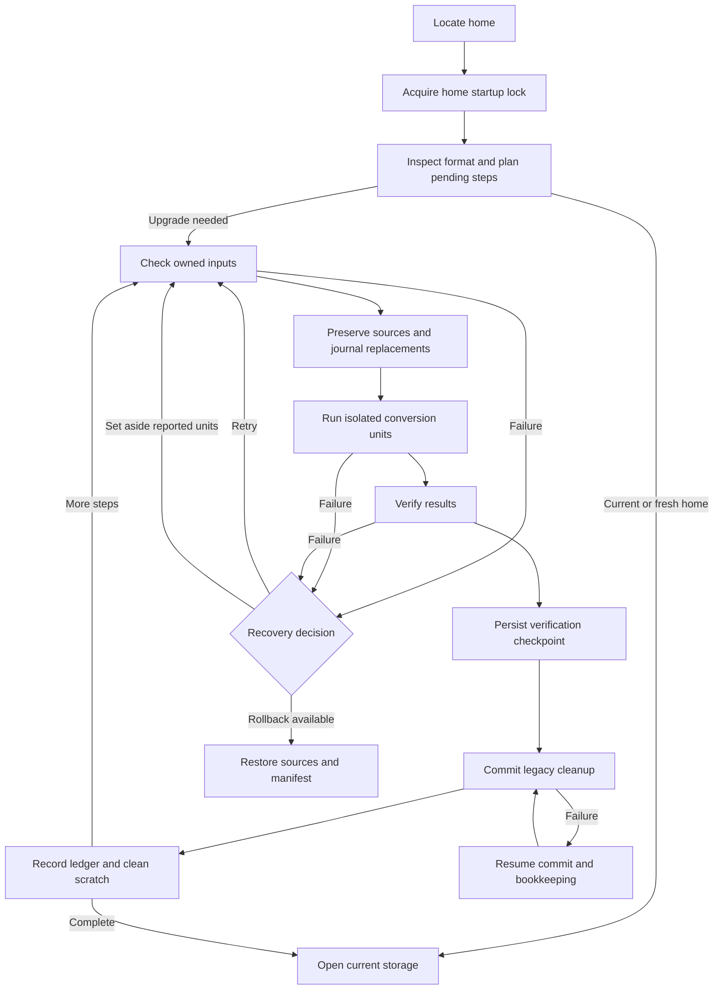

# Storage migrations

Home migrations upgrade persistent data when a release changes how Nerve stores it. They coordinate database, file and configuration changes before the normal runtime opens storage. The daemon runs the upgrade, the framework preserves recovery state, and the web app lets the user resolve damaged inputs while healthy data remains recoverable.

Preservation uses retained sources and a journal of original file state, rather than a full-home backup. That keeps rollback proportional to changed data. The verification checkpoint is the boundary after which cleanup may irreversibly remove legacy sources.

## Choosing the migration boundary

A **home step** coordinates an on-disk conversion across stores or files. Pure core SQL changes use the core's transactional migrations and separate SQL ledger. A **ledger** records which conversions have been applied; the home ledger lives outside SQLite so a step can replace the database itself. Schema changes still require prior approval under `AGENTS.md` because they affect the persistent data model.

All unreleased home changes since the root `package.json` release version belong in one draft step. Extend that step so the next release has one coherent conversion from its released predecessor. Releases without storage changes need no step.

The supported baseline is 0.34.1; older homes must first be opened with that release so admission starts from a known format. Fresh homes start at the current layout with registered steps recorded, because there is no legacy data to convert.

Steps use frozen local shapes and helpers so later application refactors cannot reinterpret an old conversion. Released steps are immutable and fixes ship in a subsequent step, preserving the meaning of their recorded checksums. A **checksum** identifies the conversion's file contents so the framework can detect unexpected changes. Legacy core conversion details live in the [0001 step README](../../packages/workbench-server/src/infrastructure/migrations/steps/0001-conversation-core/README.md).

## Isolating damage

A **unit** is an independently attributable input, such as a conversation or configuration file. Steps declare their owned inputs so unrelated files cannot become upgrade blockers. Unit conversion combines file isolation with step-supplied database transactions and report checkpoints, because restoring files alone cannot undo SQL or report changes.

For example, a malformed configuration file can be reported as a failed unit. If the user chooses to set it aside, the framework preserves it in **quarantine**, a recovery location containing the source and reason, then retries with that decision recorded. Healthy units can proceed without silently deleting the damaged source.

Home-wide integrity failures stop the upgrade because the framework cannot safely attribute them to an independent unit. Per-record salvage is preferable where supported, but coverage depends on the step. This is a preservation standard, not a promise that every corruption can be repaired automatically.

## Commit and rollback

Before verification is persisted, retained sources and journaled replacements support rollback. The journal preserves the first original state across retries so restoration targets the pre-step home. New destinations can be rebuilt or removed instead of copied into a full backup.

After verification is persisted, commit may delete legacy sources. An interrupted commit resumes cleanup and bookkeeping; it cannot promise restoration of sources already deleted. Reports survive scratch cleanup so set-aside units and recorded losses remain inspectable after success.

Migration and offline tools share the home startup lock. Startup retains ownership through storage opening and daemon publication so another writer cannot enter between those operations.

## Recovery decisions

Failures persist with the available recovery actions. Only reported units can be set aside, and those decisions survive restart so retry remains tied to the diagnosed inputs. Rollback restores the pending step's sources and manifest when available before the verified boundary.

Startup owns recovery presentation and daemon behavior; see [startup](startup.md#failures-and-recovery). Runtime settings repair has a separate [settings-health](storage.md#settings-health) path because it does not require rerunning an upgrade.

The standalone `storage:migrate` command uses the same runner and lock as startup so offline conversion follows the same data-safety rules. Its dry run plans admission and pending steps; corruption validation requires executing the step's checks.

## Adding or extending a step

1. Check the root `package.json` version to identify the latest release. Extend the single unreleased draft step for changes since that release, or create a step when there is no draft, so the release has a coherent conversion path.
2. Define owned inputs and isolated units using frozen local shapes and helpers. Keep legacy deletion in commit so earlier failures remain reversible.
3. For a new step, add its implementation to the ordered registry and its metadata to `MIGRATION_METADATA`. Compute the folder checksum with `hashStepFolder`, then update both that metadata and `migrations.lock.json` so planning and execution agree. Run `pnpm exec tsx scripts/storage-migrations/check.ts` to check consistency. The helper and checker are linked below; the checker does not regenerate checksums.
4. Write fixture tests for corruption, rollback and resume so recovery is exercised alongside successful conversion. Include byte-preservation and quarantine assertions where the step changes sources.
5. Rehearse on a stopped home copied into an unused slot with `pnpm storage:copy --slot N`, or use `pnpm storage:rehearse --from <stopped-home> --slot N`. Choose a slot other than 1 so rehearsal cannot modify the normal development home.

## Validation and ownership

Exception-injected phase tests do not cover every process-kill or filesystem durability boundary, so a passing fixture suite alone does not establish crash safety. Rehearsal also has isolation limits: copied project configuration is not a copied working tree, and copied credentials can still reach real providers. Check these boundaries before exercising a disposable home.

| Concern                                        | Owner                                                                                                                                                                                                                            |
| ---------------------------------------------- | -------------------------------------------------------------------------------------------------------------------------------------------------------------------------------------------------------------------------------- |
| Admission, planning and home ledger            | [`readMigrationHome`, `planMigrations` and `recordMigration`](../../packages/workbench-server/src/infrastructure/migrations/framework/ledger.ts)                                                                                 |
| Registry and frozen checksums                  | [step registry](../../packages/workbench-server/src/infrastructure/migrations/steps/index.ts); [`migrations.lock.json`](../../packages/workbench-server/src/infrastructure/migrations/migrations.lock.json)                      |
| Registration metadata and checksum calculation | [`MIGRATION_METADATA`](../../packages/workbench-server/src/infrastructure/migrations/framework/registry-metadata.ts); [`hashStepFolder`](../../packages/workbench-server/src/infrastructure/migrations/framework/lock.ts)        |
| Lock consistency check                         | [migration checker](../../scripts/storage-migrations/check.ts)                                                                                                                                                                   |
| Phase ordering and commit boundary             | [`runMigrations`](../../packages/workbench-server/src/infrastructure/migrations/framework/runner.ts)                                                                                                                             |
| Step and unit API                              | [`MigrationStep` and `StepContext`](../../packages/workbench-server/src/infrastructure/migrations/framework/step.ts); [`runUnit`](../../packages/workbench-server/src/infrastructure/migrations/framework/toolkit.ts)            |
| File preservation                              | [`MigrationFilesystem`](../../packages/workbench-server/src/infrastructure/migrations/framework/filesystem.ts); [`RollbackJournal`](../../packages/workbench-server/src/infrastructure/migrations/framework/rollback-journal.ts) |
| Shared startup exclusion                       | [`acquireStorageStartupLock`](../../packages/workbench-server/src/infrastructure/storage-bootstrap/startup-lock.ts)                                                                                                              |
| Recovery decisions                             | [`discardFailedItems` and `rollbackFailedMigration`](../../packages/workbench-server/src/infrastructure/migrations/framework/recovery.ts)                                                                                        |
| Core SQL migration boundary                    | [`coreMigrations` and `migrate`](../../packages/conversation-core/src/storage/migrations.ts)                                                                                                                                     |
| Safe rehearsal tooling                         | [`storage:rehearse`](../../scripts/storage-migrations/rehearse.ts)                                                                                                                                                               |
