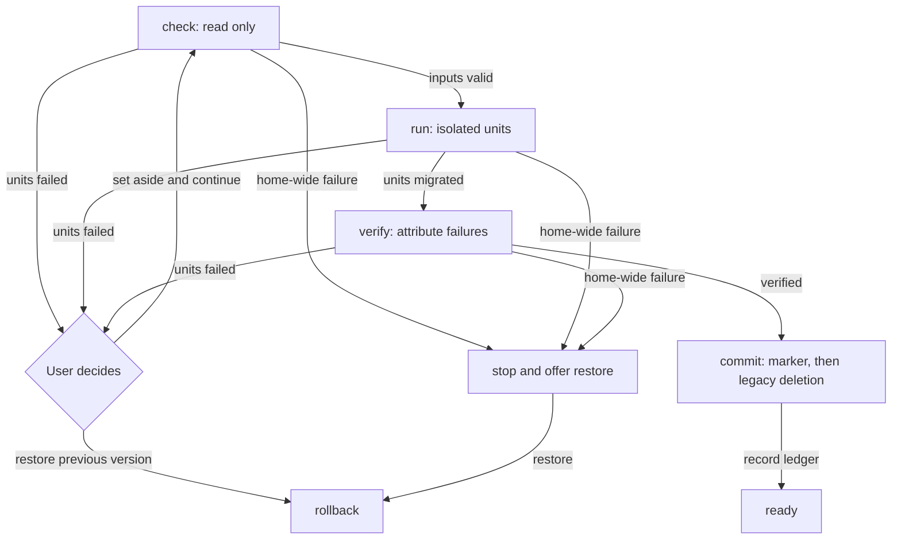

# Storage migrations

This is the standard for storage migrations. The target lifecycle and safety
rules below apply to every future step. The final status table distinguishes
implemented behavior from framework work still planned; it is not a claim that
step 0001 already meets every rule.

See [startup](startup.md) for server boot and recovery UI ownership, and
[storage](storage.md) for the home layout and conversation-core storage.

## Guarantee

A stable release must never fail to start or lose the home because of one broken
conversation or settings file. Invalid LLM output, crashes and manual edits are
normal inputs to recovery, not reasons to abandon the home.

Only home-wide damage stops an upgrade. Even then, before commit, the previous
version's home must be restorable. Recovery must not require editing a ledger or
finding a backup by hand.

## When a migration exists

A step exists only when a release changes on-disk storage: SQLite schema or data,
managed files, or configuration document formats. Releases without such changes
have no step. All unreleased changes since the last release belong in one step;
extend that draft rather than adding another. The root `package.json` version
identifies the latest release.

Pure SQL changes inside conversation core use its ordered transactional
`SCHEMA_MIGRATIONS`. These are atomic and fast; failure leaves the database
untouched, so they need no file rollback journal. A home step coordinates changes
across stores, files or configuration. Do not duplicate the core's SQL machinery.

An up-to-date home must pay only a manifest read for migration discovery, not a
scan of conversations or configuration. The current runner also attempts cleanup
of applied-step scratch directories and stale recovery files; it does not walk
conversation data when no step is pending.

## Frozen steps

A step never imports application code. Use Node built-ins, the framework and
local frozen shapes/helpers, so later refactors cannot change an old conversion.
A released step is never edited; fixes are new steps.

There is one baseline: release **0.34.1**. Older homes must be opened with 0.34.1
first. No compatibility sweep or permanent legacy loader belongs in the runtime.

```text
packages/workbench-server/src/infrastructure/migrations/
├── framework/          # runner, context, ledger, lock, recovery, worker
├── steps/
│   ├── index.ts        # ordered registry
│   └── 0001-conversation-core/
└── migrations.lock.json
```

`migrations.lock.json` records each step's checksum and stage: `draft`, or
`released` with `releasedIn`. Checksums cover file names and bytes in stable order.
Registry, folders and lock IDs must match. `pnpm check` rejects changed released
steps. Draft steps may change until release.

## Admission and ledger

The runner works under the home startup lock. Startup retains that lock through
storage opening and daemon publication. Standalone migration and recovery acquire
the same lock; two processes must never upgrade one home concurrently.

- Empty home: initialize the latest layout and record every step as applied.
  No conversion runs.
- Existing home with a ledger: validate its ordered prefix against the registry.
  Unknown/out-of-order IDs and released checksum mismatches fail admission.
- Existing home without a ledger: require manifest version 1 and the 0.34.1
  database ledger's first ten migration IDs (0001–0010). Otherwise report
  `Run Nerve 0.34.1 first`.

The home ledger is `manifest.json`:
`migrations: [{ id, checksum, appliedAt }]`. It lives outside SQLite so a step can
replace the database. Append it atomically after successful verification and
commit, then remove the step scratch directory.

Baseline admission retains the original manifest as
`migrations/work/manifest.before.json` before adding an empty ledger. Recovery
restores those original bytes when rolling back the initial, unrecorded step.
The current backup logic is for baseline admission, not a general manifest
snapshot before every future step.

## Standard lifecycle

The framework must enforce four phases. Separate `check` and `commit` hooks are
planned; today's interface has `run`, optional `verify`, and optional rollback
hooks. Step 0001 implements its own preflight and commit boundary inside them.



### Check

Read-only. Validate every input the step will read, including its shape, not just
JSON syntax. Report all bad units together rather than stopping on the first.
Read only declared owned paths. Missing optional inputs are not corruption;
missing required inputs must be attributed to their owner.

Do not add a second full input scan for safety. Check reads only what run will
read anyway; retain checked data or bounded per-unit results for run. No writes,
renames or set-aside operations occur during check.

### Run

Process one isolated unit at a time. Journal in-place writes before they happen.
A failed unit rolls back its database transaction, files and report entries; other
units continue. Collect failures and raise one `DiscardableMigrationError` for
the phase after all units have been attempted.

A unit is `{ kind, id, title? }`. Current kinds are `conversation` and
`configuration`; extend them when another independent owner is needed.
Conversation IDs identify source conversations; configuration IDs are absolute
file paths. Failure items also carry a short, actionable `reason`.

### Verify

Verify the replacement against the checked source and import receipts. Attribute
history, record and asset failures to their unit and report all failed units
at once. Home-wide checks remain fatal: schema identity, database integrity and
cross-unit invariants cannot be waived by discarding an arbitrary conversation.

Verification is proportional to the data. Reuse digests, mapped heads, coverage
counts and other import receipts rather than repeatedly walking the same source.
Do not turn an attributable record failure into a home-wide exception.

### Commit

This is the point of no return: persist the verified marker first, then delete
legacy sources. Rollback is unavailable once the marker exists. No destructive
operation occurs before commit; reversible, journaled replacements are allowed.
The runner must own the marker and commit phase rather than trusting each step
to order them correctly. This framework ownership is planned.

A crash after the marker resumes cleanup, not conversion. A crash after the ledger
append resumes scratch cleanup. Never delete the only source before verification.
Commit failure may require cleanup retry; it cannot promise pre-commit rollback.

## Cost and rollback

No full-home backup or snapshot per migration. Retain legacy sources and keep a
write-ahead journal only for in-place changes:

- original bytes of files rewritten or removed, with required file metadata;
- renames and their original locations;
- directory entry snapshots, so rollback can remove newly created layout dirs.

New-layout file contents are not journaled: they can be removed and rebuilt.
Preserve the first original state across retries, not an intermediate rewrite.
Use atomic file replacement. Rollback itself must resume safely after a crash.

One read pass per unit is the target, not repeated preflight/import scans.
Set-aside uses rename rather than copy wherever possible. Export only failed
rows when their source is a shared database. Do not copy the whole database for
one bad conversation.

Discarding only import-time failures already reuses the completed import in
step 0001: those units left no imported state, so retry only re-verifies.
Discarding verification failures currently rebuilds the import without them.

## Framework toolkit

The following is planned framework API, not the current `StepContext`:

- `ctx.fs`: automatically journal writes, renames and removals.
- `ctx.unit({ kind, id, title }, fn)`: isolate transaction, files and report
  entries; aggregate unit failures without stopping the step.
- `ctx.readJson(path, schema)`: checked reads attributed to the current unit.
- Declared owned paths: files outside them are never read or upgrade-blocking.
- Runner-owned verified marker and commit, with rollback as the framework default
  rather than an optional per-step hook.

Owned paths matter: step 0001 currently enumerates all JSON in user and registered
project configuration directories. A leftover `config/mcp.json` from an unmerged
branch can therefore block an upgrade even though no conversion owns it. The
standard forbids that behavior; narrowing ownership is planned, not implemented.

Today's context provides `paths`, `scratchDir`, persisted `discarded` IDs,
`progress(...)` and `log(message)`. Steps currently use filesystem and SQLite APIs
directly. Unit isolation and checked reads are step-local, not framework defaults.

## Set aside and salvage

The standard's set-aside operation is quarantine, not deletion. Planned location:
`home/quarantine/<step>/<unit>/`, containing raw source bytes or records and the
reason. Use rename for standalone files and export only failed database rows.
Quarantined data must remain recoverable after successful upgrade.

A persisted upgrade report must survive scratch cleanup and be shown after
success, for example: “2 conversations were set aside”. This is planned.
Prefer per-record salvage before quarantining an entire unit: import readable
records, insert a placeholder for a lost record and record the loss explicitly.
This is planned; never silently invent history or silently drop damage.

Current behavior differs: discarded conversations are excluded and their legacy
directories are deleted during committed cleanup; the legacy database is also
removed. Discarded configuration is renamed to adjacent `.corrupt` files, with
numeric suffixes on collisions. Runtime resets use `.invalid-<time>` files.
These are not the planned quarantine/report contract.

## Settings and runtime

The runtime owns six home documents: `daemon`, `harness`, `ui`, `permissions`,
`providers` and `integrations`. A migration never rewrites an unreadable one.
Step 0001 leaves it untouched and treats it as empty for conversion purposes.
Startup validates all six and reports invalid documents together as
`CONFIGURATION_INVALID`. On request it renames the selected originals aside and
writes runtime defaults. This explicit reset flow is implemented.

Starting on in-memory defaults without overwriting the file, with a non-blocking
notice, is planned. Today invalid runtime settings still block readiness until
repaired or reset; the stronger startup guarantee is not yet automatic.

The same principles apply to damaged conversations at runtime, but runtime
conversation recovery is outside this document. See [storage](storage.md).
Any database table/column change requires explicit prior approval under the root
`AGENTS.md`; recovery is not permission to grow the schema.

## Recovery protocol

The runner writes `migrations/last-failure.json` with `step`, `phase`, `error`,
`failedAt`, optional `discardable` items and `rollbackAvailable`. Global failures
stop the upgrade and offer restore when rollback remains available. A failure
before a rollback-capable step is established may not offer it today.

The daemon stays alive in `failed`, serving lifecycle routes and the workbench
recovery screen. Recovery is workbench-owned, not an Electron error page.

- `POST /api/lifecycle/retry` accepts `{ discardIds }` or an empty request for
  ordinary retry. IDs must come from the reported failures.
- Migration discard choices accumulate in the step scratch directory's
  `discarded.json`; they survive restart until the step records successfully.
- `POST /api/lifecycle/rollback` restores the failed, unrecorded step if available,
  then restores the baseline manifest backup where applicable.
- Successful rollback enters terminal `MIGRATION_ROLLED_BACK`, with retry disabled.
  The daemon stays up so the desktop supervisor does not restart the upgrade.
  Quit and reinstall the previous version to use the restored home.

Accepted recovery requests return 202 with the new lifecycle; unavailable actions
return 409. Follow progress through `GET /api/lifecycle`. See [startup](startup.md)
for authentication, boot gating and reconnection rather than duplicating them here.

## Progress and resumption

Every long phase has a plain-language label and, when known, a count and total:
“Importing conversations”, 120 of 393. Startup exposes this as `upgrading`.
The workbench splash shows the label and determinate progress when possible.

The runner logs start, phase changes with previous-phase duration, periodic
progress, and completion or failure with the report path. Step logs and checkpoints
live in its scratch directory and are removed after success. Do not rely on them
as the eventual persisted user-facing upgrade report.

Daemon migrations run in a worker thread so synchronous SQLite does not starve
HTTP or lifecycle polling. Long loops also yield to the event loop. Standalone
`pnpm storage:migrate --home <dir> [--dry-run]` uses the same runner on a stopped
home; dry-run plans admission and pending steps, not a full corruption check.

## Step 0001 — conversation core

The draft converts the 0.34.1 home to conversation core and file-owned config:

1. Require 4 GiB free, plus a runtime check for 15% of legacy database size.
   Rename legacy SQLite sidecars before the main file to
   `data/nerve.sqlite.migrating`. Retain that source across retries; discard any
   partial destination database on a full rerun.
2. Preflight user/project JSON and conversation overlays before configuration
   conversion. Collect invalid configuration items together; leave unreadable
   runtime-owned documents for startup recovery. This preflight is inside run,
   after source rename, and is not the target read-only framework check.
3. Convert permission levels/rules, suggestion predicates and enablement,
   sub-agent settings and scoped profiles, and project task/launch definitions.
   Journal in-place config/project changes. Reassess trust for converted content.
4. Import projects, trust, scratch notes, conversations, events, queued inputs,
   async bash and assets using frozen local schema/importer code. Each source
   conversation tree has its own transaction and report/file rollback. Continue
   after a failed conversation and collect failures for verify.
5. Write child/root capability and permission overlays under full conversation
   IDs. Preserve referenced task outputs in conversation storage; convert launch
   log directory names with journaled renames, retaining collisions.
6. Verify selected history, user-message digests, mapped heads, tool pairing,
   projected payloads, asset sizes/coverage, row counts, schema checksum, foreign
   keys and `quick_check`. Attribute supported history/event/asset failures to
   source conversations; home-wide assertions remain fatal.
7. Raise one `DiscardableMigrationError` containing import and verification
   failures before marking verified. Otherwise write `verified.json`, update
   manifest version to 2, then remove legacy sources. This is today's step-owned
   commit inside `verify`, not a separate framework hook.
8. Delete excluded legacy conversation dirs, relocated payload sources, task and
   report bundles, query cache, old journals/migration folders and obsolete
   databases. Delete `.migrating` sidecars and database last. The runner then
   appends the ledger and removes scratch, including the rollback journal.

A verified retry resumes verification/cleanup using the summary even after source
removal. No backup remains after success. Before the marker, rollback restores
journaled files, links, directory entries and renames, removes the new database,
and returns the retained source and sidecars to their original names.

Processes are not resumed. Imported bash process references remain null.
Historical lossy mappings and missing assets are counted in the import summary;
this is not the planned general per-record salvage or durable upgrade report.
Some ancillary records (agents, tasks and queued inputs) are decoded globally
before the conversation loop; corruption there can still abort the whole step.
Moving those reads into attributable units is required by the standard.

### Profile conversion limits and manual review

Conversion covers user resources and projects registered in the source database,
not unregistered projects or arbitrary directories. Later-opened old projects
need explicit canonical `.nerve/config/subagents.json` conversion; there is no
runtime legacy Markdown loader.

Conflicting legacy/canonical documents and incompatible capability shadowing
still require manual resolution in step 0001. Legacy same-name definitions
replaced entire tool/skill maps; canonical sparse maps merge keys. Do not invent
toggles or silently broaden capabilities. Preserve sources and retry after an
explicit decision. These conversion conflicts are not all isolated discardable
units today; the framework standard requires that improvement.

### Development homes with an earlier draft applied

Extending unreleased step 0001 does not rerun an already-applied ledger entry.
Use a fresh slot or copy a pre-upgrade baseline into an isolated slot and run the
extended migration there. Do not remove ledger entries to force replay against
converted data. This is a dev-only draft limitation, not a new released step or
compatibility loader.

## Testing and rehearsal

Each step needs unit tests for corruption handling, attribution, retry and rollback.
Step 0001 tests aggregated failures, import reuse, verification-failure re-import,
configuration set-aside, and restoration of original database/file bytes.

Planned shared corruption suite, required for every step:

- Truncate each JSON input, garbage each record kind, and remove required files.
- Assert unit damage is never fatal unless it is genuinely home-wide.
- Assert rollback restores byte-identical sources and set-aside completes.
- Crash and resume at every phase, including marker/cleanup/ledger boundaries.

Planned `pnpm storage:rehearse` automates copying a baseline home into a slot,
redirecting registered projects to slot-local `.nerve` copies, injecting corruption,
checksumming the baseline and driving the lifecycle API. Real repositories must
never receive rehearsal writes. Full copied baselines are test isolation, not a
per-migration production backup strategy. Use copied/fresh slots, not slot 1.

Manual PR rehearsal covered 311 conversations, roughly 90–100 seconds of import,
and byte-identical restoration. This is evidence for that copied home, not proof
that every corruption or crash boundary is covered.

## Writing a new step

- Confirm an on-disk change needs a home step rather than core SQL alone.
  Extend the current unreleased step when one exists.
- Declare owned paths and independent units; never scan unrelated files.
- Check every required input read-only and aggregate all bad units.
- Run journaled, isolated units; roll back failed unit files and report entries.
- Verify per-unit results and keep home-wide invariants fatal.
- Commit only after verification: marker first, legacy deletion second.
- Make run, cleanup and rollback resumable; do not add full-home snapshots.
- Keep imports frozen and local; use clear progress labels and bounded diagnostics.
- Add unit tests and, when available, pass the shared corruption/rehearsal suite.
- Register the ordinal folder/ID and lock entry as `draft`; freeze checksum and
  record `releasedIn` when changing its stage to `released`.
- Until the planned toolkit lands, supply these guarantees explicitly in the step;
  the existing interface does not enforce them for you.

## Implementation status

| Item                                                                           | Status                                                                        |
| ------------------------------------------------------------------------------ | ----------------------------------------------------------------------------- |
| 0.34.1 admission, manifest ledger, home lock, released-step immutability       | Implemented                                                                   |
| Fresh-home latest layout; pending-only conversion                              | Implemented                                                                   |
| Strict manifest-read-only up-to-date fast path                                 | Planned; runner also attempts recovery cleanup                                |
| Transactional core `SCHEMA_MIGRATIONS`                                         | Implemented                                                                   |
| Worker, lifecycle progress and phase logging                                   | Implemented                                                                   |
| Retained source, write-ahead journal, resumable cleanup and rollback           | Implemented in step 0001                                                      |
| Conversation transaction/file/report isolation and aggregated failures         | Implemented in step 0001; ancillary global decoding still has gaps            |
| Attributed verification                                                        | Implemented for supported per-conversation checks; global checks remain fatal |
| Import-time discard reuse and re-verification                                  | Implemented                                                                   |
| Read-only check/run/verify/commit enforced by runner                           | Planned                                                                       |
| Framework journal, `ctx.fs`, `ctx.unit`, `ctx.readJson`, default rollback      | Planned                                                                       |
| Owned-path declarations and no unrelated-file blocking                         | Planned                                                                       |
| One-pass checked inputs and receipt-based verification without re-walks        | Planned; step 0001 still rescans source/configuration                         |
| Quarantine rather than conversation deletion/scattered aside files             | Planned                                                                       |
| Per-record salvage and persisted post-success upgrade report                   | Planned                                                                       |
| Unreadable runtime settings preserved, `CONFIGURATION_INVALID`, explicit reset | Implemented                                                                   |
| Non-blocking startup on in-memory settings defaults                            | Planned                                                                       |
| Failure fields, retry/discard, rollback API and terminal rollback state        | Implemented                                                                   |
| Manifest restoration on rollback                                               | Implemented for initial baseline admission; per-step generalization planned   |
| Per-step recovery unit tests                                                   | Implemented for step 0001                                                     |
| Shared mandatory corruption/crash suite and `pnpm storage:rehearse`            | Planned                                                                       |
