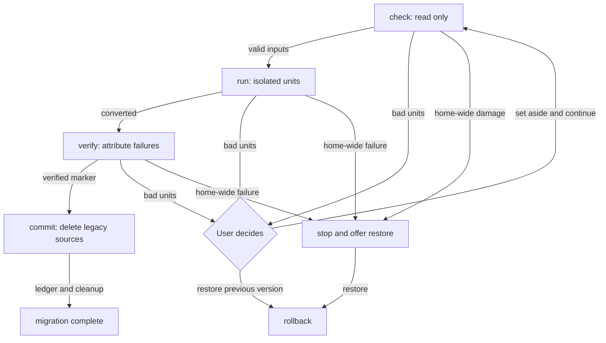

# Storage migrations

One mechanism upgrades a Nerve home across changes to SQLite data, managed files
and configuration formats. It runs before normal storage opens, while HTTP and
the workbench recovery screen are available. See [startup](startup.md) for boot
ownership and [storage](storage.md) for the home layout.

## Guarantee

A stable release must not fail to start or lose the home because of an individual
broken conversation or settings file. Invalid LLM output, crashes and manual edits
are normal recovery inputs. Isolate damaged units; keep healthy data usable.
Only home-wide damage stops an upgrade. Before commit, the previous version's
home must remain restorable without manual ledger edits.

This is the migration standard, not a claim of exhaustive corruption coverage.
The limits at the end describe the remaining coverage and automation boundaries.
Runtime damaged-conversation handling is outside this document; the same
preservation and attribution principles apply there.

## When a step exists

Add a step only for on-disk changes. Releases without storage changes have none.
All unreleased home changes since the latest release belong in one draft step;
extend it rather than adding another. The root `package.json` version identifies
the latest release.

Pure SQL changes inside conversation core use its transactional
`SCHEMA_MIGRATIONS`, separately from home steps. They are atomic and fast; a
failed transaction leaves the database untouched and needs no file journal.
Use a home step to coordinate conversions across stores, files or configuration.
Database schema changes still require explicit prior approval under `AGENTS.md`.

An up-to-date home reads the manifest and performs one existence check for a
cleanup marker. There is no conversation/configuration scan. Only an interrupted
upgrade with cleanup outstanding triggers recovery cleanup on that path.

## Baseline and frozen release policy

There is one baseline: **0.34.1**. Older homes must be opened with that version
first. No permanent legacy loader or compatibility sweep belongs in the runtime.
A fresh home starts at the latest layout with all registered steps recorded;
no conversion runs.

An existing home needs an ordered manifest ledger, or the recognized 0.34.1
manifest/database migration history. Unsupported homes report
`Run Nerve 0.34.1 first`. Unknown/out-of-order ledger entries and changed released
checksums fail admission.

Steps live in `infrastructure/migrations/steps/`, with an ordered registry and
`migrations.lock.json`. A step imports only Node built-ins, the framework and
frozen local helpers/shapes, never application code. Later refactors must not
change an old conversion.

The lock records each folder's checksum and `draft` or `released` stage, with
`releasedIn` for released steps. Checksums cover names and bytes in stable order.
Registry, folders and lock IDs must match. Drafts may evolve until release;
released steps are immutable and checks reject changes. Fixes ship as new steps.
Step-specific conversion mappings and development-home caveats belong in each
[step README](../../packages/workbench-server/src/infrastructure/migrations/steps/0001-conversation-core/README.md),
not in this architecture.

## Lock and ledger

Migration and recovery share the home startup lock. The startup caller retains
it through storage opening and daemon publication; standalone tools acquire the
same lock. Two processes must never upgrade one home concurrently.

`manifest.json` stores `migrations: [{ id, checksum, appliedAt }]` outside SQLite,
so a step can replace the database. The runner keeps original manifest bytes for
the pending step; baseline admission also preserves the pre-ledger manifest.
Rollback restores the appropriate original bytes, not a reconstructed document.

After commit, append the ledger atomically, then remove scratch state. An
interrupted ledger/scratch cleanup resumes on the next start. The ledger is not
a database schema version: conversation core owns its separate SQL ledger.

## Lifecycle

The runner orders `check` → `run` → `verify` → `commit`, collects phase failures,
and owns the verified marker. Steps supply conversion and invariant logic.

- **Check:** read-only validation of the inputs the step owns and will consume.
  Validate shapes as well as syntax; report all bad units together. Distinguish
  absent optional inputs from missing required data. Set-aside writes wait for run.
- **Run:** journal writes and convert one isolated unit at a time. Roll back a
  failed unit's transaction, files and report entries, then continue other units.
- **Verify:** attribute record/history/asset failures to units. Schema identity,
  integrity and genuinely cross-unit invariants remain home-wide and fatal.
  Reuse import receipts and digests; verification must be proportional to data.
- **Commit:** the runner persists the verified marker before invoking legacy
  deletion. This is the point of no return: rollback is unavailable afterwards.
  A verified retry skips conversion and resumes commit, report and ledger work.

No irreversible source deletion before commit. Reversible journaled replacements
are allowed during run. Commit failure needs cleanup retry, not a promise of
pre-commit rollback. Admission damage may prevent rollback from being offered,
but must not mutate the source home.

## Framework toolkit and units

Current unit kinds are `conversation` and `configuration`, extensible for other
independent owners. A failure carries `{ kind, id, title?, reason }`.
IDs are opaque, stable unit identities. File-backed configuration units use
absolute paths; database-backed configuration units may use stable legacy-record
identifiers instead.
The framework raises one `DiscardableMigrationError` containing phase failures.

- `ownedPaths` and `ctx.ownPaths(...)` declare exact input paths and trusted roots.
  Unrelated files must never be read or become upgrade blockers.
- `ctx.readJson(path, schema)` checks owned JSON, records checked text and
  attributes invalid input to its unit or configuration file.
- `ctx.unit({ kind, id, title }, fn, options)` provides file isolation, optional
  transaction/checkpoint hooks, and aggregated errors. Steps must supply the
  database transaction and report checkpoint where those resources are involved.
- `ctx.fs` journals filesystem mutations automatically and rejects writes during
  check. Use it rather than bypassing the framework with raw conversion writes.
- `ctx.quarantine(...)` preserves selected units; `ctx.loss(...)` records losses.
  `scratchDir`, persisted discard decisions, progress and logging support resume.

A stray configuration file from another branch must not block an upgrade.
The framework's ownership checks are a boundary, not permission for steps to
scan arbitrary directories or import live application validators.

## Cost and rollback

No full-home backup or snapshot per migration. Retain legacy sources and journal
only in-place changes: original file bytes/metadata, renames and directory entry
snapshots. New-layout contents are rebuilt or removed, not copied into a backup.
Preserve the first original state across retries. Use atomic replacements and
resumable rollback; framework restoration precedes any step-specific source undo.

Check must not introduce a second full read pass for safety. Reuse checked data,
digests and import receipts instead of repeated walks. Set-aside uses rename
where possible; export failed rows from shared databases rather than copying the
whole database. An import whose only failed units left no destination state can
be reused after discard, with verification only; avoid rebuilding healthy data.

## Quarantine and success reports

Set aside means preservation, not deletion. Migration quarantine lives under
`home/quarantine/<step>/<unit>/`, with raw files or exported records and a reason.
The framework gives units safe, collision-resistant directory names. Quarantine
survives successful upgrade; rollback reverses pre-commit quarantine moves.

Reports under `migrations/reports/` retain set-aside units, reasons, quarantine
paths and recorded losses after scratch cleanup. The workbench presents unseen
reports after success, for example “2 conversations were set aside”.
`GET /api/storage/upgrade-reports` lists unseen reports;
`POST /api/storage/upgrade-reports/:step/dismiss` marks a report seen without
deleting its data. Damaged reports do not block the workbench.

Prefer conservative per-record salvage before whole-unit quarantine: keep readable
records and record any lost record explicitly rather than inventing history.
General salvage coverage is still evolving; do not assume every record kind can
be repaired automatically.

## Runtime-owned settings

Migrations never overwrite an unreadable runtime-owned home document: `daemon`,
`harness`, `ui`, `permissions`, `providers` or `integrations`. Runtime reads use
in-memory defaults for invalid documents, preserve source bytes and expose a
non-blocking settings-health notice. Normal startup remains available.

Writes to invalid documents are blocked until explicit resolution. Reset moves
the original to `quarantine/settings/` and writes defaults; reload validates a
user-repaired file before clearing the invalid state. Both refresh live settings
and dependent services, including provider catalog notifications. Merely editing
the file does not silently authorize saving cached defaults over it.

Invalid permissions or harness settings require explicit tool approval until
reset or reload; fallback defaults must not grant autonomous execution.
Settings health and resolution use `/api/settings/health` and
`/api/settings/health/resolve`, not a blocking migration recovery screen.

## Recovery and progress

Failures persist in `migrations/last-failure.json` with step, phase, error, time,
optional `discardable` units and `rollbackAvailable`. The daemon remains alive
in `failed`; workbench-owned screens offer set-aside/continue or restore where
available. Electron only handles an unreachable server, not migration decisions.

`POST /api/lifecycle/retry` accepts `{ discardIds }` or an empty retry request.
Only reported IDs are accepted; decisions persist in step scratch across restart.
`POST /api/lifecycle/rollback` restores the pending step and manifest, then enters
terminal, non-retryable `MIGRATION_ROLLED_BACK`. The daemon stays up so the desktop
supervisor cannot rerun the upgrade. Quit and reinstall the previous version to
use the restored home. Accepted recovery requests return 202; unavailable actions
return 409. See [startup](startup.md) for lifecycle polling and authentication.

Every long phase reports a plain-language label and counts when known.
The runner logs phase durations, periodic progress, completion and failure report
paths. Step logs/checkpoints are temporary, unlike upgrade reports. Daemon
migration runs in a worker thread so synchronous SQLite cannot starve HTTP.
Long loops also yield. Standalone `pnpm storage:migrate --home <dir> [--dry-run]`
uses the same runner; dry-run plans admission/pending steps, not corruption checks.

## Tests, rehearsals and limits

Each step needs focused unit tests plus the shared corruption suite. Generated
cases truncate JSON inputs, garbage record kinds and remove required files;
assert attributable failures, byte-identical source rollback and set-aside retry.
Safe optional/runtime inputs may succeed without a migration failure. Known gaps
must remain explicit, not hidden behind a passing happy-path test.

Crash-resume tests currently inject exceptions at progress events, not every
filesystem durability boundary or process-kill window. Finer crash coverage
remains necessary; resumability is not established by phase tests alone.

`pnpm storage:rehearse` copies a stopped baseline into an isolated slot, redirects
registered projects to slot-local `.nerve` copies, optionally injects corruption
and writes checksums of the prepared baseline. It prints instructions for starting
the daemon, exercising recovery and checking restoration. It does not yet drive
the lifecycle API automatically. Copied credentials can still reach real providers;
project copies contain configuration, not working trees. Never rehearse on real
homes or write real project repositories. Full copied homes here are test
isolation, not the production migration strategy.

## Writing a step

- Confirm a home step is needed; pure core SQL stays separate. Extend the current
  unreleased draft when one exists.
- Declare owned inputs and units; check read-only, run isolated journaled writes,
  verify attributed results, and reserve legacy deletion for commit.
- Keep imports frozen/local, actions resumable and progress labels understandable.
- Supply transaction/report hooks and source-specific rollback where needed.
- Test corruption, quarantine, byte restoration and resume using isolated fixtures.
- Register the ordinal ID/folder and draft lock entry; freeze its checksum and
  record `releasedIn` when promoting to released.
