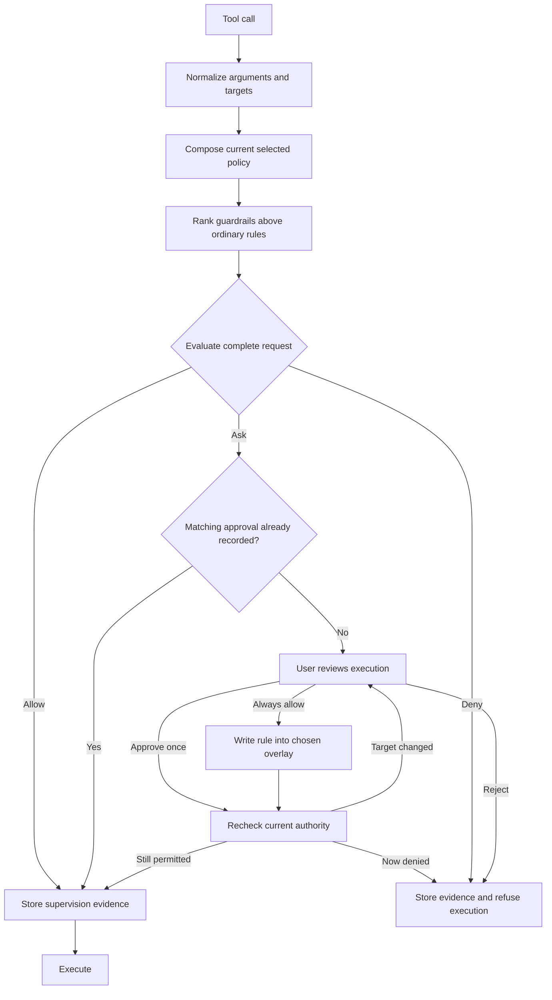

# Permissions

The permission subsystem decides whether a tool call can run automatically, needs user approval or must be denied. Tools describe the resources they affect, the host loads trusted policy, and conversation core supervises the call before execution. This separation lets policy change independently of tool implementations while keeping a record of why each call ran or stopped.

## Terms

| Term               | Meaning                                                                                                                                                            |
| ------------------ | ------------------------------------------------------------------------------------------------------------------------------------------------------------------ |
| Rule set           | A named collection of rules selected for a conversation.                                                                                                           |
| Baseline           | Built-in policy composed into lead conversations to provide common protections and defaults.                                                                       |
| Overlay            | Additional rules for a selected rule set, stored at user, project or conversation scope.                                                                           |
| Guardrail          | A prompt-or-deny rule that outranks ordinary rules, including later overlay grants.                                                                                |
| Allow / ask / deny | Run automatically, request user approval, or refuse execution. The evaluator calls the ask outcome `prompt`.                                                       |
| Approval grant     | “Always allow” persists a rule in a chosen overlay so matching future calls can be authorized by policy. One-time approval applies only to the reviewed execution. |

## Authorization flow

A **target** is a normalized resource affected by the call, such as a path or command. Normalization gives policy a consistent representation to match, so equivalent argument spellings cannot accidentally acquire different authority.

For leads, policy composition brings together:

1. Baseline.
2. The selected rule set.
3. User, project and conversation overlays bound to that rule set.

Guardrails take precedence over ordinary rules. Within an enforcement class, scope rank and rule priority determine precedence, so an overlay grant cannot defeat a guardrail. Each overlay binds to a particular rule set because a grant made under one policy must not leak into another: allowing a command under Supervised should not automatically grant it under Planning.

An allowing rule must cover the complete request because a tool can affect several resources. Allowing a source file alone must not authorize a call that also writes to an unrelated destination. Invalid arguments, unnormalizable targets and incomplete policy fail closed rather than becoming automatic permission.

For example, a user reviewing a bash call for `pnpm test` can choose “Always allow” and store a matching rule in the project overlay. That rule applies to the selected rule set and remains subject to guardrails and the rest of the request's targets.

## Trust and child policy

Project overlay trust binds to a **digest**, a hash of the file's exact bytes, so edits require renewed trust before they can grant permission. Untrusted project overlays are excluded with diagnostics. Unknown, disabled or malformed selected policy and malformed required overlays block affected execution because approval must not substitute for missing security configuration.

Children use an allowed rule set without Baseline or overlays. Their rule sets do not ask for human approval, and excluding overlays prevents grants made for interactive lead work from widening delegated execution. Child authorization is independent of the lead's policy; see [agent profiles and delegation](conversation-core/delegation.md#rules-enforced-for-every-sub-agent).

Rule-set definitions and overlays are separate resources so reusable policy can remain distinct from local grants. Persistent approval writes go into overlays; rules contain no secrets. Policy controls tool admission rather than operating-system isolation, so it should not be treated as a sandbox or a proof that shell or Python source is safe.

## Admission and evidence

Core stores the decision and its supporting authority with the call and preserves supervision evidence in history, so later edits do not erase why execution was allowed or stopped. Approval binds to the reviewed execution evidence: a changed target requires fresh approval, and a later denial defeats earlier approval.

Current policy is rechecked after approval waits and during restart recovery because queued work may outlive the policy under which it was requested. See [configuration activation](configuration.md#persistence-and-activation) and the [tool-call lifecycle](conversation-core/tool-call-lifecycle.md) for capture and recovery boundaries.

## Where it lives

| Concern                                   | Owner                                                                                                                                                                                                                                   |
| ----------------------------------------- | --------------------------------------------------------------------------------------------------------------------------------------------------------------------------------------------------------------------------------------- |
| Rule contracts and guardrail validation   | [`permission-rule-sets.ts`](../../packages/contracts/src/domains/permissions/permission-rule-sets.ts)                                                                                                                                   |
| Normalization, composition and evaluation | [`normalizePermissionRequest`, `composeEffectivePermissionPolicy`, `evaluatePermissionRequest`](../../packages/tools/src/policy/permission-policy.ts) and [policy tests](../../packages/tools/test/policy/permission-rule-sets.test.ts) |
| Built-in policy                           | [Rule-set definitions](../../packages/tools/src/policy/rule-sets/)                                                                                                                                                                      |
| Loading, health and current selection     | [`createPermissionConfigurationService`](../../packages/workbench-server/src/core-host/permission-configuration.ts) and [`createScopedPermissionSource`](../../packages/workbench-server/src/core-host/scoped-permission-source.ts)     |
| Overlay locations and persistent grants   | [`ConfigurationScopePaths`](../../packages/workbench-server/src/infrastructure/configuration/scope-paths.ts) and [`createPermissionPort`](../../packages/workbench-server/src/core-host/permission.adapter.ts)                          |
| Exact-content project trust               | [`trustProjectPermissions`](../../packages/workbench-server/src/core-host/permission-overlays.ts)                                                                                                                                       |
| Admission and durable evidence            | [`ToolCallService`](../../packages/conversation-core/src/tool-calls/tool-call.service.ts) and [admission tests](../../packages/conversation-core/src/tool-calls/execution-admission.test.ts)                                            |
