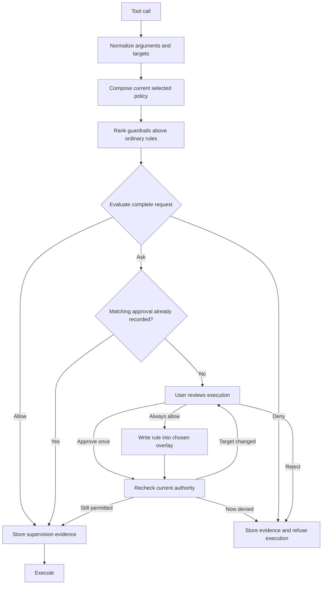

# Permissions

The permission subsystem decides whether a tool call can run automatically, needs user approval or must be denied. Tools describe the resources they affect, the host loads trusted policy, and conversation core supervises the call before execution. This separation lets policy change independently of tool implementations while keeping a record of why each call ran or stopped.

## Terms

| Term           | Meaning                                                                                                                                                            |
| -------------- | ------------------------------------------------------------------------------------------------------------------------------------------------------------------ |
| Baseline       | Built-in policy composed into lead conversations to provide common protections and defaults.                                                                       |
| Overlay        | Additional rules for a selected rule set, stored at user, project or conversation scope.                                                                           |
| Guardrail      | A prompt-or-deny rule that outranks ordinary rules, including later overlay grants.                                                                                |
| Ask            | Request user approval; the evaluator calls this outcome `prompt`.                                                                                                  |
| Approval grant | “Always allow” persists a rule in a chosen overlay so matching future calls can be authorized by policy. One-time approval applies only to the reviewed execution. |

## Authorization flow

A **target** is a normalized resource affected by the call, such as a path or command. Normalization gives policy a consistent representation to match, so equivalent argument spellings cannot accidentally acquire different authority.

For leads, composition layers Baseline, the selected rule set, then the user, project and conversation overlays bound to that rule set. Guardrails outrank ordinary rules, so an overlay grant cannot defeat one; scope rank and priority order the rest. Each overlay binds to one rule set because a grant made under one policy must not leak into another: allowing a command under Supervised should not grant it under Planning.

An allowing rule must cover the complete request because a tool can affect several resources. Allowing a source file alone must not authorize a call that also writes to an unrelated destination. Invalid arguments, unnormalizable targets and incomplete policy fail closed rather than becoming automatic permission.

## Trust and child policy

Project overlay trust binds to a **digest**, a hash of the file's exact bytes, so edits require renewed trust before they can grant permission. Untrusted project overlays are excluded with diagnostics. Unknown, disabled or malformed selected policy and malformed required overlays block affected execution because approval must not substitute for missing security configuration. A malformed project overlay blocks tool execution in that project until it is fixed or reset; reset removes the overlay so the user-level policy applies. Model replies without tools continue, because they need no authorization.

Children use an allowed rule set without Baseline or overlays, and selection rejects rule sets that contain an enabled `prompt` rule. Child authorization is independent of the lead's policy; the restrictions are owned by [agent profiles and delegation](conversation-core/delegation.md#rules-enforced-for-every-sub-agent).

Rule-set definitions and overlays are separate resources so reusable policy can remain distinct from local grants. Persistent approval writes go into overlays; rules contain no secrets. Policy controls tool admission rather than operating-system isolation, so it should not be treated as a sandbox or a proof that shell or Python source is safe.

## Risk and shell classification

Two risk vocabularies exist on purpose. A tool's static **category** (`StaticToolRisk`) is what rule sets match on; a call's **effective risk** (`ToolRisk`, persisted as `supervision.effectiveRisk`) is what the approval UI and evidence show. `effectiveRiskForCategory` is the single mapping between them. Shell commands are assessed per invocation: wrappers are unwrapped, then `git` is classified as `read` only when its subcommand, sub-form and every flag match an explicit allowlist (`git-rules.ts`); anything else, including flags that run programs or write files, stays a command. Plan mode's bash filter (`plan-mode.ts`) is a separate blocklist that shares the shell parsing helpers.

## Admission and evidence

Core stores the decision and its supporting authority with the call and preserves supervision evidence in history, so later edits do not erase why execution was allowed or stopped. Approval binds to the reviewed execution evidence: a changed target requires fresh approval, and a later denial defeats earlier approval.

Current policy is rechecked after approval waits and during restart recovery because queued work may outlive the policy under which it was requested. See [configuration activation](configuration.md#persistence-and-activation) and the [tool-call lifecycle](conversation-core/tool-call-lifecycle.md) for capture and recovery boundaries.

## Where it lives

| Concern                                   | Owner                                                                                                                                                                                                                                   |
| ----------------------------------------- | --------------------------------------------------------------------------------------------------------------------------------------------------------------------------------------------------------------------------------------- |
| Rule contracts and guardrail validation   | [`permission-rule-sets.ts`](../../packages/contracts/src/domains/permissions/permission-rule-sets.ts)                                                                                                                                   |
| Normalization, composition and evaluation | [`normalizePermissionRequest`, `composeEffectivePermissionPolicy`, `evaluatePermissionRequest`](../../packages/tools/src/policy/permission-policy.ts) and [policy tests](../../packages/tools/test/policy/permission-rule-sets.test.ts) |
| Built-in policy                           | [Rule-set definitions](../../packages/tools/src/policy/rule-sets/)                                                                                                                                                                      |
| Loading, health and current selection     | [`createPermissionConfigurationService`](../../packages/workbench-server/src/core-host/permission-configuration.ts) and [`createScopedPermissionSource`](../../packages/workbench-server/src/core-host/scoped-permission-source.ts)     |
| Overlay locations and persistent grants   | [`ConfigurationScopePaths`](../../packages/workbench-server/src/infrastructure/configuration/scope-paths.ts) and [`createPermissionPort`](../../packages/workbench-server/src/core-host/permission.adapter.ts)                          |
| Exact-content project trust               | [`trustProjectPermissions`](../../packages/workbench-server/src/core-host/permission-overlays.ts)                                                                                                                                       |
| Risk vocabulary mapping                   | [`effectiveRiskForCategory`](../../packages/contracts/src/domains/permissions/permissions.ts)                                                                                                                                           |
| Shell and git read-only classification    | [`assessment.ts`](../../packages/tools/src/policy/shell/assessment.ts) and [`git-rules.ts`](../../packages/tools/src/policy/shell/git-rules.ts)                                                                                         |
| Admission and durable evidence            | [`ToolCallService`](../../packages/conversation-core/src/tool-calls/tool-call.service.ts) and [admission tests](../../packages/conversation-core/src/tool-calls/execution-admission.test.ts)                                            |
