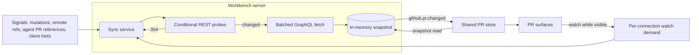

# Pull request sync

The workbench server owns pull request state. A sync service keeps an in-memory snapshot of each watched repository's PRs and checks, refreshes it from GitHub, and notifies clients when it changes. Every PR surface in the app renders from one shared store that mirrors those snapshots, so all surfaces agree and update together. GitHub traffic scales with what users are looking at, not with the number of windows or devices.

## Design decisions

- **REST detects changes; GraphQL fetches details.** An authorized conditional REST request that returns `304 Not Modified` does not count against GitHub's primary rate limit, while every GraphQL query costs points. Repository and checks probes therefore use ETags, and GraphQL runs only for PRs that actually changed. Polling GraphQL directly would make fast updates unaffordable.
- **Signals, not faster polling, make updates feel immediate.** Nerve Git mutations, remote-tracking ref changes from the workspace monitor, `created` PR [references](conversation-discovery.md) from agent output, and client hints (such as opening a compare URL) trigger an immediate probe. Remote-tracking refs cover agents, terminals and external tools alike, so shell output is never parsed for `git push`.
- **Polling follows demand.** Each connection declares what it shows with `github.pr.watch.sync`, and disconnecting releases that demand. The scheduler polls faster while pending checks are visible or a PR is expected, slower while PR surfaces are merely visible, and not at all when nothing is visible. This is separate from `git.repository.monitor.sync` because a PR tab can be open while the Git panel is closed, and filesystem and GitHub demand have different costs.
- **Events invalidate; clients read memory.** `github.pr.changed` carries a revision and changed PR numbers, not data, matching `git.repository.changed`. Clients re-read with `github.pr.snapshot.get`, which never waits on GitHub. Small events keep replay and reconnect simple: on a revision gap or reconnect, a client reads the full snapshot.
- **One entity per PR in the client.** Lists, the current-branch card, badges and PR tabs read and write the same store entry, so they cannot disagree. Filtering happens locally against the snapshot's capped set of open PRs; only oversized repositories fall back to server-side search.
- **Memory only.** No tables or columns hold PR data; snapshots rebuild from the next demand after a restart.
- **No webhooks.** A local daemon has no public endpoint. A relay or GitHub App could later feed in as one more signal.

## Where it lives

| Concern                                  | Owner                                                                                                                                                                                                     |
| ---------------------------------------- | --------------------------------------------------------------------------------------------------------------------------------------------------------------------------------------------------------- |
| Snapshot, watch and event contracts      | [`git.ts`](../../packages/contracts/src/domains/git/git.ts); [`operations.ts`](../../packages/contracts/src/domains/git/operations.ts); [`events.ts`](../../packages/contracts/src/domains/git/events.ts) |
| Conditional probes and batched summaries | [`git-github-sync.ts`](../../packages/tools/src/git/git-github-sync.ts)                                                                                                                                   |
| Sync service and signal matching         | [`pr-sync/`](../../packages/workbench-server/src/domains/git/pr-sync/); [`create-runtime-services.ts`](../../packages/workbench-server/src/app/bootstrap/create-runtime-services.ts)                      |
| Tiers, backoff and retention             | [`pr-sync-policy.ts`](../../packages/workbench-server/src/domains/git/pr-sync/pr-sync-policy.ts)                                                                                                          |
| Client store and watch delivery          | [`pr-store.svelte.ts`](../../packages/workbench-app/src/lib/features/git/state/pr-store.svelte.ts); [`pr-store-model.ts`](../../packages/workbench-app/src/lib/features/git/state/pr-store-model.ts)      |
