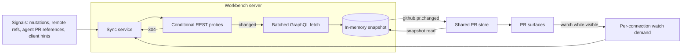

# Pull request sync

The workbench server owns pull request state. A sync service keeps an in-memory snapshot of each watched GitHub repository's PRs and checks, refreshes it from GitHub, and notifies clients when it changes. It follows the snapshot, demand-watch and invalidate-then-reread model of [Git workspace sync](git-workspace-sync.md#design-decisions); this doc keeps only the PR-specific rules. Every PR surface renders from one shared store, so all surfaces agree.

## Design decisions

- **REST detects changes; GraphQL fetches details.** An authorized conditional REST request that returns `304 Not Modified` does not count against GitHub's primary rate limit, while every GraphQL query costs points. Repository and checks probes therefore use ETags, and GraphQL runs only for PRs that actually changed. Polling GraphQL directly would make fast updates unaffordable.
- **Keyed by GitHub repository.** Snapshots are keyed by `owner/name`, not by checkout path, so worktrees and clones of one remote share one snapshot, ETag and polling schedule. Clients still address PRs by repository path; the server maps each path to its remote.
- **Signals, not faster polling, make updates feel immediate.** Mutations, branch and remote-ref changes from [Git workspace sync](git-workspace-sync.md), PR [references](conversation-discovery.md) in agent output and client hints trigger an immediate probe. Remote-tracking refs cover agents, terminals and external tools alike, so shell output is never parsed for `git push`.
- **Polling follows demand.** The scheduler polls faster only while pending checks are visible or a PR is expected, slower while PR surfaces are merely visible, and not at all otherwise. PR watches (`github.pr.watch.sync`) are separate from `git.workspace.watch.sync` because a PR tab can be open while the Git panel is closed, and filesystem and GitHub demand have different costs.
- **One rate-limit budget per host.** Rate-limit headers feed a shared budget: a primary or secondary limit pauses every repository on that host, probe cycles are staggered, and polling stretches when little of the limit remains.
- **Small events.** `github.pr.changed` carries a revision and changed PR numbers, not data. `github.pr.snapshot.get` reads memory and never waits on GitHub.
- **One entity per PR in the client.** Lists, the current-branch card, badges and PR tabs read and write the same store entry, so they cannot disagree. Filtering happens locally against the snapshot's capped set of open PRs; when the snapshot reports `truncated`, the client uses `github.pr.list`.
- **No webhooks.** A local daemon has no public endpoint. A relay or GitHub App could later feed in as one more signal.

## Where it lives

| Concern                                  | Owner                                                                                                                                                                                                     |
| ---------------------------------------- | --------------------------------------------------------------------------------------------------------------------------------------------------------------------------------------------------------- |
| Snapshot, watch and event contracts      | [`git.ts`](../../packages/contracts/src/domains/git/git.ts); [`operations.ts`](../../packages/contracts/src/domains/git/operations.ts); [`events.ts`](../../packages/contracts/src/domains/git/events.ts) |
| Conditional probes and batched summaries | [`git-github-sync.ts`](../../packages/tools/src/git/git-github-sync.ts)                                                                                                                                   |
| Sync service and signal matching         | [`pr-sync/`](../../packages/workbench-server/src/domains/git/pr-sync/); [`create-runtime-services.ts`](../../packages/workbench-server/src/app/bootstrap/create-runtime-services.ts)                      |
| Tiers, backoff and retention             | [`pr-sync-policy.ts`](../../packages/workbench-server/src/domains/git/pr-sync/pr-sync-policy.ts)                                                                                                          |
| Client store and watch delivery          | [`pr-store.svelte.ts`](../../packages/workbench-app/src/lib/features/git/state/pr-store.svelte.ts); [`pr-store-model.ts`](../../packages/workbench-app/src/lib/features/git/state/pr-store-model.ts)      |
