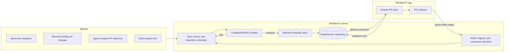

# Pull request sync

The workbench server owns pull request state. One sync service per daemon keeps an in-memory snapshot of each watched repository's pull requests and checks, refreshes it from GitHub with cheap conditional probes, and tells clients when it changes. Every PR surface in the app (Git Changes card, Pull Requests panel, branch badges, PR details tab, mobile hosts) renders from one shared store that mirrors those snapshots.

This gives two properties that per-window polling could not: every surface shows the same data and updates together, and GitHub traffic scales with what users are looking at rather than with the number of windows or devices.

## Snapshot

A snapshot belongs to one `(project, repository)` pair and lives only in server memory. It holds a revision that increases whenever published data changes, the canonical set of open PRs, closed or merged PRs that are still watched, and a sync status (`fresh`, `stale`, `rate_limited`, `unauthenticated`, `unavailable`, `error`). Nothing is persisted: after a restart the first demand rebuilds it, and clients detect the new revision sequence on reconnect.

The canonical set is capped. Clients filter it locally (author, drafts, title, labels, head, review requested), so changing a filter costs no GitHub request. A repository above the cap is marked `truncated`, and filtered lists fall back to the server-side `github.pr.list` search. That search runs only on demand and is never polled.

A merged or closed PR stays in the snapshot while it is the latest PR for a watched branch or open in a tab, so the Git Changes card can show it as Merged or Closed and its tab keeps rendering. Composer completions (`github.pr.cached.list`) read the same snapshot, so there is one PR cache on the server.

## Detecting changes cheaply

An authorized conditional REST request that returns `304 Not Modified` does not count against GitHub's primary rate limit, while every GraphQL query costs points. The service therefore uses REST to detect changes and GraphQL only to fetch details after a change:

- **Repository probe:** the most recently updated pulls with an ETag. A `304` costs nothing. A `200` is compared against per-PR fingerprints (updated time, state, head SHA), and only changed PRs are fetched in one batched GraphQL query.
- **Checks probe:** check runs and combined status for a head SHA, each with its own ETag. The checks summary is computed directly from the REST response. Only heads that are shown and still pending, or newly pushed heads on a focused PR, are probed.

The scheduler picks a tier for each repository from current demand and signals. **Hot** applies while a visible surface shows pending checks. **Awaiting PR** applies for a bounded window after a push or hint for a branch that has no PR yet. **Warm** applies while any PR surface is visible. **Cold** applies when nothing is visible and stops probing; the next snapshot read revalidates if it is old. Intervals, budget stretching and backoff live in the pure, unit-tested policy rather than here.

Across all tiers, requests go through the shared Git network permit, a repository has at most one fetch in flight, and signals within a short debounce window coalesce into one probe. Signals bypass the interval but never rate-limit backoff. When the remaining budget runs low, intervals stretch. On a rate limit the service backs off (honoring `retry-after` and the reset header) and publishes `rate_limited` so the UI can show one quiet notice. Repositories without a GitHub remote or authentication are not probed.

## Signals

Signals make updates feel immediate without faster polling:

| Signal                                                   | Effect                                                                          |
| -------------------------------------------------------- | ------------------------------------------------------------------------------- |
| Nerve `push` or `syncBranch`                             | Awaiting PR for the branch when it has no open PR, plus an immediate probe.     |
| Nerve `mergePr`                                          | The snapshot marks the PR merged at once, then revalidates.                     |
| Other Nerve Git mutations                                | Immediate probe.                                                                |
| Remote-tracking ref change seen by the workspace monitor | Awaiting PR for each changed branch, or a plain probe if the branch is unknown. |
| Conversation gains a `created` GitHub PR reference       | Probe the matching project repository and fetch that PR by number.              |
| Client `github.pr.expect` (compare URL opened)           | Awaiting PR for the branch.                                                     |
| Client `github.pr.refresh`                               | Forced probe and fetch, still respecting backoff.                               |

Remote-tracking refs cover agents, terminals and external tools alike, so shell output is never parsed for `git push`. Agent `gh pr create` is matched through the conversation [reference](conversation-discovery.md) extracted from its output.

## Demand and delivery

Each connection declares what it shows with `github.pr.watch.sync`: whether the window is visible, whether a PR list is open, the current branch, open PR tabs and the active tab. The watch registry merges demand from all connections and drives the scheduler. A disconnected connection releases its demand, following the same per-connection model as the repository monitor. PR demand is a separate channel from `git.repository.monitor.sync` because a PR tab can be open while the Git panel is closed, and filesystem and GitHub demand have different costs.

`github.pr.changed` is an invalidation event, like `git.repository.changed`. It carries the revision and the PR numbers whose summary or checks changed or were removed, not the data. Clients re-read the snapshot with `github.pr.snapshot.get`, which serves server memory and never waits on GitHub. Events are delivered only to connections watching that repository. Small events keep replay and reconnect simple; a client that sees a revision gap or reconnects reads the full snapshot.

## Client store

The app keeps one reactive entry per PR in the PR store. List rows, the current-branch card, branch badges and the PR tab all read the same entry, and when a PR tab loads full core or checks it writes into that entry too, so they cannot disagree. Surfaces declare interest with `watchPullRequests` from an effect; the store merges interests per repository, adds document visibility, and sends a debounced watch sync.

On `github.pr.changed` the store re-reads the snapshot and reloads only the open PR views listed as changed. Heavy sections (files, commits, conversation) reload when the head or update time changed and they are visible; otherwise they reload when opened. PR filter preferences stay in local storage.

## Where it lives

| Concern                                          | Owner                                                                                                                                                                                                     |
| ------------------------------------------------ | --------------------------------------------------------------------------------------------------------------------------------------------------------------------------------------------------------- |
| Snapshot, watch and event contracts              | [`git.ts`](../../packages/contracts/src/domains/git/git.ts); [`operations.ts`](../../packages/contracts/src/domains/git/operations.ts); [`events.ts`](../../packages/contracts/src/domains/git/events.ts) |
| Conditional probes and batched summaries         | [`git-github-sync.ts`](../../packages/tools/src/git/git-github-sync.ts); [`git-github-api-client.ts`](../../packages/tools/src/git/git-github-api-client.ts)                                              |
| Sync service                                     | [`PrSyncService`](../../packages/workbench-server/src/domains/git/pr-sync/pr-sync-service.ts)                                                                                                             |
| Tiers, backoff, retention and diffing            | [`pr-sync-policy.ts`](../../packages/workbench-server/src/domains/git/pr-sync/pr-sync-policy.ts)                                                                                                          |
| Signal intake                                    | [`create-runtime-services.ts`](../../packages/workbench-server/src/app/bootstrap/create-runtime-services.ts); [pr-sync signals](../../packages/workbench-server/src/domains/git/pr-sync/)                 |
| Per-connection event filter                      | [`WorkbenchConnection`](../../packages/workbench-server/src/adapters/protocol/workbench-connection.ts)                                                                                                    |
| Client store, local filtering and watch delivery | [`pr-store.svelte.ts`](../../packages/workbench-app/src/lib/features/git/state/pr-store.svelte.ts); [`pr-store-model.ts`](../../packages/workbench-app/src/lib/features/git/state/pr-store-model.ts)      |

## Not covered

- **Webhooks or a GitHub App.** They would remove polling but need a public endpoint or relay, which a local daemon does not have. Webhook input could later become one more signal.
- **Persistence.** Snapshots are rebuilt after restart; no tables or columns hold PR data.
- **Live sync of heavy PR detail sections** while they are not visible.
