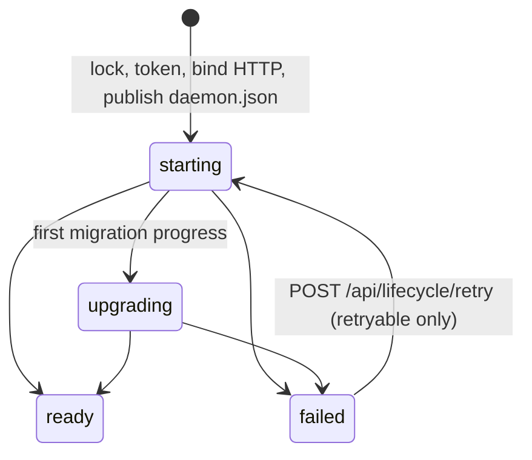
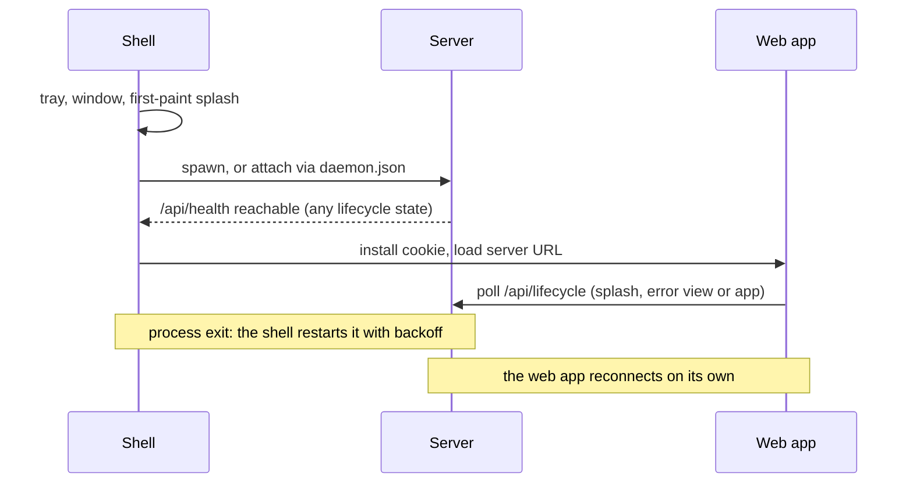

# Startup and reconnection

> **Status:** Current implementation. `packages/contracts/src/domains/status/lifecycle.ts` is the authoritative contract.

The workbench server owns its startup, including storage migrations, and reports it over HTTP. The web app is the only UI for startup progress, startup failure and reconnection. A shell (Electron today) only launches the server and loads its URL, so the same flow works in the desktop app, in a browser and on a hosted server.

| Layer   | Owns                                                                                                                       |
| ------- | -------------------------------------------------------------------------------------------------------------------------- |
| Shell   | Tray, window, first-paint splash, spawn or attach, process restart, auth cookie, an error page when no server is reachable |
| Server  | Early HTTP bind, migrations, the lifecycle state, failure details, retry                                                   |
| Web app | Splash progress, startup error view, reconnect overlay, reload when the server version changes                             |

## Server lifecycle

Boot order in `workbench-server/src/main.ts`:

1. Take the home startup lock and resolve the local token (`ensureLocalToken`). A fresh home gets a new token; the token never moves during migrations, so a missing token on an existing home is a non-retryable `TOKEN_MISSING` failure.
2. Resolve host and port from bootstrap settings (current configuration, or defaults for an unmigrated home), bind HTTP and publish `daemon.json`.
3. Run the storage phase (migrations, configuration, secrets) while serving the boot app. Then build the runtime, swap the listener's handler to the full app, start mobile HTTPS and republish `daemon.json`. The state becomes `ready`.

Migrations run in a worker thread (`migrations/framework/worker.ts`), so heavy synchronous SQLite work never blocks HTTP, health checks or lifecycle polling. The main thread keeps the startup lock; the worker reports progress back as messages. If migrated settings change the host or port, the bound listener is kept and the change applies on the next restart.

A storage failure keeps the process alive in `failed` with `{ code, message, step, phase, reportPath, retryable }` and optional `discardable` units and `rollbackAvailable`. Migration failures (`MIGRATION_FAILED`, with details from `migrations/last-failure.json`) and other storage errors are retryable. Invalid home settings use in-memory defaults and a non-blocking settings-health notice, with explicit reset/reload; they do not block readiness. Retry may include `{ discardIds }`; rollback restores the failed step when available and enters terminal, non-retryable `MIGRATION_ROLLED_BACK`. The daemon stays alive to prevent supervisor-driven re-upgrade. See [storage migrations](migrations.md#recovery-and-progress) for the recovery contract. An unsupported home, a missing token and errors while building the runtime are not retryable; runtime errors still exit the process.

### HTTP while not ready

| Route                          | Auth      | Response                                      |
| ------------------------------ | --------- | --------------------------------------------- |
| Static UI assets               | as before | Served, including the loopback cookie         |
| `GET /health`                  | public    | `ServerHealth { status, version, lifecycle }` |
| `GET /api/health`              | token     | `ServerHealth`                                |
| `GET /api/lifecycle`           | token     | `ServerLifecycle`                             |
| `POST /api/lifecycle/retry`    | token     | 202 with the new lifecycle, otherwise 409     |
| `POST /api/lifecycle/rollback` | token     | 202 when restoration starts, otherwise 409    |
| Other `/api/*` and `/ws/*`     | token     | 503 `{ error: "starting", lifecycle }`        |

The lifecycle routes stay available after `ready`. A home without a usable token answers lifecycle routes to loopback clients only.

## Web app

`WorkbenchProvider` waits on the boot gate (`application/startup/server-lifecycle.svelte.ts`) before the normal startup runs. The gate polls `/api/lifecycle` every 500 ms and drives the `index.html` splash: status text, a detail line such as "Importing conversations · 120 of 393", and a determinate meter when a total is known. Network errors keep it polling as "Starting Nerve". On `failed` it shows `StartupErrorView` with technical details, Copy diagnostics and, when retryable, Try again.

After the app has loaded, a dropped protocol channel or a 503 `starting` response starts the reconnect monitor. After one second it polls the lifecycle and shows `ServerReconnectOverlay` only if the server is not ready, with the same progress text. When the server is ready again:

- a different `version` reloads the page;
- the same version (a plain restart, visible as a new `startedAt`) hides the overlay and lets protocol reconnection and recovery resync state.

Polling is deliberate: it is stateless, survives restarts and behaves the same in every host.

## Shell

The desktop shell (`desktop-shell/src/app/desktop-runtime.ts`) never opens storage. It reads bootstrap settings from files only (timeout, heap size, Ozone platform) and falls back to defaults. Its startup timeout covers only "HTTP reachable". On daemon status changes it updates the tray and, on `ready`, reinstalls the cookie because a restarted daemon may rotate its token. It does not navigate the window, except back to the server URL after its own error page. `/api/health` reports the lifecycle; while an owned daemon last reported `starting` or `upgrading`, failed health checks do not count toward a restart, and only a process exit triggers recovery.

The shell error page is only for the case where no server is reachable: spawn failure, the process exiting before HTTP is up, or the restart budget being exhausted. Its Try again restarts an owned daemon, or re-acquires a daemon owned by someone else.
