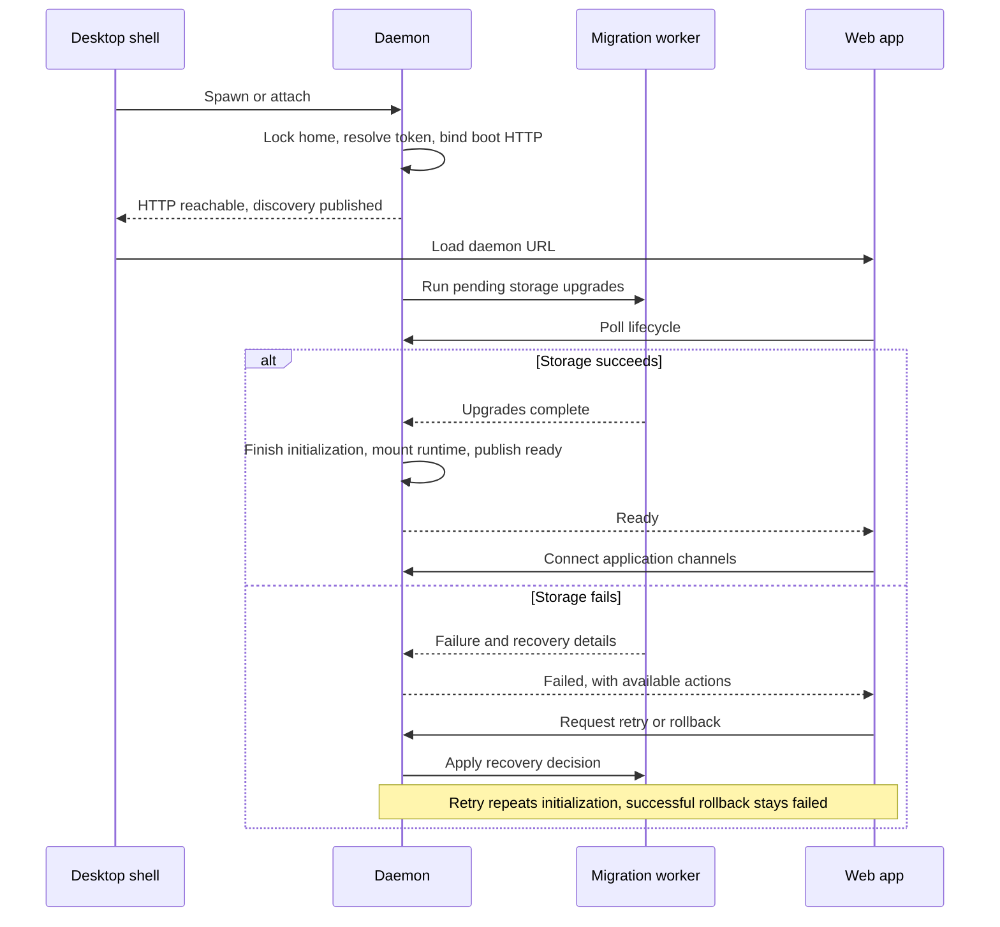

# Startup and reconnection

Startup brings a Nerve home into a usable state and connects the user to it. The daemon owns storage initialization and upgrades; the web app shows progress and recovery actions. The desktop shell launches or attaches to a daemon and supervises its process, so browser and desktop users share the same storage recovery flow.

A browser starts at the web-app participant; it does not need a shell to manage the server.

## Why HTTP starts early

The daemon binds a small boot application before opening normal storage. This makes a slow or failed upgrade observable over HTTP instead of looking like an unreachable process. Once storage succeeds, the daemon constructs the runtime and switches the existing listener to the full application.

Migration work runs in a worker thread so synchronous database conversion cannot starve lifecycle requests. A **lifecycle** is the server's reported startup state and available recovery actions. The home startup lock excludes other storage writers through initialization and daemon publication, so offline tools cannot enter midway through that transition.

The initial listener uses bootstrap settings. If migration changes the configured bind address or port, those changes apply on the next restart; keeping the listener stable lets clients finish observing the current upgrade.

## Failures and recovery

Storage failures leave the daemon reachable so the web app can offer retry, set-aside or rollback when available. **Set-aside** preserves a damaged migration unit in quarantine while allowing healthy data to proceed. [Migration recovery](migrations.md#recovery-decisions) explains the preservation boundary.

A successful rollback leaves the daemon alive in a terminal failure state. This prevents a process supervisor from immediately upgrading the restored home again. Runtime construction failures are fatal because the normal application could not be mounted. Invalid runtime-owned home settings instead use a separate, non-blocking [settings recovery](storage.md#settings-health) path.

## Connecting and reconnecting

The web app waits for readiness before normal startup. After a disconnect it checks lifecycle again: a changed server version reloads the page, while a same-version restart lets protocol reconnection resynchronize state. Polling works here because it survives server restarts without requiring a live session.

The shell hands off when HTTP is reachable, rather than waiting for full readiness, so migration progress remains visible. Its error page handles failure to reach a daemon; storage decisions stay in the web app. Normal conversation status and notifications are covered by [conversation state and attention](conversation-state-and-attention.md).

## Where it lives

| Concern                            | Owner                                                                                                                                                                                                                          |
| ---------------------------------- | ------------------------------------------------------------------------------------------------------------------------------------------------------------------------------------------------------------------------------ |
| Lifecycle contract                 | [`ServerLifecycle`](../../packages/contracts/src/domains/status/lifecycle.ts)                                                                                                                                                  |
| Early bind and runtime handoff     | [`main`](../../packages/workbench-server/src/main.ts); [`createBootApp`](../../packages/workbench-server/src/app/lifecycle/boot-app.ts)                                                                                        |
| Storage/fatal failure split        | [`createStartupSequence`](../../packages/workbench-server/src/app/lifecycle/startup-sequence.ts)                                                                                                                               |
| Initialization and worker boundary | [`initializeStorage`](../../packages/workbench-server/src/infrastructure/storage-bootstrap/initialize.ts); [`runMigrationsInWorker`](../../packages/workbench-server/src/infrastructure/migrations/framework/worker-client.ts) |
| Recovery actions                   | [`storageRecoveryControls`](../../packages/workbench-server/src/app/lifecycle/storage-recovery.ts)                                                                                                                             |
| Web boot gate and reconnection     | [`waitForServerReady`](../../packages/workbench-app/src/lib/application/startup/server-lifecycle.svelte.ts) and its lifecycle monitor                                                                                          |
| Shell supervision                  | [`DesktopRuntime`](../../packages/desktop-shell/src/app/desktop-runtime.ts)                                                                                                                                                    |
