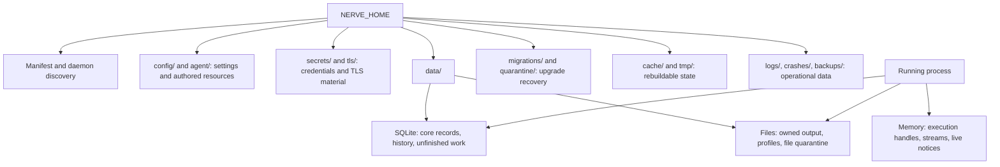

# Storage architecture

A Nerve home holds the server's persistent data and operational files. Conversation core owns relational conversation state, while the host supplies configuration, secrets and managed file storage. Some live state exists only in the running process; understanding that boundary explains what can be recovered after a restart.

## Home ownership

The home defaults to `~/.nerve`; `NERVE_HOME` selects another location. Development uses repo-local slots so ordinary testing stays isolated from the live home. The manifest identifies the storage format, and daemon discovery describes the running server.

The diagram groups stable areas rather than enumerating files. Exact paths belong to the host's path resolver, including the query-cache database under `cache/` and file quarantine under `data/`. Recovery areas preserve evidence and damaged sources, while caches can be rebuilt. This distinction matters when deciding what a cleanup operation may safely remove.

Electron's profile lives outside the Nerve home, so tests that launch the shell need separate profile isolation. Home admission and conversion follow [storage migrations](migrations.md).

## SQLite and managed files

Core SQLite stores conversation records, event history and unfinished work. Access is synchronous, with WAL (write-ahead logging) and foreign-key enforcement. Immediate write transactions give related durable changes a shared commit boundary; nested calls join the outer transaction, and asynchronous callbacks are rejected so work cannot escape it.

The [core data model](conversation-core/data-model.md) explains record relationships. Event-tree history selects what a conversation sees, while durable replay lets clients recover stored changes; see [events and context](conversation-core/events-and-context.md). Tool settlement and input delivery belong to the core's [tool lifecycle](conversation-core/tool-call-lifecycle.md) and [input queue](conversation-core/input-queue.md).

Managed assets split metadata from bytes: database records identify the owner and relative file reference, while content lives beneath the host-supplied data root. For example, a tool's full output can remain in an owned file while the model receives a smaller projection. This keeps durable output available without forcing every consumer to load it; see [tool-result projection](tool-result-projection.md).

## Configuration and authored files

Configuration describes current choices independently of event history. Agent preferences and prompt context live in scoped documents, while the conversation working directory remains in SQLite. A **scope** is the user, project or conversation location from which a configuration domain reads its settings. [Configuration](configuration.md) explains resolution and save guarantees.

Reusable agent definitions and their captured conversation settings belong to [profiles and delegation](conversation-core/delegation.md). Permission rule sets and trusted configuration layers belong to [permissions](permissions.md). Project [launch definitions](launch-definitions.md) are project-authored files so they can travel with the project; running launch instances belong to the workbench process.

## Settings health

Invalid runtime home settings use a separate recovery path from failed upgrades. The runtime preserves unreadable bytes, uses in-memory defaults and exposes a non-blocking health notice so the application remains available for repair. The authoritative document set comes from the settings-health contract and home configuration codecs.

Writes stay blocked until explicit resolution so cached defaults cannot overwrite damaged sources. Reset quarantines the original before writing defaults; reload validates a user-repaired file before clearing the invalid state. Security-sensitive scoped configuration follows stricter health and authorization rules because a fallback must not grant execution authority. See [configuration](configuration.md).

## Restart and recovery

Persistence follows the owner of the state rather than whether the state appears in the UI:

- Core history and unfinished work survive restart. Native execution handles are process-local, so [async bash recovery](conversation-core/async-bash-and-launches.md) cannot simply resume or replay a command.
- Streaming fragments, tool progress and workbench invalidation notices are ephemeral. Clients recover through snapshots and core replay so the workbench does not need a second durable journal; see [channels](conversation-core/channels.md).
- UI drafts, attention and notifications follow their own persistence rules; see [conversation state and attention](conversation-state-and-attention.md).
- Invalid home settings preserve their source bytes for explicit [reset/reload recovery](#settings-health). Security-sensitive scoped settings have stricter execution rules because fallback must not silently grant authorization.

## Unreadable conversations

Stored history can fail the current contracts after an upgrade gap, a partial write or disk trouble. One such conversation must not stop startup, the conversation list or other conversations. Recovery enumerates raw conversation identities first and then validates and recovers each conversation independently; a failure is reported and that conversation is skipped. Its data is never coerced into a valid shape. List and summary reads skip invalid rows individually, and a replay or projection failure removes only that conversation's stream while healthy streams on the same connection continue.

Reported failures collect into one header activity item, "N conversations couldn't be loaded", with a confirmed Delete for each. Delete works from raw identity, without decoding the broken row, and removes descendants and files. There is no raw export. Missing image assets are a narrower case: they return a typed not-found response and the transcript shows a placeholder, leaving the rest of the conversation readable.

## Where it lives

| Concern                                   | Owner                                                                                                                                                                                                                                                                                                  |
| ----------------------------------------- | ------------------------------------------------------------------------------------------------------------------------------------------------------------------------------------------------------------------------------------------------------------------------------------------------------ |
| Home selection and exact paths            | [`resolveDataDir` and `storagePaths`](../../packages/workbench-server/src/infrastructure/storage-bootstrap/paths.ts)                                                                                                                                                                                   |
| Database access and transaction behavior  | [`openCoreDatabase`](../../packages/conversation-core/src/storage/database.ts)                                                                                                                                                                                                                         |
| Ordered, checksummed SQL upgrades         | [`migrate`](../../packages/conversation-core/src/storage/migrations.ts)                                                                                                                                                                                                                                |
| Asset root supplied by the host           | [`ConversationCoreOptions.dataDir`](../../packages/conversation-core/src/core.ts)                                                                                                                                                                                                                      |
| Per-conversation read containment         | [`ConversationRepository`](../../packages/conversation-core/src/storage/conversation.repository.ts) failure reporter; [`recoverCore`](../../packages/conversation-core/src/runtime/recovery.ts); [conversation channel](../../packages/workbench-server/src/adapters/protocol/conversation-channel.ts) |
| Unreadable-conversation notice and delete | [`UnreadableConversationActivity`](../../packages/workbench-server/src/domains/activity/unreadable-conversation-activity.ts); [`ConversationService.delete`](../../packages/conversation-core/src/conversations/conversation.service.ts)                                                               |
| Home settings recovery                    | [`settingsDocumentIdSchema`](../../packages/contracts/src/domains/settings/settings-health.ts); [`readHomeConfiguration`](../../packages/workbench-server/src/infrastructure/configuration/home-configuration.ts)                                                                                      |
| Home document mapping                     | [`storagePaths`](../../packages/workbench-server/src/infrastructure/storage-bootstrap/paths.ts); [configuration codecs](../../packages/workbench-server/src/infrastructure/configuration/home-configuration-codecs.ts)                                                                                 |
