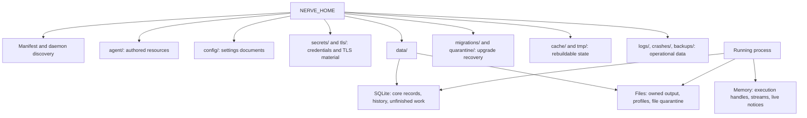

# Storage architecture

A Nerve home holds the server's persistent data and operational files. Conversation core owns relational conversation state, while the host supplies configuration, secrets and managed file storage. Some live state exists only in the running process; understanding that boundary explains what can be recovered after a restart.

## Home ownership

The home defaults to `~/.nerve`; `NERVE_HOME` selects another location. Development uses repo-local slots so ordinary testing stays isolated from the live home. The manifest identifies the storage format, and daemon discovery describes the running server.

The diagram groups stable areas; exact paths belong to the host's path resolver. Recovery areas preserve evidence and damaged sources, while caches can be rebuilt. This distinction matters when deciding what a cleanup operation may safely remove. Home admission and conversion follow [storage migrations](migrations.md).

## Home layout

Every file a feature stores belongs to exactly one area, chosen by who writes it:

| Area                                                                            | Holds                                                                                                                                                                    | Written by            | Project form                |
| ------------------------------------------------------------------------------- | ------------------------------------------------------------------------------------------------------------------------------------------------------------------------ | --------------------- | --------------------------- |
| `agent/`                                                                        | **Authored resources**: files a user or agent writes and can copy between homes and projects. One folder per kind, plus `AGENTS.md`, `SYSTEM.md` and `APPEND_SYSTEM.md`. | User, agent, Settings | `.nerve/<kind>/`, same name |
| `config/`                                                                       | **Settings documents**: JSON with a schema, a revision and [settings health](#settings-health), edited through Settings.                                                 | Settings, by hand     | `.nerve/config/`            |
| `data/`                                                                         | **Nerve-owned state**: SQLite (history, unfinished work, every [trust decision](trust.md), [accounts](#accounts)), conversation files, images, plans.                    | Nerve only            | —                           |
| `secrets/`, `tls/`                                                              | Credentials and TLS material.                                                                                                                                            | Nerve only            | —                           |
| `cache/`, `tmp/`, `logs/`, `crashes/`, `backups/`, `migrations/`, `quarantine/` | Operational and recovery files.                                                                                                                                          | Nerve only            | —                           |

The authored resource kinds:

| Kind               | User                    | Project                  |
| ------------------ | ----------------------- | ------------------------ |
| Skills             | `agent/skills/`         | `.nerve/skills/`         |
| Prompt suggestions | `agent/suggestions/`    | `.nerve/suggestions/`    |
| Agent profiles     | `agent/agent-profiles/` | `.nerve/agent-profiles/` |
| Extensions         | `agent/extensions/`     | `.nerve/extensions/`     |
| Launch definitions | —                       | `.nerve/launches/`       |

Rules:

1. **One name per kind.** A user resource lives at `<NERVE_HOME>/agent/<kind>/` and its project form at `<project>/.nerve/<kind>/`. A new resource kind follows this pattern. _Why:_ users and the agent find every kind the same way, and copying a folder between the two places is how resources are shared.
2. **Exceptions are listed here.** Launch definitions are project only. Permission rule sets are user only and stay in `config/rule-sets/`, because they are settings-edited policy, not portable resources.
3. **`.agents/` is for cross-tool formats only** (skills today, at `~/.agents/skills` and `<project>/.agents/skills`). Nerve-only kinds never go there.
4. **Trust is never a file.** Approvals of resources live in SQLite under `data/` ([trust](trust.md)); a resource folder holds only its own content.
5. **Nerve-owned state never goes in `agent/` or `config/`,** and authored resources never go in `data/`, so cleanup, backup and sharing can treat each area as a whole.

## SQLite and managed files

Core SQLite stores conversation records, event history and unfinished work. Access is synchronous, with WAL (write-ahead logging) and foreign-key enforcement. Immediate write transactions give related durable changes a shared commit boundary; nested calls join the outer transaction, and asynchronous callbacks are rejected so work cannot escape it.

The [core data model](conversation-core/data-model.md) explains record relationships. Event-tree history selects what a conversation sees, while durable replay lets clients recover stored changes; see [events and context](conversation-core/events-and-context.md). Tool settlement and input delivery belong to the core's [tool lifecycle](conversation-core/tool-call-lifecycle.md) and [input queue](conversation-core/input-queue.md).

Managed assets split metadata from bytes: database records identify the owner and relative file reference, while content lives beneath the host-supplied data root. A tool's full output can stay in an owned file while the model receives a smaller projection; see [tool-result projection](tool-result-projection.md).

## Accounts

Extension accounts live in the `account` table of the core database (core schema v5). They replace `config/accounts.json` and the account entries of `secrets/credentials.enc`; model-provider credentials stay in `credentials.enc`.

| Column                       | Holds                                                                                                                                                                                                |
| ---------------------------- | ---------------------------------------------------------------------------------------------------------------------------------------------------------------------------------------------------- |
| `id`, `name`                 | Account id (local to the home) and the name the user gave it.                                                                                                                                        |
| `kind`                       | The account definition's id. **Not a foreign key:** definitions come from extension manifests, not the database; a row whose definition is gone stays and shows as `unavailable`.                    |
| `project_id`                 | `NULL` for a user-level account, the project for a project-level one (`ON DELETE CASCADE` states ownership; projects are not deleted today). A project lists `project_id IS NULL OR project_id = ?`. |
| `fields`                     | Non-secret fields as JSON.                                                                                                                                                                           |
| `credential`                 | The encrypted credential blob; `NULL` when nothing is stored.                                                                                                                                        |
| `status`                     | `ready`, `needs_sign_in` or `failed` (the credential's own state). `unavailable` and scope-derived `needs_sign_in` are derived on read, never stored, so enabling an extension writes nothing.       |
| `expires_at`, `last_used_at` | Access-token expiry and last credentialed use, readable without decrypting. Partial index `account_refresh` on `expires_at`.                                                                         |

- **Encryption.** `credential` is `version(1) | iv(12) | tag(16) | ciphertext`: AES-256-GCM under the master key (`secrets/master.key`) with the account id as associated data, so a blob cannot be moved to another row. The plaintext is one versioned JSON object: typed-in secrets by name, provider state (tokens), identity, the last error, granted scopes and `codeHash` (the credential code that wrote it). Only the [credential vault](extension-platform.md#credential-vault) decrypts it; backups, `storage:copy` and database inspection see ciphertext only.
- **Writes.** A refresh writes `credential`, `status` and `expires_at` in one transaction before the new token is used. `last_used_at` is written on use, at most once a minute per account. Move updates `project_id`; duplicate inserts a new row and re-encrypts under the new id; clear sets `credential` to `NULL` and `status` to `needs_sign_in`.
- **Refresh sweep** is a query: accounts with `status = 'ready'`, `expires_at` within the next 10 minutes and `last_used_at` within 30 days; rows without a refresh token are skipped after decryption ([background jobs](background-jobs.md)).
- **Migration.** The home step `0006-agent-resource-layout` ([`accounts.ts`](../../packages/workbench-server/src/infrastructure/migrations/steps/0006-agent-resource-layout/accounts.ts)) moves each account of `config/accounts.json` into the table as a user-level account, seals its secret (`provider:account:<kind>:<id>:apiKey`) into `credential` (`ready`, or `needs_sign_in` when it had none), removes those secrets from `credentials.enc` and deletes `accounts.json`. A duplicate id gets a new one and an invalid entry is dropped; both are reported as loss notices.

## Configuration and authored files

Configuration describes current choices independently of event history. Agent preferences and prompt context live in scoped documents, while the conversation working directory remains in SQLite. A **scope** is the user, project or conversation location from which a configuration domain reads its settings. [Configuration](configuration.md) explains resolution and save guarantees.

Reusable agent definitions and their captured conversation settings belong to [profiles and delegation](conversation-core/delegation.md). Permission rule sets and trusted configuration layers belong to [permissions](permissions.md). Project [launch definitions](launch-definitions.md) are project-authored files so they can travel with the project; running launch instances belong to the workbench process.

## Settings health

Invalid runtime home settings use a separate recovery path from failed upgrades. The runtime preserves unreadable bytes, uses in-memory defaults and exposes a non-blocking health notice so the application remains available for repair. The authoritative document set comes from the settings-health contract and home configuration codecs.

Writes stay blocked until explicit resolution so cached defaults cannot overwrite damaged sources. Reset quarantines the original before writing defaults; reload validates a user-repaired file before clearing the invalid state. Security-sensitive scoped configuration has stricter rules because a fallback must not grant execution authority; see [configuration](configuration.md).

## Restart and recovery

Persistence follows the owner of the state rather than whether the state appears in the UI:

- Core history and unfinished work survive restart. Native execution handles are process-local, so [async bash recovery](conversation-core/async-bash-and-launches.md) cannot simply resume or replay a command.
- Streaming fragments, tool progress and workbench invalidation notices are ephemeral. Clients recover through snapshots and core replay so the workbench does not need a second durable journal; see [channels](conversation-core/channels.md).
- UI drafts, attention and notifications follow their own persistence rules; see [conversation state and attention](conversation-state-and-attention.md).
- Invalid home settings preserve their source bytes; see [settings health](#settings-health).

## Unreadable conversations

Stored history can fail the current contracts after an upgrade gap, a partial write or disk trouble. One such conversation must not stop startup, the conversation list or other conversations. Recovery enumerates raw conversation identities first and validates each independently; a failure is reported and that conversation is skipped, and its data is never coerced into a valid shape. List reads, replay and projection contain failures to the affected conversation.

Failures collect into one header activity item with a confirmed Delete for each. Delete works from raw identity, without decoding the broken row, and removes descendants and files. There is no raw export. Missing image assets are narrower: a typed not-found response and a transcript placeholder.

## Where it lives

| Concern                                     | Owner                                                                                                                                                                                                                                                                                                                                                             |
| ------------------------------------------- | ----------------------------------------------------------------------------------------------------------------------------------------------------------------------------------------------------------------------------------------------------------------------------------------------------------------------------------------------------------------- |
| Home selection and exact paths              | [`resolveDataDir` and `storagePaths`](../../packages/workbench-server/src/infrastructure/storage-bootstrap/paths.ts)                                                                                                                                                                                                                                              |
| Database access and transaction behavior    | [`openCoreDatabase`](../../packages/conversation-core/src/storage/database.ts)                                                                                                                                                                                                                                                                                    |
| Ordered, checksummed SQL upgrades           | [`migrate`](../../packages/conversation-core/src/storage/migrations.ts)                                                                                                                                                                                                                                                                                           |
| Asset root supplied by the host             | [`ConversationCoreOptions.dataDir`](../../packages/conversation-core/src/core.ts)                                                                                                                                                                                                                                                                                 |
| Per-conversation read containment           | [`ConversationRepository`](../../packages/conversation-core/src/storage/conversation.repository.ts) failure reporter; [`recoverCore`](../../packages/conversation-core/src/runtime/recovery.ts); [conversation channel](../../packages/workbench-server/src/adapters/protocol/conversation-channel.ts)                                                            |
| Unreadable-conversation notice and delete   | [`UnreadableConversationActivity`](../../packages/workbench-server/src/domains/activity/unreadable-conversation-activity.ts); [`ConversationService.delete`](../../packages/conversation-core/src/conversations/conversation.service.ts)                                                                                                                          |
| Home settings recovery and document mapping | [`settingsDocumentIdSchema`](../../packages/contracts/src/domains/settings/settings-health.ts); [`readHomeConfiguration`](../../packages/workbench-server/src/infrastructure/configuration/home-configuration.ts); [configuration codecs](../../packages/workbench-server/src/infrastructure/configuration/home-configuration-codecs.ts); paths in `storagePaths` |
