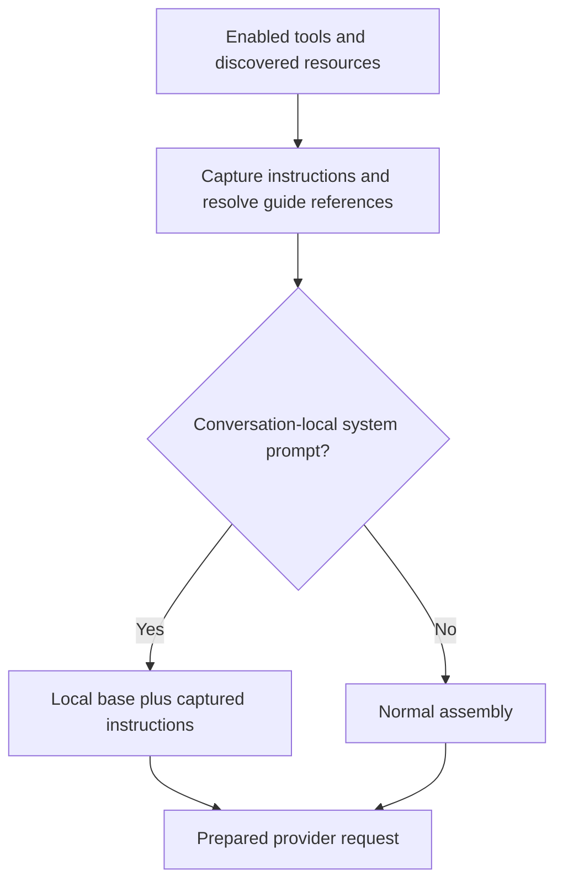

# System prompt and tool descriptions

The system prompt gives an agent its working instructions and the context available for a request. The host assembles it from the base prompt, project resources and conversation instructions; tool definitions explain how to use the available capabilities. Keeping the base small lets tools and skills carry capability detail close to its implementation, so the prompt is less likely to drift from the tools.

## Assembly

The host first filters tools and loads the resources available to this conversation. The prompt builder then assembles those captured inputs in order:

Normal assembly uses:

1. The default base, or a supplied replacement base.
2. Appended project context.
3. Captured profile and conversation instructions.
4. Applicable project instruction files.
5. Available skills, when the agent has the read tool needed to open them.
6. Available child profiles, when the delegation prompt tool is present.
7. Environment context.

A conversation-local system prompt replaces normal assembly, while captured profile and local instructions still append. Maintainers should preserve this distinction because replacing only the introduction and replacing the assembled context are different operations. [Profiles](conversation-core/delegation.md) explains instruction ownership; [scoped configuration](configuration.md) explains when a new capture takes effect.

Guide references such as `{{skill:<name>}}` resolve to bundled skill paths during resource preparation so instructions can point to workflows without embedding their full text. Built-in guide skills belong to tool groups and stay outside the user-toggleable available-skills list.

## Tool-writing rules

- Lead with what the tool does, adding non-obvious execution behavior so the agent can predict effects such as background work or external transfer.
- Keep units, defaults, indexing and format examples where needed, while avoiding repeated parameter names and types because the schema already supplies them.
- Leave out configuration details the agent cannot act on so descriptions remain useful at call time; errors should explain configuration failures.
- Retain explicit user-request restrictions on mutating tools where required so shortening a description does not weaken its safety instructions.
- Move lengthy workflows into guide skills while retaining enough detail to call the tool correctly and safely, so workflow guidance and call requirements can evolve at their owning layers.

For example, a tool can point to a bundled integration guide rather than repeating its workflow in every description. The tool definition still retains any required restriction on mutations because loading a guide must not be a prerequisite for knowing that boundary.

## Where it lives

| Concern                                 | Owner                                                                                                                                                                                          |
| --------------------------------------- | ---------------------------------------------------------------------------------------------------------------------------------------------------------------------------------------------- |
| Tool filtering and resource preparation | [`scopedTurnResources`](../../packages/workbench-server/src/core-host/scoped-turn-resources.ts)                                                                                                |
| Assembly and custom-prompt behavior     | [`buildNerveSystemPrompt`](../../packages/workbench-server/src/core-host/nerve-system-prompt.ts) and [prompt tests](../../packages/workbench-server/src/core-host/nerve-system-prompt.test.ts) |
| Guide-reference resolution              | [`resolveSkillPlaceholders`](../../packages/skills/src/paths.ts) and [guide skills](../../packages/skills/src/guides/)                                                                         |
| Exact tool descriptions and schemas     | [Tool catalog](../../packages/tools/src/catalog/) and its owning tests                                                                                                                         |
