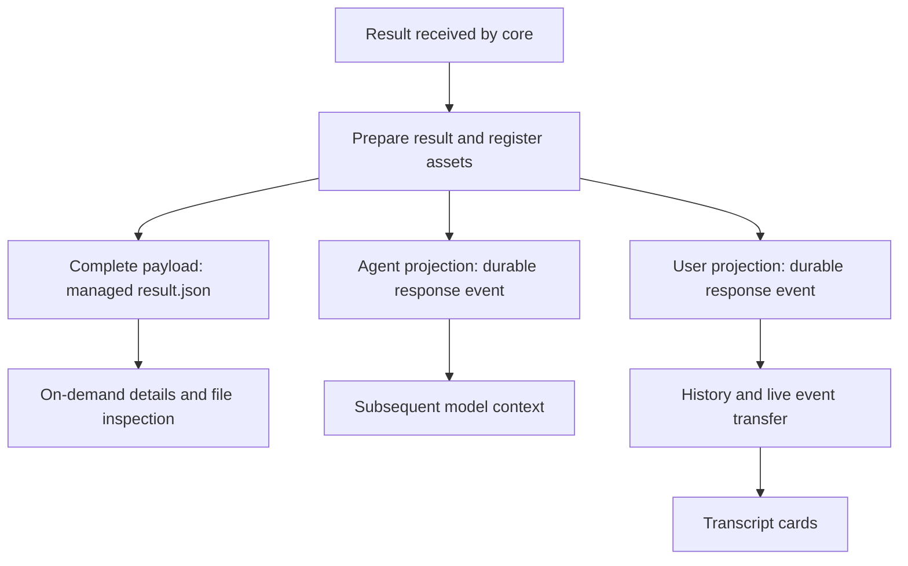

# Tool-result projection

Tool results can contain far more data than a model request or transcript card should carry. Core saves the received result for inspection and builds two smaller representations: one for the model and one for the user. Each reader gets a representation suited to its cost and purpose, while managed files provide a route back to fuller evidence.

## Three readers, three representations

A **projection** is a selected representation of a result, rather than a second execution of the tool. The agent projection protects model context, where oversized output can be paid for again on later requests. The user projection keeps transcript rendering small and predictable. The complete payload supports inspection without loading full results for every card.

“Complete” means the result received by core, independently of preview reduction. Execution may already have bounded capture or saved separate artifacts, so this payload cannot reconstruct bytes the tool never returned. Core also normalizes display data and replaces embedded image bytes with asset references before saving it.

For example, a command with a long log can yield a short diagnostic summary for the model, a compact output preview for the transcript, and managed files for deeper investigation. These views serve different readers and therefore have independent reduction rules.

## Agent projection

A tool policy first builds a **candidate**: the semantic content worth showing to the model. A **profile** supplies its inline and overflow budgets. A fitting candidate passes through unchanged; oversized candidates use a reduction strategy such as diagnostic selection or source continuation. “Unchanged” therefore refers to the candidate, which may already differ from raw output.

Each call has its own budget so parallel calls do not compete for a shared allowance. Text is measured by lines and UTF-8 bytes, with item accounting where applicable. Images are outside this text accounting.

Failures, denials, cancellations and interruptions take precedence over ordinary output so the model sees the outcome before bulk data. Their explanation does not imply rollback, because an interrupted operation may already have changed external state. Unknown tools and candidate-building failures use a conservative fallback so projection can still produce bounded context.

Reduction can retain references to validated artifacts or the complete payload, allowing further inspection instead of treating a summary as the only evidence. Process output notices use the same projection machinery so background completion and ordinary tool settlement share policy.

| Concern                                     | Owner                                                                                                                     |
| ------------------------------------------- | ------------------------------------------------------------------------------------------------------------------------- |
| Candidate selection and terminal precedence | [`projectAgentResult`](../../packages/tools/src/result-projection/projector.ts)                                           |
| Budgets                                     | [`AGENT_RESULT_PROFILES`](../../packages/tools/src/result-projection/profiles.ts)                                         |
| Tool-specific policies                      | [`agentResultPolicyForTool`](../../packages/tools/src/result-projection/policies/index.ts) and neighboring policy modules |
| Reduction behavior                          | [`strategies.ts`](../../packages/tools/src/result-projection/strategies.ts)                                               |
| Process output and notices                  | [`projectProcessOutput`](../../packages/tools/src/result-projection/process-output.ts)                                    |

Sub-agent completion reports have a separate lifecycle cap; see [delegation](conversation-core/delegation.md). The sub-agent tool's own result still passes through tool-result projection because it enters model context as a tool response.

## User projection

The settled transcript preview contains bounded argument and result data plus overflow metadata. Tool-specific summaries, such as edit diffs, can differ from the agent's candidate because users are inspecting what happened rather than consuming model context. Live progress is separate from this settled preview.

Core builds the preview at settlement, and the app consumes it without loading the complete payload for every card. Preview limits belong to the shared builder so rendering components can rely on bounded input.

| Concern                      | Owner                                                                                                                                           |
| ---------------------------- | ----------------------------------------------------------------------------------------------------------------------------------------------- |
| Argument and result previews | [`buildUserProjection`](../../packages/tools/src/result-projection/user-projection/tool-user-projection.ts)                                     |
| App transcript adaptation    | `toolRecord` in [`core-transcript.adapter.ts`](../../packages/workbench-app/src/lib/features/conversations/adapters/core-transcript.adapter.ts) |

## Persistence and transfer

Result preparation saves the complete payload, registers produced files, validates artifact claims and builds both projections. An **artifact** is a separately retained file. Claims must resolve to registered files from that tool call, because an arbitrary claimed path is insufficient evidence of ownership.

The payload lives at `conversations/<id>/tool-calls/<toolCallId>/result.json` under the managed data directory. Managed assets carry producer ownership and event linkage; event-linked assets cannot be overwritten through the asset store's write operation, preserving settled evidence.

The durable response event holds the projections, call metadata and asset IDs. Ordinary event transfer omits the agent projection, keeping transcript delivery focused on the user preview. Opening details fetches the selected call's agent projection and complete payload on demand.

| Concern                                    | Owner                                                                                                                |
| ------------------------------------------ | -------------------------------------------------------------------------------------------------------------------- |
| Result preparation and artifact validation | [`prepareToolResult`](../../packages/conversation-core/src/tool-calls/tool-result.service.ts)                        |
| Managed paths, ownership and files         | [`AssetStore`](../../packages/conversation-core/src/assets/asset-store.ts)                                           |
| Event transfer filtering                   | [`transferConversationEvent`](../../packages/contracts/src/domains/core/event.ts)                                    |
| Protocol delivery and details operation    | [`createConversationProtocolSession`](../../packages/workbench-server/src/adapters/protocol/conversation-channel.ts) |
| Details retrieval                          | `ConversationCore.getToolCallDetails` in [`core.ts`](../../packages/conversation-core/src/core.ts)                   |

## Images and model context

Images returned in tool content become managed assets referenced by ID. They need not appear in both previews, because each projection chooses its own content. Model-context assembly resolves image references explicitly present in the agent projection; UI image requests use the asset HTTP route. Keeping bytes outside events avoids carrying binary payloads through transcript replay.

Image resolution is owned by [`loadProjectionOptions`](../../packages/conversation-core/src/context/asset-projection.ts). For how projections enter subsequent model requests, see [events and context](conversation-core/events-and-context.md).
