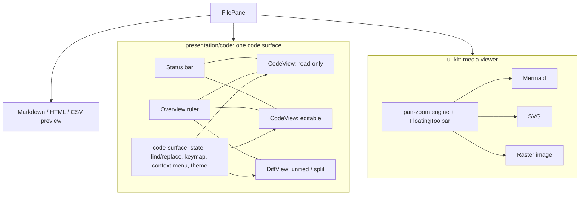

# Code viewer, editor, diffs and previews

> **Status:** Proposal. Covers the CodeMirror file viewer/editor, the Git/PR/tool-call diff views, and the image/SVG/Mermaid/Markdown/HTML previews.

## Goal

Users should be able to read, review and make small edits to project files without leaving Nerve. Nerve is not an IDE. Out of scope: autocompletion, LSP, linting, multi-file refactors, terminal-style editor modes.

Required: an editor that feels like an editor, find and replace, go to line, clear diffs where changes are easy to find, consistent preview tooling, and no performance regression on large files.

## Current state

### Viewer and editor

- `presentation/code/CodeMirrorViewer.svelte` is a read-only viewer with editing added later. The config entry point is `readOnlyCodeExtensions({ editable })`. Editing only adds `history()` and `defaultKeymap`.
- `CodeMirrorViewer` and `features/git/views/CodeMirrorGitDiff.svelte` duplicate about 300 lines: find state, context menu, keymap and fold markers. `CodeMirrorEditor.svelte` (settings JSON) has its own config path.
- Missing basics: replace, go to line (`Mod-G` is bound to "find next"), auto-closing brackets, `indentOnInput`, multiple cursors and rectangular selection, active line, `scrollPastEnd`, indentation detection, and a line/column status.

### Why the editor feels like an input field

Code review and the current theme point to these causes:

| Symptom | Cause |
| --- | --- |
| Gutter numbers look misaligned or "off" | Line numbers use `--text-ui` (13 px) while code uses `--text-body` (15 px) at line height 1.5. Baselines differ and the gutter reads as a separate widget. |
| Extra unexplained column on the left | In edit mode, unsaved-change markers come from a full `unifiedMergeView` whose change gutter sits beside the fold gutter. It is an unlabelled colored strip, separate from the line numbers. |
| No sense of position | `.cm-activeLine` is forced transparent, there is no active-line gutter highlight, and there is no line/column readout. |
| Text stuck to the bottom edge | No `scrollPastEnd`. The last line pins to the bottom like a `<textarea>`. |
| Scroll jank on long files | `codeFoldMarker` calls Svelte `mount()` for every fold marker CodeMirror creates and never unmounts it. Scrolling keeps creating component instances. |
| Typing lag on large files | The unsaved-changes gutter runs a full merge diff against the baseline on every document change, up to the 1 MiB edit limit. |
| Large body font | 15 px monospace is larger than typical editor defaults (13–14 px), so less code fits on screen. |

### Diffs

- The Git panel and PR files use `unifiedMergeView` with defaults. They don't use `collapseUnchanged`, `goToNextChunk`/`goToPreviousChunk`, split view (`MergeView`), `diffConfig` limits, or hunk controls.
- A new `EditorView` is created whenever the inputs change, so refreshes lose scroll position and folds.
- There is no way to see where the changes are in a long file. The earlier minimap (`@replit/codemirror-minimap`, #262) was removed in #320 because of performance. That library paints document text to a canvas and redraws on updates, which is costly on long documents and merge views. It also answers "what does the file look like", when the question here is "where are the changes".
- Transcript tool diffs (`DiffSections` → `ResultCodeBlock language="diff" highlight={false}`) are plain patch text with no syntax colors or word-level changes.

### Previews

- Mermaid (`ui-kit/renderers/mermaid/MermaidDiagram.svelte`) has a custom pan/zoom with a `FloatingToolbar` (wheel-zoom toggle, zoom out/in, fit, optional open in tab). `MermaidPane` never passes `onOpenStandalone`, so the open-in-tab button never shows in file views. It has no copy, download or fullscreen.
- SVG is classified as an image on the server and shown, like raster images, in a plain ``. There's no zoom, pan, toolbar, or option to view the source.
- PDF, audio, video and images over 5 MiB fall back to "Binary preview unavailable". CSV is shown as plain text.
- `defaultFileDisplayMode` opens Markdown and Mermaid as rendered from the extension alone, so an empty `README.md` opens as a blank preview that looks broken.

### File I/O and transport

- Reading and saving a single file is pure Node (`filesystem.service.ts`). Native (`packages/native`) covers directory listing, the path index, content search, git (including `read_git_file_diff`) and the change monitor.
- Save checks the revision by re-reading and hashing the file in `prepare`. After writing, it calls `fileContent`, which reads and hashes the file again.
- `readTextLineWindow` (truncated files opened at a line) streams the whole file through `readline`, so its cost grows with file size.
- Images go out as base64 JSON up to 5 MiB. Git and PR diffs send full `original` and `modified` text over WS RPC (native cap 16 MiB per side). Every Git diff request also runs a full `readSnapshot`.
- Open tabs are never told when a file changes on disk. Only the file tree consumes `filesystem.project.changed`.

## Proposal

### 1. One shared code surface

Move the duplicated logic into one module that the viewer, the editor, the diff view and the settings JSON editor all use:

- Find/replace state and panel, keymap, context menu, theme and fold markers in one place.
- Read-only and editable become explicit modes, replacing the `editable` flag on the read-only config.
- Fold markers are plain DOM elements with an inline Lucide SVG string, not Svelte `mount()` calls.
- Reconfigure through compartments and transactions instead of rebuilding the `EditorView`. This keeps scroll, selection, folds and search across refreshes, including for diffs.
- Delete `CodeMirrorEditor.svelte` and the copy-pasted code in `CodeMirrorGitDiff.svelte`.

### 2. Editor feel and light editing

Visual polish:

- **Gutter:**
  - Line numbers use the code font size and line height, so baselines match.
  - One gutter area: line numbers, then one narrow change-marker lane, then the fold lane.
  - Fold chevrons show only on hover or on the active line.
- **Font:** code text drops to 13–14 px.
- **Position cues:**
  - Show the active line (subtle) and highlight its gutter number. In read-only mode, show these only while the view is focused.
  - Add `scrollPastEnd` and keep the cursor a few lines from the edges when scrolling.
- **Behavior and reset:**
  - Use `drawSelection`, `dropCursor`, `crosshairCursor` and `rectangularSelection`, and allow multiple selections.
  - Remove `cursor: text` from read-only views.
  - Stop overriding `Mod-A` and `Mod-C` in editable mode.

Editing features (editable mode only):

- **Find and replace:**
  - Replace one or all, regex/case/whole-word, match count, find in selection.
  - `Enter` / `Shift+Enter` / `F3` move between matches.
  - Regex capture groups work in replacements.
- **Go to line:** `Mod-G`, with `line:col` support.
- **Typing helpers:** `closeBrackets` and `indentOnInput`.
- **Indentation and line endings:** detect indentation from the file content and set `indentUnit` and `tabSize` from it. Keep line endings and the final newline as they are (the line separator is already preserved).
- **Commands:** move/copy line up or down, toggle comment, indent/outdent selection, duplicate selection. All are standard `@codemirror/commands`.
- **Status bar:** `Ln, Col`, selection count, indentation, `LF`/`CRLF`, encoding and language. Clicking an item opens its action, for example go to line or change indentation.
- **Unsaved-change markers:**
  - Track the composed `ChangeSet` since the baseline. The cost depends on the edits, not on document size.
  - Recompute the exact diff on idle (debounced) only to clear markers for lines reverted to their original text.
  - This replaces the per-keystroke merge view.
- **Save conflict:** when the server returns `FILE_REVISION_CONFLICT`, offer Reload, Compare (opens a diff of disk vs. buffer) or Overwrite.
- **External changes:** if the tab is clean, reload it silently. If it is dirty, show a "changed on disk" bar (see §6).

### 3. Finding changes in diffs

**Overview ruler instead of a minimap.** Add a thin (8–10 px) lane beside the scrollbar that shows only *where* things are, not the text itself:

- Added, removed and modified regions from `getChunks()`, in `success`/`destructive`/`info`. Search matches, the target line and unsaved edits use the same lane in the normal editor.
- A viewport thumb shows the visible part. Click or drag to jump.
- Cost depends on chunk count, not document size. Positions come from `lineBlockAt(pos).top / contentHeight`. Draw to one `<canvas>` in a `ViewPlugin`, redraw only when the chunk set or geometry changes, and coalesce redraws into `requestAnimationFrame`.
- It deliberately shows no text, which avoids the work that made the old minimap slow. A text minimap will not be rebuilt.

Diff view features:

- **Unchanged regions** collapse by default (`collapseUnchanged: { margin: 3, minSize: 6 }`) and expand on click.
- **Change navigation:** a `Change 3 of 12` counter and prev/next buttons in a floating diff toolbar, plus `Alt+↑/↓` and `F7`/`Shift+F7`. The view scrolls to the first change when it opens.
- **Layout:** unified by default, with a toggle to split (`MergeView`). The choice is saved per user. Narrow and mobile layouts force unified.
- **Large files:** set `diffConfig.timeout` and `scanLimit` so very large diffs degrade to coarser chunks instead of freezing the UI.
- **Read-only:** all diff views stay read-only, with no per-hunk revert or stage. To edit, use "Open file" from the diff toolbar, which jumps to the same line in the file tab.
- **Transcript diffs:**
  - Render tool-call patches with Shiki syntax highlighting (the transcript highlighter), add/remove backgrounds and word-level changes.
  - Show line numbers from the hunk headers.
  - Add an "Open in diff view" action that opens the full file comparison in a center tab.

### 4. Shared media viewer (Mermaid, SVG, images)

- **Shared engine:** extract the pan/zoom logic from `MermaidDiagram.svelte` into a ui-kit module (wheel zoom at the cursor, pointer-drag pan, fit with `ResizeObserver` refit, scale limits). Mermaid, SVG and raster images all use it.
- **Floating toolbar:** one `FloatingToolbar` set, top-right, the same on every surface. Actions:
  - zoom out, zoom %, zoom in
  - fit, 1:1
  - wheel-zoom toggle
  - copy (image blob, or SVG/Mermaid source)
  - download
  - fullscreen
  - open in tab, when embedded
  - for raster images only: a transparency checkerboard toggle and pixel dimensions
- **Keyboard:** `+`/`-`/`0` zoom and fit, `F` fullscreen, and double-click toggles between fit and 1:1.
- **SVG** gets the media viewer by default, plus a Preview/Source toggle that opens the source in the code view. It is editable as text, like other text files, with a live preview.
- **Images in tool cards:** `ImageFrame`'s `onOpen` opens the same viewer in a lightbox dialog.

### 5. Previews and default display mode

- **Default mode:**
  - Open in **edit/raw** mode when the file's rendered content would be empty: whitespace only, or for Markdown, only front matter and comments. Re-check when the file is reloaded, unless the user has already picked a mode for that tab.
  - Files created from Nerve also open in raw mode.
  - Otherwise keep the current rules: Markdown and Mermaid rendered, a target line forces raw, and the per-tab choice is saved.
- **Split mode** for Markdown, Mermaid, HTML and SVG: editor on one side, live preview on the other, updated with a debounce, with optional scroll sync for Markdown using source line numbers. The tab toggle becomes Code / Split / Preview.
- **Empty preview state:** if the rendered output is empty anyway, show "This file is empty" with an "Edit" action instead of a blank page.
- **New previews:** CSV/TSV as a virtualized read-only table (raw text stays editable), PDF in a sandboxed `<iframe>`/`<embed>`, and audio/video with native controls. PDF and media need the raw-byte route in §6.
- **Markdown rendered view:** a small floating toolbar with Edit, copy source and an outline (headings) popover.

### 6. Performance and native I/O

Budgets, measured on the desktop build with a mid-range laptop:

| Scenario | Budget |
| --- | --- |
| Open a 1 MiB text file to first paint | ≤ 150 ms server + ≤ 100 ms client |
| Typing in a 1 MiB file | p95 input-to-paint ≤ 16 ms |
| Scroll a 50k-line file | no long tasks > 50 ms |
| Open a 10k-line diff | ≤ 250 ms to interactive; ruler drawn in ≤ 5 ms |
| Save a 1 MiB file | one read for the revision check, one write, no re-read |

Server and native changes:

1. **Native `read_text_file` (Rust, `packages/native/src/files`).** One pass that returns:
   - the result of `stat`
   - bytes up to the limit
   - binary/UTF-8 check (SIMD validation)
   - SHA-256 revision
   - line count and dominant line ending
   - an optional line window found by seeking with `memchr` over newlines instead of `readline`

   For truncated large files, keep a small LRU line-offset index keyed by (path, mtime, size), so opening at line N doesn't rescan the file. The JS path stays as a fallback where the native module is unavailable.
2. **Native `write_text_file`.** Atomic write with the revision check done on bytes already in memory: read once, hash, compare, write, return the new revision and stat. This removes the second `fileContent` read. The same symlink and inside-project rules apply.
3. **Raw byte route (Node streaming is enough).** `GET /filesystem/raw` sends:
   - the correct `Content-Type`
   - `ETag` (revision or mtime+size)
   - `Range` support
   - `Content-Security-Policy: sandbox` and `nosniff` for SVG/HTML

   Images, SVG, PDF and media load from it by URL instead of base64 JSON. That drops the 5 MiB image cap and the base64 overhead.

   **Auth:** a short-lived signed token in the URL, bound to project, path and revision, expiring in minutes. This works the same in browser, desktop and mobile clients.
4. **Push changes to open files.** Extend the workspace monitor notice with the changed file paths (or let clients subscribe to the paths of open tabs). Tabs compare against the stored revision and reload or show the "changed on disk" bar. Coalesce updates with the monitor's existing 300 ms quiet window.
5. **Git diff path.**
   - Reuse a cached status snapshot (refreshed by the monitor) instead of calling `readSnapshot` on every `git.file.diff.get`.
   - Stop cloning blobs in `file_diff.rs`.
   - Keep sending full texts up to 4 MiB per side (configurable), because the diff view and collapsed regions need them. Above the cap, return native-computed hunks only and render them in the read-only patch view.
   - Computing diffs in Rust/WASM on the client is deferred until measurements show CodeMirror's diff, with a timeout, is the bottleneck.

Moving SHA-256 or base64 to Rust is not proposed. Node already does both in native code, so the gains come from fewer reads and from serving raw bytes.

## Phasing

1. Shared code surface, editor feel fixes, find/replace, go to line, status bar, and the fold-marker and unsaved-changes performance fixes.
2. Diff view: overview ruler, collapsed unchanged regions, change navigation, unified/split, persistent state, `diffConfig` limits.
3. Media viewer for Mermaid, SVG and images. Empty-file default mode and empty preview state.
4. Native read/write, raw byte route, open-file change push, Git diff caching and caps.
5. Split preview, transcript Shiki diffs with "open in diff view", CSV/PDF/media previews.

Phases 1–3 are frontend-only and can ship separately. Phase 4 unblocks PDF/media previews and large images in phase 5.

## Validation

- Unit tests for the code-surface state: find/replace (including regex replace), go to line, indentation detection, unsaved-change ranges from composed changes, overview-ruler mark computation, and the empty-file display-mode rule.
- Native tests for `read_text_file` and `write_text_file`: binary/UTF-8 detection, revision stability, line-window seeking, conflict on revision mismatch, symlink and outside-project rejection.
- A perf harness in the design lab (`/dev/...`) that loads generated 1 MiB / 50k-line files and 10k-line diffs and records long tasks and input latency against the budgets above.

## Decisions

- **Raw route auth:** a short-lived signed token in the URL.
- **Diff actions:** diffs stay read-only, with no hunk revert or stage.
- **Diff layout:** unified by default, with a split toggle.
- **Minimap:** overview ruler only; no text minimap.
- **Full-text Git diff cap:** 4 MiB per side, configurable. Above it, show hunks only.
