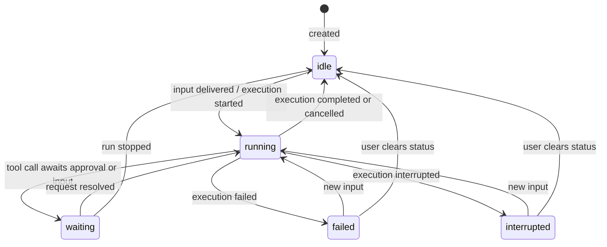

# Composer consistency and conversation attention

> **Status:** Implemented. Replaces `unified-composer-state.md` and `unified-conversation-attention.md`.

## Summary

Two independent fixes that share one small seam (which conversation is in front of the user), plus the user-facing notification design:

1. **Composer** — each conversation pane builds one composer view (configuration + actions) for draft and saved conversations alike. Shortcuts and the status bar read the active pane's view instead of rebuilding configuration from the persisted store. Client-only. → [composer.md](composer.md)
2. **Activity and attention** — the server adds two derived fields to `ConversationSummary` so every conversation row knows about background work and pending input, including unopened conversations and sub-agents. The client turns live summary transitions into notifications and a session-local "unseen" marker. → [activity-and-attention.md](activity-and-attention.md)
3. **Notification UX** — what the user sees and hears on each surface: rows, tabs, project buttons, the bell, toasts, sounds, system pop-ups, the dock badge and the settings page. Delivery is decided by presence (watching / elsewhere / away). → [notifications-ux.md](notifications-ux.md); wireframe at `/dev/wireframes/conversation-attention` (local)

The design deliberately avoids new state machines, caches, ordering schemes, cross-window coordination, and persisted acknowledgement. Each of those can be added later if a concrete bug requires it.

## Confirmed problems

| #   | Problem                                                                                            | Evidence                                                                                                                            |
| --- | -------------------------------------------------------------------------------------------------- | ----------------------------------------------------------------------------------------------------------------------------------- |
| C1  | Composer shortcuts are dead in draft panes and write to the persisted store                        | `WorkbenchProvider.svelte` — `hasConversationComposer: () => Boolean(config)`, `config` comes from `activeStore` only               |
| C2  | Subscription-provider highlighting reads a mirrored draft field                                    | `register-workspace-read-models.svelte.ts` reads `pending.selectedModelKey`; `ConversationCenterHost` copies it by hand             |
| C3  | Draft configuration is resolved twice, with separate invalidation                                  | `ConversationCenterHost.svelte` and `WorkbenchComposerAdapter.svelte` both call `projectAgentDefaults.get` and `resolveProject`     |
| C4  | Draft creation resolves a model client-side from settings and fails if none                        | `workspace-actions.svelte.ts` → `resolveNewAgentComposerSelection`                                                                  |
| A1  | A new failure after an earlier "clear" is hidden                                                   | `conversation-activity.ts` treats any `statusClearedAt` as cleared; server `status.ts` compares it with the failure time            |
| A2  | "Waiting on sub-agents / background commands" only works for conversations with an open transcript | `waitingConversationIds()` scans `openStores` only                                                                                  |
| A3  | A sub-agent awaiting approval/input is not visible on its root conversation row                    | Root summary has no descendant information; workspace lists only roots                                                              |
| A4  | No OS/sound notification for input needed, result ready, or failure                                | `notifyNative` has no production caller; sound preferences (`question`, `approval`, `planReview`, `completed`, `failed`) are unused |

## Schema and data changes at a glance

| Area                                                                       | Change                                                                                                                                                                        |
| -------------------------------------------------------------------------- | ----------------------------------------------------------------------------------------------------------------------------------------------------------------------------- |
| **SQLite schema / migrations**                                             | **None.** New summary fields are computed by queries over existing tables.                                                                                                    |
| **Tool-call schemas** (`toolCallSchema`, `interactionSchema`, tool I/O)    | **None.**                                                                                                                                                                     |
| **Conversation event / `execution_state` payloads**                        | **None.**                                                                                                                                                                     |
| **`conversationStatusSchema`** (`idle/running/waiting/failed/interrupted`) | **None.** Semantics unchanged; see diagram below.                                                                                                                             |
| **`ConversationSummary`** (wire contract in `packages/contracts`)          | **+2 derived, read-only fields:** `pendingWork: boolean`, `pendingInput: {…} \| null`. Not persisted.                                                                         |
| Operations / notices (`conversation.changed`, etc.)                        | No new operations or notice types. `conversation.changed` is additionally emitted for ancestors.                                                                              |
| Settings / notification-preference schemas                                 | None. Existing per-event sound preferences are reused; only UI copy changes.                                                                                                  |
| Desktop IPC (`desktop-shell` ↔ app bridge)                                 | **+1 call** to set the dock/taskbar badge count. Not a data schema.                                                                                                           |
| Client-only `PendingConversationState`                                     | Fields removed (`selectedModelKey`, `thinkingLevel`, `agentProfile`, `permissionRuleSetId`, `inheritedSettings`, mirrored `config` settings). Not persisted, so no migration. |
| Client persistent storage (local storage, draft text)                      | None.                                                                                                                                                                         |

## Conversation execution status — unchanged

The server-owned status machine is **not modified**. It is shown here as the reference the rest of the proposal builds on (derived in `conversation-core/src/runtime/status.ts`).

What changes is what the client **derives** next to this status (row activity and notifications). Those end-state diagrams are in [activity-and-attention.md](activity-and-attention.md#end-state-row-activity). The draft → conversation lifecycle on the client is also unchanged ([composer.md](composer.md#draft-lifecycle--unchanged)).

## Delivery plan

Four separately reviewable changes. 1–2 are independent; 3 precedes 4.

| Step | Scope                                                            | Packages                                                              |
| ---- | ---------------------------------------------------------------- | --------------------------------------------------------------------- |
| 1    | Status-clear fix (A1)                                            | `conversation-core`, `workbench-app`                                  |
| 2    | Composer view per pane + active-composer slot (C1–C4)            | `workbench-app`                                                       |
| 3    | Summary `pendingWork` / `pendingInput` and row activity (A2, A3) | `contracts`, `conversation-core`, `workbench-server`, `workbench-app` |
| 4    | Attention controller, notification delivery and UX (A4)          | `workbench-app`, `desktop-shell` (badge)                              |

## Non-goals

- Persisting drafts or creating conversations when a draft opens.
- A client-side settings resolver; the server stays the configuration authority.
- Changing submission/promotion (`submitPendingConversation` already reuses the created ID on retry).
- Cross-window or cross-device acknowledgement/deduplication, and delivery while the app is closed (hidden in the tray still works).
- New notification settings (mute is session-local; the dock badge has no toggle).
- Replaying notifications missed while disconnected.
- Expanding draft features (instructions, compaction editing).
