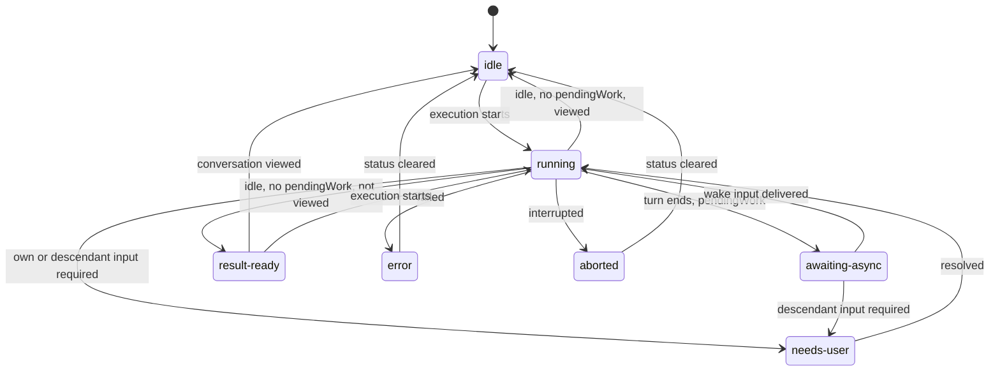

# Conversation activity and attention

Fixes A1–A4 from the [overview](README.md).

## Plan step 1 — Status-clear fix (A1)

The server already resolves `status` correctly (`status.ts` only reports `failed`/`interrupted` when the failure is newer than `statusClearedAt`). The client override in `summaryActivity` is therefore wrong and must go.

It probably exists because `ConversationService.update` emits `conversation_changed` **before** `status.refresh(id)`, briefly publishing `status: "failed"` with `statusClearedAt` set. Fix both:

- `conversation.service.ts` `update`: write the patch, call `status.refresh(id)`, then emit one summary.
- `conversation-activity.ts`: use `row.status` as-is.
- Test: failure → clear → new failure shows `failed`.

## Plan step 3 — Summary fields (A2, A3)

### Contract change

`packages/contracts/src/domains/core/conversation.ts`, `conversationSummarySchema.extend({...})`:

```ts
/** Derived. Work that will resume or feed this conversation: running async Bash or
 *  queued wake inputs here, or any running/waiting descendant (recursively). */
pendingWork: z.boolean(),
/** Derived. Oldest unresolved approval/input in this conversation or a descendant. */
pendingInput: z
  .object({
    conversationId: z.string(), // may be a descendant
    toolCallId: z.string(),
    kind: z.enum(["approval", "user_input", "plan_review", "configuration_blocked"]),
  })
  .nullable(),
```

Both are computed on read; nothing is stored. No tool-call, event, or status schema changes.

### Derivation (`conversation-core`)

Extend the existing summary query in `conversation.repository.ts` (which already computes `last_parent_prompt_at` and `child_count`) with a recursive CTE over `conversation.parent_conversation_id`:

- `pendingWork` = exists, for this conversation or any descendant `d`:
  - `async_bash` with `status = 'running'`, or
  - `input_queue` row with `wake_when_idle = 1` while the conversation is not paused, or
  - `d.status IN ('running','waiting')` (descendants only).
- `pendingInput` = first `tool_call` in state `awaiting_approval` (`kind: "approval"`) or `awaiting_input` (`kind` from `interaction.kind`) across self and descendants, ordered by `updated_at`.

Async-Bash completion already updates its row and enqueues its wake notice in one transaction (`async-bash.service.ts` `finish`), so `pendingWork` cannot flicker false between "command finished" and "conversation resumed". A test pins this, and the same for child completion → parent report.

### Publication

Ancestors' derived fields change when a descendant changes. Add one core helper, `publishSummary(id)`, that emits `conversation_changed` for `id` and each ancestor. Call it where `conversation_changed` is emitted today, and after `async_bash_changed` and `queue_changed`. The protocol adapter forwards these unchanged as `conversation.changed`. No new notice types, no ordering scheme: per-conversation notices already arrive in emission order on one connection, and reconnect reloads lists.

If ancestor emission proves noisy, coalesce per tick. Don't build it upfront.

### Client consumption

- `summaryActivity(row)` reads `row.pendingWork` and `row.pendingInput`. The second `awaitingAsync` parameter goes away.
- Delete `waitingConversationIds()`, the `pendingAsyncConversationIds` workspace port, and its selector wiring.
- The transcript's detailed pending-work list (`pendingWork()` in `agent-team.ts`) stays; it shows _which_ work is pending.

## End state: row activity

Client-derived, per root conversation row/tab/inbox entry. Precedence top to bottom; the first match wins. **New** rows are marked.

| Indicator        | Condition                                         | Change          |
| ---------------- | ------------------------------------------------- | --------------- |
| `needs-user`     | `status === "waiting"` or `pendingInput !== null` | extended (A3)   |
| `error`          | `status === "failed"`                             | fixed (A1)      |
| `running`        | `status === "running"`                            | —               |
| `awaiting-async` | `pendingWork`                                     | now global (A2) |
| `aborted`        | `status === "interrupted"`                        | now red tone    |
| `result-ready`   | session-local unseen result (plan step 4)         | **new**         |
| `completed`      | `completedAt` (user marked done)                  | —               |
| `idle`           | otherwise                                         | —               |



The same transitions apply from `awaiting_async` to `result_ready` / `idle` / `error` once the wake input has run. This is a client derivation over the unchanged server status; nothing here is persisted.

## Plan step 4 — Attention controller and delivery (A4)

`application/activity/conversation-attention.svelte.ts`, started with the workbench connection. It observes `conversation.changed` notices for root conversations and keeps the previous summary per id.

**Baseline:** list loads and reconnect reloads only update the previous-summary map. They never notify. Missed events while disconnected are not replayed; current state still shows via row activity.

**Live edges** (previous → next summary of the same root):

| Edge                                                        | Attention      | Sound event (existing preference)                                                            |
| ----------------------------------------------------------- | -------------- | -------------------------------------------------------------------------------------------- |
| `pendingInput` becomes non-null or its `toolCallId` changes | Input required | `approval` / `question` (`user_input`) / `planReview` / `approval` (`configuration_blocked`) |
| busy → `idle` with `!pendingWork && !pendingInput`          | Result ready   | `completed`                                                                                  |
| status becomes `failed`                                     | Failure        | `failed`                                                                                     |
| status becomes `interrupted`                                | Interruption   | `failed`                                                                                     |

`busy` = `status ∈ {running, waiting}` or `pendingWork`. "Result ready" therefore means the lead has actually finished: it isn't waiting for sub-agents or background commands. Creation, title edits, and status clears are not edges into these states, so they never notify.

**Sub-agents:** the only sub-agent event that notifies is a request that needs a human: an approval or a human-in-the-loop tool (ask user, plan review). These surface through the root's `pendingInput`. A tool call only reaches `awaiting_approval`/`awaiting_input` after supervision (`supervising` state), so these are by definition requests the lead can't handle. A sub-agent going idle, failing, or being interrupted never notifies; the lead handles it.

**User stop:** stopping a run ends as `cancelled` → `idle`, which would otherwise look like "result ready". The window that sends Stop records the conversation ID, and its next quiet edge for that conversation is silent. Another open window may still play the sound (duplicates are accepted).

**Delivery:** each edge goes through one `deliverAttention(event)` function that applies the presence rule, mute, throttling and preferences, then calls `notifyNative` (sound + system pop-up) or shows a toast. Presence, surfaces and the user-facing rules are specified in [notifications-ux.md](notifications-ux.md).

**Unseen results:** an in-memory `Set<conversationId>`. A "result ready", failure, or interruption edge adds the conversation unless the user is _watching it_ (present and viewing it). "Viewing" means the active center tab's conversation, the viewed sub-agent, or a pending tab's `createdConversationId`. Opening or deleting the conversation removes the entry. It drives the `result-ready` indicator and the bell's "Finished" items. Not persisted. Bounded by the number of conversations.

**Needs-you list:** `deriveNeedsYou` stops filtering out errors and uses `pendingInput` so the bell, desktop and mobile inbox share one derivation.

Multiple windows may each notify. This is accepted (see non-goals). Interruption uses the existing `failed` sound; no new preference.

## Tests (owning layers)

- `conversation-core`: `pendingWork` with running async Bash, queued wake input, running/waiting grandchild; false after completion + wake delivery without a false gap; `pendingInput` from a child approval with the child's IDs; ancestor summaries emitted on child status change.
- `workbench-app` `summaryActivity`: precedence table above, including failure after clear.
- Attention controller: baseline is quiet; each edge row fires once; repeated approval with a new `toolCallId` fires again; presence rule (watching → indicators only, elsewhere → sound + toast, away → sound + system pop-up); mute; one sound per 4 s; Stop from this window silences the next idle edge; sub-agent idle/failed summaries never notify; deletion clears unseen.
