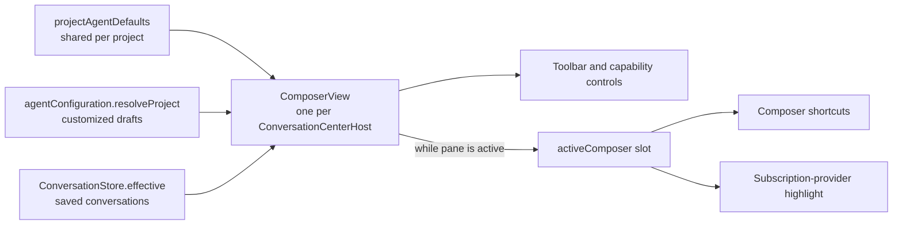
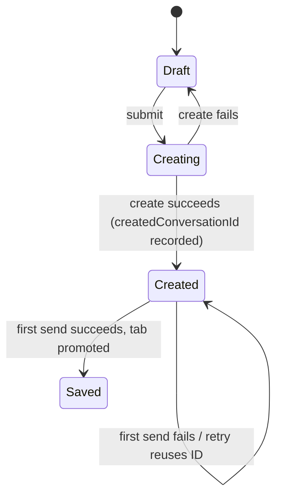

# Composer view per pane

Fixes C1–C4 from the [overview](README.md). Client-only; no contract, protocol, or storage changes.

## Problem

`ConversationCenterHost` already derives a complete composer view (resolution, applied profile, locks, overrides) for both drafts and saved conversations. But it is local to the component, so:

- `WorkbenchComposerAdapter` re-resolves the same draft configuration for capability controls.
- `WorkbenchProvider` builds a third, saved-only copy for keyboard shortcuts.
- The status bar reads a hand-mirrored `pending.selectedModelKey`.
- Draft creation picks a model client-side before the server projection is consulted.

The fix is mostly **moving** existing code into one place and pointing consumers at it.

## Design



### `ComposerView`

`application/composer/composer-view.svelte.ts` exports `createComposerView(deps)`, created once per `ConversationCenterHost`. It owns what that host does today at lines ~253–440, plus the adapter's draft resolution.

```ts
type ComposerView = {
  readonly target:
    | { kind: "draft"; pendingId: string; projectId: string }
    | { kind: "conversation"; conversationId: string; readOnly: boolean };
  readonly status: "loading" | "ready" | "unavailable";
  readonly resolution?: EffectiveResolution; // existing contract type
  readonly inherited?: LeadSettingsOverrides; // needed for override normalization
  readonly appliedProfile?: string;
  readonly overrides: LeadSettingsOverrides; // settingsOverrideView(...)
  readonly locked: { model; thinking; permission; compaction }; // from provenance
  setModel(key: string): Promise<void>;
  setReasoning(level: ThinkingLevel): Promise<void>;
  setPermission(id: string): Promise<void>;
  setProfile(name: string): Promise<void>;
  patchCapabilities(
    changes: LeadSettingsOverrides,
    resets?: string[],
  ): Promise<void>;
};
```

- `readOnly` is true when viewing a sub-agent; every action is a no-op and `WorkbenchProvider` treats the pane as having no editable composer.
- Convenience values (`selectedModelKey`, provider) are getters over `resolution`, never stored.
- Actions enforce `locked` themselves (not only the disabled UI), so pointer and keyboard paths behave identically.

### Resolution

Unchanged rules, one owner:

| Target                                | Source                                                                    |
| ------------------------------------- | ------------------------------------------------------------------------- |
| Draft without profile/overrides       | `projectAgentDefaults.get(projectId)` (shared across drafts)              |
| Draft with explicit profile/overrides | One `resolveProject` request; latest-wins via a per-effect `current` flag |
| Saved conversation                    | `ConversationStore.effective`                                             |

Invalidation stays as `ConversationCenterHost` does it today (`agentConfiguration.changed`, `conversationDefaults.changed`, reconnect), just moved. No new request cache, coalescing, or ordering layer: there is now exactly one requester per pane.

Saved-conversation capability edits keep using `ScopedAgentState` (revision-checked writes). The view owns that instance instead of the adapter.

### Active-composer slot

`application/composer/active-composer.svelte.ts`:

```ts
let current = $state<ComposerView>();
export const activeComposer = () => current;
export function activateComposer(view: ComposerView): () => void {
  current = view;
  return () => {
    if (current === view) current = undefined;
  };
}
```

`ConversationCenterHost` calls it from an `$effect` guarded by its existing `active` prop. Non-conversation tabs register nothing, so the slot is empty.

### Consumer changes

| File                                       | Change                                                                                                                                                                            |
| ------------------------------------------ | --------------------------------------------------------------------------------------------------------------------------------------------------------------------------------- |
| `ConversationCenterHost.svelte`            | Replace local derivation with `createComposerView`; register when `active`; pass the view to the adapter.                                                                         |
| `WorkbenchComposerAdapter.svelte`          | Delete `pendingCapabilityResolution`, `refreshCapabilities` draft branch, and its notice subscriptions; read `view.resolution` / call `view.patchCapabilities`.                   |
| `WorkbenchProvider.svelte`                 | Delete the `activeStore` / `effective` / `config` / `lockedFields` block; composer shortcuts call `activeComposer()`. Run stop stays on the active conversation store.            |
| `register-workspace-read-models.svelte.ts` | `selectedProvider` → `activeComposer()?.resolution?.settings.model?.provider`.                                                                                                    |
| `workspace-actions.svelte.ts`              | Draft creation no longer calls `resolveNewAgentComposerSelection`; an unusable configuration shows as `status: "unavailable"` in the composer instead of blocking draft creation. |
| `pending-conversations.svelte.ts`          | Remove mirrored fields (below).                                                                                                                                                   |

### `PendingConversationState` end state

```ts
type PendingConversationState = {
  id: string;
  projectId: string;
  projectDir: string;
  title: "New Conversation";
  explicitAgentProfile?: string; // user intent
  overrides?: LeadSettingsOverrides; // user intent
  /** Creation inputs that are not agent settings. */
  config: {
    systemPrompt: string | null;
    instructions: string | null;
    workingDirectory: string;
  };
  sending: boolean;
  error?: string;
  createdConversationId?: string;
  createdAt: string;
};
```

Removed: `selectedModelKey`, `thinkingLevel`, `agentProfile`, `permissionRuleSetId`, `inheritedSettings`, and `config.model/reasoningLevel/permissionRuleSetId/agentProfile`. `submitPendingConversation` receives `inherited` from the view at submit time instead of reading it from pending state. This state is in-memory only, so nothing migrates.

## Draft lifecycle — unchanged

Shown for reference; this proposal does not change it.



## Tests

Unit tests next to `composer-view.svelte.ts` / `active-composer.svelte.ts`:

- Untouched draft uses project defaults; explicit profile/overrides trigger one resolve; an older response is dropped.
- Locked fields reject `setModel` / `setReasoning` / `setPermission` for both drafts and saved conversations.
- Read-only (sub-agent) view: actions do nothing.
- `activateComposer` cleanup from an older view does not clear a newer one.

Manual check: model/permission/profile shortcuts work in a new-conversation tab, and the status bar highlights the provider the toolbar shows.
