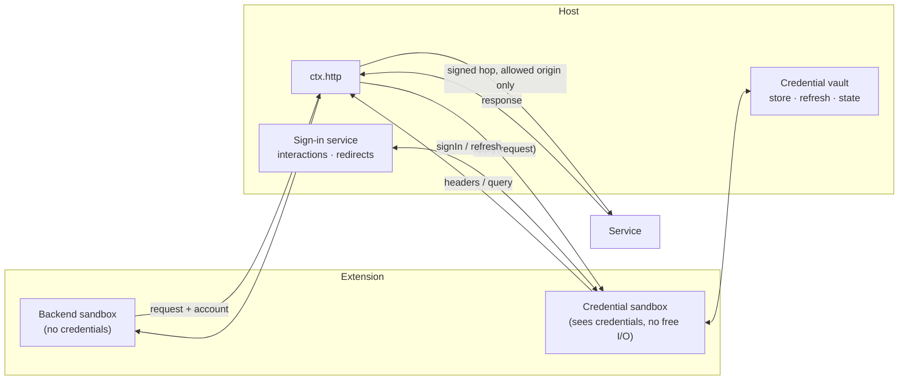
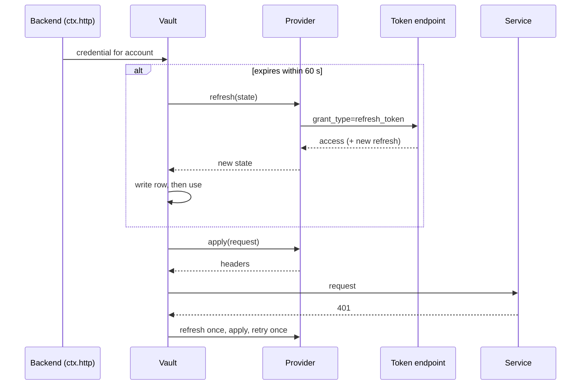

# Extension accounts: credential providers

**Status:** Draft · **Area:** extensions, auth

Extensions can use any kind of account: typed-in secrets, OAuth sign-in, request signing, token exchanges, sign-in flows Nerve has never heard of. Standard mechanisms are declared as data and run by the host. Everything else is the extension's own **credential provider**: code that runs in a separate sandbox, sees the credentials, and can only hand them to the host for the account's own origins. The extension's backend and UI still never see a secret.

Current design: [extension platform](../../architecture/extension-platform.md) (context security, accounts, sandbox adapter), [trust](../../architecture/trust.md) (consent and grants), [configuration](../../architecture/configuration.md#extension-settings) (accounts storage).

## Problem

- **One account shape.** An account kind ([`AccountKindData`](../../../packages/extension-api/src/settings.ts)) has non-secret fields, exactly one typed-in secret, and one of three injections (`basic`, `bearer`, `header`) that add a fixed header ([`credentialHeader`](../../../packages/tools/src/extension-host/http.ts)).
- **Anything else is impossible.** No browser or device sign-in, no refresh, no temporary credentials, no request signing (AWS SigV4, HMAC-signed APIs, OAuth 1.0a), no key-based token exchange (GitHub Apps, Google service accounts), no login-for-session-token APIs, no multi-part secrets (key id + secret + passphrase).
- **Adding mechanisms to the host does not scale.** Each new scheme in host code is a vendor feature in the host, a release, and a public-API change, and an extension author still cannot add the one they need. The platform's rule is that the host names no extension and public types name no provider.
- **Sign-in exists only for model providers.** [`OAuthFlowManager`](../../../packages/workbench-server/src/domains/auth/oauth-flow-manager.ts), the [loopback relay](../../../packages/workbench-server/src/domains/auth/oauth-loopback-relay.ts) and the app's interaction prompts (`oauthInteractionSchema` in [contracts](../../../packages/contracts/src/domains/auth/auth.ts): browser, device code, choice, text input, progress) are bound to `pi-ai` providers.

## Goals

- An extension author can implement any credential mechanism without a Nerve change.
- The secret boundary holds: backend code, UI frames, the agent and logs never receive a credential.
- Common mechanisms (typed-in secrets, standard OAuth 2.0) need no credential code.
- The host owns storage, refresh scheduling, sign-in UI, consent and origin checks for every mechanism.
- One sign-in service for model providers and extension accounts; works on the desktop and on a hosted daemon.

## Non-goals

- Vendor-specific code in the host (no AWS, GitHub or Google in host code or public types).
- Reading other tools' credential files or running their CLIs from the host.
- Making a malicious credential provider safe against the services it is allowed to talk to. The boundary is the origin allowlist the user consented to, as today.

## Design



An account kind names its **provider**: a built-in provider (data) or the extension's own (code). Both implement the same host interface, so the vault, sign-in service, consent and `ctx.http` do not care which.

### Provider interface

A provider has four operations. The host calls them; none is reachable from the backend, UI or agent.

| Operation | Called when | Returns |
| --- | --- | --- |
| `signIn(account, ui)` | The user clicks Sign in, or saves the account form | A credential state (opaque JSON) and its expiry |
| `refresh(account, state)` | Before expiry, or once after a 401 from a credentialed origin | A new state, or "needs sign-in" |
| `apply(account, state, request)` | Every `ctx.http` hop to an allowed credential origin | Headers to set and query parameters to add |
| `revoke(account, state)` | The account is deleted (best effort) | Nothing |

- **Typed-in secrets** are inputs, not state: the account kind declares one or more secret fields (labels, help, multi-line for keys), entered in the account dialog and passed to the provider. The single `secret` becomes one case of this.
- **`apply` input:** method, URL, headers and a body handle with two host calls: `digest(algorithm)` (any size, computed by the host, including bodies streamed from files) and `bytes()` (buffered bodies under a limit only; otherwise a clear error). See [Body access](#body-access). Output is limited to adding headers and query parameters; it cannot change the method, URL, path or body, so it cannot redirect a request.
- **`apply` has no network.** Provider `http` exists only during `signIn` and `refresh`. This is what makes body access safe: whatever `apply` sees can only travel to the origin the request was already going to.
- **Identity:** `signIn` and `refresh` may return non-secret identity fields (login, account id, role) that the backend sees on `AccountInfo`, like account fields.
- **Test:** the existing account `test` hook stays on the backend side and works through `ctx.http`, unchanged.

### Built-in providers (data)

Host-implemented, vendor-neutral, configured in the manifest:

- **`static`** (default): typed-in secrets with today's `basic`, `bearer`, `header` injections, plus a query-parameter injection. Existing manifests keep their meaning.
- **`oauth2`**: authorization code with PKCE and device code; endpoints as URLs, account-field templates or OIDC discovery; scopes; optional userinfo endpoint for identity fields; `bearer` injection. The client id is an **account field** the author may give a default; a client secret, when the service needs one, is an account secret. Nerve registers and ships no OAuth apps, so a user can always bring their own (an organisation's app, a self-hosted service).

New built-ins are added only for open standards many extensions need, never for one vendor.

### Extension providers (code)

For everything else, the extension ships a credential provider, built by the SDK from a separate entry (`src/credentials.ts`, `defineCredentialProvider`) into `dist/credentials.js`.

- **Its own sandbox.** A QuickJS runtime separate from the backend's, opened per operation and disposed after it. It shares no memory, session or module state with the backend.
- **Its `ctx` is small and fixed:**
  - `http` to the provider's **sign-in origins** only (token endpoints, device authorization, STS-style exchanges), declared in the manifest, through the same SSRF guard. Responses go back to the provider only.
  - `crypto`: hash, HMAC, random bytes, and asymmetric signing (RSA, ECDSA, Ed25519) for JWT assertions. Host-implemented, because QuickJS has none and pure-JS crypto is slow.
  - `ui` during `signIn` only: show a link, show a device code, ask a choice, ask for text, show progress, and get a loopback redirect URL and wait for its callback. These map to the existing interaction contract and app prompts.
  - Nothing else: no artifacts, files, settings, extension store, `ctx.authorize`, agent-visible reports or logs.
- **Libraries, not host features.** Signing schemes such as SigV4 or OAuth 1.0a are libraries an author bundles into `credentials.js` (the SDK may ship some as opt-in helpers). The host only provides the primitives above.

#### What keeps credentials in

| Channel | Rule |
| --- | --- |
| Return values | `apply` output goes on the wire only for hops to the account's credential origins; the backend sees the response, never the request headers it added. `signIn`/`refresh` state goes to the vault. Identity fields are checked to be short plain strings and shown in consent as "may share identity details". |
| Network | Provider `http` reaches only declared sign-in origins; `apply` output reaches only credential origins. Both lists are grants. |
| Errors and logs | Provider errors are shown to the user in Settings and reach the backend and agent only as a fixed message ("The <kind> account needs sign-in"). Provider logs are dropped outside development slots. |
| Shared state | None between the two sandboxes; the backend cannot call the provider. |
| Other projects | A project-defined kind's accounts and credential state are visible only in that project ([Account levels](#account-levels)). |
| Echoing services | A service that echoes request headers back in its response can leak what `apply` added. The same is true of today's injected headers; origins are consented and user-templated. Accepted residual risk, called out in consent for broad origins. |

### Body access

Signing schemes differ in what they need from the body, and the platform cannot know which ones authors will use:

| What `apply` gets | Covers | Leaves out |
| --- | --- | --- |
| SHA-256 only | SigV4, `Content-Digest` with SHA-256 | HTTP Message Signatures with other algorithms, OAuth 1.0a form bodies, HMAC over `timestamp + body`, MD5-based schemes |
| Full body always | Everything | Large and file-streamed uploads would have to pass through the sandbox (slow, memory-heavy, and they stream from disk today) |
| **Body on demand (chosen)** | Every scheme for buffered bodies; every hash-based scheme for any body | Raw-body schemes on large streamed uploads, which fail with a clear error |

`digest(algorithm)` supports SHA-256, SHA-384, SHA-512, SHA-1 and MD5 and is computed once per request. `bytes()` is limited to the same size as a buffered `ctx.http` body.

### Account levels

An account has a **level**: a **user-level account** is available in every project, a **project-level account** only in one project. Both are stored in the Nerve home, never in the repository. A project sees its own accounts and the user accounts; a project account can be chosen where a user account would be (a work GitHub account for work repositories).

Which levels a kind allows depends on where the kind is defined:

| Kind defined by | User-level accounts | Project-level accounts |
| --- | --- | --- |
| Built-in or user extension | Yes | Yes |
| Project (repository) extension | No | Yes, for the defining project only |

_Why the restriction:_ account kinds are unique only within one composition (built-ins, user, the current project; [`extension-catalog.ts`](../../../packages/workbench-server/src/core-host/extensions/extension-catalog/extension-catalog.ts)), so two repositories can define the same kind name with different origins and different credential code. A user-wide account of such a kind would reach whichever repository asks. Today accounts are user-wide for every kind, so this gap exists already for typed-in secrets, guarded only by consent; the rule closes it.

Existing accounts (Atlassian, Tavily) are user accounts and stay so. Installed extensions have not shipped, so no account of a project-defined kind exists yet.

**Selecting accounts in settings.** An extension's `account` setting at user scope can select only user accounts; at project or conversation scope it can select user accounts and that project's accounts. Moving an account to a project makes user-scope settings that selected it unresolved, shown with a fix like any missing account.

**Moving and duplicating.** On the Accounts page an account can be moved between user and project level, or duplicated into either, within the table above (an account of a project-defined kind stays in its project). Both keep the credentials: the row is moved, or copied under the new account's id. A copy shares the original's sign-in: when the service rotates refresh tokens, the first of the two to refresh invalidates the other's token, and that one becomes `needs_sign_in`. The page says so when duplicating a signed-in account, and offers Clear credentials on any account.

### Platforms, definitions and users

Three names, so that several extensions can describe the same kind of account without taking each other's accounts:

- **Platform:** a shared, non-unique name for what the account is for (`github`, `jira`). Any extension can name any platform.
- **Account definition:** one extension's description of how to hold an account for a platform: fields, secret inputs, credential provider, sign-in origins, credential origins, scopes. Its id is today's account kind (`<extension-id>…`, unique, with the existing prefix rule for installed extensions).
- **Account:** belongs to exactly one definition, for its whole life. Its credential state is only ever given to that definition's provider.

So two extensions that both define a GitHub account keep both definitions and their own accounts, and nothing has to be switched: the user sees **every GitHub account, whichever extension defined it**, and picks one where an account is selected.

- **A using extension** declares `uses: { platform, scopes?, origins? }` instead of defining its own. An `account` setting offers every account of that platform whose definition covers the user's origins (a subset) and can grant its scopes; it can narrow access, never widen it. Consent is per using extension and platform: "csv-sync uses your GitHub accounts with scopes repo".
- **Scopes** requested when signing in to an account are the union of its definition's and every enabled extension using that platform. When that union grows (a definition update, a newly enabled user), the affected accounts become `needs_sign_in` at once, and availability names what is missing.
- **Definition removed or off:** its accounts stay listed (state `unavailable`, naming the extension) and are not offered until it returns; the user can delete them.
- **Levels of definitions:** a project extension may use platforms with user-level or built-in definitions (with project consent); accounts of project-defined definitions are offered only in their project.

### Accounts page

Settings gets one **Accounts** page listing every account, with filters by platform, level (user, project), defining extension and state (`ready`, `needs_sign_in`, `failed`, `unavailable`). It is where accounts are added (choosing a definition when a platform has several), signed in, tested, moved, duplicated, cleared and deleted. Extension pages keep their account selectors and link to the Accounts page filtered to their platforms instead of hosting account management themselves.

### Storage

Accounts live in one SQLite table in the Nerve home database (approved schema change). It replaces `config/accounts.json` and the account entries of `secrets/credentials.enc`.

```sql
CREATE TABLE account (
  id TEXT PRIMARY KEY,
  kind TEXT NOT NULL,                 -- the account definition
  project_id TEXT REFERENCES project(id) ON DELETE CASCADE,  -- NULL: user-level account
  name TEXT NOT NULL,
  fields TEXT NOT NULL,               -- JSON, non-secret
  credential BLOB,                    -- encrypted; NULL: nothing stored
  status TEXT NOT NULL CHECK(status IN ('ready','needs_sign_in','failed')),
  expires_at TEXT,                    -- access token expiry; NULL: does not expire
  last_used_at TEXT,
  created_at TEXT NOT NULL, updated_at TEXT NOT NULL
) STRICT;
CREATE INDEX account_refresh ON account(expires_at) WHERE expires_at IS NOT NULL;
```

- **Level** is `project_id`: `NULL` for a user account, the project for a project account. A project lists `project_id IS NULL OR project_id = ?`. Project rows are not deleted today; the `ON DELETE CASCADE` only states that accounts belong to their project, like `trusted_resource` rows.
- **Credential** is one encrypted JSON value: typed-in secrets, provider state (tokens, granted scopes), identity, the last error for the user, and `codeHash` (the credential code that wrote it). Encrypted with AES-256-GCM under the existing master key (`secrets/master.key`), with the account id as associated data so a blob cannot be moved to another row. Only the vault decrypts it. `nerve-debug`, `storage:copy` and backups see only ciphertext.
- **Columns outside the blob** are what the host filters and shows without decrypting: `status`, `expires_at`, `last_used_at`. They are not secret.
- **Refresh sweep** is a query: `expires_at < now + 10 min AND last_used_at > now - 30 days AND status = 'ready'`, then decrypt those rows. Whether a refresh token exists is in the blob; rows without one are skipped after decryption.
- **`last_used_at`** is a single-row update, so it is written on use, throttled to once a minute per account in memory.
- **Writes** of a refresh update `credential`, `status` and `expires_at` in one transaction, before the new token is used.
- **Move** updates `project_id`; **duplicate** inserts a new row and re-encrypts the credential under the new id; **clear** sets `credential` to `NULL` and `status` to `needs_sign_in`.
- **Kinds are not a foreign key.** Definitions come from extension manifests, not the database; a row whose definition is gone stays and shows as `unavailable`.

**Migration** (extending the unreleased step `0006-agent-resource-layout`): create the table, move every account from `config/accounts.json` into it as a user account (`project_id NULL`), encrypt its secret (stored today as `provider:account:<kind>:<id>:apiKey`) into `credential` (`status` `ready`, or `needs_sign_in` when it had none), delete those secrets from `credentials.enc` and remove `accounts.json`. Model-provider credentials stay in `credentials.enc`.

### Credential vault

Replaces the plain `secret(kind, id)` read in [`AccountsService`](../../../packages/workbench-server/src/domains/accounts/accounts.service.ts). It is the only reader and writer of the `account` table's credentials and the only caller of provider operations.

- **State** per account, as the app and availability see it:
  - Stored in `status`, the credential's own state: `ready`, `needs_sign_in` (no credential, refresh refused, cleared), `failed` (with the provider's message for the user).
  - Derived when read, never stored: `unavailable` (the definition is gone or off) and `needs_sign_in` because of missing scopes (granted scopes, read from the credential, are fewer than the definition's and its enabled users' union). Deriving them means enabling an extension or updating a definition needs no write to every account.
  - `AccountView.secretConfigured` becomes this state; availability derives "needs sign-in" with a Sign in fix, as it derives "no saved secret" today.
- **Binding:** a credential written by credential code that consent no longer covers is not handed to the provider; the account is `needs_sign_in`.

### Token refresh

The same flow for `oauth2` (host code) and extension providers (their `refresh` operation); the vault owns timing, concurrency, persistence and failure handling.



- **Ahead of expiry, in the background.** The **account credential refresh** [background job](../background-jobs/README.md) sweeps every 5 minutes: it queries the accounts that expire within the next 10 minutes and were used in the last 30 days, and refreshes those with a refresh token one by one. A `needs_sign_in` found this way is reported in the bell, so the user signs in before a task needs the account. Accounts not used for 30 days are skipped and may expire; they become `needs_sign_in` when next used. See [Storage](#storage) for the query.
- **On use, as the fallback.** For when the daemon was not running or the machine slept past expiry: before a credentialed request, the vault refreshes when the access token expires within 60 seconds, and once more after a 401 from a credentialed origin, retrying the request once. A second 401 is the account's error as today. Availability does not refresh: an account with a refresh token is `ready` even when its access token has expired.
- **Single-flight.** One refresh per account at a time, whether started by a request or the background job; others wait for it. Only one daemon runs on a Nerve home, so an in-process lock is enough.
- **Last use** (`last_used_at`) is set by credentialed requests and account tests (not by the background refresh itself, or nothing would ever age out).
- **Rotation.** When the token response has a new refresh token, the vault writes the row before using the new access token, so a crash never leaves only a used refresh token. A response without one keeps the old.
- **Failures.** `invalid_grant` (refresh token expired or revoked) and `invalid_client` (wrong client id or secret) make the account `needs_sign_in` or `failed`, with a fix naming the Accounts page. Network errors and 5xx are transient: the row is unchanged and the request fails as `unreachable`. Extension providers report the same distinction by returning `needsSignIn` or throwing.
- **Scopes.** Granted scopes from each response are stored; if a refresh grants fewer than the union the kind needs, the account is `needs_sign_in`.
- **No refresh token.** When the access token expires the account is `needs_sign_in`.
- **Retries and bodies.** The retry after a 401 reuses the request as built; streamed bodies are reopened per attempt as they are per hop today.
- **Revocation.** Deleting an account calls the declared revocation endpoint (RFC 7009) for the refresh token, best effort, then deletes the row.

### Sign-in service

`OAuthFlowManager` and the loopback relay become one sign-in service with two clients: model providers and account providers (built-in or extension). Model providers keep their credentials and provider-specific sign-in logic in `pi-ai`'s store; they share only the service (interactions, loopback listeners, relay). Moving them into the vault would mean rewriting provider logic `pi-ai` already owns, for no user-visible gain. It owns the interaction contract, loopback listeners, the relay for remote browsers, timeouts and cancellation. Only the app starts, answers or cancels a sign-in; no agent tool, `quick_script` namespace or extension API reaches it ([trust](../../architecture/trust.md), rule 3).

### Consent and grants

The grant snapshot ([trust](../../architecture/trust.md#extension-grants), [`consent-summary.ts`](../../../packages/workbench-server/src/core-host/extensions/extension-catalog/consent-summary.ts)) gains, per account kind: the provider (built-in name or "own code"), sign-in origins, credential origins, scopes, and identity sharing. An extension provider is worded as broad access: "Runs its own code with your <kind> credentials, also in the background to keep you signed in; they are sent only to …".

For user extensions, a code-only change keeps consent today. A credential provider is the one part where that is too weak, so its `credentials.js` hash is part of the grant: any change to it asks again, listing only that the credential code changed.

### Public surface

Additive changes, so no compatibility floor moves except the new `credentials` surface (its own floor, like `backend` and `ui`):

- `AccountKindData`: `provider?` (built-in config or `"extension"`), `secrets?` (typed-in secret fields; the single `secret` stays as shorthand), `signInOrigins?`.
- `platform` on `AccountKindData`; `uses: { platform, scopes?, origins? }` on the definition; an `account` setting may name a platform instead of a kind.
- `AccountInfo.level` (`user` or `project`), read-only.
- `AccountInfo.identity?`.
- New SDK entry `defineCredentialProvider` and its `ctx` types; new manifest section and `credentials.js` output.
- `ctx.http` is unchanged for the backend.

### Documentation to update

On implementation, per phase: [configuration](../../architecture/configuration.md) (accounts storage), [extension platform](../../architecture/extension-platform.md) (context security, accounts, credential sandbox), [trust](../../architecture/trust.md) (credential grants), [storage](../../architecture/storage.md) (the `account` table), the `configure-nerve` skill's extension guide and generated API reference (agent-facing; follow [agent-facing content](../../agent-facing.md)), `packages/extension-sdk/UPGRADING.md` for the new surface, and the website's extension and settings pages. This proposal is deleted once its phases are implemented.

## Examples

Shapes the design must support, as validation cases rather than host features:

| Account | Provider | How |
| --- | --- | --- |
| Jira API token | `static` + `basic` | Today's manifest, unchanged |
| GitHub user | `oauth2` device code | Data only |
| Google Workspace | `oauth2` PKCE with OIDC discovery | Data only |
| GitHub App installation | Extension | Private key secret → `crypto` RS256 JWT → token exchange in `refresh` → bearer in `apply` |
| AWS access key | Extension | Key id + secret → SigV4 library in `apply` |
| AWS IAM Identity Center | Extension | Device code via `ui` → role choice → role credentials in state → SigV4 in `apply` |
| Exchange API with HMAC | Extension | Key + secret → HMAC of timestamp and body hash in `apply` |
| Login for session token | Extension | Username + password secrets → login in `signIn` → token in state |

## Phases

1. **Vault, storage, account levels, Accounts page, `static` with multiple secrets, `oauth2` with refresh on use.** Existing accounts move to the vault unchanged; GitHub device-flow example.
2. **Background refresh**, as the first [background job](../background-jobs/README.md). Background jobs phase 1 ships with it, since credential refresh is its only job.
3. **Extension credential providers**, user and project. Credential sandbox, `crypto`, `ui`, body access, consent wording, SDK entry and build; AWS SigV4 and GitHub App examples in the SDK's `examples/`.
4. **Platforms** (`platform`, `uses`, OAuth scope union, per-user consent, several definitions per platform).
5. **SDK helper libraries** for common signing schemes, if examples show authors repeating them.

## Risks

| Risk | Mitigation |
| --- | --- |
| Credential reaches backend, UI or agent | Separate sandbox; fixed `ctx`; errors and logs filtered; tests per channel. |
| Credential sent to a wrong origin | Per-hop origin check before `apply`; `apply` cannot change the URL; tests per hop and redirect. |
| Provider code changes silently | Credential code hash is a grant for every scope. |
| Provider stalls a request | Per-operation time and size limits; a failing `apply` fails the request with the fixed message. |
| Refresh storms or lost tokens | Single-flight refresh; write before use. |
| One repository reads another's accounts | Project kinds have project accounts. |
| A using extension widens access | `uses` origins must be a subset of the selected account's definition; scopes are per-user grants. |
| A definition squats a platform name | It gets only accounts the user creates with it; other definitions' accounts are never handed to its code. |
| Remote daemon sign-in | Device code; loopback relay for redirects. |
| Public API growth | Additive types plus one new surface with its own floor; `public-surface.test.ts` snapshot updated in the same change. |

## Open questions

None at the moment.

## Decided

- **Client ids:** account fields with an optional author default; Nerve ships none.
- **Model providers:** share the sign-in service only; credentials stay in `pi-ai`'s store.
- **Body access:** on demand (`digest`, `bytes`); `apply` has no network.
- **Account levels:** user-level and project-level accounts; project-defined kinds have project accounts only; existing accounts stay user accounts.
- **Moving and duplicating** between scopes keep the credentials; a copy may need sign-in again after the service rotates tokens.
- **Platforms:** accounts belong to one definition; definitions share a platform name; using extensions select any account of a platform, with narrower access and their own consent. Several definitions of a platform coexist; nothing is switched.
- **Accounts page:** one Settings page for all accounts with filters; extension pages link to it.
- **OAuth scope additions:** every affected account needs sign-in at once.
- **Storage:** one `account` table (`project_id` NULL for user accounts, encrypted `credential` blob, `status`, `expires_at`, `last_used_at`), replacing `accounts.json` and account secrets in `credentials.enc`; migrated in the unreleased step.
- **Refresh:** a background sweep every 5 minutes refreshes accounts expiring within 10 minutes and used in the last 30 days (`last_used_at`); on use and after a 401 as the fallback. One daemon per home, so locks are in-process.
