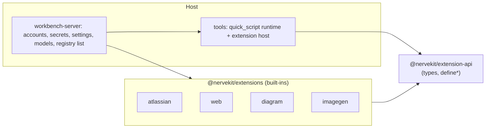

# Extension platform

**Status:** Draft · **Area:** extensions, packages

## Problem

The four built-in extensions (Atlassian, Web, Diagrams, Image generation) have manifests, a settings schema and operation-based permissions, but they are not built on a platform API. Their execution reaches into host internals, and the host knows each of them by name:

- Methods receive one context type that is the union of every extension's needs (`jira()`, `confluence()`, `kroki`, `imagegen`, `generateImage` in [`sdk-types.ts`](../../../packages/tools/src/quick-script/runtime/sdk-types.ts)).
- The server decides availability, resolves accounts and builds credentials per extension by hand ([`quick-script-availability.ts`](../../../packages/workbench-server/src/core-host/quick-script-availability.ts), [`execution-accounts.ts`](../../../packages/workbench-server/src/core-host/execution-accounts.ts), `create-conversation-core.ts`).
- Accounts are typed per product (`atlassianProfiles`, `tavilyProfiles` in contracts settings), with a dialog per kind in the app and secret ids built in several places (`atlassian:<id>`).
- Extension code calls `fetch` directly, imports helpers from `@nervekit/tools`, and the runtime imports from the Atlassian folder (`runtime/files/artifacts.ts` → `extensions/atlassian/shared/raw-request.ts`). Confluence storage builders and Atlassian error mapping live in the runtime; the Tavily client and Confluence HTML mode live in `tools`.

[coupling.md](coupling.md) lists every coupling point and the API that replaces it. Until these are gone, adding an extension means editing contracts, tools, the runtime, the server and the app, and third-party extensions are impossible.

The package layout has also grown by accretion: `skills` is a thin content package with one consumer, and `quick-script` is a tool split from `tools` for historical reasons while also hosting the extensions.

## Goals

1. **Built-in extensions use only the extension API.** Outside its own folder, an extension is named only by the built-in registry list and old migration steps. A boundary rule enforces it.
2. **The API is shaped for isolation.** Every host service is async and exchanges plain serializable data, so extension code can later run in the QuickJS sandbox through `__hostCall` without a rewrite. Built-ins run in-process in phase 1.
3. **Generic host.** Settings, accounts, secrets, availability, connection tests and the settings UI work for any manifest; no per-extension branches.
4. **Fewer, clearer packages** ([packages.md](packages.md)).
5. **No regression.** Agent-visible behaviour, permissions and the extensions benchmark stay equal or better.

Non-goals (phase 1): installing extensions, running built-ins in the sandbox, extension-defined UI (tool results use the platform display kinds), extensions contributing agent profiles, MCP servers.

## Design

[api.md](api.md) holds the API. In short:

- **`@nervekit/extension-api`** (new, no dependencies): `defineExtension`, `defineNamespace`, `method`, the manifest types and the `ExtensionContext` (`ctx`) interfaces. This is the future public contract for third-party authors.
- **Manifest** (declarative): identity, settings schema with version and migrations, account kinds, declared permissions (network origins, host capabilities), namespaces, sandbox-side helpers (`prelude`), resource links.
- **Namespace methods:** `parse → authorize → run(session, args, ctx)`. `authorize` returns the operation and targets (unchanged from today). A per-run `session(ctx)` replaces the host's `jira()`/`confluence()` loaders and caches.
- **Direct tools:** a manifest can contribute tools with a JSON-schema input, usually bound to a namespace method; results render with platform display kinds.
- **`ctx`:** `settings`, `accounts`, `http` (host-side egress with credential injection), `artifacts`, `report`, `models` (declared host capabilities, e.g. image generation), `signal`, `log`.
- **Secrets never reach extension code.** `ctx.http` injects the selected account's credential (`basic`, `bearer` or a named header) on the host side, only for origins the manifest allows. All four current integrations fit this.
- **Availability is derived** from the manifest (`requires: { account: "account" }`, `enabledBy`) and the resolved settings; an optional `availability(ctx)` hook covers extra checks. Reasons and fixes are generated with the extension's name, replacing the hand-written texts.
- **Accounts become generic:** `accounts.json` keyed by kind, secrets under `account:<kind>:<id>`, one generated account dialog and list, and the kind's `test(account, ctx)` hook replaces the Atlassian health service.

## Phases

**Phase 1: decouple the built-ins** (this proposal, one branch, the steps below in order)

1. **API and host.** Add `extension-api`. Implement `ctx` in the runtime and its server ports. Generic accounts store and secret ids, generic availability, generic account UI and connection test. Extend the unreleased migration step 0005 for `accounts.json` and secret ids (files and the secret store only, no database change).
2. **Package moves** ([packages.md](packages.md)). Create `@nervekit/extensions` with the four built-ins, merge `quick-script` into `tools`, merge `skills` into `workbench-server`. Temporary allowed edges from `extensions` to `tools` and `contracts` are listed in the boundary rules with a comment pointing here.
3. **Port** in order of difficulty, each one deleting its host special cases: Diagrams (setting, `http`, artifact) → Web (account, injected bearer, `http`) → Atlassian (two switches, session, attachments, prelude, error mapping) → Image generation (`models.image`). Then remove the temporary edges.
4. **Verify.** Grep goal, focused checks and unit suites, the extensions benchmark (Haiku 5.5, compare with the recorded baseline) and QA on a copied slot (settings, accounts, approvals, each namespace).

**Phase 2: prove isolation.** Run one built-in (Diagrams) inside its own QuickJS runtime, with `ctx` over `__hostCall`. This tests the boundary before outsiders depend on it.

**Phase 3: installable extensions** (separate proposal): packaging, install from folder, `apiVersion` checks, consent for declared permissions, network allowlist, limits and attribution for agent-facing text from third parties, updates.

## Options

1. **Keep built-ins as host code, design an API only for third parties.** Least work now, but the API is never exercised, and every built-in remains a special case. Rejected.
2. **Built-ins on the API, in-process (recommended for phase 1).** The API is proven by four real extensions; isolation is a later runtime change, not an API change.
3. **Built-ins on the API and sandboxed at once.** Strongest proof, but it mixes the decoupling with sandbox work (streaming, binary transfer, performance) and delays the phase. Phase 2 takes one extension through it instead.

## Changed rules

- [Code mode](../../architecture/code-mode.md): methods receive `session` and `ctx` instead of `SdkEnvironment`; the registry list moves to the server's composition.
- [Configuration](../../architecture/configuration.md): `accounts.json` becomes generic by kind.
- [Codebase](../../architecture/codebase.md): package table and allowed graph ([packages.md](packages.md)).

## Decisions

1. **Extensions can contribute direct tools.** A tool the agent needs often (`web_search`) must not cost a trip through `sdk.*` discovery. The Web extension contributes `web_search` as a direct tool bound to its `web.search` method, so both share one implementation and one operation ([api.md](api.md#direct-tools)). `web_fetch` stays a core tool (no account), and its guarded fetch becomes the implementation behind `ctx.http`.
2. **Confluence conversion belongs to the Atlassian extension.** `confluenceStorageToMarkdown` (storage XHTML and macros to Markdown) moves out of the tools worker into `extensions/atlassian/confluence/`; the tools worker keeps plain HTML for `web_fetch` only. In phase 1 the conversion runs in-process without the worker's timeout; inputs come from the user's own site and keep the size limit, and phase 2 puts extension code under the sandbox's limits.
3. **App code that knows Atlassian or Tavily is replaced by generic code** (not the website docs, which describe the built-ins and stay):
   - Settings → Extensions: the Atlassian and Tavily account dialogs, lists and health badges become one generated account list and dialog.
   - Discover → Guides: the "Connect Jira and Confluence" and Tavily setup coaches (step targets inside those dialogs) are removed, not generalized. Guidance for extensions comes later, on the website or in Discover.
   - `AtlassianLinkCapability` (Jira and Confluence site URLs for links) has had no consumer since step 5 removed the Jira and Confluence tool views; delete it. Manifest `links` are not needed in phase 1.
4. **`extension-api` is its own package.**
