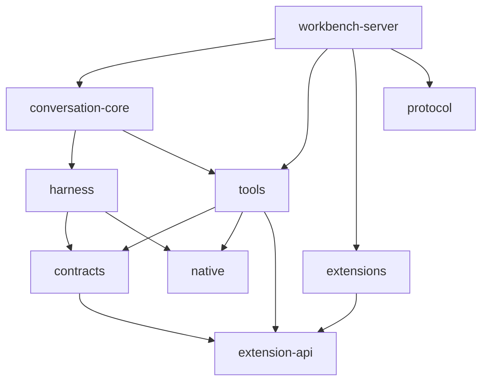

# Package layout

Part of [Extension platform](README.md). The allowed graph is [`package-architecture.rules.ts`](../../../scripts/checks/package-architecture.rules.ts); [codebase.md](../../architecture/codebase.md) describes the layers.

## Problem

Packages should exist for a boundary worth enforcing (reuse, dependency direction, build or release unit). Two do not meet that bar today, and the extension work needs one boundary that does not exist:

- **`skills`** is about 80 lines of catalog code plus two built-in skill folders. Only `workbench-server` imports it (the rules also allow `conversation-core`, which does not use it). Skill loading and formatting already live in `harness`.
- **`quick-script`** is a tool, like `shell` or `python`, but sits outside `tools`. It also hosts the built-in extensions, so the extension code can import anything `quick-script` can (tools, native, contracts) and the runtime imports extension internals.
- Nothing stops extension code from reaching into the host.

## Proposed layout

| Package            | Change                                                                                                       | Why                                                                 |
| ------------------ | ------------------------------------------------------------------------------------------------------------ | ------------------------------------------------------------------- |
| `extension-api`    | **new**, no dependencies                                                                                     | The contract extensions build on; later published for third parties |
| `extensions`       | **new**, depends on `extension-api` only                                                                     | The four built-ins; the boundary checker enforces goal 1            |
| `tools`            | **absorbs `quick-script`** as `src/quick-script/` (runtime, `files`/`image`/libraries/`sdk`, extension host) | `quick_script` is a tool; no other consumer needs it separately     |
| `workbench-server` | **absorbs `skills`** as `src/builtin-skills/`                                                                | Only consumer; content, not a reusable boundary                     |
| `contracts`        | may import `extension-api` types                                                                             | Validates manifests against the API types                           |
| others             | unchanged                                                                                                    |                                                                     |

Count stays at 13 (−2, +2), but every package has one reason to exist, and the new ones enforce the decoupling instead of relying on review.

## Moves and their cost

- **quick-script → tools:** `tools` takes the sandbox-library and docs asset copy (`scripts/build/copy-quick-script-assets.ts`), the libraries become `tools` devDependencies, and `bundle-desktop.ts` (`bundleAssets`, externalized document libraries), `release/workspace-packages.ts`, `scripts/impact/rules.ts` (`CORE_PACKAGES`), the root `tsconfig.json` references and the benchmark import change. Docs per extension move with it to `extensions`.
- **skills → workbench-server:** the asset copy (`copy-skills-assets.ts`, `SPECIAL_OWNERS` in `scripts/impact/rules.ts`) and `bundleAssets` (`dist/builtin`) move; the edges `skills → harness` and `conversation-core → skills` go.
- **extensions:** owns `docs/` per extension and its asset copy. Its tests use a fake `ctx` from `extension-api/testing`, which also replaces `test-harness.ts`.

## Considered and not proposed

- **Split `git` out of `tools`** (about 48 files: service, GitHub client, isolated reader). A real domain of its own, but unrelated to extensions; revisit separately.
- **`protocol` into `contracts`:** protocol's rules keep transport mechanics apart from domain schemas; little gain.
- **`harness` + `conversation-core`:** would collapse the portable engine boundary; compaction exists in both and deserves its own review first.
- **`ui-kit` into `workbench-app`:** ui-kit is deliberately domain-free; keep.
- **One package for API and built-ins:** saves a package but needs a new path-level rule, and the API must be separable once published.
