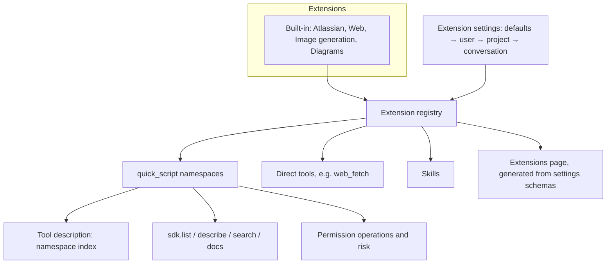

# Extensions

> **Status:** Accepted for steps 1–5 (branch `feat/extensions`). MCP servers and installable extensions are later proposals. How `quick_script` works today: [architecture/code-mode.md](../../architecture/code-mode.md).

## Summary

An **extension** is a unit of capability with its own settings. It contributes `quick_script` SDK namespaces and, for built-in extensions, direct tools and skills. This proposal covers the four built-in extensions (Atlassian, Web, Image generation, Diagrams).

**Later:** MCP servers become a separate resource with their own page, reaching the agent as `mcp.<server>` namespaces through the same registry ([mcp.md](mcp.md)). Installable extensions follow once the contract has settled.

Integration-style direct tools (Jira, Confluence, diagram export, image generation) are removed, and their capabilities are reached only through `quick_script` namespaces. The tool description becomes a short namespace index, and the agent pulls detail on demand with `sdk.*` calls inside the sandbox. Settings → Integrations becomes **Settings → Extensions**: one page, at user and project scope, where each extension is enabled and configured from a settings schema it declares.

| File                             | Covers                                                                                          |
| -------------------------------- | ----------------------------------------------------------------------------------------------- |
| [extensions.md](extensions.md)   | Extension manifest, contributions, built-in extensions, docs layout, package, installable tiers |
| [settings.md](settings.md)       | Settings schema, `extensions.json` storage and versions, layering, accounts, migration          |
| [ui.md](ui.md)                   | Extensions page, detail view, Tools page; wireframe                                             |
| [discovery.md](discovery.md)     | `sdk.*` API, large namespaces and output budgets, tool description                              |
| [permissions.md](permissions.md) | Operation-level rules replacing direct-tool authorization                                       |
| [parity.md](parity.md)           | Every removed direct tool mapped to its SDK route                                               |
| [mcp.md](mcp.md)                 | Later: MCP servers (notes for a separate proposal)                                              |

## Problem

- **Every request pays for every schema.** The 17 `jira_*`, 11 `confluence_*`, `generate_image` and `kroki_export` definitions are sent on each turn whether the task needs them or not. MCP would add tens or hundreds more.
- **The `quick_script` guide is static while the capability set is not.** `SKILL.md` and `references/*` describe Jira, Confluence and web for every conversation. Only the tool description ([`description.ts`](../../../packages/tools/src/execution/quick-script/description.ts)) follows settings, so the two can disagree.
- **The upfront reading cost is high.** "Read the guide before first use" walks description → `SKILL.md` → `.d.ts` → workflow file, about 2–6k tokens, before a simple `XLSX` read.
- **Adding a capability touches many places:** description fragments, `activeQuickScriptIntegrations` in [`scoped-turn-resources.ts`](../../../packages/workbench-server/src/core-host/scoped-turn-resources.ts), the guide, the broker's `brokerable()` list, `toolRows` and the Tools and Integrations pages. Nothing outside the repository can add one.
- **Settings follow tools, not capabilities.** The same Atlassian account is picked in `tools.jira`, `tools.confluence` and `tools.quick_script.settings`. The Integrations page is user-only, so a project cannot pin its site.
- **`packages/skills` mixes two kinds of content.** `builtin/` holds catalog skills; `guides/` holds tool manuals that are not in the catalog but use the same `{{skill:…}}` placeholder and `SKILL.md` format.

## Current state

- **Single source for SDK methods:** each method is declared once in a method table ([`sdk-types.ts`](../../../packages/tools/src/execution/quick-script/sdk-types.ts)). The prelude, scanner, dispatch and generated `references/*.d.ts` all read these tables.
- **Errors already teach:** a misspelled method lists the valid names, an unknown option lists the valid options, and an unavailable integration names the setting to fix.
- **Nested authorization maps each SDK call to a direct tool** ([permissions](../../architecture/code-mode.md#permissions)). Removing direct tools removes those identities; see [permissions.md](permissions.md).
- **Agent settings already resolve in four layers** (built-in defaults → user → project → conversation, plus agent profiles) ([configuration](../../architecture/configuration.md)). Extension settings reuse this.

## Goals

1. **Constant-size tool surface.** Adding a namespace adds about one line to the `quick_script` description, never a schema.
2. **One contract for every extension**, designed so installed extensions and MCP servers can use it later. An extension provides its own metadata, settings schema and docs, and nothing else in the system needs to change.
3. **Generic settings UI.** The Extensions page renders any extension from its settings schema.
4. **Docs live with the extension** and are disclosed on demand, filtered to what is available.
5. **Policy granularity does not regress** when the direct tools go.

**Non-goals:** MCP servers; installable extensions (packaging, distribution, signing, installation UX); exposing the conversation settings layer in the UI; and moving general-purpose tools (`read`, `write`, `edit`, `bash`, `python_exec`, `web_fetch`, `web_search`) into the sandbox only. Those stay direct because agents use them outside integration work.

## Design

## Decisions

- **"Extension" is the unit.** It names the page, the manifest and the registry. "Provider" stays reserved for model providers (Settings → Providers).
- **Jira and Confluence are one Atlassian extension**, with one account picker and a switch per product.
- **Extensions declare a settings schema**, stored in `extensions.json` at user, project and conversation scope with a version per extension, and settable by agent profiles; the UI is generated from it. Accounts live in the user-only `accounts.json` (renamed from `integrations.json`) ([settings.md](settings.md)).
- **Settings → Integrations becomes Settings → Extensions**, at user and project scope, with a detail view per extension on a nested settings route (`extensions/atlassian`) ([ui.md](ui.md)). The conversation layer exists in the backend but is not exposed in the UI.
- **Discovery happens in the sandbox** through `sdk.*`, not through a guide rendered per settings combination ([options](#options-considered)).
- **`packages/skills` holds only catalog skills.** `guides/` is deleted; extension docs live with their code ([extensions.md](extensions.md#docs-layout)).
- **Quick-script moves to a new `@nervekit/quick-script` package** ([extensions.md](extensions.md#package)).
- **Image generation is the `imagegen` namespace**, named for the capability so it can support several backends.
- **`web_fetch` and `web_search` stay as direct tools**, contributed by the Web extension, and `web.fetch` and `web.search` stay in the SDK. Both routes authorize the same way.
- **Nested checks become operations** (`jira.issues.create`) evaluated as `quick_script` with the namespace as tool group; built-in rule sets give the same decisions as today ([permissions.md](permissions.md)).
- **Large namespaces:** discovery bounds itself, summarises, spills the full text to an artifact the agent can read or grep, and pages `search` results ([discovery.md](discovery.md#large-namespaces)).
- **MCP servers are deferred** to their own proposal; [mcp.md](mcp.md) keeps the decisions made so far.

## Delivery

Five steps on one branch, each leaving `main`-quality code. The agent-visible changes come in step 1 and step 5; steps 2–4 are internal or settings-only.

1. **Registry, discovery and built-in extensions.** Manifest and registry, the four built-in extensions wrapping today's namespaces, `sdk.*` with the discovery budget, the `quick_script` description and prelude built from the registry. Docs move next to their extensions; `SKILL.md` is removed and its rules move into the description. Direct tools are untouched.
2. **Package split.** Move quick-script code to `@nervekit/quick-script` and delete `packages/skills/src/guides/quick-script`.
3. **Extension settings and the Extensions page.** The `extensions` settings key with schema validation and per-field layering, availability computed from it, settings migration, the nested settings route, the generated Extensions page and detail view. Replaces the Integrations page and trims the Tools page ([ui.md](ui.md)).
4. **Operation-level rules.** The rule contract change, the broker rewrite and the equivalence test over built-in rule sets ([permissions.md](permissions.md)).
5. **Direct-tool removal.** Close the gaps in [parity.md](parity.md), add `imagegen`, run the benchmark, then remove `jira_*`, `confluence_*`, `kroki_export`, `generate_image`, `guides/jira`, `guides/confluence`, their settings and presentation code, and migrate rules, exceptions and settings.

Rule, exception and setting changes from steps 3–5 go into one new draft home migration step (`0005`), and into the project configuration version chain for project files. None of them touch the database.

**Later:** MCP servers ([mcp.md](mcp.md)), then installable extensions.

## Measurement

Required before step 5 only; steps 1–4 are reversible and leave the direct tools in place. Step 1 checks token counts in unit tests instead: the `quick_script` description size and the tool-definition total per request, before and after.

A fixed task set against the test Atlassian site, each with a written success check: single lookups; cross-call joins; bulk updates with approvals; Excel to a Confluence page with a diagram; edits with known pitfalls (custom field by name, required transition field, stale page version). Five runs per model family (Claude, GPT), comparing `quick_script` alone with the direct tools alone. No harness exists yet; building it is part of step 5.

Report:

- success rate and turns per task
- tool-definition tokens per request and total tokens
- tokens read before the first successful SDK call
- failed calls caused by wrong arguments or unknown methods
- calls into unavailable namespaces
- approvals

Step 5 proceeds unless the direct tools win clearly on a model family.

## Options considered

1. **Static guide, only the description changes with settings (today).** Simplest, but the guide drifts from the active set, and MCP and extensions cannot contribute to it.
2. **A guide rendered for each settings combination,** written to a hashed folder for the Read tool. The docs are filtered, but generated files have to be managed, MCP tool lists are dynamic, and file paths leak into the prompt.
3. **Discovery calls in the sandbox (chosen).** One mechanism for every extension, docs filtered at read time, and a stable description. The cost is one extra tool call before unfamiliar work, which the measurement checks.

## Open questions

- **Discovery budget size:** about 12 KB is a starting point; tune it with the measurement.
- **Further built-in extensions** (GitHub/GitLab, for which PR-sync credentials exist): out of scope here; revisit with MCP.
