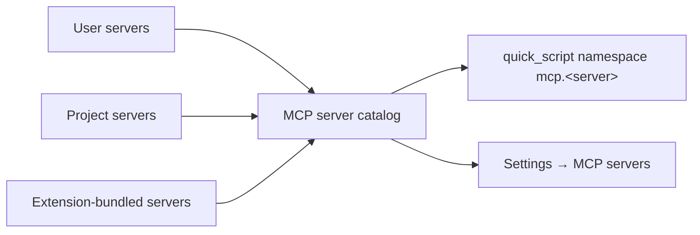

# MCP servers

Part of [Extensions](README.md).

> **Status:** Deferred. Not part of delivery steps 1–5; it becomes its own proposal. Candidate client: [`pi` `packages/mcp`](https://github.com/earendil-works/pi/tree/main/packages/mcp), to be evaluated. The notes below record decisions already made (MCP servers are a separate resource with their own page; unannotated tools default to destructive) and the design sketch so far.

MCP servers are their own kind of agent resource, like skills and prompt suggestions, not a kind of extension. A user or project configures servers directly, and an extension may also bundle one or more. Either way, a server's tools reach the agent only through `quick_script`, as the namespace `mcp.<server>`, so a server with a hundred tools adds one line to the tool description.



## Sources and definitions

| Source    | Definition stored in                                | Notes                                                                                                 |
| --------- | --------------------------------------------------- | ----------------------------------------------------------------------------------------------------- |
| User      | `config/mcp-servers.json` in the home               | Personal servers, available in every project.                                                         |
| Project   | `.nerve/config/mcp-servers.json` in the project     | Shared with the repository. Runs commands from the repository, so it needs trust (below).             |
| Extension | The extension's manifest (`contributes.mcpServers`) | Present while the extension is enabled; its definition is read-only and versioned with the extension. |

- **A definition** is a name (the namespace suffix, unique across sources), a transport (`stdio` command with args and env, or `http` URL), the account kind it needs for credentials, and optional default risk overrides. Secrets live in accounts, never in the definition.
- **Name clashes:** a project server shadows a user server of the same name, like project skills shadow user skills. Extension servers are namespaced by the extension (`atlassian-rovo`) so they never clash.
- **Project trust** uses the exact-content trust of project permission overlays ([permissions](../../architecture/permissions.md)): a project server runs only after the user trusts the file's current bytes, and an edit requires renewed trust.

## Enablement and per-server settings

Server definitions and server settings are separate, like skills and their on/off state. Settings are layered built-in default → user → project → conversation like extension settings ([settings.md](settings.md#storage-and-layering)); the file layout is decided in the MCP proposal:

```ts
mcpServers: {
  github: { enabled: true, account: "github-pat", trustAnnotations: false, risk: { search_code: "network" } },
  linear: { enabled: false },
}
```

- A user can disable a project's server for themselves, or enable a user server only in one project.
- An extension-bundled server follows its extension's enable switch; its `mcpServers` entry can still disable it or override risk.
- Entries for servers that no longer exist are kept and listed as unused, as on the Skills page.

## In `quick_script`

- **Methods** come from `tools/list`. Names stay as the server defines them, with characters that are invalid in identifiers mapped to `_`, so `mcp.github.create_issue({...})` works without bracket access. The single options object is the tool's `arguments`.
- **Types** are converted from `inputSchema` (and `outputSchema` when present) to TypeScript. Large schemas are summarised in `search` and shown in full only by method-level `describe` ([large namespaces](discovery.md#large-namespaces)).
- **Risk defaults to destructive.** Annotations can lower it (`readOnlyHint` → network, `destructiveHint: false` → external_write), but they come from the server and are untrusted, so they apply only with `trustAnnotations`. A per-tool `risk` override always wins. An unannotated tool on an untrusted server therefore asks for destructive approval; a rule or an override quiets it.
- **Operations** are `mcp.<server>.<tool>`, with the server as a target, so rules can allow or deny a whole server ([permissions.md](permissions.md)).
- **Results:** `structuredContent` when present, otherwise text. Images and resources become artifacts.
- **Connection:** servers start lazily on first use in a conversation and the tool list is cached per connection. `sdk.list()` shows every enabled server, and one that cannot connect reports `unavailable` with its error. The description lists enabled servers only, so connecting and reconnecting do not change it.

## Settings page

Settings → MCP servers sits next to Skills at user and project scope: a catalog from several sources, switched on and off per scope. Modelled on the Skills page, with `SettingsItem` rows ([settings UI](../../ui/settings.md)):

- **Toolbar:** search, "N of M enabled", and Add server (user scope adds to the user file, project scope to `.nerve/config/mcp-servers.json`).
- **Sections by source:** Yours, This project, From extensions. Each row shows the name, transport and command or URL, status (Connected · 41 tools, Not started, Failed as the problem line), change indicator and enable switch. Extension rows name their extension and are read-only.
- **Project servers need trust.** An untrusted project file shows the standard project trust notice; its servers are listed but cannot be enabled until trusted.
- **Server detail view** on the nested settings route ([ui.md](ui.md#nested-settings-route)): connection (status, last error, Restart), definition (read-only for extension servers), account, trust annotations switch, and a searchable tool list with each tool's risk and an override Select. The namespace name (`mcp.github`) is shown so the user can recognise it in approvals.
- **Unused entries:** settings for servers that no longer exist, with Remove, as on the Skills page.

## Open questions

- **Import:** read existing `mcp.json` files from other agents (Claude Code, Cursor) as an extra source, or offer a one-time import?
- **Lifecycle:** one process per conversation, or shared per daemon with per-conversation sessions? Shared is cheaper but leaks state between conversations for stateful servers.
