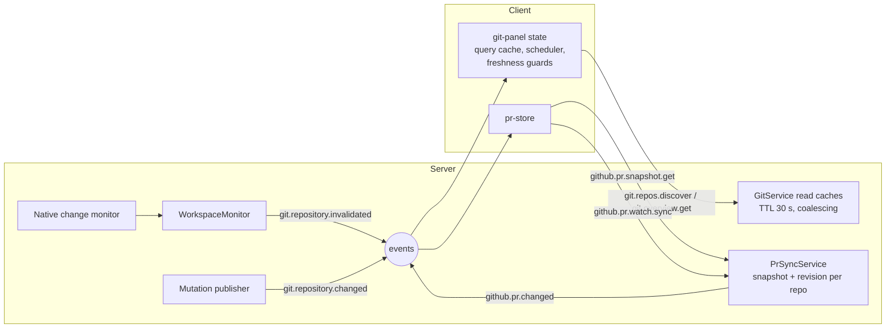
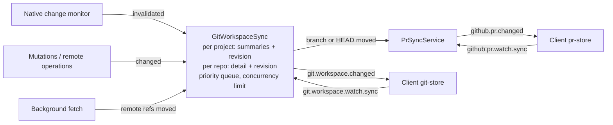

# Multi-repository Git workspace

> **Status:** Implemented (phases 1–4). Open follow-ups: a setting to disable background fetch, Windows measurements (`scripts/bench/git-workspace-bench.ts`). Quick performance fixes shipped separately (see [Already done](#already-done)). Wireframe: `/dev/wireframes/git-multi-repo` (local, gitignored: `packages/workbench-app/src/lib/app/design-lab/wireframes/git-multi-repo.svelte`).

## Problem

Large projects are often several components, each its own Git repository, and each component may have several worktrees. The Git and Pull requests panels are built around one selected repository:

- Only the selected repository shows its branch. To know which branch every component is on, the user clicks through them one by one.
- Selecting a repository waits for a detailed read before showing anything. On Windows this took seconds per click.
- The repository list does not scale. Past six rows it scrolls in a small region; worktrees of the same repository appear as unrelated rows; long branch names have no room.
- PR status for the current branch of each repository is not visible from the list.
- The client owns Git state: it decides when to read, caches, retries and schedules refreshes. Pull requests already work the other way, with server-owned state, and the two models now coexist in the same panel.

## Goals

- See every repository and worktree, its branch, sync state, changes and PR status at a glance, at 240–420px panel width.
- Selecting a repository is instant.
- Git state is local-first and server-owned, like pull requests: the workbench server reads, refreshes, throttles and pushes; clients render a store.
- No database schema change.

Non-goals: committing from the panel, cross-repository batch commits, a "group by branch" feature view, creating or removing worktrees, and a phone layout (the mobile shell keeps its current Git behaviour). They can build on this later.

## User experience

The Git changes tab separates navigation from selection: **repositories expand, branches select**. Every repository behaves the same whether it has one worktree or many, so there is one rule to learn.

| Level           | Job                | Content                                                                                                |
| --------------- | ------------------ | ------------------------------------------------------------------------------------------------------ |
| Repository rows | Navigate           | Name; when collapsed, a summary of its branches                                                        |
| Branch rows     | Scan and select    | Branch name and its status                                                                             |
| Selected branch | Understand and act | Repository with icon-only actions, branch selector, the branch's pull request (collapsible, resizable) |
| Changes         | Edit               | Staged and unstaged tree, collapsed until needed                                                       |

```
┌ Git changes 30 ────────────────── ⋯ ⟳ ┐  ⋯ = All repositories: Fetch all, Pull all,
│ [ Filter repos or branches          ]  │      Back to base
│ All 13   Changed 6   Attention 5       │
│ ◉▾ api  3 worktrees                    │  repo icon carries expand state
│  │ ⑂ main                              │
│  │ ⑂ feature/NRV…th-refresh     ↑ ⇡ 2 │  status packed right, one gap
│  │ ⑂ hotfix/1.4.2                   ⑃ │  merged PR
│ ◉▾ ui  3 worktrees                     │  expanded: repo row stays quiet
│  │ ⑂ main                            ↓ │
│ ▌│ ⑂ feature/NRV…le-clients    ⇅ ⇡ 12 │  selected branch
│  │ ⑂ tlm/design-tokens-v2        ☁  5 │
│ ◉▸ payments-reconciliation-ser… ⓘ  7  │  collapsed: most urgent sync, worst PR, total
│ ◉▸ notifications-gateway               │  clean: just a name
│ ◉▸ worker  2 worktrees           ⓘ  1  │
├────────────────────────────────────────┤
│ ▾ ◉ ui  NRV-2481                   ⇅ ⋯ │  repository (+ worktree), icon-only actions
│ ⑂ feature/NRV-2481-add-oau…le-clients ▾│  production branch selector
│ ┌ #412 tlm · 14m ✓ ──────────────────┐ │  the branch's PR card, when one exists
│ │ Add OAuth token refresh for mobile │ │
│ │ ✗ 5/7  💬4            +486 −112    │ │
│ └────────────────────────────────────┘ │
├────────────────────────────────────────┤
│ ▸ Changes 12                 2 staged  │  section header; both sections resize by drag
└────────────────────────────────────────┘
```

### Repository rows: navigate

Every repository is expandable, including single-checkout ones. Clicking a repository row only expands or collapses it; it never changes the selection. Worktrees that share a Git directory (`commonDir`, already returned by native discovery) are one repository with several branch rows.

- **Icon as disclosure.** There is no separate chevron: the remote icon (GitHub, other, none) carries a small corner chevron for the expand state, so every repository icon sits in one column and nesting reads from indentation. Branch rows are indented under the name with a guide line down from the icon. Branch rows hang off a guide line from the icon with tree connectors (`├`, a rounded `└` for the last), with no branch icon, so branch names align with the repository name. The icon turns primary when the selected branch belongs to the repository.
- **Collapsed summary.** On the right: the most urgent sync state among its branches (failed > running > behind > unpublished > ahead), the worst checks state among its branches' open PRs, and the change total. A clean repository is just its name. A collapsed repository with a single checkout also shows its branch after the name when the whole name fits (it is hidden, never cut).
- **Expanded.** The repository row shows no status; its branch rows carry it, so nothing is shown twice.
- **Context menu:** Fetch, Open on GitHub, Copy repository URL, Expand.
- Search and filters temporarily expand repositories with matches; this does not change the remembered expansion state.
- **Order.** Repositories alphabetically by display name, case-insensitive; inside a repository the primary checkout first, then linked worktrees by folder name. The order never changes with status, so positions become muscle memory.
- **Selection inside a collapsed repository.** Collapsing never clears the selection; a collapsed repository that contains the selected branch gets the selection tint.

### Branch rows: scan and select

One line: tree connector, branch name, then status **packed to the right edge with one fixed gap**. Absent items take no space, so there are never holes between them, and the right edge is always aligned.

- _Branch name._ Never abbreviated. When too long it keeps at least ~6 leading and the last ~10 characters (`feature/NRV…le-clients`); the full name is in the tooltip. Detached HEAD shows `detached` in the warning tone.
- _Sync._ One glyph: `↓` behind (warning), `↑` ahead, `⇅` both (warning), cloud-up not published, spinner while an operation runs, `ⓘ` when the last operation failed (destructive). Clicking runs the action (pull, push, sync, publish, stop, or opens retry).
- _Pull request._ One glyph whose tone is the checks state: open PR in success (checks pass), destructive (failing), warning (running) or muted (no checks); draft icon for drafts; merge icon in the info tone for merged. Clicking opens the PR.
- _Changes._ The number of changed files; clicking selects the branch and opens the Changes section. Empty when clean.

No other numbers or text badges: tooltips give details, the selected branch area gives everything. Clicking the row selects the branch; double-clicking it also opens the branch picker (expanding the Selected branch section if needed). The context menu has every branch action: Sync, Fetch, Pull, Push/Publish, Switch to base and pull, Switch branch…, Stashes, Open on GitHub, Copy repository URL, and the existing "Create pull request" item that opens GitHub's compare page.

**Filters.** All · Changed · Attention, each with the number of matching branches.

- _Changed:_ the worktree has uncommitted changes.
- _Attention:_ the last remote operation failed; the branch's PR has failing checks; the branch is merged into its base; or the branch is behind its upstream **and** also has local commits or uncommitted changes (diverged or dirty). Being only behind (a clean `main` that is not pulled yet) does not count, so the filter is not flooded by base checkouts.

**Keyboard and accessibility.** The list is a tree (`role="tree"`, repositories and branches as `treeitem`s with `aria-expanded` on repositories). Up/Down move between visible rows, Right expands a repository or moves to its first branch, Left collapses or moves to the parent, Enter or Space selects a branch, Home/End jump. Status buttons are reachable with Tab inside the focused row, and every glyph has an accessible label with its numbers. Section headers are buttons with `aria-expanded`; dividers are keyboard-resizable (paneforge handles), and the context menu opens with Shift+F10 or the Menu key.

**No hover-revealed controls.** Nothing appears or disappears on hover; hover only tints.

### Panel layout: list plus two resizable sections

Below the filters, the panel is a vertical split of three panes (the existing `ui-kit` resizable panes):

1. **Repository list**, which gives and takes space.
2. **Selected branch** section, collapsible.
3. **Changes** section, collapsible, collapsed by default.

- Each section has a one-line header that stays visible when the section is collapsed; a collapsed section shrinks to that header.
- Dragging a divider resizes the sections. Clicking a header collapses the section, or restores the height it had before collapsing.
- Opening one section takes space from the list, never from the other section.
- Header-driven collapse and expand animate the height (about 200 ms, ease-out); dragging never animates, and `prefers-reduced-motion` disables the animation.
- The library sizes panes in percentages, so the collapsed (header-only) size is derived from the panel height and recomputed when the panel is resized.

### Selected branch: understand and act

1. **Header line: repository and actions.**
   - Remote icon, full repository name (truncated only when it does not fit), and the worktree folder when the selection is not the repository's primary checkout.
   - **Icon-only action buttons**, right-aligned before `⋯`, with tooltips that carry the numbers:
     - one remote action chosen from the branch state: stop (while running), retry (last operation failed, destructive tone), publish (not published), sync (ahead and behind, warning tone), pull (behind, warning tone), push (ahead), or sync when up to date;
     - merge icon (info tone) when the branch is merged into its base: switch to base and pull (`mergedToBase` is computed today but never shown);
     - stash icon when the worktree has stashes: opens the stash dialog.
   - `⋯` holds the full branch menu.
   - Clicking the rest of the header collapses or expands the section. The actions stay visible when collapsed.
2. **Branch line: the existing branch selector** (`GitBranchPopover`: search, local and remote branches, base badge, PR badges, New branch, All branches). The trigger shows the full branch name, never abbreviated; when it does not fit it is trimmed keeping the start and the end, with the full name in the tooltip.
3. **Failure message**, when the last remote operation failed.
4. **Pull request:** the existing pull-request card for the branch (with expandable checks) when an open or recently merged PR exists. Nothing otherwise; there is no "create" button.

### Changes: edit, on demand

Header: `Changes 12 · 2 staged`. Expanded, the existing staged/unstaged tree with stage, stash and discard per file, folder and group. Clicking a branch row's change count selects the branch and opens this section.

### Worktrees: what is shared and what is not

Worktrees of one repository share the Git directory: refs, stashes, remotes and configuration. Each has its own `HEAD`, index and working tree. The UI follows that split:

| Per worktree (branch row)                                                                                | Per repository (all its branch rows)                     |
| -------------------------------------------------------------------------------------------------------- | -------------------------------------------------------- |
| Branch, ahead/behind, unpublished, changes, merged into base, running/failed operation, PR of its branch | Stashes, fetch, remote and GitHub identity, open PR list |

- **Stashes** are one list per repository. The stash icon appears on every worktree of that repository and opens the same list.
- **Fetch** runs once per repository, not per worktree (background fetch included). Pull, push and sync still run in the worktree they were started from.
- **A branch can be checked out in only one worktree** (Git refuses a second checkout). Therefore:
  - the branch selector marks branches checked out in another worktree (`in api-oauth`) and disables them;
  - "Switch to base and pull" and the merged action are disabled with an explanation when the base branch is checked out in another worktree;
  - "Back to base" (All repositories menu; per branch "Back to main") targets each repository's primary checkout only.
- **Display name** of a repository: the primary checkout's folder name; when the primary checkout is not inside the project, the folder that contains the shared Git directory. Duplicate names are disambiguated with the existing `repoButtonLabels` algorithm.
- **Discovery.** Native discovery today skips dot-directories and `node_modules`, `dist`, `build`, stops at depth 2, rejects worktrees outside the project, and allows at most 128 repositories, so worktrees under `.worktrees/` are not found. Discovery is extended: for every repository it finds, it also reads that repository's linked worktrees (the `worktrees/` entries of its Git directory) and includes each one whose working tree is inside the project, including dot-directories and deeper paths. Worktrees outside the project stay excluded (the project directory remains the read boundary). Linked worktrees count toward the 128-repository limit.

### Pull requests tab

Pull requests belong to the remote repository, not to a checkout, so this tab never lists worktrees: each GitHub repository appears once (keyed by `owner/name`, which also merges separate clones of the same remote).

1. **Search** (same control as the Git changes filter) instead of a repository picker. One query matches, case-insensitively:
   - repository name,
   - PR title,
   - PR number, with or without `#` (`412`, `#41` matches by prefix),
   - author login,
   - head branch name.

   Several words narrow the result (every word must match some field), so `api renovate` finds Renovate PRs in `api`.

2. **Whose:** All · Mine · Review, each with its count (filter menu applied, search not), combined with the search.
3. **List:** the existing pull-request cards, unchanged, grouped by repository under one sticky header each (`api 2`); repositories without matches are hidden, and "No pull requests match." shows when nothing matches. Within a repository, PRs whose head branch is checked out in any local worktree sort first and carry the card's existing "checked out" mark, so no per-card captions are needed.

Header (count of matching PRs, filter configuration, refresh) and empty states (no GitHub repositories, `gh` missing or not signed in, rate-limited) stay as today.

- **Opening a PR** uses the repository's primary checkout as the repository path the existing PR actions expect (any worktree with that remote resolves to the same GitHub repository).
- **Filter menu.** The filter dialog is replaced by a dropdown menu on the header's filter button, styled like the existing "All repositories" menu, with one configuration per project instead of per repository:
  - _Drafts:_ Include · Exclude · Only (radio items).
  - _Labels:_ one checkbox item per label present in the loaded PRs; none checked means any label.
  - _Sort:_ Recently updated · Least recently updated (radio items).
  - _Reset filters_ when anything differs from the defaults.

  The button shows the active state when any option differs from the defaults, as today. Removed options and where they went: author and username (search, Mine), title (search), review requested (Review), current branch only (checked-out PRs sort first and the Git changes tab shows the branch's PR).

- "Mine" means the PR author is the signed-in GitHub user (`viewer` in the snapshot); "Review" means a review is requested from that user.

The server already keeps a PR snapshot for every GitHub repository in the project (up to 100 open PRs each, with checks); search runs on the client over those snapshots. Showing every repository raises them from the cold tier to the 60 s warm tier while the tab is on screen: one ETag probe per repository per minute, with summary fetches only for changed PRs. The per-repository backoff should become a shared budget so many repositories cannot exhaust the rate limit together. Repositories with more open PRs than the snapshot holds (`truncated`) need a note and `github.pr.list` for the rest.

### Remembered preferences

Every choice the user makes in these panels is remembered on the client (`localStorage`), so the panels look the same after switching projects, tabs or restarting. Nothing is stored on the server and no schema changes are needed. Preferences are per device (the desktop app and a browser tab keep their own).

| Preference                                      | Scope                                                                 | Default                                                               |
| ----------------------------------------------- | --------------------------------------------------------------------- | --------------------------------------------------------------------- |
| Git changes filter (All, Changed, Attention)    | Project                                                               | All                                                                   |
| Expanded and collapsed repositories             | Project, keyed by repository group                                    | Collapsed, except the repository of the selected branch on first load |
| Selected branch (worktree)                      | Project                                                               | First branch of the first repository                                  |
| Selected branch section: collapsed, height      | Panel (all projects)                                                  | Expanded, 30 %                                                        |
| Changes section: collapsed, height              | Panel (all projects)                                                  | Collapsed                                                             |
| Folders collapsed in the change tree            | Project and worktree (exists today)                                   | Expanded                                                              |
| Pull requests quick filter (All, Mine, Review)  | Project                                                               | All                                                                   |
| Pull request filter menu (drafts, labels, sort) | Project (today per repository)                                        | Include drafts, any label, recently updated                           |
| Expanded check details on a PR card             | Not remembered                                                        | —                                                                     |
| Search text (Git changes and Pull requests)     | Not remembered across reloads; kept while switching tabs in a session | Empty                                                                 |

Implementation follows the existing preference modules (for example `files-panel-preferences.ts`): one versioned key per scope (`nerve:git-panel:v1:<projectId>`, `nerve:git-panel-layout:v1`), validation with defaults for missing or corrupt values, and writes debounced while dragging dividers. Repository and worktree keys that discovery no longer returns are pruned when a snapshot arrives, and per-project entries are capped (least recently used) so storage cannot grow without bound. Today's per-repository keys (selected repository, PR filters) are not migrated; the new keys start from defaults.

## State architecture

### Today



Pull requests are server-owned: `PrSyncService` keeps an in-memory snapshot per repository with a revision, derives a refresh cadence from client demand (`github.pr.watch.sync`, released when the socket closes), handles ETags and rate-limit backoff, and pushes a small `github.pr.changed` ping. The client store accepts only newer revisions.

Git is client-owned: the client calls `git.repos.discover` and `git.overview.get`, caches with a 30 s staleness rule, and on `git.repository.invalidated` decides whether and when to re-read (`git-auto-refresh-scheduler`, `git-refresh-coordinator`, `git-read-refresh`, overview read guards).

### Proposed: `GitWorkspaceSync`, a server-owned store

A new service in `packages/workbench-server/src/domains/git/`, a sibling of `PrSyncService`, reusing its patterns (watch registry with per-owner demand, revision publishing, debounced signals, timers with `unref`).



**What it holds (memory only).**

- _Workspace snapshot_ per project: `revision`, discovery result, one `GitRepoSummary` per repository or worktree (branch, ahead/behind, unpublished count, change count, stash count, base branch, merged into base, remote kind, worktree group key and primary flag), read errors, staleness.
- _Detail snapshot_ per worktree, only while demanded: `revision`, file changes with staged/unstaged/untracked counts, stashes. Recent commits are read today but never displayed; they are dropped.
- Not in the store: the branch list for the branch selector stays an on-demand `git.branches.list` call when the selector opens.

**Demand.** `git.workspace.watch.sync { projectId, visible, detail?: repo, hint?: repo }` per connection, replacing `git.repository.monitor.sync`. `visible` keeps summaries live for the project. `detail` is the selected worktree while the Changes section is open or a diff needs it. `hint` is a "may select soon" signal (hover, keyboard focus) that warms detail at low priority; it replaces the client-side prefetch. Demand is released with the socket, as for PR watches. Without demand nothing is read; the monitor only marks entries dirty.

**Triggers.**

- Change monitor notice for a repository → mark its summary (and detail, if held) dirty.
- Mutation or remote operation finished → dirty, with priority.
- Background fetch moved remote refs → dirty summary (ahead/behind, merged).
- Manual refresh → force, bypassing debounce.
- Monitor reported an uncertain scope → slow fallback poll for that scope only.
- No fixed-interval polling of working trees otherwise.

**Scheduling.** One queue per daemon with priorities: detail of a demanded repository > summary of the selected repository > summaries of visible projects > hints. A small concurrency limit for native reads (start at 2; tune for Windows), per-repository debounce of 250–500 ms to absorb editor and build bursts, and coalescing: a change during an in-flight read schedules exactly one follow-up. These rules live in a pure policy module (`git-workspace-sync-policy.ts`), tested like `pr-sync-policy.ts`.

**Background fetch.** For repositories with a remote in a visible project, a staggered `git fetch` every 5–10 minutes with jitter, one at a time, never while a user remote operation runs in that repository, non-interactive (no credential prompts), with exponential backoff on failure. Results surface through the summary (`↓n`) and signal PR sync about moved remote refs (the existing remote-ref signal).

**Publishing.** The revision is bumped only when content changes (fingerprints already exist client-side and move to the server). `git.workspace.changed { projectId, revision, repos: string[], detail: string[] }` is a small ping delivered only to sockets with matching demand; clients read `git.workspace.snapshot.get` or `git.repo.detail.get`. Same shape as `github.pr.changed` + `github.pr.snapshot.get`, which keeps reconnects and missed events simple (read the latest snapshot).

**Mutations.** Stay as RPCs (`git.file.*`, `git.branch.*`, `git.stash.*`, `git.operation.*`). They return the revision that includes their effect, so the UI waits for that revision instead of re-reading.

**PR integration.** PR sync is keyed by GitHub repository (`owner/name`) instead of by repository path, so worktrees and clones of the same remote share one snapshot and one polling schedule instead of probing GitHub once each. The server knows each worktree's current branch, so `GitWorkspaceSync` tells `PrSyncService` about branch switches and pushes directly. The client no longer relays branch names for non-selected repositories; PR watches keep their visibility and list demand. Row PR glyphs and the Selected branch section read the PR snapshot (`prs[]` carries the checks summary). Hidden repositories refresh PR checks on signals and slowly for visible rows; this staleness is accepted.

### Client

A `git-store.svelte.ts` alongside `pr-store.svelte.ts`: per-project workspace snapshot and per-repository detail, ingest by revision (`acceptSnapshot`), watch delivery debounced and serialized (as `PrWatchDelivery`), re-sync on reconnect. Views derive from the two stores. UI state stays client-side; see [Remembered preferences](#remembered-preferences).

Removed: Git query-cache reads for discovery and overview, `git-auto-refresh-scheduler`, `git-refresh-coordinator`, `git-read-refresh`, overview read guards and refresh policies, `prefetchGitRepo`, `git.repository.monitor.sync` / `clear`.

### Contracts

In `packages/contracts/src/domains/git/`:

- `gitRepoSummarySchema`: add `worktreeGroup` (stable key derived from `commonDir`), `primaryWorktree`, `stashCount` (replaces `hasStashes`).
- New: `gitWorkspaceSnapshotSchema`, `gitRepoDetailSnapshotSchema`, `gitWorkspaceWatchSyncRequestSchema`, `gitWorkspaceChangedEventSchema`, operations `git.workspace.watch.sync`, `git.workspace.watch.clear`, `git.workspace.snapshot.get`, `git.repo.detail.get`, `git.workspace.refresh`.
- Removed after migration: `git.repos.discover`, `git.overview.get`, `git.repository.monitor.sync` / `clear`, `git.repository.changed` (folded into `git.workspace.changed`).
- Kept: `git.project.files.status.get` and `git.repository.invalidated`, which the Files panel's Git decorations also use. Moving file decorations into the store is out of scope; the events are removed only once nothing consumes them.

Transport mechanics (watch ownership, release on disconnect, event routing by demand) reuse the `packages/protocol` lifecycle used by PR watches.

## Already done

Quick fixes, independent of this proposal:

- The selected repository's branch line, and the branch-scoped PR state, render from the discovery summary immediately instead of waiting for the detailed overview.
- `git.overview.get` no longer spawns two `git diff --shortstat` processes; insertion/deletion totals were never displayed and were removed from the contract. Overview reads now go through the native backend only.
- Hovering or focusing a repository row for 120 ms prefetches its overview (to be replaced by the `hint` demand above).

## Plan

1. **Server summaries.** Discovery extended to linked worktrees inside the project, with `worktreeGroup`, `primaryWorktree` and `stashCount`; `GitWorkspaceSync` with demand, queue, debounce and publishing for workspace summaries; contracts; client `git-store` for the list. Selection still uses `git.overview.get` for detail.
2. **Detail tier.** Move files and stashes into detail snapshots; mutations return revisions; remove the client query cache and schedulers.
3. **Repository-first UI.** Expandable repositories (icon disclosure, collapsed summary), selectable branch rows with right-packed status, filters, keyboard tree navigation, context menus, animated, resizable, collapsible Selected branch section (repository with icon-only actions, production branch selector with "checked out in" marks, PR card) and Changes section; Pull requests tab with search (repository, title, number, author, branch), All / Mine / Review, filter menu, and a list grouped by repository; remembered preferences.
4. **PR sync keyed by GitHub repository**, shared rate-limit budget, server-side branch signalling to PR sync, and background fetch.

Phase 3 depends only on summary data (most of which exists today) and can run in parallel with phases 1–2.

## Testing

- Policy unit tests: priorities, debounce and coalescing, background fetch cadence and backoff, demand transitions.
- Service tests with a fake read backend: revision bumps only on content change, demand release, uncertain-monitor fallback, mutation revisions.
- Client store tests: revision ingest, reconnect, watch delivery.
- Preference module tests: defaults, corrupt values, pruning of removed repositories, capped project entries.
- Pure UI helper tests: collapsed-repository summary (most urgent sync, worst checks), Attention rule, PR search matching (fields, `#` prefix, several words).
- Native discovery tests: linked worktrees inside the project (including dot-directories) are found, outside ones are excluded.
- Manual check on Windows with many repositories and worktrees: time to first list, selection latency, idle CPU.

## Decisions

Settled during review, recorded so implementation does not reopen them:

- **Server-owned Git state**, modelled on PR sync; memory only, no schema change.
- **Background fetch** for visible repositories every 5–10 minutes, staggered, once per repository.
- **PR checks staleness** for repositories not on screen is accepted (signals plus slow refresh for visible rows).
- **Worktree discovery** includes linked worktrees inside the project (also under dot-directories); outside ones are excluded.
- **Linked worktrees and the base branch:** switch to base and the merged action are disabled with an explanation when the base is checked out in another worktree; no detach or worktree removal.
- **PR filters:** one dropdown menu per project with drafts, labels and sort; the dialog is removed.
- **Attention** (filter) excludes branches that are only behind.
- **No "Create pull request" button** in the Selected branch section; the existing context-menu item that opens GitHub's compare page stays.
- **Phone layout** is out of scope.
- **Preferences** live in `localStorage` only.

## Risks

- **Windows watcher cost.** Whether the native change monitor falls back to polling for some scopes on Windows determines the idle cost of live summaries for many repositories. Needs measurement before tuning the concurrency limit and fallback poll.
- **Very large workspaces.** With dozens of worktrees, summaries for all of them may be too much; options are reading only rows in the viewport (virtual list as demand) or capping live summaries per project.
- **Event granularity.** A ping plus snapshot read is simple; file-level deltas would cut payload size for huge change lists. Start with snapshots.
- **Background fetch etiquette.** Credential helpers that prompt, metered networks and corporate proxies; may need a setting to disable.
